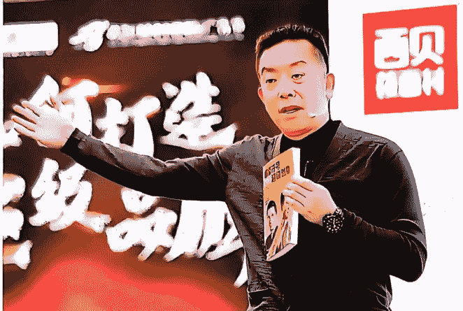

# 西贝的错误战争

发布专栏 知几共话

西贝该“预制”的不是菜，而是成熟的市场环境，和成熟的老板。

2025年9月10日，罗永浩发微博吐槽西贝，认为西贝“都是预制菜，还那么贵”，随后，西贝创始人、董事长贾国龙做出反击，表示西贝“没有一道预制菜”，并将开放西贝厨房邀请食客参观制作过程，然而，记者在参观过程中发现多种保质期极长的蔬菜、肉类包装，引发社会热议。

本次事件的焦点，很大一部分在于大众和企业对预制菜的概念产生了分歧，那么预制菜的标准究竟是什么？餐饮业能否公开、透明地推广预制菜？更重要的是，这场风波的背后，又隐藏着怎样的商业逻辑？

## 01 标准、科技、质疑

9月14日 8:56

贾国龙作为企业的决策者，为什么能把这次舆论事件处理得这么差呢？

他是清楚民众心中对于预制菜的标准，和企业心中的标准存在差异的。更多的是，他把预制菜卖得和做的一价格一样。我是觉得归根结底是因为我们对于预制菜这种新事物缺少一定的科普和宣传。

便宜、现做、规模化——这就是一个不可能三角。

虽说公众对此认知不足，但是蔬菜、肉类能如此长的保质期还是不得不让人担心啊。

更让人担心的可能是，这种大型连锁店都在使用，那么小商只会用得更多。如果真要严格起来，底层人民就别想吃到廉价的饭了。

> 对你要认识厨师，问问就知道了。

其实，没必要对冷冻蔬菜的长保质期过度恐慌。现在蔬菜拥有长保质期并非因为添加了多少防腐剂，而是得益于技术的生产、存储、包装与物流等环节的整体进步。

相反，如果一家企业把蔬菜保质期定到三个月可能需要恐慌，因为这说明这家企业的生产技术有问题，只能通过缩短保质责任期来规避责任。

所以要引导社会走向理性、尊重科学，直面公众的怀疑，而不是一味顺从公众错误的认知，不停让换得一时安宁，这才是实现真正稳定的必之路。

大众的认知需要一个过程，第一个被揭露的任人都都会被烧烤的布鲁诺。就像现在，曾经不能被批评的战狼，网上评价变得很差，民众的意识形态转变需要时间。

编者注：
文艺复兴时期，意大利思想家萨尔丹诺，布鲁诺因固持其哲学和宇宙观点，被罗马天主教教会裁判所判为异端，最终于1600年在罗马鲜花广场被处以火烧死。

这次西贝对罗永浩打得一拳，也会慢慢让一些打仗习惯的群体明白，拳头不是乱打的。这个世界上，大部分事情上标，没有四两重，你非要打得一拳，就要做好自己满脸花花的准备。

子明

西贝和当年红绿蓝幼儿园非常相似，做的其实都很好，但再好的东西也没法这么上榜。

## 02 质论、人性、上市

9月15日 7:46

贾国龙这一拳开得太愚蠢了，没有人否定科技进步带来的便利，但他作为老板，面对消费者的一点意见，是不诚恳回应，反而直接上升到法律层面，全程自言自话、回避质疑。

你把罗永浩当成2021年的台湾，西贝当成中国，罗永浩咬你一口，你对罗永浩全力出击，结果是？罗永浩这种才爱砸了狗屎，狗屎都郁闷的人，你去跟他打拳不是送命了吗？

编者注：
2021年立陶瓷府允许台湾当局在立陶瓷设立所的“驻立台湾代表处”。

罗永浩吵架的立场是自身定位为消费者，消费者在现实里是弱者，与论场中就是强者，所以西贝是不可能赢的，甚至陷入了彻底崩陷。

对，西贝是在错误的时间，错误的地方，错误的对象开启了一场不会胜利的战斗。

一场卖货的消费者之间的战争就像女朋友联手你吵架，你能赢吗？现在的局面，全国网友几乎都是罗永浩的闺蜜和女友，你你怎么赢？

这中间夹杂着消费降级对产品的不满。

认识贾龙好多年，他是非常优秀的企业家，当然也非常骄傲和自负，自尊心极强，在餐饮行业里面，他是顶尖的企业家，西贝也是最重视食品安全和出品质量的连锁企业之一。

大部分的成功者在龙门的时刻都是这副德，马云如此，马斯克如此，老板也是如此。

马云在外滩，马斯克在白宫，老板安排的老杨在阿拉斯加，都是和老黄一样的，人性是生物的底层代码。

这些人人时候不是临场发挥吗？难道也都是听令事？

马云、老杨、老黄后面不是有人吗？唯一存疑的是马斯克后面有没有。

那为什么说现在是“错误的时间”？

你西贝明年要IPO了，拿到资金可以飞速发展，这直接把自己坑了。

一旦西贝模式被视为割菜，那么税收成本有可能直接增加，导致利润率锐减，店扩扩张不起来，明年IPO时候的估值也会腰斩，西贝老板和他的们的售价会大幅缩水，谈好的preIPO的盟友怕也不会再跟他了。

子明

编者注：
2023年，西贝董事长关国龙在致辞中表示计划在2026年实现IPO上市，2017年至今，西贝共有3轮融资。最新一次融资是2025年。

西贝和当年红绿蓝幼儿园非常相似，做的其实都很好，但再好的东西没法这么上榜。

## 03 逻辑

（此处省略后续未完全完整的内容或根据原文逻辑结束）
