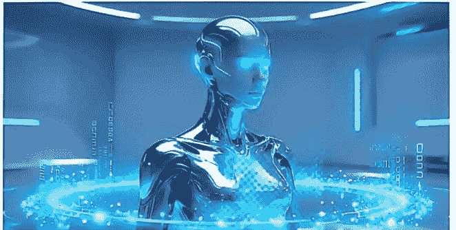

# AI 变革中的普通人
## 发布专栏 知几共话

我们曾让世界剧变，也将踏入剧变。

时代变局中，普通人如何看清前路？当人工智能如浪潮般席卷，我们能否避免当年“阿拉伯之春”的动荡？当机器人取代工人、AI重塑产业，个人的工作、投资与教育又该如何抉择？

让我们带着这些问题，一起走深圳线下会员活动，听听子明和会员朋友们的讨论，从中探寻新时代的底层密码。

深度视野VIP群 人工追踪50+大V 付费进群加微信cuk255 微信chp5568

12月6日 11:24

昨天公讲的真的好多，趁周末未消化一下，配合局势，周一就可以开始行动了。

昨天的信息密度，是不是有点太高了。

子明：昨天的一天的信息密度确实太高了，很难过瘾。

昨天公在在线演说课上讲了投资方面，感觉很受用，可否再找时间聊聊普通工作和小孩教育问题？

前者在昨天其实有涉及到，我现在做梦都是机器人，梦见机器人在挖矿。

短期颠覆标准制造业是有可能的，但是要说挖矿，估计都不够下井的。

就是昨天说的、2005年想这个世界上突然出现了十个亿、几乎不吃不喝的机器人，五年后，一个失业的阿拉伯青年自焚。

备注：2010年12月17日，突尼斯小商穆穆赛德·布瓦吉兹困得无力维持生计，在街头引火自焚。此行为竟点燃了阿拉伯世界一系列悲剧，引发了冲击整个中东的“阿拉伯春”。

前沿的东西是少数玩的，普通人感觉也没有多少私机会，那普通人除了炒股还有哪些路线应对？

站在西方角度，2005年之后，投资就是投中国，把中国换成美国就行了。

对于普通人，参考2005年之后的普通人。落后的资源省份像东方，发达地区像欧美。

2005 (25) 的十一计划开始后，不跟中国 (AI) 玩的，都会被慢慢淘汰。

好的，我这两天顺着您的思路研究了一下。我自己也是直炒股，最近两年盈利稳定些，结合明的展望，对未来两年的收益比较乐观。但是作为普通行业从业者，目前的局面感觉还是要抓机遇多储备一些底子，好迎接后面革命的洗礼。

从2005-2020，随着中国进入WTO全面开始生产，全世界迎来了失业的十年。

中东的手工模特，在中国“机器人”的机器人化大生产局面，不堪一击。

给人感觉像是厌弃一个制造业黑洞正在迈向另一个制造业黑洞。

03-08的铺底，和10之后的应用成熟，对于有资本有资源的人都是机会。AI也会有这样的阶段，其机会还是少的。

只要把机器人当成20年前的中国人，未来是很清晰的。

> 印度人本来想取代中国人，结果发现取代中国的是机器人。

这一年来让我深刻理解了AI对下一个纪元的重要性，中美之间关于AI的竞争真的是很关键，美国也是个不能小小觑的对手。

听了明公一年的课，让我知道这个世界上还有罗马，罗马是美帝。

> 蛮族虽不能灭了罗马，但是正视罗马的强大。

子明：昨天结束之后，我们又讨论了这一会，美帝能不能垮掉就看大总统如果大胜后，会不会搞自己连任。我们不是应该大力支持他，让他爽？

> 蛮族虽不能灭了罗马，但是正视罗马的强大。

如同2005年一样，AI席卷世界，而如今我们到了一个转折点，即将取代我们的。

# 深度视野文集
限时188/年 cuk255

全部包含以下内容：
- 深度视野（含子明私享）
- 守夜人司令星球（接换魔王后星球）
- 创始佳笔记
- 欧洲会员
- 卢瓦仁
- 卢克文读书会（含）
- 财经新周刊（独家）
- 蒜森财经
- 杨世光在金钱
- 潇游异译
- 司马林解读课全套音频和书籍无损
- 虚构三部曲[民国梦、帝国战争、不被理解的MAO]
- 卢克知识星球
- 卢涯元新浪韭付费专栏、三村丰老王、三花九洞文集

（更多资源写不下了……）
