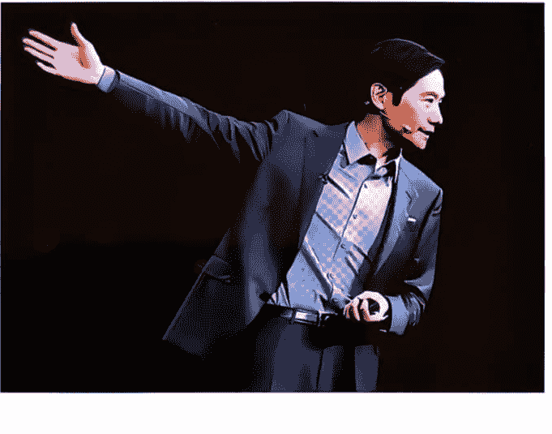

# 小米“涅槃”吗？

发布专栏 知几共话

漩涡之中，小米还能涅槃？

2025年12月，小米近期股价自6月高点61.45港元回调30%，市值蒸发超5000亿港元，雷军身家也大幅缩水1200亿元。

近期论论中的小米，可谓风波不断。无论是被戏称为“逆风之王”的小米营销，还是小米汽车接连二三的安全事故，都昭示这家企业当前的真实困境——产品技术不完美。

然而，除了技术本身之外，小米是否还藏着其他“不可说”的困境呢？未来的小米，还能在谷底涅槃重生吗？

12月9日 10:33

# 小米怎么还在跌不休？

他有什么理由不跌吗？负面新闻就没断过，还要营销上的小米明。

有没有可能在洗盘，毕竟散户太多的话，以后拉升也难。

备注：洗盘主要是指主主力资金为了清理市场中的浮动筹码，减轻后续拉升股价时的压力，从而进行的一种操作。

等着跌出一个好价格，然后低建仓。

您这是相当相信小米？

# 我对小米的忧虑主要是明年手机的销量和利润，因为存储涨价了。

备注：当前市场存储芯片正经历涨价，并预计持续到明年。例如，DDR5内存一周涨价25%，NAND内存涨幅超过20%，常见的DDR4内存价格暴涨两倍。这是由于AI潮使得微软、谷歌这些技术巨头疯狂AI基，存储厂商们将产能转向了利润更高的AI专用存储，留手机的产能随之增长。

在我眼中，小米是一个深邃漩涡版的比亚迪。

我同意这个观点。

当政治潮流过去，且没有被击倒，小米的被利用价值会凸显。

股价翻倍也不是不可能的事儿。

小米在APEC上都被作为国礼，赠给其他国领导人了，这是一个重要的信号，你可以不相信小米，但你不能不信小米。

一旦沾上了京圈，他就不可能是纯粹的商业公司了，更不能用简单的商业逻辑去考量他的未来。

小米和比亚迪本质是一样的，在智能时代，有人提供大脑，有人提供芯片，就像Winter。但所有的制造，大的从汽车到机器人，小的从家电到手机，都将是比亚迪和小米的天下。在工业智能制造平台上，大的看比亚迪，小的就看小米。

这个领域，外人难与中国竞争；而在中国内部，大的没人打得过比亚迪，小的没人打得过小米。

备注：这里的Winter指的是美国互联网生态圈，在知乎共诸9月26日更新的《能构建AI时代的资本生态圈（上）》中有详细论述，其中也包含了小米的生态位讲解。

这一说，真的有点中国版三星的意思了，啥都干。

在大脑和芯片的竞争中，中国和美国的局尚尚不明，目前只能说中国阿里和美国谷歌更有优势一点。但制造业，已经没有什么挑战者了。

汽车、小家电、机器人、无人机，本质都是智能体的制造环节，逻辑是一模一样的。

没错，这些小米确实都能做。

也就是说，小米有能力切入传统国企的汽车市场，也能进军美的、格力的家电领域，甚至能足机器人、无人机，去碰碰大疆的盘子。

比亚迪也能做，且成本更低，ToB的储能电池业务更有优势；而小米更擅长ToC，产品更贴近用户需求。

智能体的制造，总要有人去扮演这个角色。

黄赌毒大师（编者注：一名网友）和小米怎么看比亚迪和小米？我不是太明白其中的逻辑。

我认为这两个属于没有核心竞争力的企业啊。黄赌毒大师认为比亚迪会成为智能体的载体，但智能体和对应的生态应该是控制点。

如果说精密制造还有点技术难度，电子制造业没有核心难度的，制造和代工只能看到制造工的钱。核心还是要看他载智能的产品，而偏偏他最擅长的就是智能体。

我记得我年前还说过，比亚迪是电动汽车的领先者，但是在智能汽车时落伍，有点像智能手机刚刚出来时HTC的状态。显然这几年比亚迪发展得挺好，料中了新能源的风口。除了电子产品代工，还有电池、电动车和电池相关的储能，智能能确实还没上正轨。

> 我不是看好，是在正黄赌毒大师的价值评估逻辑。这两个公司都是没有有丝章价值投资的意义。但是都有巨大的被利用价值。

把比亚迪看成富士康就行了，软件和华杰还要看中国的。
