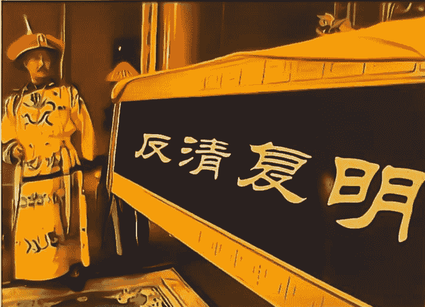

# 为何又要“反清复明”？

发布专栏：知几共语

“反清复明”的背后是民族观念的重铸。

近期，关于民族叙事的话题频繁登上热搜，多民族、多元文化叙事框架被层层解构，看过去子明文章的朋友应该都知道，这种舆论现象和特朗普“回归”紧密相连。

可透让人人生疑惑：为何每次谈及“多民族”认知，都会将清朝作为论证中心，清朝到底有怎样的民族特征和民族统治理念？未来的文化叙事又将去何处？

## 01 董玉引领“反清复明”

12月9日 10:38

股市玄学的真无处不在。

| 大明电子 | |
| :--- | :--- |
| 603376 | 股票 |
| 42.33 | 开  39.88 | 总跌 42.55 | 最低 39.88 |
| 7.90% | 3.10 换手 27.44% | 单单 85169 金额 3.52亿 |
| 总值 169.3亿 流值 13.14亿 市盈率 65.85 | 更多 |

- 股东大会：于2025-12-18日召开2025年第四次临时股...

| 五日 | 日K | K周 | 更多 | 大单模式 |
| :--- | :--- | :--- | :--- | :--- |
| | 均: 41.30 涨幅: 42.33 3.10 7.90% | | | |
| 42.56 | 8.49 走线 大分价 | | | |
| | 1 42.34 18 | | | |
| | 42.33 8 | | | |
| 分时成交- 79 | | | | |
| 10:30 42.26- | | | | |
| 10:40 42.25- 40 | | | | |
| 10:45 42.27- 28 | | | | |
| 10:49 42.25- 34 | | | | |
| 10:53 42.24- 10 | | | | |
| 10:57 42.23- 10 | | | | |

不过也不光是股市，我观察，最近吃瓜盟的走红、洪承畴与康熙的父子疑诡、红楼梦是醒明之作……这种涉及主体民族和其他民族之间争论的奥思潮背后到底反映怎样的社会情绪？

## 特朗普赢了之后，大清的多民族叙事终结了，回归大明红胖脖子时代。

子明：懂王还有这种联动效应吗？不愧是文化霸主。
子明：带动的何止这些。
子明：不讲“多元化”“包容”了，主体民族伟大复？

大清时期确实是多民族共存，但是真“包容”吗？

大清逼的就是文化包容。

子明：我看《美国国家安全战略报告》就在批评美国胡乱欧，也在支持欧洲保守派上台，大家一起搞民族伟大复兴。

## 02 大清的“包容”

12月9日 11:01

啊？大清真的文化包容吗？扬州十日、嘉定三屠，还有“留头不留发，留发不留头”，这看起来可不可包容啊。

编注：“扬州十日”和“嘉定三屠”是明末清初制造的两起大屠杀。

哪朝代的包容要看统治的整体结果，而不是个体。按照EU5的逻辑，大清的包容是大的，大清的文化包容很好，是多元的。

编注：此处的讨论《欧陆风云4》中的游戏模块，“人权理念”与“宗教理念”——一起构成了治理稳定的两大支柱。它的核心思想是接纳多元、以宽容换取稳定。看起来像另一类的“包容”，把自己的文化圈割后的一种“包容”。北魏、唐、辽、元、清这些有些“胡”的基因是统治权的扩张。

大清的包容是典型的西北和青藏地区的，清代是唯一控制的朝代。毕竟他自己也是少数派的联合。

按照EU5的定义：
- 在清朝，满族是一等民族。
- 蒙古是二等民族。
- 北方汉族是三等民族。
- 南方汉族是二等民族……
- 在明朝，汉族是一等民族。

因为唐本质上是承袭北魏-隋-唐的文化，本身就是魏-隋-唐的文化传承，大清清朝是文化包容很高，汉族都是不受歧视的。

大清本质上是反向歧视，明就是民族至上。

大清是文化多元+宗教，大明是族国家+国教。

## 03 世界中的民族叙事

12月9日 1:22

现代强国，从带英开始，本质上都是主体民族的“民族国家”，包括美国。一旦主体民族滑落，目前可以替换民族叙事的只有阶级叙事。

我之前看过一个对吃瓜主的描述，和你这个逻辑有些联系。说以前是“团结史观”，现在是“史观”，我理解的是阶级叙事破产，现在民族叙事抬头。

我记得山高评价白左的团结政策时说，一个帝国，要么有一个人人反边疆区，要么有一个五颜色的核心区。

白左本质上还是适配美国那个主体民族急速衰落的现实，非拉裔白人占人口的比例为57.8%，而该数字在2010年为63.7%。新生白人已经经历过半，很快就是无主体民族国家，如果白人都没有一半，你要怎么当红脖子？

美国那种政策有点难，有的红脖子直接被淘汰了。所以也能理解老白们那种“痛失国家”的愤愁。而且我们的少数民族很多看不出来和汉族的区别，但是他们属于种族不一样，所以外观看着不一样，冲击力更强。

原本用来控制低端人口的，结果反向控制民族结构了。这个和大清还是有一定的区别的。大清的状态跟奥利利帝国、奥斯曼帝国很像，主体民族太少了。奥利利帝国以德意志人为核心，但在德意志范围内（尤其是1867年奥匈妥协后），德意志人仅占总人口的约24%。奥斯曼帝国的统治民族是土耳其人，但在帝国鼎盛时期（如16世纪），土耳其人在安纳托利亚和巴尔干的总口并不占绝对优势。

唯一的出路就是族融合，这三个里面反而是清醒的最好。王的台上不仅是一次政治力量的更换，更是一次文化和理念的洗牌——世界范围内多民族叙事的瓦解，使得主权国家的主体民族情绪高涨。“反清复明”或许只是旗帜，但旗帜下蕴含着强大的政治号召，那些属于“民主党”时代的意识理念也将暂入尘埃。

— END —

相关阅读：
【明明解读】《明朝为什么火了？》
