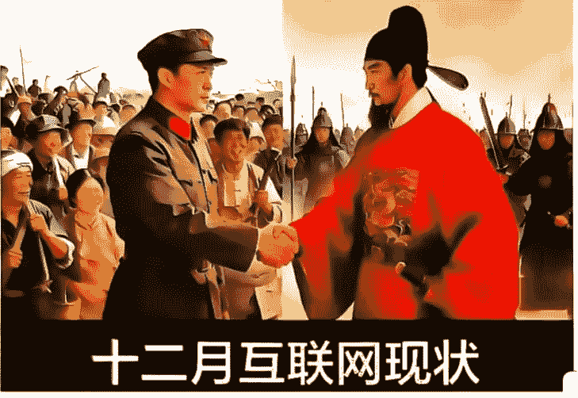

## 五皇同盟与齐华蒂明

发布时间：2025年12月18日

每逢百年遇的生产力变革带动上层建筑调整，主流的思想与意识形态就必然会分化，形成了一种有趣的意识形态分裂，不是马克思（左），就是马斯克（右）。
被生产力过剩与机器替代冲击的劳动阶层乃至国家政体，都会不自觉地选择将其一加入到其中。
美的两党分化，科技巨头政治站队，均源于此。

随着拜登这个右翼盟主去年选举失败，全球如今是右翼风头正盛，开始肃拜登余毒。
特朗普 1.0 时代的保守主义“三皇同盟”，正在酝变并升级为“五皇同盟”（C5），
试图去颠覆布鲁塞尔与民主党主导的左翼世界秩序。
以特朗普为首的他们就像百年前的梅特奇与传拉斯梅麦一样，试图以和平与切蛋糕的方式，在大变局的时代为地主贵族和大资产阶级掠夺利益。

对于统治阶级来说，左与右是利益的重新分配规则；
但对于迎接时代滚浪洪流的普通大众来说，或左或右，他们需要一种心理的安慰剂，避免其内心直接遭受生产力变革带来的迅猛冲击。

生产力变革越是“加速主义”，失业与负面事件越多，广大众的失望情绪就越是激烈，他们就越是需要一个窗口发泄情绪，越是需要一个美好的愿景来指引。

芳华与瑾明，就是在这个时代大背景下出现的。
虽然双方一个左一个右，既不阻碍他们不停地怀念地绊过去，也不阻碍民众理想里有一个左理想又有一个右异理想。
就像当年在百年未有之大局的冲击下，布尔什维克克与民族社会主义工人党握手手分波兰，
随着生产力变革带来的新一轮百年未有之大变局冲击不断，两个完全对立的意识形态也于 25 年底在互联网络胜利会师。
他们不是相信对方的主义，而是站在同一个利益受损的阶级。

### 布鲁塞尔
来源：维基百科
(法语: Bruxelles; 荷兰语: Brussel)

全称布鲁塞尔城，是比利时的首都，布鲁塞尔首大区和弗拉大区的首府，也是欧洲联盟的主要政机构所在地。
布鲁塞尔城位于该国中部布鲁塞尔首都大区，属于比利时的法语社区和弗拉芒社区（弗拉芒人是比利时的两大主要民族之一），法语和荷兰语均为官方语言（但法语使用者居多）。

大佬文集圈 VIP 专属分享，付费进群加微信 pep854 微信 daizongdai201

## 克莱门门斯·冯·梅特奇

来源：维基百科
(德语：Klemens Wenzel von Metternich; 1773年—1859年)

（德意志民族）神圣罗马帝国出生的奥地利帝国政治家、外交家、古典保守主义者，不喜欢自由主义并竭力阻止帝国分裂。

梅特奇是贵族外交官，曾任为尼德兰（荷兰语：Nederland）公使，曾在普克莱森（德意志共和国的一个联邦州）、普鲁士及巴黎担任公使。

1809 年任奥地利帝国外交大臣，首要工作是与法国进行缓和。他促成了奥地利公主、女公爵玛丽路易苏与拿破仑的婚姻。不久后，他推动了奥地利加入第六次反法同盟，签署了《枫柏白条约》，该条约使拿破仑退出意大利。

他是维也纳会议主席。（维也纳会议目的是为了解决法国大革命战争和拿破战争导致的一系列问题，保证欧洲的长久和平）

“梅特奇体系”持续了几十年，这是奥地利外交上的高峰。
此后，梅特奇逐渐淡出。

## 奥托·冯·俾斯麦
来源：维基百科
(德语：Otto von Bismarck; 1815年—1898年)

德国政治家、外交家，普鲁士首相，德意志帝国的奠基者。

1815 年在普鲁士梅尔林出生。1862 年任普鲁士首相。
通过 1866 年普奥战争和 1870 年普法战争，统一了德意志地区，建立了德意志帝国。
他推行“铁血政策”，在复杂的国际局势中维持了欧洲的平衡，直到 1890 年辞职。

