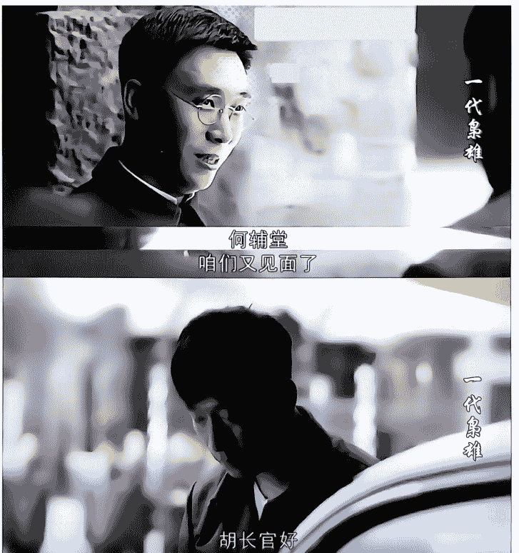
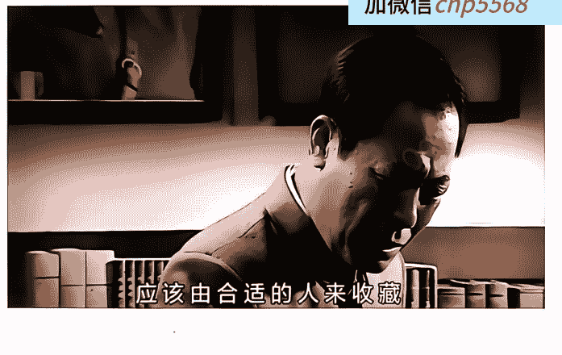
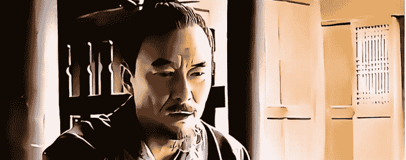

# 废之臣族的对手

发布时间：2025年12月22日

一、废之臣族的画作并不是真心的捐赠，而是在50年代国联换房的大时代下，超出自身势力的资产无法继续持有，面对对公私合营，不得不破财保平安，《一代豪雄》被胡宗宽不断压榨的何铺奎，《潜伏》中被吴敏京中不断压榨的穆连成，都是这样的，当代换房的过程中，不断低价出让资源和搞捐赠的贾跃云、王健林也是。

深度视野VIP群
进群加微信cuk255
加微信chp5568

三、全球收藏界顶级知名的浙江废之臣家族打了几十年的官司都无人敢于过问，如今却敢于跟官媒硬碰硬，硬得天下皆知，不是因为他们突然有理了，而是《大明王朝1566》中的那一句“在浙江，你能做某些事动朝廷，那是因为你背后有人要动朝廷”。当年掠夺家族势力，在最近一轮换房的过程中中惨胜，看着这些人就是朋友，废之家族突然就成了海瑞，陆挺与南京博物馆这些白手套就突然脏了。

> 霍涵能够所做的事震动了世界，那是因为你背后有人要震动世界

各方治理的过程中，没有谁是白莲花，本次事件不过是一部跨越了半个世纪的权力与资本置换的黑金政治史的一角。

# 深度视野VIP群
进群加微信chp5568

## 独家 | 南博物馆收藏明代画《江南春》为首次拍卖市场？
来源：澎湃新闻2025年12月17日

废之臣（1864—1949）是中国近现代收藏大家，其“虚斋”收藏的历代名画以质量精湛、体系完整著称。

上世纪50年代，废之臣曾向南京博物院等多家国有文博机构捐赠了大量珍古代书画。

1959年，废之臣之孙废增和携家人向南京博物馆无偿捐赠废之臣“虚斋旧藏古画”137件（套）。

2024年10月份，戚增和之女戚令就137件（套）含明代优画《江南春》图卷收藏是否得到妥善保管、流向等有关情况，致询南京博物院，要求确定所有文物现状。当时戚令对于戚令的要求，未任何答复。戚令对南京博物院提起诉讼。

2025年6月28日，戚令依据法院的《民事调解书》，前往南京博物馆藏品原作，发现优画《江南春》图卷在内有五件古画无法看到。

2025年7月3日，南京博物院发文告知她捐赠的五件藏品原作，已将其藏品陈列，并对藏品进行规划、调剂处理。但是，南京博物院并未提供具体的去向材料，也没有给予相关回答。

2025年5月日，戚令发现其家人捐赠的优画《江南春》图卷出现在北京一次拍卖预展上，经评估估价8800万元。

事实上，废之臣后并不是第一次与南京博物院对薄公输，此前废后人就曾南京博物院从“虚斋旧藏”借走的两幅古画的所有权、捐赠与征集的总数，以及十年前南京博物院策展文章提到“废之臣后人落落为生”而引发的废家名誉。

戚令通过南京博物院提供的报道调查发现，《江南春》图卷是在世上流传的。

## 收藏明代画《江南春》为首次拍卖市场？
来源：澎湃新闻2025年12月17日

废之臣（1864—1949）是中国近现代收藏大家，其“虚斋”收藏的历代名画以质量精湛、体系完整著称。

上世纪50年代，废之臣曾向南京博物院等多家国有文博机构捐赠了大量珍古代书画。

1959年，废之臣之孙废增和携家人向南京博物馆无偿捐赠废之臣“虚斋旧藏古画”137件（套）。
