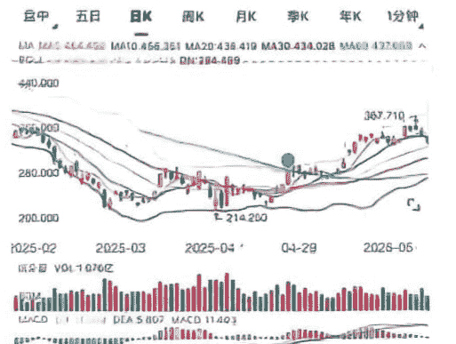

# 重塑保守主义大联盟

发布专栏：知几共话

保守主义的回潮正撕开全球旧秩序一角，而新联盟的轮廓，已在右转的方向中显现。

2025年12月17日，特斯拉股价在周二收盘时上涨3.07%，报489.88美元，市值约1.63万亿美元。特斯拉股价盘中最高曾达491.5美元，创下历史新高。

子明的文章中曾提到“以英伟达为代表的美国国家AI安全的叙事退潮，与以Google、Tesla为代表的美国AI企业叙事崛起的换挡……”

如今，美股市场按此脚本如期上演，我们是否会紧跟这一节奏？在全球右转的浪潮下，保守主义联盟正在重塑，大萧条是否会接踵而至？旧秩序下的债务又该去何从？

## 01 保守主义大联盟

12月17日 8:48

特斯拉高了。

| 报价 | 杠杆多空 | 资讯 | 财务 | 简况 |
| --- | --- | --- | --- | --- |
| TSLA 特斯拉 | | | | 美国 L1 |
| 收市 12-16 16:25 | 最低 | 491,500 开市 | 472,210 |
| 489.880 | 最高 | 465,830 盈收 | 475,310 |
| +14.570 +3.07% | 最低 | 320.60 羊尾 | 3.24% |
| 成交量 1.08亿 | 市率 | | | 20:00 |

涨幅 490.733 +0.853 +0.17%
汽车 +2.11%

特斯拉(TSLA.US)计划于2027年在德国建电池，加州……

所以，美股市场上，现在是以英伟达为代表的美国国家AI安全的叙事退潮，与以Google、Tesla为代表的美国AI企业崛起的换挡期。

山会崩后，世界上不再是

子明

子明解读
AI逻辑的转变

## 那我们是不是也会按照这个逻辑吗？

明公这篇文章里都已经解释过了。

备注：这里指的是子明解读11月27日发表的《AI投资逻辑的转变》。

中国更需要阿里、腾讯、华为，还是美国更需要七姐妹？

刚刚还想到一个问题，在什么情况下，美政府会对七姐妹进行抄家？或者严厉干预其经营，比如今年拆分洛菲的石油公司。

编注：这里指的“七姐妹”是苹果、微软、谷歌(Alphabet)、亚马逊、Meta、英伟达和特斯拉这家科技巨头。

不能怎么干预的，巨头们在私人宴会上已经经过一波保护费了。

从彼得·蒂尔2016年支持特朗普开始，科技巨头影响力已经不逊于华尔街与传统产业巨头。搞不好未来七姐妹是可以换总统的。

## 第二次工业革命，是石油七姐妹。

编注：“石油七姐妹”指的是新泽西标准石油（后来的埃克森石油公司）、纽约标准油（后来的美孚石油公司）、加利福尼亚标准石油（后来的雪佛龙）、德士古、海湾石油、英国波斯石油、壳牌公司。

懂王这算不算在与资本共天下的框架下，出了个“暴君？”或者应该说新资本也需要？

## 中国的大皇帝。

大皇帝算是右略。

我昨天文章里面，好像也在讨论如今这个时代的保守主义联盟。

> “一个幽灵，一个抹除西方文明的幽灵，正在布鲁塞尔的上空游荡，为了这个幽灵进行身体上的围剧，保守主义的一切势力，教皇与沙皇，皇帝与毗西妥神，川皇帝以及波波意奥的右翼政党，都联合了……”

子明解读
基辛眼中，取代G7的C5

改编这一段的时候还是挺劲的。

像我这种脑子的理想主义者，感觉受了一万点暴击。

加速右转，方向盘打死。

子明

看了您昨天的文章，确实感觉和现在越看起来像了。

如果不是核武器这种直接打首脑的手段，可能这个世界已经如一战之前的欧洲了。

话说，全球最大的梅特混吹不是马思，如果不是共产党宣传写了他，加上他的知名度并不会太高。

子明

但是不得不说，保守主义结起来的时候，真的可以跨种族、跨越意识形态。

编辑器注：梅特瑾、奥地利政治家，保守主义核心信导者，主导维也会议构建欧洲均衡体系，被称为“蝴蝶大臣”。马克思在《共产党宣言》中多次提及及梅特瑾，他们将梅特瑾描绘为欧洲封建专制势力的代表，是镇压自由和革命运动的象征。例如“一个幽灵，共产主义的幽灵，在欧洲游荡。对于这个幽灵进行神圣的围围，旧势力……”

## 02 权力与债务

12月17日 8:48

所以，大萧条要来了？

