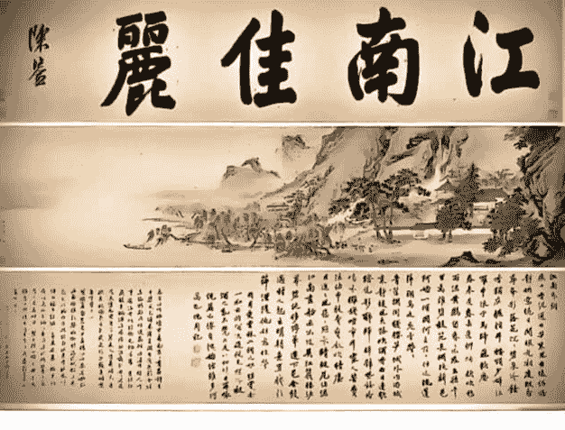
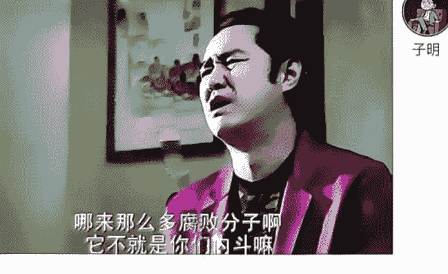
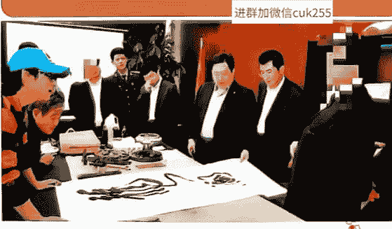

# 国宝背后的权力转移

发布专栏 知乎共语

所有收藏的背后，都是对安全边界的测，那些“潜伏”的国宝，成了新一轮政治角力中，最危险的脚注。

子明解读前几天发布的文章《潜伏”的国宝收藏，不知道大家都看了没有？标题之尖锐，光是文章预估的“存活”时间，就已经在评论区读者和群众之间引发诸多猜测了，可见这篇文章的信息量和干货指数有多高。今天，我们就接着这这篇文章继续聊下去。

我看明那篇《潜伏》的国宝收藏的正文和留言区都还在，没有被处理，难道真的是背后有人要震动朝廷？真的如评论区所言，吴站长是之和吗？

就是有人要震动朝廷啊。

子明

这里面有个逻辑我不是很明白，之所以要痛打落狗，是不是为了让吴站的位置置空出来，安排上新的吴站长？

是要以人民的名义，清理吴站长。

子明

进群加微信cuk255

那即便当初捐赠是为了获得庇护，冯家后人现在也没有可能再把捐的东西拿回来了呀，这么搞纯粹是为了出口气吗？

你这个浙江人能震动浙江，是因为上面有人想要震动浙江。

子明

不过这里和大明的情况似乎还不不太一样？印象中，大明那时是严党和清流刚经历毁堤坝田，还没有两难自解那一步，双方还远没决出胜负。

## 总觉得是新产业资本对旧金融资本的清算...

子明
哪来那么多溃股分子啊，它不就是你们的斗嘛

确实，而且都是浙江的，恐怕只有老乡，才会对老乡的家里如此了解和记忆。进群加微信：cuk255
一手优质资源每天更新，人工选路50+V免费文...

我感觉早期的干部，大多对艺术品没有鉴赏能力。

子明

嗯，那时候的人，最多时候换个老婆、生个孩子，不可能对古玩字画那么感兴趣。

> “一切机械化、一切自动化、一切细节化、总要按一下。”

子明

备注：以上词句为CY元帅的诗。

哪怕是她，很有时候也是能够跟张宗一较高高的。

更多资源加微信cuk255

军阀割据的年代，能你好说两句话就算是文明人了，不然直接突突……

我们创业人，大部分都是黑社会大哥出身，拜拜画像就对了，大部分人是识别不了艺术品的。

子明

参考一些转职干部，到地方之后，文字工作极其依赖秘书书，真正做到“出将入相”是非常困难的。艺术品的经营是需要几代人积淀的，是需要钱砸出来的。

我印象比较深的一个段子，王国维顺倒了一批文物给溥仪看，溥仪说是假的，王国维问为什么假的？溥仪说我也不知道，就是感觉跟我家里的一一样。

但我总觉得没这么简单。是不是还有一层：发展重于安全后，北院分量上升，而且江苏乃至长江收获良好，这次南博事件与舆论洪水，有没有可能就是南院借机打压北院风头？

没有。

本质上是几个老钱家族狗咬狗。

新钱家族进搞这个？再说了，老板的鉴赏水平决定了他的哥兄弟们对那些古玩字画也不甚感兴趣。上所有好，下必妥。如今老J那个时代，大家都喜欢庸风的如今老老板落在，毛笔字能写好的怕都是没几个。

进加微信cuk255

## “潜伏”的国宝收藏

## 《废莱臣与》

## 深度视野

## 深度视野，全部包含以下内容：

- 1 粉丝群（子明）
- 2 粉丝群（内部）
- 3 粉丝群（子明）
- 4 粉丝群（雪花）
- 5 粉丝群（欧洲）
- 6 粉丝群（三花）
- 7 粉丝群（卢克文）
- 8 粉丝群（建茶）
- 9 粉丝群（骆哥）
- 10 粉丝群（财新）
- 11 粉丝群（杨世光）
- 12 粉丝群（森森）
- 13 源泽异译付费文章
- 14 司马林解读毛选全套音频和全套书籍无删减
- 15 虚虚三部曲[民国梦、帝国争亡、不被理解的MAO]
- 16 卢克文知识星球文章
- 17 额外再送：卢锐元新微博付费专栏、三村边老王、三花九洞文集

不定期内容：
- ① 守夜人司令星球、接魂魔王知识星球、生才有知识星球、
- ② 创始人笔记、达叔译论文章、成付财富圈、雪花甲老头等
- ③ A视野、大树乡谈、江初国、泮咩说、上海海家学等付费文集
- ④ 西风付费文章、老端、赢在八小时之外、局外的视野、升值、老体制内等若干其它大V付费文章
