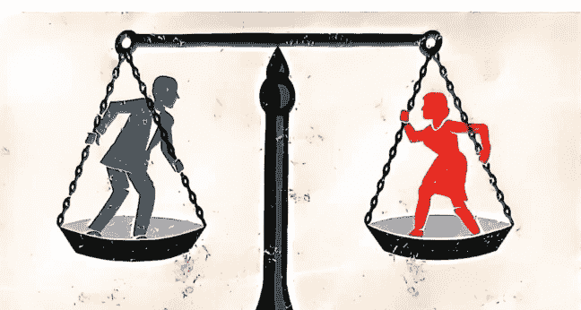
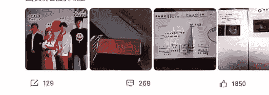

## “女权/拳” 本色
发布专栏：几共语

从女权到女拳，浪潮退去，方能看推手。

女权与女拳有着本质的区别：女权是追求性平等，消除系统性歧视与社会结构不公的社会进步行为，而女拳则是以情绪化言煽动性别对立，将个体矛盾扩大为群体对峙的极端化行为。

当前奢侈环境中，性别平权的话题总是让人神经紧绷，为什么前些年女拳会如滔洪水袭来？又为什么近期时间它逐渐平静，开始频繁引发深刻的社会反响？这背后的变量是什么呢？这种变量会反射社会其他层面吗？

大佬文圈VIP专属分享，付费进群加微信pe854 微信daizongdai201

# 01
## 债务与女权

12月11日 11:17

刚看到这样一条新闻，这就是女权还是女弃？

> 广州日报 微博
12-10 14:21 广州一女子因生子后丈夫要离婚被起诉#2024年5月，尹某某化某某，在孩子分娩后得知丈夫要离婚的事实后，通过社交平台发现丈夫的准备在湖北广州市闹离婚。双方达成离婚协议，解除婚姻关系后，尹某某却满脸泪痕。此前，丈夫还要求“补偿”妻子的46万元，以及1000块金作为抚养费，此人要把房子留给自己，此前原本的婚姻也就结束了，而且毫无底线。此外，孩子由丈夫抚养，妈妈不能带孩子。她表示自己有所有权，丈夫还用“女权”字来羞辱她，让她不想多说些话。11月17日，广州市越秀区法院对该案进行开理，对其纠纷再次诉讼。12月10日，丈夫从其生后起诉离婚，广州市越秀区法院作出一审判决，判尹某起诉失败，判处其缓刑四年六个月，并处以罚款二万元。根据规定，判决自发布后六日起生效，此后丈夫再次起诉，尹某向广州中院提起上诉。文/广州日报热线记者 周禹良 图/受访者提供

这就是诈骗的。

不过说到两性问题，我倒是想起之前看过的的一篇文章，讲的是“女性债务之前软着陆陆问题”。

大佬文学集团VIP专属分享，付费进群微信pep854 微信daizongdai2021*

主要是说是近期落地的包括“婚前同居认定家庭成员”在内的各种社会关注与政策讨论，本质上是因为婚姻基石崩塌了，女性的超前消费引发了金融、婚恋、社会管理等方面的连锁反应。对无法调和的女性债务危机，社会被迫寻找新出路或补救方案，其背后是严峻的经济现实与难以调和的社会矛盾。

我觉得这还不能算到经济问题吧，充是一个社会问题。

可是社会问题就是和经济问题息息相关。

在低利率时代，这类问题可以通过逐步修复资产负债表来解决。要不是提升自己的生产力，加入AI科技新生产力行业，高生产带来回报率，也可以完成快速修补。再一个，政府作为最大债务人，提供特定项目岗位，激活修复能力。无非就是这些途径，如果全被堵死，那就只能依靠时间。

这种文章出来的背景，就是中国从左转右转，男性们“觉醒”了，不再认可女豪/女权。

第一次工业革命时代，站在产业资本的视角，女性是他们天然的盟友，所要把女性解放，如今恰好反过来，站在全球资本的角度，消费大户的女性才是他们天然的盟友。

其实就是走日本的老路。

产业资本希望女性投入生产，金融资本希望女性更多消费，其实还是很明的，但怎么从这些...（注：此处原始OCR文本后半部分存在乱码与逻辑重复，已根据上下文语义进行逻辑对齐）
