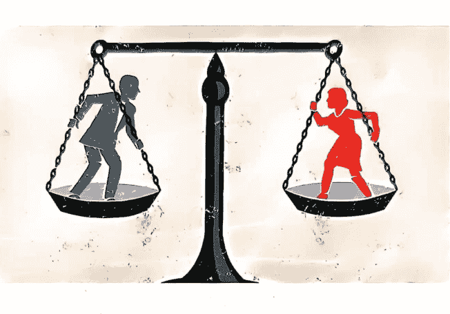

# “女权/女拳” 本色

发布专栏 知几共语

从女权到女拳，浪潮退去，方能看清推手。

女权与女拳有着本质的区别：女权是追求性性别平等，消除系统性歧视与社会结构不公的社会进步，而女拳则是以情绪言论煽动性别对立，将个体矛盾放大为群体对立的极端化行为。

当前舆论环境中，性别平权的话总是让人神经紧绷，为什么前些女拳会如滔洪水般袭来？又为何近期时间逐渐平静，甚至开始频繁引发深刻的社会反思？背后的变量是什么呢？这种变量会辐射社会其他层面吗？

## 01 债务与女权 

付费进群+V: cuk255
人工智能50+V 付费...
每日分享各类深度文章..

12月11日11:17

### 刚刚看到这样一条新闻，这算是女权还是女拳

+ 广州微博 微博
12-10 14:21 回复：我妈妈已离婚
【关注】我今年已与妻子离婚的情况，是我在短视频平台确认的。2024年5月，尹某化尹某某，两人在广东省广州市市民政局办理离婚，双方约定达成协议共同生活。结婚后的一个月后，尹某发现妻子经常与男的约会，尹某后发现妻子在微信上转账了40万元，100万全部转给了另一个男的，由于妻子出轨，尹某向法院提起离婚诉讼，法院已受理诉讼。2024年10月6日，法院判决离婚，尹某无过错。此外，尹某的父母和妻子母亲曾在网络上谩骂尹某，诽誉其在头上。离婚后，尹某的妻子从后不和他交流，洗衣服倒垃圾等事都扔给他。他所有付出，尹某被妻子母亲“找出差错，让她不好多说什么。

2023年11月17日，湖北省州人民法院对尹某提出的诉讼作出裁决，指控其起诉理由不充分，驳回起诉。同年12月10日，广州市中级法院再次受理尹某的起诉。尹某再次起诉，判处尹某有期四年六个月，还被告金二万元。尹某对判决结果不服，向法院提起上诉。而向检察院复诉，尹某某表示上

全文：@周链接

文广/今日日报新华记者：周禹良
图片来源提供

### 这算是骗子的。

不过说到两性问题，我倒是想起之前看过的一篇文章，说是“女性债务软着陆问题”。

主要是说近期落地的包括“婚前同居认定家庭成员”在内的各种社会与政策讨论，本质上是因为婚姻基石崩塌了，女性的超前消费引发了金融、婚姻、社会管理等方面的连锁反应。对无法解决的女性债务危机，社会被迫寻找新出路或补救方案，其背后是严峻的经济现实与难以调和的社会冲突。

付费进群+V: cuk255
人工追踪50+大 VIP文...
每日分享各类深度文章...

我觉得这不能算到经济问题吧，完全是个社会问题。

可是社会问题就是经济问题息息相关。

在低利率时代，这类问题可以通过逐步修复资产负债表来解决。要不是提升自己的生产力，加入AI科技新质生产力行业，高生产带来高回报，也可以完成快速修补。再，政府作为最大债务人还债，提供特定项目岗位，激活修复能力。无非这些途径，如果全被堵死，那就只能依靠时间。

这种文章出来的背景，就是中国从左转向右转，男性们“觉醒”了，不再认可女权/女拳。

第第一次工业革命时代，站在产业资本的角度，女性是他们天然的盟友，所以要要搞女性解放，如今反而反过来，站在全球金融资本的角度，消费大女性才是他们天然的盟友。

付费进群+V: kuk255
人工追踪50+大V付费文...每日分享各类深度文章..

其实就是在走日本的老路

产业资本希望女性投入生产，金融资希望女性更多消费，其实还是很明的，但从这些资本需要演变到现在的情况？里面的逻辑我有点搞不懂。

右翼政府倾债和女性化性质相似的，政府要让有钱掏钱解决债务问题，就需要要让非卖品，提升资本的地位。同样的，右翼的女性化债就需要提升男性地位，允许男人多像。

我觉得婚姻到底到底为了共同抚养孩子，大家都不生孩子的时候，国家干脆也不够鼓励婚姻了，直接搞高质量婚姻，高质量生孩子。这和房地产逻辑类似，国内外的形势，还有我们以出口为导向的经济模式，已经不能支持通过房地产将过多的外汇转换为国内。既然房地产搞不下去，那就不用鼓励发展了，但是就是要发展高质量。

说了了，如果某些行业跑起来，那就是两手抓，一手托底，不要发生社会问题，另一手，把这个行业拔成高质量发展。像是社会达尔文主义。

付费进群+V: cuk255 人工追踪50+大V付费...每日分享各类深度文章。右翼重视的是生产效率，左翼重视的是社会保障。那左翼方案又是什么？

左翼的政府化，是对资本家，左翼女性化债，是对男性，本质是一样的。中国这些年实施的是左翼政策：
- 左翼政策之下，底层要跟着政府从富裕手里抢蛋糕。
- 右翼政策下，资本家的红利分给强势群体，底层要跟着政府从女性手里抢回自己的蛋糕。
- 右翼时代，是资本家要压榨弱势群体，包括女性、轻微、老人。
- 站在特普视角，吸毒者失去能力，就不配视。
- 同样的，特普视角下，女性生产不如男性，就不应该该比例更多。

## 02 税务与企业

付费进群+V: cuk255
人工追踪50+大V付费...
每日分享各类深度文章..

按照这种逻辑，小微企业解决不了科技和出海问题？

所以说微企业只要有能力纳税，全额社保，并且每年分红，还是没有什么。想起90年代的时候，农村经常有杀人或者种地的西瓜，今天一毛钱没有卖，结果第二天涨水了，人就在看西瓜的房子里吊了。如今的微企业，和农民没什么区别，都是自生自灭。淘汰落后是大势所趋，谁也没办法，我们只是让自己尽可能成为落后的一份子。特朗普引领的世界右转，我们已经在篇文章中探讨过其社会辐射度，女权也是其中重要环。当我们面对债务危机，可见无形的大手在背后推波助澜。女权是一种社会认知的表象，其深处扎根的，是更高阶层的理念下沉。引样的道理，在当今转向大潮中，生产效率亟被置于更高位置，税收只是一种手段，只服务于那些在潮前的新宠。

— END —

付费进群+V: cuk255
人工追踪50+大V付费文...
每日分享各类深度文章..

## 深度视野优质文集，链接优质群，助你成功

全部包含以下内容：限时年费188/年 加微信cuk255

- 吃瓜群众时享圈加群对话（原价365 元/年）
- 子明私享（含）内部文章
- 政事堂（原子明）费内容再送顺群聊
- 米联诸闲【作者米糕】（原价599 元/年）
- 欧洲金雀会员专属文章（原价328 元/年）
- 传五幻内部圈（原价400 元/年）
- 卢克文青读书会专属文章（原价699 元/年）
- 鉴茶财经知识星球（原价3310 元/年）
- 猫哥的视界知识星球（原价299 元/年）
- 财新周【独家新闻】（原价1498 元/年）
- 杨世光在金钱圈（原价2200 元/年）
- 森森财经知识星球（原价1600 元/年）
- 源译异付费文集（持续更新）
- 司马林解读毛选全套音频和全书珍藏版无割（原价2.3 万）
- 虚走三部曲[民国梦、帝国亡、不被理解的MAO]（原价599 元/年）
- 卢克文再送：星球文章（原价268 元/年）
- 额外送：卢元新涨付费专栏、村西边老王、三花九文集

不定内容（更多资源将不下去了……）：

- 守夜人司令知识星球、接魂魔王知识星球、生有财富知识星球
- 创始笔记、达叔泛谈星球、付费财富圈、雪花甲老头等
- A视野、大树乡谈、江柠优、咩咩说、上海海学等付费文集
- 西风付费文章、老端、赢在八小时之外、外局人的视野、升值、老
- 体制内等等一些V付费文集（每月不低于600 元付费文集）
