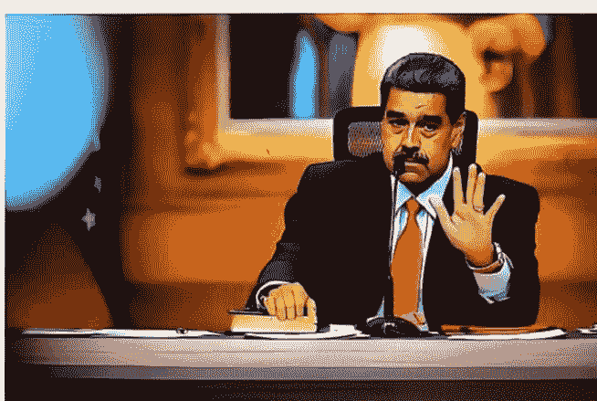

# “正义使命”与“禁青先锋”

发布专栏 几共语

当内部账单难以支付，强权就会去找最便宜的“外包人”。

2025年8月以来，美国特朗普政府以“打击拉美境贩毒集团”为由，在加勒比地区进行大规模军事集结。随着“福特”号航空母舰战斗机群抵达该地区，美军兵力达到1.5万人。这是美军在1994年对海地进行军事干预以来，在该地区实施的最大规模军事集结。

12月16日，美国总统特朗普在社交媒体上认定委内瑞拉政府是“外国恐怖组织”。

美军为何会在“全球收缩”的大战略下主动出击？又为何将目标锁定为委内瑞拉呢？让我们一起来回一下下个月旬我们对美军行为的解读，再结合昨天的“斩首”行动，看看普西和大东之间旧有着怎样的“契机”。

12月15日 19:21

我看明公最近关于明清话题的文章反响都不错，原来明明的粉丝也会被吃瓜带带起来。

因为明公说的确实在，明清的统治阶级都不是好东西，不约而同地为了一时安全放弃了发展，耽误了整个国家向前的进步。

如果不按照这个逻辑去分析当下，是不是为了缓解发展带来的内部对立，反东诸敌就成了必然选项？同理，美帝在此时选择了反毒也是这个目的？

揉软柿子提捍。

亚明

日本和委内瑞拉可能自己都懵了，“在下何德何能？”

无非是迅速将红脖子黄脖子和少民矛盾，转化为敌对民族矛盾。

我们敢战胜没有建立军事能力的日本、美国敢战胜国防首都都不吝的委内瑞拉，都可以确保获胜。

> Dictator最怕的就是对压力失败，由于失败，国内蚕动的政治力量可以容易没爆炸了，参考赛捷或亨奇利的惨胜利

# 付费进群+V: cuk255

人工追踪50+大V付费文...每日分享各类深度文章..

编者：Dictator, 独裁者。

失败的代价确实惨痛，比如普普对乌克兰，他以为二毛还是14年的二毛，然后直接挨就上菜单了。

二毛战前就来十万军队。

对，如果是懂王在台上，是不是会好点？

如果是特朗普在台上，他根本不会援助乌克兰。

子明

西大和东大都不约而同地选择了“捏软柿子”，对周围“反叛”或“敌人”的政权进行隔离或绞杀。昨天，东大在台湾地区进行军事演习，对台湾岛实行了完整包围，此举的意图是什么呢？这一举动又和西大封锁委内瑞拉有着怎样的联系呢？

12月29日 15:43

这次演习的关键词是“斩首”，我怎么感觉像是在对台当局局进行威慑呢？

通过威慑来促进和谈也算是高招了。

遥台湾政治环境调整。参考特朗普看内瑞拉马杜罗政府更迭。虽然我们承诺不干涉国内内政，但台湾属于内政。

子明

# 付费群+V: cuk255

人工追踪50+大付费文...
每日分享各类深度文章。

发展会带来利益的迅速膨胀，内部的矛盾对立将愈演剧烈，这时，向外宣泄愤怒是历史反覆选择的戏码，如今的我们和美国也不会例外——以高市的错误言论为起点扩大争端，用毒品由兵内拓国境，本质都是国内的“高压钢”松松气阔。

只是，柿子还是得软的，否则就会像一样被局势压住，被硬柿子崩掉老迈的牙齿。

待周围的力量稍许平息，我们终于能够专处理自己的内部事务，而这件事，无论压力有多大，我们也将必执行“正义行动”。

# 相关阅读：

【子明解解读】公众号

《东部战区：“正义使命-2025”，开启！》

(2025年12月29日更新)

—— END ——

# 深度视野优质集圈，链接优质群，助你成功

全部包含以下内容：限时年费188/年 加微信cuk255

- 1 吃瓜群众包信圈加时群聊对话（原价365 元/年）
- 2 子明私享亨（会）内部文章（原价568 元/年）
- 3 政事堂（原子明）付费内容再加送子明群聊
- 4 米联锦间【作者米糕](原价599 元/年）
- 5 欧洲金雀会员专属文章（原价328 元/年）
- 6 铸五厂内部圈文（原价400 元/年）
- 7 卢克文青读书会专属文章（原价699 元/年）
- 8 鉴茶财经星球（原价3310 元/年）
- 9 猫哥的视界星球（原价299 元/年）
- 10 财新周刊【独新闻】（原价1498 元/年）
- 11 杨世光在钱（原价2200 元/年）
- 12 森森财经星球（原价1600 元/年）
- 13 源译译付费文章（持续更新）

# 深度视野文集
进微信cuk255

14 司马林解读毛选全套音频和全套书籍珍藏版无割减（原价2.3 万）

15 虚虚三部曲[民国梦、帝国战争、不被理解的MAO](原价599 元/年）

16 卢克文知识星球文章（原价268 元/年）

17 额外再送：卢阡元新浪爆博付费专栏、三村边老王、三花九树文集

不定期内容：（更多资源不下去了……

- ① 守夜人司令知识星球、接魂魔王知识星球、生有术知识星球
- ② 创始笔记、达沃译论星球、成付财富圈、雪花花甲老头等
- ③ A视野、大树仿谈、江初知道、咩咩说、上海海学等付费文集
- ④ 西风付费文章、老端、赢在小时之外、局人的视界、升值、老体制内等其它一些大V付费（每月不超过600元的付费文集）

# 限时年费188/年 低成本基础链接全网V优质内容
