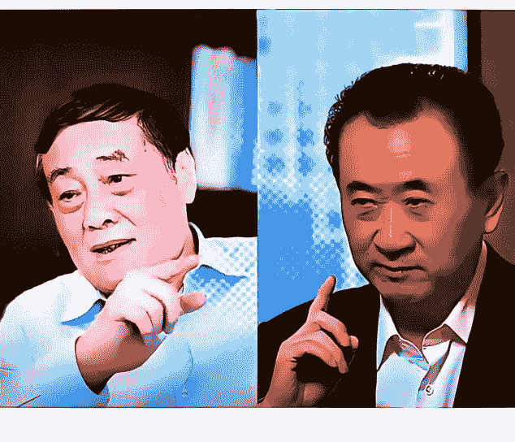

# “老老钱”背后的豪门等级
发布专栏：知几共语

平辈以前买水的我们，将宗庆后推上了“老老钱”的宝座。

2025年7月，娃哈哈集团现任董事长宗馥莉，被三名“同父异母的弟弟妹妹”起诉至香港法庭。

三位私生子要冻结丰丰银行一个账户内的18亿美元资产，并向馥莉追讨父宗庆后生前留的高达21亿美元巨额的家族离岸资产。

微信公众号jnts6，免费进资料群

从“妻一女一破产”的商人典范，到“二奶三子争亿遗产”的豪门内宰，全民吃瓜宗庆后的同时，也不禁让人生疑惑：

只靠“卖水”生意，宗氏家族何以成为顶级富商？富豪林立，豪门与豪门之间又存在怎样的等级秩序？

## 01 豪门视角

7月16日 16:24

还是豪门的秘闻有意思啊，现在各种消息都有，宗老的人生真是丰富多彩。

现在娃哈哈销售得还好，这事儿越闹越大。最顶级的商战和豪门恩怨，最后还是会落到这种事情上来。

我还看到说宗馥莉和王思聪以前相过亲......

加微信 jntsg2，免费进资料群

人家应该看不上王思聪吧。

富豪圈子里面是有鄙的，譬如李家看不起宗家，同样的，宗家也看不起王家。

李：宗家算什么货色？宗：王家算什么货色？

不过无论他们相互之间谁谁不起谁，好像都比我们这种普通做生意的强太多了吧。

不要太高估那些所谓的首富。在宗看来，王就是跪着要饭的乞丐，同样的，在李看来，宗也是跪着要饭的乞丐。

也没有什么问题，毕竟“土农工商”里，“商”在最后啊。

不用高估王健林和一般人的差距。

微信jntsg2 免费进资料群

这种差，和李嘉诚和许正之间的差别差不了多少。李嘉诚和宗庆这些“老钱”是真的是钱。而许正和王健林之流，扣除债务的总资产，肯定是没有在座的各位多的。

因为李、宗之流根基深厚，已经是经理阶级，坐拥万年江山；而后的他们还是风口浪尖上的猪，稳定性不同。

是的，高负债的首富和现金流的首富不能一概而论。

在老钱们眼里，许正和王健林这种“净负债”的首富，都是定时炸弹。净资产群体追求的是稳定性和传承。

说到到底还是家里差距，一边已经是完成了财富积累，靠钱生钱就行；一边是背着债务拆了东墙补西墙，四处堵窘。

老钱去世前经营状况有所倒退，但还是好几亿实打的净资产。

也相当于让巴菲特去玩比特币。

那王健林这一代的商人为什么就成不了宗庆那样的老钱呢？是因为时代背景原因吗？

> 不是，王健林是那种东北大哥，表面上厉害得不行，实际上兜比脸还干净。
> 
> 宗是典型的浙江墨有钱人，看起来很低调，但净资产真的是多的。

毕竟财富的积累需要时间，100亿的资产，每年能有几个亿的净收入就算不错了。

加微信jnts2，免费进资料群

这次风波，也算让我们见识了真正的“老钱”们到底有多少钱了，同时也给他们“老钱”们敲响了警钟。宗庆那个位置，身后的名誉还是被大房二房的嫡庶争夺毁了。

同样是富豪，“老钱”和“新钱”们有着着质的区别：前者靠巨大的财富积累下根基，追求稳定和传承；后者则是依靠巨量现金流维持着表面的光鲜亮丽，在一次不得已的资产抛售中不保。

这种差距造就了“钱”与“钱”之间的隐形纽带。宗庆是如何着“卖水”成为老钱的？

## 02 生命之源

宗给后代留了这么多钱，看起来饮料产业还是有利润，真这么挣钱，怪不得睁眼就能首富。

晓应该不是卖水吧，更多的还是投资业务。

李嘉诚也喜欢卖水，从屈臣氏的苏打水到英国的水务基建都有涉足。本质上是收税，而且需求稳定。嗯，这思路就和巴菲特当年看好可口可乐一样（注①）。能产生两个首富的怎么不能暴利？成本最贵的装水的瓶。

注①：1988年，可口可乐的股价处于历史高位，多数投资者望而却步，巴菲特却投入13亿美元。这笔投资让他获利超20倍。

然而，完成了财富积累的新晋“老钱”，却没做好稳定和传承的必修，家族内斗、名誉尽毁、产业消耗、宗家的闲闹，什么时候才会结束？
