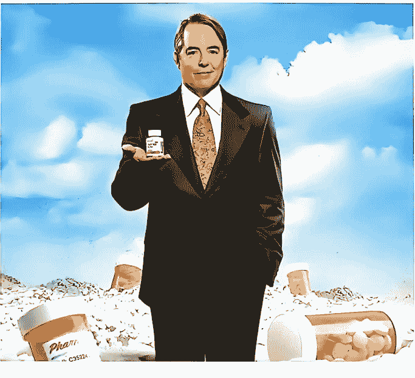
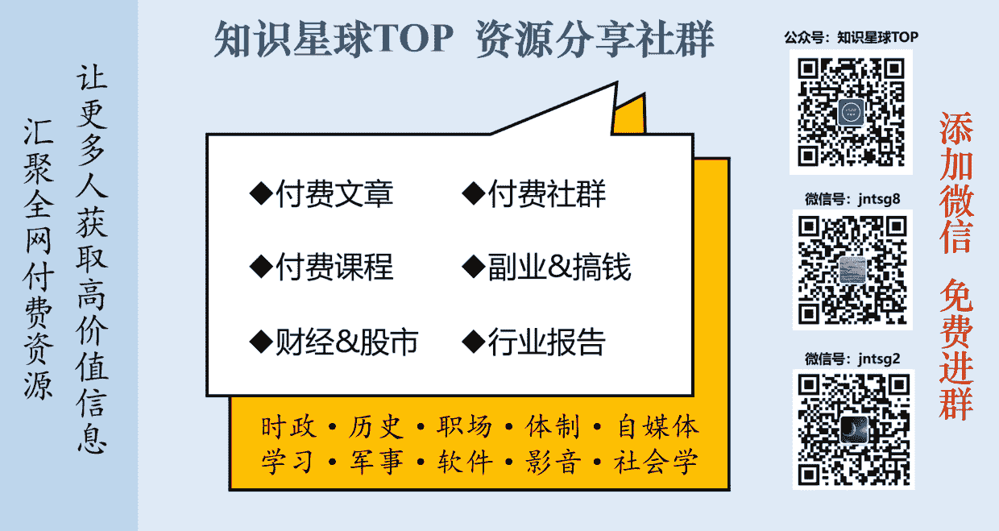

[content]
# 芬太尼、中美关系的镇定剂

麦布专栏：知乎共话

驾驭大国外交的马车，缰绳总是有过的。

2025年7月16日，美国总统特朗普表示，他认为中国将很快对制造和分销芬太尼的人处死刑。次日，外交部发言人林剑回应，芬太尼是美国的问题，不是中国的问题，责任在美国自身。

加微信公众号jntsg2，免费进资料群

## 作为被列管为奢侈品的药物，芬太尼为什么会在近期频繁成为中美口战的焦点？当大家都在讨论芬太尼的流向时，中美关系的走向真的和芬太尼本身有关吗？

## 01 妖精背后的神仙角力

7月22日 11:54

中美两边最近怎么在揪芬太尼不放啊？这就不么重要吗？

我觉得关键不在于芬太尼有多重要，而是台面下的事情更重要，不过没法摆搁到明面上说，只好拿芬太尼说事实了。

最近在看电视剧《扫毒》，有一个感觉，每一次中美关系缓和，倒霉的都是这些江湖生意的。97年的代表是刘昌星（注①），05年的代表是刘招华，这一线估计要交出来一个芬太尼的巨头了。

加微信jntsg2

是的，毕竟只有在双方关系不好的时候，才会放这些偏门的给对方使绊子。

昨天吃饭还在说这个剧，只是感觉像刘招华、姚玉这种天才，国家应该给他们一个改过自新的机会，为国家多做贡献。

> 你以为刘招华背后就没有大佬吗？说白了，只是在政治斗争失败后，成了所谓的刘招华的保护伞，而实际上，刘招华不过是老养的一条狗。
—— 子明

> 其实就是有一股反美的政治力量让他们这么干，那么亲美派自然就要要把他们往死里搂。
—— 子明

加微信公众号jntsg2

现在就很好理解了，美国要求中国控芬太尼不仅是控制毒品的问题，更是要中国这边击一波反美势力。

像是西游记里面扮成佛祖收油钱的犀牛精。

站在小周期的角度来看，马云本质上也是一个毒瘤，干掉马云同样向美国缴投名额。

—— 子明

可是为什么马云能被当作反美势力？

你觉得马云2020年“放炮”是在打什么？本质上就是在反美元体系。说得难听点，马云也是造假币的，支付宝本质上就是一个假币印刷厂。
—— 子明

原来这样理解，现行金融体系确实就是美国延伸。

> 马云背后的那几个人，都是中国反美最坚决的力量，击马云，也能顺便击马云背后的反美大本营。
—— 子明

注①刘招华：曾是武警、法警，后堕落为震倾世界的“技术主义大毒魁”，利用化学知识研发冰毒合成工艺，生产规模巨大，纯度极高，创世界之最。2007年，刘招华因制造、运输、贩卖毒品罪被处死刑。

妖精的浮现，系于背后“神仙”的角力；“神仙”的层次变了，自然会波及地上。赖、刘如此，马云亦然，未来也有可能现身一个“大妖精”，为中国的芬太尼问题画上一个圆满的句号。

大外交是一场复杂的博弈，过去的我们做了什么？未来又应该怎样的外交动作，来维护我们珍贵的发展期呢？

## 02 事以密成

加微信信号jntsg2，免费进资料群

现在看来，支付宝国际在东南亚搞了的一圈本地钱包是有政治逻辑的。
—— 子明

> 嗯，记得之前说过，我反对搞航母就是怕恶化中美关系。
> 其实我的意识形态跟支付宝背后的人一样，大东亚民族主义。但是在行为上，我支持他们对立面，还需要在美国面前放低姿态。
—— 子明

都是成年人了，心里再怎么想，也别把“我要干掉你”写在脸上。

事以密成，语以逸败。

世纪理解了老的那句“闷声发大财”。我们之前被他保护的太好了。

如果我们97年用的是20年的态度，还能收回香港吗？要是拍桌子和英国人说“我们不接受卖地出发”，恐怕不仅香港收不回来，WTO也别想要了。

想要办成事就是要审时势，想要达成的得给对方一些利益。

参考遇到太老君的青精，能用钱摆平的，就不去拍桌子。

佛教逐渐取代道教的过程，走的就是不断利用猴子闹事，再不断撒钱，维系佛道表面平衡的路。

虚化掏空，李代桃僵。

被揉上台面的芬太尼，不过是这盘棋中，被逐时挪动，用以震虎或纳的棋子。

而外交的本质，是在复杂力量的平衡中，实现根本目标而进行的取舍与运作，我们曾经做得很好，或可能挪用的经验。

# 相关阅读：

【知否共话】专栏

《33 藏在外交身后的假市场》（6月专栏更新）

# 知识星球TOP 资源共享社区

| 付费文章 | 付费社群 |
| 付费课程 | 副业&搞钱 |
| 财经&股市 | 行业报告 |
| 时政·历史·职场·体制·自媒体 | 学习·军事·软件·影音·社会学 |
