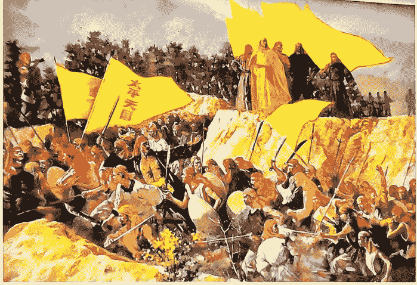

# 太平天国的路线错误

发布专栏：知几共语

天国日落，历史最大的一场起义，亦可烛今日。

清末历史，太平天国是绕不开的重要话题。

1850年末至1851年初，洪秀全、杨秀清、冯云山等人组成的反清义举运而起，随后建立太平天国。一路斩木为兵，北上东进，历经十四春秋，动摇清王朝根基又被清王朝镇压，所有的理想都归于灭，唯留了一段波澜壮阔的历史供后人评价。

一个农民阶级组成的草台班子，太平天国能够撼动清朝的统治。人人平等、妇女解放、耕者有其田......明明有着诸多超脱时代的理想，太平天国缘何以为维，终归落落。而我们又能从这段历史中，得到什么外交经验？

7月24日 9:46

有时候感觉太平天国真的有点可惜了，反封建、反侵略，还做了一定的土地改革，在那个已经做得相当不错了，是什么导致了他们的失败啊，改革的步子迈太大了？

洪秀全就好比是马克思，冯云山好比是列宁，如果南王冯云山没有死那么早，太平天国或许还能走得更远一些。

冯云山在估计也很困难吧，洪秀全没有直接应对国家的利益诉求，天田制度又损害了小农和地主阶级的利益，两面联合绞杀，太平天国注不会长远。

> 对他没有联合地阶级，也没有联合外部势力，覆灭就是迟早的事，可以参考李成章。

我的意思是，洪秀全理论建设，冯云山搞组织建设，毕竟冯的政治视野比洪高，如果是冯还活着，后面可能会灵活调整政策，或许就能考虑联合两大力了。

比如兰斯的国父也是GCD，但是很“灵活”，能联合资本主义打击。其实灵活掌握转打左横是非常厉害的，自己就能解读经书，不被教条所束缚。

> 嗯，苏共二代的那些领导人，上台前每一个都是反美分子，上一台就变成亲美的了。

美国领导人也是一样的，上台前一个都是反美分子，上一台都亲中了。

道理都是一样的，特明普普最近天天呵他喜欢中国，还是不是因为他给他喂饱了吗？

子明

话说回来，洪秀全能在两股力量的挤压之下生存这么久，肯定还是有看着他的政治力量在背后斡旋？

这么说吧，洪天王的主要作用，就是削弱了满集团在南方的统治，让汉族主阶层趁机掌握了实权。

> 洪天王打击清势力，南方的汉族主是乐见其成的，发展到最后，就跟《投名状》的三大大臣（注①）一样，玩起了养寇自重。

子明

确实，洪天王不折腾这一下，曾国藩、李鸿章可能都不会上位。

不过他的主张本质上就是打土豪分田地的级版本，不可能被地主们认可，这感觉也和雍正的摊入入有点像。

说到《投名状》，我想起来那个“刺马案”（注②）了，有分析说这个案子代表了清廷和地方大员的拉扯，双方都在相互试探。

这逻辑说得通。一个总督大员被一个大头兵捅杀了，还没人敢查，本身就很说明问题。从实力的角度来讲，祁同岌不敢杀沙瑞金的，刺了就会有一个案件组进来。但是未真的可以这样干，清廷弱，不敢派钦差人了了。但是必须得先有试探，才能有后面的“此乱命，粤不奉召”。

注①三大大臣：《投名状》里三位“下棋茗茶、翻云雨”的大臣，影片只给了姓氏，若照历史原型“刺马赛”与清末政局，他们具有一定的象征意义：

- 湘大入——射影曾国藩（旗人身份艺术加工），代表湘系与朝廷绪;
- 陈大臣——射影李鸿章，军机重臣兵权不足，与湘系暗争
- 姜大臣——射影左宗棠或其派系，手握悬 Lists营兵。

注②刺马赛：同治九年七月二十六日（1870年8月22日），新任两江总督马尚新在新南京被刺。刺马赛表面是个人恩怨，实质是清廷与湘系权力分配。此后三十年，两江总督似乎由湘、淮占据，朝廷再难。

注③小白菜：同治十二年（1873）十月，浙江余杭发生“由于杨乃武与葛丰秀（绰号小白菜）有奸情”的传诱，遂以此杀夫。小白菜在“烧烤豆腐丝”后被杨乃武斩杀。光绪元年（1875），慈禧下旨将人犯、卷宗及葛易连杖解，由刑部开除。老作依据《洗冕集录》确认葛系病亡，无毒。余杭县刘锡以下140余官员被革职、流放或永不复用，浙江官场大地震。推翻旧的王朝，建立新的秩序，要么瓦解、络结其内部阶级力量，要么寻求外部力量的支撑，而太平天的路线则将自己孤立起来，走向失败就是注定的结局。
