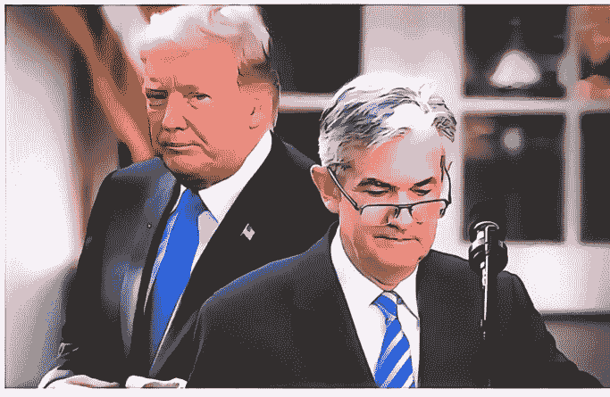

# 美联储影子主席
发布专栏：知几共语

一个注定走到尽头的主席，他的倔强已然无力。

2025年7月4日，据央视新闻报道，当地时间周四，美国财政部长贝森特表示，特朗普政府将在今年秋季集中精力选出美联储主席鲍威尔的继任者，并称有很多优秀的候选者。

此前，特朗普多次抨击鲍威尔。值得注意的是，贝森特本人也是美联储主席一职的竞争者。

加微信号jnts2，免费进料群

由于鲍威尔始终不愿配合特朗普政府的降息政策，后者已多次公开抨击前者。本次提前为美联储储候选人也是特朗普在表达不满。

那么，本次贝森特的发言隐含了哪些信息呢？提前选出掌舵人又将对美联储产生怎样的影响？

7月4日 11:27

贝森特说要在今年秋季选出美联储主席候选人，看起来特朗普才对鲍威尔的不满已经到了顶点了。

按照来说，鲍威尔的任期到明年五月才结束，美国的惯例则是总统会一直等到现任主席任期的最后几个月才着手任命继任者，这次明显是提前了。

特朗普选出一个影子美联储主席。可以理解为在央行行长长面上安了一个GSQ书记。

子明

这是相当于给美联储搞个双主席啊，是要预期信号吗？微信号：njtsg2，免费资料群

但我不理解的是，如果人选出来了，新主席又没有实际权力，该怎么操作才能配合懂王去影响市场呢？

你可以这么理解，特朗普安排了一个美联储工作小组组长……小组治国。

子明

就比方说，鲍威尔说绝不降息，新主席说我上一任就要降200个点，市场的预期就被均衡了。

储联储的官员们会分清到底是主席大、还是书记大。

子明

# 知识星TOP 资源共享社群

| 付费文章 | 付费社群 |
| --- | --- |
| 付费课程 | 副业&搞钱 |
| 财经&股市 | 行业报告 |

时政、历史、职场、体制、自媒体学习、军事、软件、影音、社会学

让更多人获取价值信息

江聚全网付费资源

添加微信 免费进群

公众号：知识星TOP

微信：jntsg8

微信：jntsg2

再如此，贵州、重庆、广东，三个60后都走向了没落。

相应的，长期投资这几位的资本，也随之吃瘪了。

但是美联储降不降息，真的会因为一个影子主席就改变很多吗？毕竟懂王只剩四年了，可他们这种人是在华尔街混一辈子的......

我也有点这方面的顾虑，懂王只是换了一个主席，其他有投票权的都是百年老根的利益集团。

新主席固然是特朗普推上去的，但特朗普并不是一个人，他的背后也是一个利益集团。

稍微延伸一下，随着美联储阻碍的消失，民党可能要垮了。懂王现在除了少数族裔，都已经团结的七七八八了。

加微信号jntsg2，免费进资料群

随着鲍威尔继任者的挑选和最后揭晓，美联储将开启一段“双主席”领导决策的新阶段。

等这位“书记”进驻美联储，我们不妨期待一下，美国乃至全球的货币政策，究竟会发生什么。

— END —

加微信号jntsg2，免费进资料群
