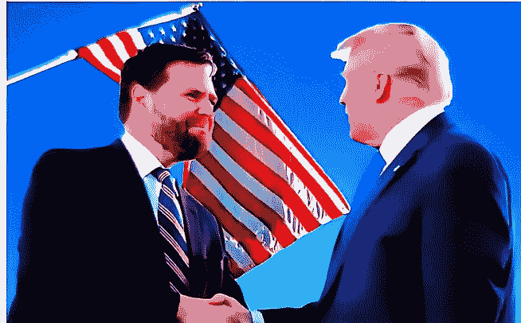

# 特朗普的继任者
发布专栏 莉几语

册太子、访华闯关——特朗普的多事之秋。

2025年8月6日，美国总统特朗普表示，副总统万斯“最有可能”成为他的“接班人”，担任2028年共和党总统候选选人。

这是特朗普竞选为止，对万斯可能作为未来总统候选人最明确的一次表态。

加微信jnts2 免费进资料群

这离访华事尚未议定，面上忙着封万斯为“太子”，两件大事，双线进行，特朗普究竟在急什么？又意欲何为？是对万斯众人的试探？还是输赢共和党基本盘的必要举措？

今天，我们共同聊一聊，诸多顺与不顺之后，国内国外两盘大棋，特朗普将如何走下去？

# 01 “太子”万斯

8月6日 10:38

这应该是特朗普第一次，这么确切地给万斯穿上裤子，算是一个名分。

终究还是放弃自己接着着的计划了吗？

应该早就放弃了吧，美国的政治传统都摆在那儿多久了，他还没有那个胆量公然挑战。而且和马斯克闹翻后，他也很难达成连任计划了。推万斯上去也是觉得他年轻、好控制，说到底还是想用符合程序的方式在幕后运控。

微信公众号jntg2，免费进资料群

万斯是里面最好控制的一个吗？感觉未必吧，此人蛮子野心很大。

其实能进入候选选内的，选谁都有翅膀硬的那一天，只是在目前的人中，特朗普选一个相对可控的，总不能选德桑逊（注①）吧？

我觉得王这也是提前给下面指条明路，让更多人关注万斯，从而抗衡贝森特一派（注②）。

毕竟王子点燃的民将火，只有万斯能玩转。

这样一来，预计28年我们就能看到万斯VS纽森的名场面了，真人VS戏精君子。

也不好是不是怕在拿万斯吸引火力，其实真正的继承人文件藏在白宫MAGA顾问的后面。

加微信jntsg2，免费进资料群

## 特朗普是在搞平衡。

贸易战和“大而美”一段告落了，拉特国际资本的阶段性任务也已经完成了。现在他要做的，是重新建构美国的权力平衡。

子明

注①德桑逊的矛盾：万斯，佛罗里达州长。

注②万斯与贝森特的矛盾：万斯偏向民族主义，支持制造业回流、贸易保护、限制移民，强调“工人阶级优先”，倾向产业脱钩+再工业化，即使牺牲金融稳定也不在不惜，代表本土制造业与传统能源、军工复合体，与俄亥俄、宾州等“铁带”工业利益深度绑定；
贝森特金融型特朗普，主通过减税、放松监管、美元强势地位来刺激经济，代表哈尔街金融资本与跨国投资者利益。

万斯得到了“太子”的名分，白宫的派系争斗了方向，料理完家事务，另一端，特朗普访华的计划，还在云里雾里之中。

## 特朗普，到底在等什么?

微信公众号jnts2，免费进资料群

# 02 访华前置条件

8月6日 13:37

可真的已经把国际上的事情都处理好了吗？访华的相关事宜不是还没决定吗？这应该算是今年外务最大的事情了吧。

我昨天听懂王接手CNBC采访时说，两国已经非常接近达成协议了。如果达成的话，他年底前就会来的，如果没达成就看不见了。

原话是这是一趟要飞19小时的航班，路途遥远，但在不久的将来，我会前往。

他都说了，达成也是年底才能来，那9.3的可能性不是越来越渺渺了？

本来就很低，本周出结果。

子明

本周？会出什么结果？

加微信jnt2 免费进资料群

可真的已经把国际上的事情都处理好了吗？访华的相关事宜不是还没决定吗？这应该算是今年外务最大的事情了吧。

我昨天听懂王接手CNBC采访时说，两国已经非常接近达成协议了。如果达成的话，他年底前就会来的，如果没达成就看不见了。

原话是这是一趟要飞19小时的航班，路途遥远，但在不久的将来，我会前往。

他都说了，达成也是年底才能来，那9.3的可能性不是越来越渺渺了？

本来就很低，本周出结果。

子明

本周？会出什么结果？
