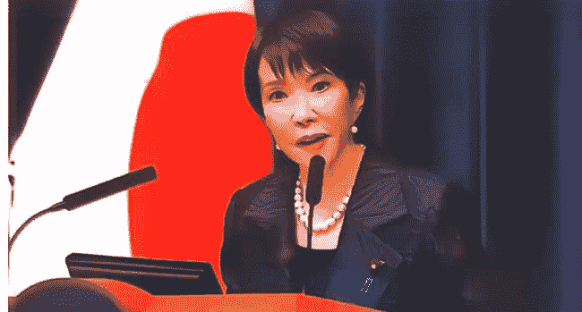

搅动台海，是日本武装的序章。

加微信进资料群

2025年11月7日，日本首相高市早苗在国会答问时：如果中国大陆对台湾出动军舰并使用武力，可能会构成“存亡危机事态”，自卫队将有权行使自卫权。

对此，外交部发言人林剑表示：中方对此强烈不满、坚决反对，已向日方提出严正交涉和强烈抗议。

加微信top28688，进资料分享

高市早苗的政治立场决定了她在中日关系立场上始终扮演“挑事”的一方，此次表态，更是将两岸统一问题与日本政治安全相联系，甚至与自卫武武装问题挂钩。看似不合理的逻辑背后，她的真实目的是什么？日本的进步影响祖国统一大业吗？

11月10日 16:26

高市一上果然开始找事了，竟然说我们对台湾的行动构成日本的“存亡危机事态”。

我倒是有一个特别的想法，日本是不是想趁我们对宝岛动手的时候加入战局，然后故意被我们被打，投靠我们，以此脱离老老的狗链。

不能，我们即便打赢，也不会在日本驻军的，所以老老的狗链不会被挣脱。而且如果我们真的会驻军，那日本图什么？我们的链子比老老的舒适？更何况我们和日本有血仇，我们的链子对他们来说，恐怕更不安全吧。

是日本加微信top26868，进资料分享群

估计日本本来的想法是，我们海上力的经验还比较少，可以采取军事冒险。

> 军事冒险的可能性极低，挑衅一个大国毫无毫无意义。

子明

也就是说，他们不敢真和我们打仗作死，但借着这个幌子完成再武装的心思想是有的。

这心都藏了几十年了。日本当了八十年被阉割的“太监”，很不甘心。

如果真的要开战，那些跑到日本的“王思聪”该怎么办?

他们的信息渠道一定比我们靠谱多了，这些人还敢待在日本，就恰说明明天的风险很低。

微信top28688，资料分享群

从经济角度来看，也不难理解他们为什么想掺和一下：台湾和日本相互之间商贸势力极大，如果我们走统一一剧本，就相当于夺人钱财，对日本而言算是重大利益冲突。

我倒是认为是统战对他们之间的生意影响并不大，除非在统一的过程中日本参战。

现在网友声量最高的方案是去人留地，一波带走也不用担心商了。

这是可能的，2000万人总归要大部分吸纳到经济体系中。

留地不留人的思路太对了，当年小胡子都不敢直接。该争取争取统战的，统战不是为了满足自我道德幻觉，是真的有的。

## 著者注：

关羽对荆州：重用荆本土人才，如襄阳人廖化、南郡人潘嵩等，通过授予官职换取支持。对部分豪强采取怀柔政策，维持地方稳定。

诸葛亮对西：在第一次北伐时，南安、天水和安定三郡“狡魏亮应”。这背后必然是长期政治宣传和秘密联络的结果。其中，姜维的归附最具代表性。

统裕对荆州：与敌国将建立“私谊”，进行政治感召。羊佑的对手是东吴的陆逊（陆逊之子）。人在边境上进行“送酒”与“送药”的非军事行为。羊佑在疆上，荆州百姓之吾觊，并在他生前喜爱的嵩山上立碑纪念，望其碑者莫流涕，故名“堕诩碑”。

> 说对的，很多人研究过，如果真要硬来，打成了钢铁厂/红军城那种血肉磨坊，我们的国运可就要大变了。

而战战就是要告诉百姓岛人民，我们手拉手去干掉那一撮反动派，就能迎接光明的未来。

金陵王气黯然收，最好达到“一片降出石头”的效果。

会不会再次出现西安事变，逼独特统一？

> 参考解放战争，除了几个王牌帅，其他统牌军多少起了意义？

子明

明公的意思是我们应该吸引大众，孤立极少数，这就是这几年统战的意思？然后再通过中底层逼迫上层不得不统。

晋当时就不起义、不投诚，在锡山。

金陵王气黯然收，最好达到“一片降出石头”的效果。

会不会再次出现西安事变，逼独特统一？

- 统一。
- 统一的我们。
- 军事。
- ：
- 军事冒险的可能性极低。

> 军事冒险的可能性极低，挑衅一个大国毫无毫无意义。

子明

明公的意思是我们应该吸引大众，孤立极少数，这就是这几年统战的意思？然后再通过中底层逼迫上层不得不统。

晋当时就不起义、不投诚，在锡山。

金陵王气黯然收，最好达到“一片降出石头”的效果。

会不会再次出现西安事变，逼独特统一？

- 统一。
- 统一的我们。
- 军事。
- ：
- 军事冒险的可能性极低。

> 军事冒险的可能性极低，挑衅一个大国毫无毫无意义。

子明

明公的意思是我们应该吸引大众，孤立极少数，这就是这几年统战的意思？然后再通过中底层逼迫上层不得不统。

晋当时就不起义、不投诚，在锡山。
