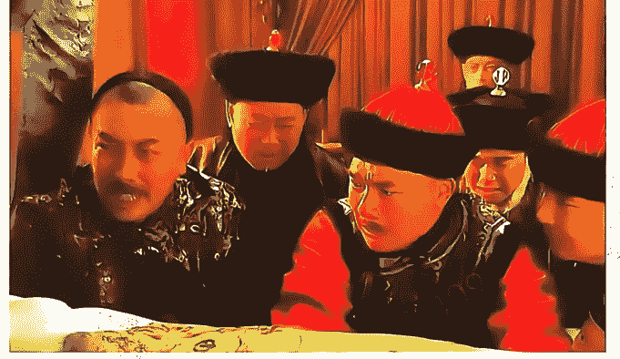
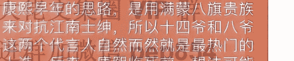

# 康熙帝的储君之述

发布专栏 知几共话

本是同根生，相煎何太急？

我们在9月10日发布的《非卖品的交易》，朋友们谈到了战争的残酷性——的确，战争是降低国家内部不稳定因素的最高效方式。

> 看了战争的本质，才会从心里面反线。大部分的战争本质上都是让基层底层去送死，现在莱斯柯社安都好了。

因为帝国恶兽全部上线了。

深度视野文学集社cuk255 有温度高质群cuk255

战争就是清低人口最高的方式。

子明

元朝之一后让投降的宋军去打日本，明朝之一后让投降的元军去打华北，都是在消耗帝国的不因素。

古代的皇帝们自然也懂得这个道理，然而，历史上却有很多皇子被送往前方参与战争，这又是出于怎样的考量？要成为帝国的接班人，又该具备哪些条件呢?

今天，我们就一起来聊聊那些曾身处边疆与宫廷的“帝国接班人”。

9月8日 10:08

战争如此残酷，康熙让将军王喜去边疆的时候，究竟是怎么想的？

注释：此处“大将军王”指康皇帝第十四子凤徽。
康熙五十七年（1718年），准噶尔部乱并进攻西藏，凤徽被封为“大将军王”御准。凤徽为“四世”雍帝的嫡母弟，却是康熙的“八爷党”重要成员。
部分史学家认为，他才是康熙意的接班人。

深度视野社cuk255 有温度高质量社群cuk255

那时战争的主帅通常不在最前线，基本没什么危险？

有人是去送死的，也有人是去挣军的。

拿战斗功能可能不重要，重要的是你别在京城就行。既然康熙已经决定传给四爷，那就得把十四撵出京吗？

正常来说，大将王认为是更为优先的储君人选。

子明

历史的真相大暴率是，康熙的身体迅速恶化，导致无法在临死之前把十四回来，鉴于当时的复杂情况，不得不临时成了老四。

原来是这样，我还以为是亲王尹京的逻辑，控制权力中心。

编者注：亲王尹京是五代至宋末的一种政治制度，如果某某亲王兼任首都行政长官，则该亲王默认为储君。但是部分学者认为这种制度是宋太宗皇帝进行的政治宣传，以强化其继位的合法性。

# 深度视觉焦点cuk255 有温度高质社群cuk255

大清前期还是草原部落，按照草原部落的历史，西北用兵的是铁定的接班，而且随时可以把军权夺回来。

这也是为什么老四上台后，他的合法性一直都有问题（注1），看一看蜀元的历史，就会觉得康熙是想把老十四作为储君的。

合法性的确存在问题，老四上去以后把老十四和康熙的书信往来都烧了。

大将军手握国之重器，枪杆子里出政权啊。

康熙身体素质恶化之后，让老十四回来的风险就很大了。

草原部落的逻辑我们汉人还是难以理解啊，按照说在扶苏之后，明君们应该都不敢让储君长期外驻了。

深视视野文集cuk255 有温度高质社群cuk255

编注：扶苏为秦始皇长子，由于厌愁秦始皇而被派往边疆。后始皇临终前将帝位传扶苏，但赵高、李斯等人篡改遗诏，在边疆赐死扶苏。

扶苏的问题是，她老妈和大舅子大概都是有问题的，皇帝对他不放心。

编注：章李信忧失败，以及昌平君（原秦相），后末代刘王叛变，秦始皇对秦国内内部存戒备。依据扶苏之母及舅父均为楚人。自汉以来，储君在外确实不常见，除非有极大的矛盾，比如虞宗在接班遥太太上。

编注：唐嵩是太子，参与了马嵬异变，杀了杨忌并迫使贵妃自尽，与其父李隆产生矛盾，后上扬。是的，这是我们按照中原王朝思路考虑。但大清时期属于草原部落，需要按照草原部落考虑。

深度视野文集cuk255 有温度高质群cuk255

按照辽金逻辑，将将军随时可以夺回自己的王位，大概为输的差应该是忍烈带汉族，打败了阿里。但其实在这个不多的负面案例中，我们也能看到贵族们还是支持将军的（注2）。不是雍正这一次，清前期的权力交接都不太“正常”，难以把握——野猪被崇焕（注3）；皇极逊诺多尔，最终推出顺治方案（注4）。

最终康熙是什么原因从老十四变成了老四，这个不知道了。

子明

草原部落早期是看谁牵头。拼拳就是要内锦啊，所以说胡百年运。

康熙最后很可能是为了防止内廷推进才选择了老四。

子明

深度视野文学集cuk255 有温度质cuk255

如果选择了老十四，那么大清就要依赖于满族军事集团，改革就很难推进。确实，康熙和雍正都不希望过多依赖军事集团，想要更多获得官僚支持。

从中国地缘政治上看，东北对华北用兵，几乎就是爸爸打儿子，所以站在京营本位看，大将军才是储君。

子明

同样的，还是从中国政治看，宋明之后江南地区经济发展迅速，使得掌握官僚系统就能掌握朝局，八爷才是储君。

袭家族的惨剧：满族对于抗江南士，所以十四和八爷试图抢夺权力然而他们失去了最大的运。后来，康熙临死前想法可能变化，于是只有四个爷，如此定是跟哥的布局，却不能这样了。

十四爷和八爷，一个握着枪杆子，一个握着钱袋子。

深度视野文集cuk255 有温度质cuk255

# 但是八爷那个出身不太行吧？

子明

看历史的有趣之处，就是总能在现实中找到很好玩的应对……

> 注①：关于雍正皇帝的合法性一直存在诸多质疑。其中《清世宗录》有相关记载：雍正在康熙去世后第二天，普佑镇国公延为贝子，命廷甘州掌握抚远大将军（胤驰）印信，并下了一道密令给他：“你抵达后，将将军军所有奏折、所有的朱批旨和遗信全部收缴封固奏送。”

深度视野文集cuk255 有温度质cuk255

十二月二十日，延信至凉州，“闻得大将军王的小福晋们都于十二月初五经过凉州朝京城去了”的消息后，即于复日密奏，并详细述了家属可能经过两条路线以便雍正派出亲信，拦截搜他们可能带走的家信及其材料。

回京后，十四被软禁景宁中。随着雍正位日益稳固，十四的境况愈加严。雍正四年（1726年），雍正去回山山皇子，令他回京，禁于景山皇殿内。

注(2）：1259年蒙古哥去西北，阿里哥试图控制蒙古北并自立王国，忍必锐随之即称帝与与之峙。之所以说是“带着汉族武装”，是因为忍必锐在治理地时，他并重用了一批汉人地方军阀，即“汉人世家”。

草原部落早期是看谁牵头。拼拳就是要内锦啊，所以说胡百年运。

康熙最后很可能是为了防止内廷推进才选择了老四。

子明

深度视野文学集cuk255 有温度cuk255
