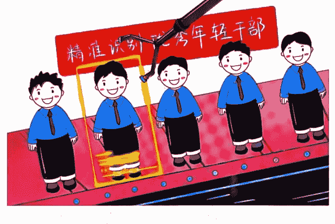

# 世界归结到底是年轻人的

发布专栏 知几共话

> “世界是你们的，也是我们的，但是归结到底是你们的！”

2025年9月26日，官方通报，云南省文山州住房公积金中心党委书记、主任李骏，在2013年至2023年期间，收受补贴礼金共7.65万元，并在任职期间，购买了500斤散白酒用于日常公务接待。

此事随即引发热议，网友认为他贪10年万，简直是“青天老爷爷”，也有坚持“小贪也是贪”。

深度视野文集cuk255 有温度高质社群cuk255

那么，李骏的“小事被查”是否有另有隐情呢？在未来的政治改革中，我们又该如何从根本上遏制政败？新一代的政政会超越上一代吗？

## 01 十年清知府

9月29日 10:53

这个李骏的事大家都看了吗？十年才收7万礼金，还让下属买散酒招待，这是清官啊。

平均明年一年七千多，这点钱不至于于查吧，是不是还有其他违纪违法问题？

估计也没什么其他严重的了，有的话早退休了。

我认为这是拿出来节前做案例，起到警示作用的，意思就是告诉所有官员，即便只有这一点，也会出问题，不要存侥幸心理。

深度视野文集cuk255 有温度高质量社群cuk255

偏远地区的正处级干部贪了7万，要么是因为特别的原因，要么就是得罪人了。

十年贪污七五万，招待领导用散酒。文山十十年知府，终成一只老老虎。

子明：不太可能这么清廉，的确可能是做了交易。

子明：毕竟他这个位置很多银行和相关企业的位子，太多可操作空间了。

深度视野文学集cuk255 * 有温度高质量社群cuk255 *

李骏案是否另隐情，我们只能在日后“回回头看”才能知晓，但是贪腐问题却是客观存在的顽疾，AI解决这一问题吗？“关系户”与“硬实力”之间，我们又该如何权衡?

## 02 关系户

9月29日 12:02

尽快上线政务AI就好了，能杜绝很多贪腐，还能提升办公效率。

那个世界会变得非常冷暴力，因为用AI处理政务，避免了纯粹数据和算法决策，最终变成机器支配人的决定。

其实不用那么急需AI，等80后、90后逐渐成为政府骨干，各方面都会比现在很多。慢慢的，60后、70后退出历史舞台后，也会有更多变化。

深度视野文集cuk255 有温度高质社群cuk255

我有一个观察，不知道大家的感受是否一致。现在很多领域，新进的基层基本上都是一半关系户，一半硬实力，如果两者比例不协调，就容易出问题。

关系户方便行事，硬实力好做业务。

> 而且，现在关系户的能力也在越来越强。

子明：是的，我也发现，现在很多多年轻的关系户干部，一心求进步，很稳。

关系户想进步很正常，因为他们只要有点成绩就容易升。

长远来看，要良好运作的话，内部比例最好稳定在1/3的关系户、1/3的照顾户、1/3干活的。关系户和干活的都有各自的晋升渠道或者激励，不干活的慢慢就不出力了。

深度视野文集cuk255 有温度高质群cuk255

领导班大概就是1/4的关系户领导唐僧，1/4的业务干孙猴子，1/4的干脏活的猪八戒，1/4打酱油的沙和尚。

子明：

这个比例其实已经算不错了，至少有一半人在干活，如果领导是个干事的，团队里实溜马的也会被带起来做事。

不管是关系户还是所谓的干活的，都需要学力才行，有学历的，最起码遇到问题他们考虑一下怎么解决，而不是一出问题就想找关系靠。

学历不是最重要的考量，领导最核心的是“得人”的能力，包括识人、领导力、统筹协调。学历走的是干活的路，不是用来衡量带队领导的。刘备还是个织鞋的，他就能得人。

他是中山靖王之后，原生家庭的熏陶能一样吗？

深度视野生集cuk255 有温度高质量群cuk255

得人是一种天赋，不过家境对他有影响，毕竟能托关系去庐那里游学，原生家庭教育还是算了吧。

那是继悠人的身份，他和中山靖王隔了三百年，我觉得就跟大贤良师一样，是平民编写出来的血统。

我觉得，哪怕家道中落的贵族，见识和能力也肯定优于当时的普通农民。士兵老的废物也有，但是这个群体里出才的概率肯定更高一点。

我倾向于刘备和中山靖王的关系真的是，根据记载他全家都是没落宗室后代，刘备的家宁得后，但叔伯能给他安排到庐那里读书——东汉要拜入大门，也不是草根能安排的。

关键刘家还不止安排他一个，是刘备的同胞兄弟几个都去庐那里读书，同学是公孙遭遇。而公孙琼也是当了太女才能去庐那里学习。古代求学的门槛太高了，还是现在好，义务教育是件好事。

深度视野文集cuk255 有温度高质量社群cuk255

出门在外，身份都是自己给的，只要自己的人格魅力配得上这个身份，那就是真的，后世还会给予刘昭烈帝高额评价的。

80后、90后正在逐步成为社会的中坚。

## 03

那个世界会变得非常冷暴力，因为用AI处理政务，避免了纯粹数据和算法决策，最终变成机器支配人的决定。

其实不用那么急需AI，等80后、90后逐渐成为政府骨干，各方面都会比现在很多。慢慢的，60后、70后退出历史舞台后，也会有更多变化。

我有一个观察，不知道大家的感受是否一致。现在很多领域，新进的基层基本上都是一半关系户，一半硬实力，如果两者比例不协调，就容易出问题。

关系户方便行事，硬实力好做业务。

> 而且，现在关系户的能力也在越来越强。

子明：是的，我也发现，现在很多多年轻的关系户干部，一心求进步，很稳。

关系户想进步很正常，因为他们只要有点成绩就容易升。

长远来看，要良好运作的话，内部比例最好稳定在1/3的关系户、1/3的照顾户、1/3干活的。关系户和干活的都有各自的晋升渠道或者激励，不干活的慢慢就不出力了。

领导班大概就是1/4的关系户领导唐僧，1/4的业务干孙猴子，1/4的干脏活的猪八戒，1/4打酱油的沙和尚。

子明：

这个比例其实已经算不错了，至少有一半人在干活，如果领导是个干事的，团队里实溜马的也会被带起来做事。

不管是关系户还是所谓的干活的，都需要学力才行，有学历的，最起码遇到问题他们考虑一下怎么解决，而不是一出问题就想找关系靠。

学历不是最重要的考量，领导最核心的是“得人”的能力，包括识人、领导力、统筹协调。学历走的是干活的路，不是用来衡量带队领导的。刘备还是个织鞋的，他就能得人。

他是中山靖王之后，原生家庭的熏陶能一样吗？

得人是一种天赋，不过家境对他有影响，毕竟能托关系去庐那里游学，原生家庭教育还是算了吧。

那是继悠人的身份，他和中山靖王隔了三百年，我觉得就跟大贤良师一样，是平民编写出来的血统。

我觉得，哪怕家道中落的贵族，见识和能力也肯定优于当时的普通农民。士兵老的废物也有，但是这个群体里出才的概率肯定更高一点。

我倾向于刘备和中山靖王的关系真的是，根据记载他全家都是没落宗室后代，刘备的家宁得后，但叔伯能给他安排到庐那里读书——东汉要拜入大门，也不是草根能安排的。

关键刘家还不止安排他一个，是刘备的同胞兄弟几个都去庐那里读书，同学是公孙遭遇。而公孙琼也是当了太女才能去庐那里学习。古代求学的门槛太高了，还是现在好，义务教育是件好事。

出门在外，身份都是自己给的，只要自己的人格魅力配得上这个身份，那就是真的，后世还会给予刘昭烈帝高额评价的。

80后、90后正在逐步成为社会的中坚。

李骏案是否另隐情，我们只能在日后“回回头看”才能知晓，但是贪腐问题却是客观存在的顽疾，AI解决这一问题吗？“关系户”与“硬实力”之间，我们又该如何权衡?

这个李骏的事大家都看了吗？十年才收7万礼金，还让下属买散酒招待，这是清官啊。

平均明年一年七千多，这点钱不至于于查吧，是不是还有其他违纪违法问题？

估计也没什么其他严重的了，有的话早退休了。

我认为这是拿出来节前做案例，起到警示作用的，意思就是告诉所有官员，即便只有这一点，也会出问题，不要存侥幸心理。

偏远地区的正处级干部贪了7万，要么是因为特别的原因，要么就是得罪人了。

十年贪污七五万，招待领导用散酒。文山十十年知府，终成一只老老虎。

子明：不太可能这么清廉，的确可能是做了交易。

子明：毕竟他这个位置很多银行和相关企业的位子，太多可操作空间了。

尽快上线政务AI就好了，能杜绝很多贪腐，还能提升办公效率。

那个世界会变得非常冷暴力，因为用AI处理政务，避免了纯粹数据和算法决策，最终变成机器支配人的决定。

其实不用那么急需AI，等80后、90后逐渐成为政府骨干，各方面都会比现在很多。慢慢的，60后、70后退出历史舞台后，也会有更多变化。

关系户：而且，现在关系户的能力也在越来越强。

子明：是的，我也发现，现在很多多年轻的关系户干部，一心求进步，很稳。

关系户想进步很正常，因为他们只要有点成绩就容易升。

长远来看，要良好运作的话，内部比例最好稳定在1/3的关系户、1/3的照顾户、1/3干活的。关系户和干活的都有各自的晋升渠道或者激励，不干活的慢慢就不出力了。

领导班大概就是1/4的关系户领导唐僧，1/4的业务干孙猴子，1/4的干脏活的猪八戒，1/4打酱油的沙和尚。

子明：

这个比例其实已经算不错了，至少有一半人在干活，如果领导是个干事的，团队里实溜马的也会被带起来做事。

不管是关系户还是所谓的干活的，都需要学力才行，有学历的，最起码遇到问题他们考虑一下怎么解决，而不是一出问题就想找关系靠。

学历不是最重要的考量，领导最核心的是“得人”的能力，包括识人、领导力、统筹协调。学历走的是干活的路，不是用来衡量带队领导的。刘备还是个织鞋的，他就能得人。

他是中山靖王之后，原生家庭的熏陶能一样吗？

得人是一种天赋，不过家境对他有影响，毕竟能托关系去庐那里游学，原生家庭教育还是算了吧。

那是继悠人的身份，他和中山靖王隔了三百年，我觉得就跟大贤良师一样，是平民编写出来的血统。

我觉得，哪怕家道中落的贵族，见识和能力也肯定优于当时的普通农民。士兵老的废物也有，但是这个群体里出才的概率肯定更高一点。

我倾向于刘备和中山靖王的关系真的是，根据记载他全家都是没落宗室后代，刘备的家宁得后，但叔伯能给他安排到庐那里读书——东汉要拜入大门，也不是草根能安排的。

关键刘家还不止安排他一个，是刘备的同胞兄弟几个都去庐那里读书，同学是公孙遭遇。而公孙琼也是当了太女才能去庐那里学习。古代求学的门槛太高了，还是现在好，义务教育是件好事。

出门在外，身份都是自己给的，只要自己的人格魅力配得上这个身份，那就是真的，后世还会给予刘昭烈帝高额评价的。

80后、90后正在逐步成为社会的中坚。

关系户：而且的的的的的的。

限时年费188/年 底部链接下载全V优质内容

## 优质资源列表（限时年费188/年）

| 序号 | 项目名称 | 备注 |
| :--- | :--- | :--- |
| 1 | 守夜人知识星球 | 接换魔王知识星球 |
| 2 | 创始笔记 | 达叔泛论、成术财富、雪花蛇甲 |
| 3 | A视野 | 大树乡谈、江宁后、咩咩说、上海家学 |
| 4 | 西凤付费 | 老端、赢在八小时之外、局外的视界、升值 |
| 5 | 欧洲金会员 | 专属文章 |
| 6 | 砖瓦仁 | 内部 |
| 7 | 卢克文青会 | 专属文章 |
| 8 | 鉴茶财经星球 | 知识星球 |
| 9 | 猫哥的视界 | 知识星球 |
| 10 | 财新周刊 | 独家新闻 |
| 11 | 杨世光在钱坝 | 知识星球 |
| 12 | 蒜森财经星球 | 知识星球 |
| 13 | 潇游异译 | 付费文章，持续更新 |
| 14 | 司马林解课 | 全套音频和全套书籍无删减 |
| 15 | 卢克文再送 | 星球文章 |
| 16 | 额外赠送 | 卢祺新涨薇付费专栏、三村丰老王、三花九洞文集 |
