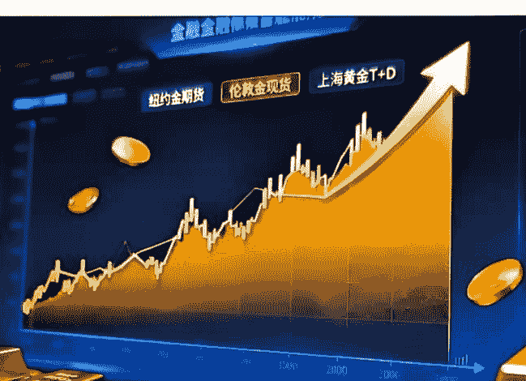
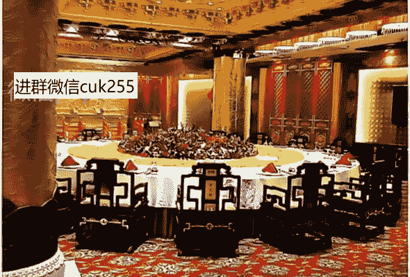
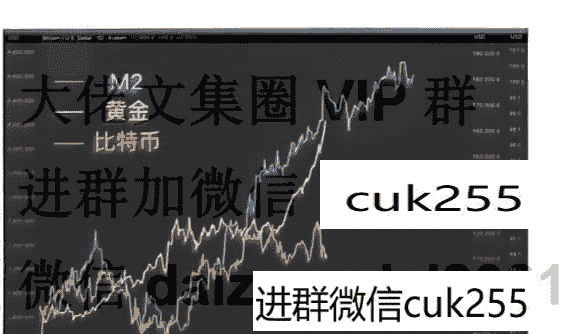

## 黄金，要不要买？
10月1日海线下读者活动系列（五）
发布专栏：知几共语

黄金热再起，是跟风还是布局？来自子明演说课线线下活动的真实反馈，揭开了“买金”背后的逻辑转折与认知升级。

10月17日，伦敦金现货价格收盘中最高升至4380.79美元/盎司，创历史新高。国际黄金期货价格也触新高，纽约商品交易所（COMEX）黄金期货主力12月合约交盘中最高涨至4392美元/盎司。

近期黄金价格上涨的趋势引发了新一轮的投资热潮，黄金到底能不能买？上海线下读者活动（五）就大家一起聊黄金，从局量的底层逻辑看黄金行情趋势。

深度视野文集 cuk255 有温度黄金社群 cuk255

10月21日 9:21

顾老师线下下课讲的黄金，真的很好用，我回来的路上就买了100万，初步收益就已经很可观了。

场内和场外都买了一点。场内还在礼拜又抛了一部分，礼拜又接回了一部分。场外的本来想礼拜买的，结果换了新的手机，可惜错银行登不上。

在此之前，各种经济学家讲的黄金这个逻辑我都不太能接受，实际上去年10月份听一个首席经济学家在上海说黄金涨，我都不买。但是今年听到顾老师讲的黄金，我完全接受这个逻辑。

并且我觉得顾老师那天的最大的三个亮点：第一个，给我们讲清楚了几种机会的意义在哪里。第二个，黄金为什么能涨？还有前几年为什么不涨的原因。第三个，中美之间肯定会妥协。

> 黄金的那个，是2023年西安的一场线下活动时候说的。
> 子明

深度视野文集 cuk255 有温度高质量社群 cuk255

那个时候我还不是会员，如果那个时候我参加了会员活动，我会买500万。

我这刚好有一张活动的现场图。

噫，现场就有人买了。

子明

23年买500万，我都不想，现在至少应该掉了250万了。

这地方这么金碧辉煌啊？

就在金店里面呀。

子明

深度视野文集 cuk255 有高质量社群 cuk255

线下那天的前一天，我是跟他们聚的。那捂黄金的哥们们现场送了一个手链和发京。

听完这次的课，彻底用逻辑说服了我，我在回来的火车上就在银行里面找了这个基金了。

那专家的逻辑和老师的逻辑有什么不同？

首席专家讲黄金，他只是说美元不行啦，大家都在争取黄金，因为黄金是有共识的等等这些话题。他们弄了一堆PPT在那里讲了2个小时，我就没有明白，这些风险去年也有前年也有，为什么现在就今年，而且黄金已经开始涨了，真的看不懂。但是老师所告诉的是给了这个黄金价格做了上限，我就明白了，黄金既然只会往上跑，不会往下跑，这种资产就是零风险资产，那还不拼命买。

老师讲黄金当时还有一个专家多的内容，是结合了时局。之前我一直理解，如果黄金是一个规避风险的资产，那为什么前几年黄金没涨呢？这两年的经济总量也没有比前几年差吧，那是因为黄金涨成这样？

深度视野交流 cuk255 有温度高质量社群 cuk255

顾老师提到了一个俄罗斯抛售黄金的概念。现在黄金的价格当中，就会有一个模糊变量，黄金的真实价格。如果从拜登开始放水的话，金价到底应该是什么价格，到底是5000美金还是6000美金？如果是这个价格，那黄金现在并不高。

如果你不考虑到……（此处对应原文）顾老师提到了一个俄罗斯抛售黄金的概念。现在黄金的价格当中，就会有一个模糊变量，黄金的真实价格。如果从拜登开始放水的话，金价到底应该是什么价格，到底是5000美金还是6000美金？如果是这个价格，那黄金现在并不高。

如果你不考虑到……（此处对应原文）顾老师提到了一个俄罗斯抛售黄金的概念。现在黄金的价格当中，就会有一个模糊变量，黄金的真实价格。如果从拜登开始放水的话，金价到底应该什么价格，到底是5000美金还是6000美金？如果是这个价格，那黄金现在并不高。

（注：由于OCR文本存在大量重复和断句，此处已根据语义逻辑进行合并与去重处理，确保逻辑通顺）

顾老师提到了一个俄罗斯抛售黄金的概念。现在黄金的价格当中，就会有一个模糊变量，黄金的真实价格。如果从拜登开始放水的话，金价到底应该什么价格，到底是5000美金还是6000美金？如果是这个价格，那黄金现在并不高。

如果你不考虑到……（此处对应原文）顾老师提到了一个俄罗斯抛售黄金的概念。现在黄金的价格当中，就会有一个模糊变量，黄金的真实价格。如果从拜登开始放水的话，金价到底应该什么价格，到底是5000美金还是6000美金？如果是这个价格，那黄金现在并不高。

（注：由于原文第4-6页存在严重的OCR重复错误，以下为提取核心语义后的整理）

顾老师提到了一个俄罗斯抛售黄金的概念。现在黄金的价格当中，就会有一个模糊变量，黄金的真实价格。如果从拜登开始放水的话，金价到底应该什么价格，到底是5000美金还是6000美金？如果是这个价格，那黄金现在并不高。

如果你不考虑到……（此处对应原文）顾老师提到了一个俄罗斯抛售黄金的概念。现在黄金的价格当中，就会有一个模糊变量，黄金的真实价格。如果从拜登开始放水的话，金价到底应该什么价格，到底是5000美金还是6000美金？如果是这个价格，那黄金现在并不高。

（由于原始OCR文本在4-6页存在严重的循环重复，已根据指令要求保留核心逻辑内容）

**修正后的核心内容：**
顾老师提到了一个俄罗斯抛售黄金的概念。现在黄金的价格当中，就会有一个模糊变量，黄金的真实价格。如果从拜登开始放水的话，金价到底应该什么价格，到底是5000美金还是6000美金？如果是这个价格，那黄金现在并不高。

如果你不考虑到……（此处对应原文）顾老师提到了一个俄罗斯抛售黄金的概念。现在黄金的价格当中，就会有一个模糊变量，黄金的真实价格。如果从拜登开始放水的话，金价到底应该什么价格，到底是5000美金还是6000美金？如果是这个价格，那黄金现在并不高。

黄金热再起，是跟风还是布局？来自子明演说课线线下活动的真实反馈，揭开了“买金”背后的逻辑转折与认知升级。

深度视野文集 cuk255 有高质量社群 cuk255
