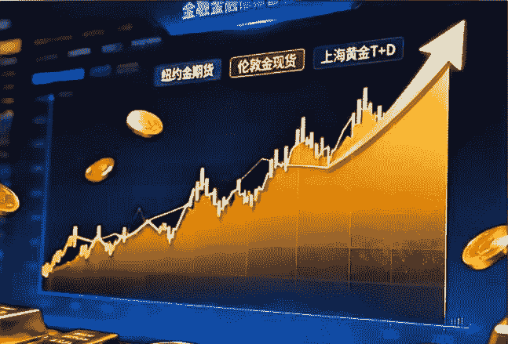
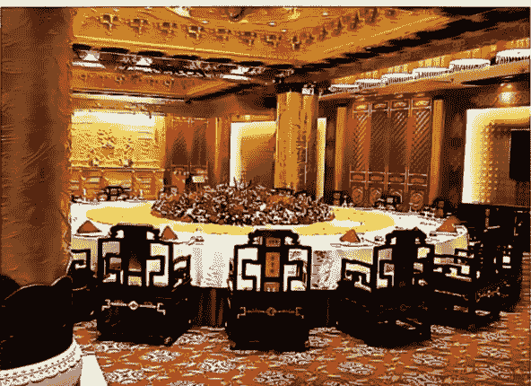
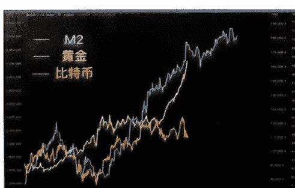
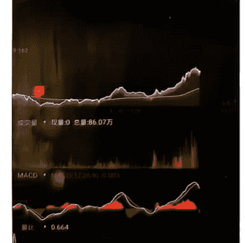

# 黄金、要不要买？
10月上海线下读者下载活动系列（五）

黄金热再起，是跟风还是布局？来自子明演说课线下会员的真实反馈，揭开了“买金”背后的逻辑转折与认知升级。

10月17日，伦敦金现货价格收盘中最高升至4380.79美元/盎司，创历史新高。国际黄金期货期货价格也触及新高，纽约商品交易所（COMEX）黄金期货主力12月份合约价格盘中高升至4392美元/盎司。

近期黄金价格一路上涨的趋势引发了新轮的投资热潮，黄金到底能不能买？上海线下读者活动系列（五）就大家一起聊聊黄金，从变量的底层逻辑看懂黄金行情趋势。

深度视野文集cuk255 有温度高质量社群cuk255

## 10月21日 9:21

顾老师线下讲课的黄金，真的很好用，我回来的路上买了100万，初步收益就已经很可观了。

场内和场外都买了一点。场内还在礼拜抛掉了一部分，礼拜又接回来了一部分。场外的本来想礼拜买的，结果换了新的手机，可惜恨银行登不上了。

在此之前，各种经济学家的黄金这个逻辑我都不太能接受，实际上去年10月份份一个首席经济学家在上海说黄金要涨，我都没买。但是今年听到了顾老师说的黄金，我完全接受这个逻辑。

并且我觉得顾老师那天讲的最大的亮点，第一个，给我们讲清楚了几中全会的意义在哪里。第二个，黄金为什么能涨？还有前几年为什么不涨的原因。第三个，中美之间肯定会妥协。

> 黄金的那个，是2023年西安的一场线下活动的时候说的。子明

深度视野文集cuk255 有温度高质量社群cuk255

那个时候我还不是会员，如果那个时候我参加了会员活动，我会买500万。

我这刚好有一张活动的现场图。

> 嗯，现场就有人买了。
子明

23年买500万，我都不敢想，现在至少该赔250万了。

这里地方这么金碧辉煌啊？

> 就在金店里面呀。
子明

深度视野文集cuk255 有温度高质量社群cuk255

线下那天的前一天，我是跟他们聚的。那搞黄金的哥们们现场每个人送了一个手链和发誓。

子明

听完这次的课，彻底逻辑说服了我，我在回来的火车上就在银行里面找到了这个基金。

那专家的逻辑和明的逻辑有什么出入吗？

首席专家讲黄金，他只是说美元元不行啦，大家都在争取黄金，因为黄金是有共识的等这些话题。他们弄了一堆PPT在那里讲了2个小时，我就没听明白，这些风险也有去年、前年有，为什么就今年，而且黄金已经涨了，真的看不懂。但是顾老师讲了这个黄金价格做了上限差。那我就明白了，黄金既然只会往上跑，不会往下跑，这种资产就是零风险资产，那还不不拼命。

顾老师讲黄金当中还有一个专家多的内容，是结合了时局。之前我一直不理解，如果黄金是一个避险风险的资产，那为什么前几年黄金没涨呢？这两年的经济也没比前几年差吧，因为什么黄金涨成这样呢？

深度视文社cuk255 有温度高质量社群cuk255

顾老师提到了一个俄罗斯抛售黄金的概念。那么现在在黄金的价格当中，就会有一个模糊变量，黄金的真实的价格。如果从拜登开始放水的话，黄金到底应该是什么价，到底是6000美金？如果是这个价格，那黄金并不高。

如果你不考虑到俄罗斯当时抛售黄金的因素在里面的话，那黄金的上涨幅度纯粹按照美元放水，它应该很大的上涨空间。这也是为什么会说，如果是23年我听了顾老师这段话，我肯定买500万黄金。这里面亏的可能性太小，一定能挣。

现在这个黄金趋势来看，真的是能收益。

深度视野文集cuk255 有温度高质量社群

## 2023年10月24日 补充更新

连续两日的深度对话，我们都在和大家聊黄金。从黄金价格上涨的底层逻辑到世界格局对黄金行情的影响。作为优质的资产投入方向，跟住节奏、布局黄金投资的读者确实收获了可观的收益。

## 延伸阅读2023年2月黄金期货结算价收跌0.8%，连续四个日下跌，报1826.8美元/盎司，创2022年12月30日以来最低。

进入3日后，国际金价一路震荡上扬，3月20日，黄金站上2000美元/盎司，突破自2022年3月以来重要关口。此后，黄金市场经历了显著上涨，价格屡创新高。

来源：每日经济新闻

## 10月23日 14:48

10月21日，国际现货金价下跌5.3%至每盎司4123.85美元，盘中一度暴跌6.3%，创下近12年来最大单日跌幅。10月22日，现货黄金再度重锤，最低跌8.01%触及4005.01美元/盎司。

我们收到了很多读者的留言：被困住了。黄金为什么会在短时间内下跌？未来黄金还能不能布局和继续持有？

带着这些问题，今天我们继续为大家剖析黄金市场的动态，厘清其中的脉络，为后续决策提供参考方向。

> 黄金这两天有点下跌了，但是听了顾老师的线下分享，现在根本不慌。

深度视野文集cuk255 有温度高质量社群cuk255

 下一步准备：机会继续买，适度买卖。

黄金估计还是会继续涨的，俄乌还没结束，只是不会像之前那样疯涨了。俄乌马上要停火了。
