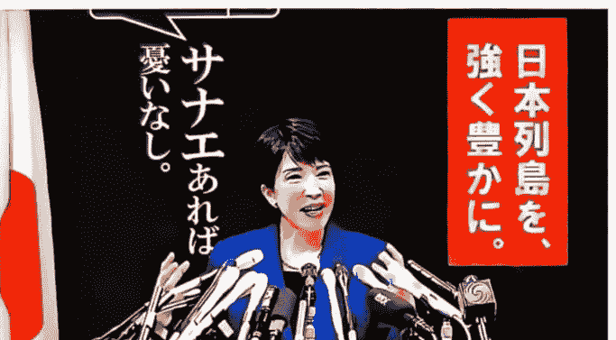

# 高市早苗当选的对华态度

发布专栏：知几共话

权宜视雾，还是日本右转前的最后一丝缓缓冲？

2025年10月21日，在日本参议院首相提名选举第二轮投票中，自民党总裁高市早苗获得125票，在投票中胜出，当选日本第104任首相，也是日本历史上首位女首相。日本自民党和维新会联合政权正式成立。

深度视野文集cuk255 有温度高质社群cuk255

# 高市早苗当选日本首相后，其对华强硬的表态越缓和，这种状态会维持吗？她执政期间日本的对华常态又会怎样的呢？

11月21日 13:01

高市早苗当选之路一路三折的。最后等于是拉了一个小党派圈闹成功了。

右翼大联盟。

大阪Yakuza梯子。

备注：Yakuza译为雅库扎，为日本黑帮组织。

高市早苗台上对华会会有什么策略？我看她最近释放了不少友好的信号。梅洛洛和米莱也是右翼上台，但上台反而还不了。

维新会是极右翼，钓鱼京找事儿呗，好消息是竹领域也会找事儿。

深度视野文集cuk255 有温度高质社群cuk255

编者：竹岛和独岛是同一组屿的日/韩不同称，目前由韩国实际控制，但日本也主张对其主权。

我记得维新会是那个搞大阪设的。自民国不怕自己的选民被右翼吸走吗？

编者：大阪设都是维新会一个持续多年的政治提议和构想，核心内容是将日本的国家行政中枢功能从东京部分或全部迁移到大阪。维新会的前身为“大阪维新会”。

> 我觉得迟早了。

子明

这么看来，中日韩是不能利用懂王期期间搞自由自贸协定了，这个窗口又白白浪费了。

等候王下去了我们或许还有机会，到那时亚亚洲我们说了也是算的，现在已经是战略相持阶段中后期了，贸易他们赢不了了，这一点现在就连我们的敌人也不怀疑了。

深度视野文集cuk255 有温度高质社群cuk255

高市早苗所释放的友好信号可能只是暂时的烟雾弹，当选之前的“强硬”作风或许才是执政时期的常态。我们需要警惕我们的邻居，也需要抓住宝贵的机会拉挑每一朋友。

# 2025年10月28日 补充更新

10月27日 13:23

子明

联合执政，后者更强调“修宪”、美日关系“对等等等美日之间“相互防御”的理想，使得美日同盟可能会变得越靠松散，不可靠和无效。
来源：央视新闻

罕见！特将与日本首相“共乘”专机

这不是睁眼睡觉吗？高市和特朗普的基本盘一致的一致，美日同盟会更加加固，而不是松散。进群加微信pep854

最近在日本在清理中国人，各种移民被拉限制。

深度视野文集cuk255 有温度高质社群cuk255

编者注：8月26日凌晨，日本入境在留管理厅发布公告，经营管理签证原本只需要500万日元的注册资本，未来将直接涨到3000万日元（约人民币140万元），且需要雇佣正式员工，并拥有硕士学历或者三年以上经营经验。

日本官方明确指出，此次政策调整是为了击打“偏离制度初衷”的申请行为，尤其是中国人通过成立空航空公司、虚假雇佣等手段获取签证的情况。数据显示，过去几年经营管理签证持有者中超过一半是中国人，但部分公司存在无实际经营、无纳税记录等问题。

— END —

# 深度视野优质集团（链接优质社群，助你成功）

全部包含以下内容：限时年费188/年 加微信cuk255

- ① 吃瓜群众包圈加微信时群对话（原价365 元/年）
- ② 子明私享汇（含）内部文章
- ③ 政事室（顾子明）付费内容加送顾子明群
- ④ 米联储闲直【作者米穗】（原价599 元/年）
- ⑤ 欧洲金雀会员专属文章（原价328 元/年）
- ⑥ 砖瓦斥内部文档（原价400 元/年）
- ⑦ 卢克文青读书会专属文章（原价699 元/年）
- ⑧ 鉴茶财经知识星球（原价3310 元/年）
- ⑨ 猫哥的视界知识星球文章（原价299 元/年）
- ⑩ 财新周【独家新闻】（原价1498 元/年）
- 十一 杨世光在金钱坝（原价2200 元/年）
- ⑫ 蒜森财经星球（原价1600 元/年）
- ⑬ 潇游异译付费文章（持续更新）
- 十四 司马林解课全套音频和全套书籍版无删减（原价2.3 万）
- 十五 虚构三部[民国梦、帝国战争、不被理解的MAO]（原价599 元/年）
- 十六 卢克再送：星球文章（原价268 元/年）
- 十七额外再送：卢薛元新浪付费专栏、三村丰老王、三花九洞文集

不定期内容……（更多资源将不下去了）

- 守夜人知识星球、接魂魔王知识星球、成跃谈论星球、成后财富、雪花枫头等
- A视野、大树乡谈、江宁、泮咩、财上海家学等付费文集
- 西风付费文章、老端、赢在八小时之外、外局人的视野、升值、老体制内等一些V付费文章（每月不超过600元的付费文集）
