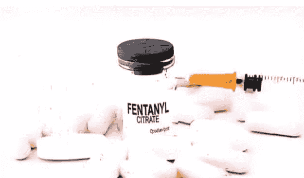
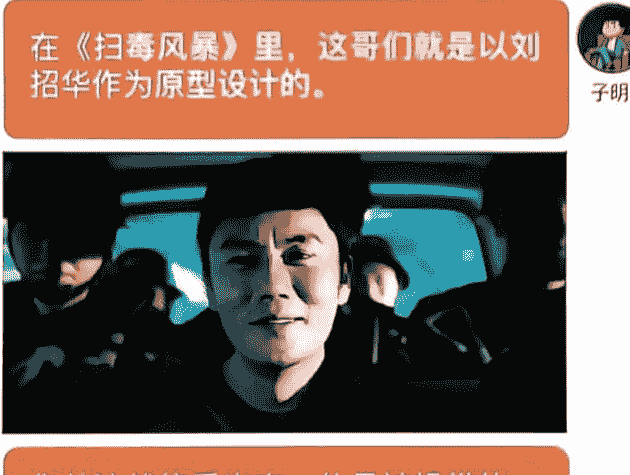

# 毒罂换关税

发布专栏 知几共话

每一只妖怪都有神仙交付的、必须完成的使命。

2025年10月24日，墨西哥正式将张志东移交给美国当局。他此前因嫌贩卖芬太尼毒品和洗钱被美国警方通缉，并被墨西哥警方逮捕，后逸脱，又被古巴警方逮捕并移交墨西哥政府。他被认为是私卖芬太尼起吨，美方将其称为“芬太尼之王”。

2025年10月30日，中美元首在韩国釜山举行会晤，会后，美方宣布，取消对华加征所得的10%芬太尼关税，并暂停实施出口管制一年。

在早些时候，子明曾判断，“芬太尼关税”并不是容易拿下的谈判内容，除非我们拿出特定的交换筹码。而在美元首会晤之前，子明又预测“将出现超预期的中美元首会晤与制裁取消”。

历史，有时候这就是玄妙，明天APEC上将出现超预期的中美元首会晤与制裁取消，而推动这历史车轮前进的，也可能一群无名之辈。

这种预期的转变是因为什么呢？难道我们真的付出了重要的“里子”？

回头来看，对于毒品管控如此严格的中国，为什么美国会死咬着“我们出口芬太尼”的态？毒贩的移交与关税的下调何惊人地同步？这中有怎样的暗线和伏笔呢？

10月20日 21:48

月底之前，我们能像图里说的，达成这么乐观的结果吗？

- 转发后小作文：可以提前宣布月亮东西大会的成果了...
1. 美国取消20%的芬太尼关税。
2. 中国开始对美国加大大禁。
3. 美国取消围南海委员会的所有制裁。
4. 中国继续维持持有的稀土供应。

> 不会，来不及及谈那么多。其中有几个可能，譬如大采购和稀土。

这不都是我们在让步吗？那咱们能得到什么呀？

> 中方对应的条款很多，譬如波音采购类的。

> 双方见面就是个停战，恢复到马德里，中方开个豆，美方开个哑。

> 芬太尼关税是核心条款，中方必须有足够的交易筹码来换，这个落地了，意味着看着其他的都该好了。

芬太这么重要啊，那这次能有结果吗？

> 我不信，如果谈好，那可就是中美一起演骗全球了。

为什么芬太尼会是核心条款呢？没想等到它在这轮贸易战中所占的比重这么高，感觉技术“卡脖子”这一系列的其他制裁可能更重要啊。

群里做外贸的朋友，先来说一下这20%关税对利润和市场份额的影响？

给大家举个例子，有家国国际物流公司，因为中美贸易摩擦，美线业务腰斩，今年的整体预算只能完成不到70%，其中一个大客户shein，美线快递业务从高峰的500吨/天，一路跌到200、100、50，最后几乎归零。间接带来的车辆、仓库、飞机、人员闲置都是无法计算的。疫情期间购买飞机的，更是头大，我举的例子还是国际物流的头部企业，毋论下面分类的，大家可以参考一下关税带来的这个损失有多大。

嗯，20%的关税确实是影响巨大的，但是我们不可以同意买大豆吗？

回到德里时刻，双方基本对等，让20%的关税，可是买点大豆就能解决的。

两个部分，一方面是20%的关税，另一方面，反过来，道光朕徐为视为烟烟呢？

二十中美达成上一次贸易协定的时候，双方的一个契机就是中国停止制造美元，停止了假美钞的印刷，世界上起了中国反美集团的规模。同样，订单亏了利益的出口，本质上也是反美利益集团的渠道、其中建立的层次的利益集团、外交交换，都需要妥协，这个对我们艰难的。

类似于当初大清要求英国出口鸦片，英国也能接受，印度的农场主怎么办？贸易的东印度公司，在中国收买的官员和买卖怎么办？除非大清能给出一个更好的贸易协议，能够弥补止鸦片的损失。

所以一旦谈到这个问题，意味着进入最后的谈判了。除非中美真的准备联手欺骗世界，否则芬太尼没那么快。

听您说英国对大清的案例，怎么有种我们现在要去搞开人的国家的感觉？本质上，是我方需要承诺消灭一个巨大的反美利益集团。

类似于要干掉方最强的游击。稀土和大豆，都是可以卖，明年不卖；芬太尼类似于东莞黄，太子没了，以后就是别人的生意了。

所以，这个问题必须是要大家读好了。

在《扫毒风暴》里，这哥们就是以刘招作为原型设计的。你就能看出他，他是被操纵的。不卖给中国人不是不想，而是上面不允许。

我的毒品不给国内消费，只给外国人消费。人家究竟用鸦片打井中国的人，我应该可以用鸦片打井并且他们的人。

同样的，为啥芬太尼在中国几乎看不不到？要是达成了芬太尼协定，我们搞不好还要交出一个刘招华。

当年的刘招华，编者注：刘招华，曾是武警，后堕落为震惊世界的“技术毒瘤”，利用化学知识研发冰毒合成，生产规模巨大，纯度高，世界顶级。2007年，刘招华因制造、运输、贩卖毒品被判死刑。因为2004年泽东上任部长，中美开始贸易谈判，2005年谈妥了，除了对中国的出口限制。嗯，2005年布什也访华了。

包括电影《无双》，讲的这也是事儿，男主角其实就是被国家出卖了。酷逸刘招华一样，都是05年的背景。把香港的立法委员会渗透大陆，用加拿大警察影响美国。这是真的被讲明白了。每一次中美大和解，都是要干掉一批黑产的。

99年的WTO。朱总1999年4月访美，同月，中央收到赖郭的举报信，当年9月，厦门特大走私案被中央领导直接列为大案。11月10日到15日，我们的代表团和美国代表团进行谈判。两军对垒，不就是这样吗？

刘招华既然是工具，当时是被真死刑，还是让他假死换身份匿于民间？必然死。知道太多，不能活着。

这么看下来，芬太尼事实重大，不是要到中期选举之后才能谈了？估计也不会那么晚，毕竟20%的关税，每一天都是钱啊。

我们还是可以把北京视为美国，地方视为中国，斗争结束结束后，除非我们胜，否则徐肯定是要死的。

工具人不好当啊。10天之前，子明一句“要是达成芬太尼协定，我们搞不好还要交出去一个刘招华”，几天后，Brother Wang (张志东) 便被速逮捕，随后，在APEC正式开幕之前，美方降低了芬太尼税。一切在冥冥之中中早已埋下伏笔。阴影中的争夺永远不能被拿到阳光之下，但也正如子明所言“推动历史车轮前进的，也可能是一群无名之葬”。

— END —

相关阅读：
【子明解读】公众号《华裔绝绝命毒师的终结》
