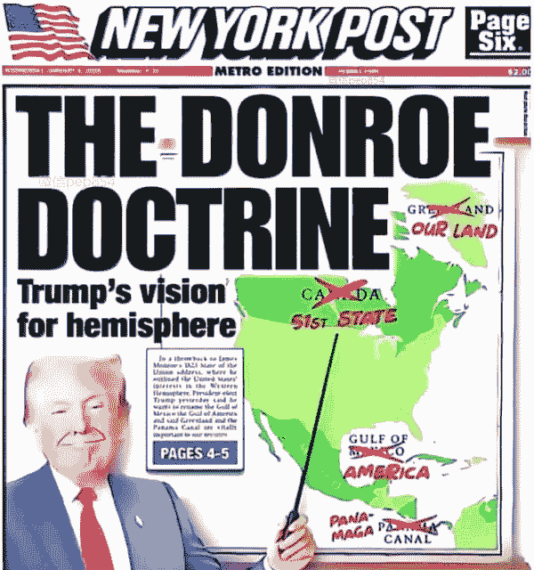

# 博裕回归后的博弈

发布时间：2025年11月5日

2020年，145期间，伴随着马某人在外滩的炮袭，孙子的博裕也躲到了新加坡；
2025年，155期间，伴随着马某人重回大会堂，孙子的博裕也开启了大规模的扩张。

爷爷搞的J派，放在全球视角，属于标准的保守党，而他爷爷本人又是个技术加速派，巧妙了，意识形态跟Trump目前执政团高度冲突，参考游戏Victory 3的设定，政府内阁意识形态相近的国家搞外交才有成功率高，这就使得老板想要跟美国谈判成功，就必须要把这个有着浓厚“反美”色彩的政党纳入内阁。

而另一方面，跟特朗普曾任主导的罗马主义2.0类似，J派的意识形态中有浓厚的东亚主义，跟韩以及东南亚地区的家族有着极其亲密的友谊，跟台湾是有着其遥远而隐秘的友谊。

# 延伸阅读

## 美媒：特朗普曾将“门罗主义2.0”推向全球
来源：参考消息2025年4月11日

门罗主义（Monroe Doctrine）由美国总统詹姆斯·门罗于1823年首次提出，旨在阻止欧洲国家干涉美国事务。其前提很简单：西半球是美国的势力范围。

特朗普2018年在联合国演讲中首次提及门罗主义，“自门罗主义确立以来，美国的正式外交政策就是拒绝外国干涉西半球。“如今在它的第二个任期，他从旁观转该谈转向实践。在它的领导下，这一念将得到重新诠释，拓展和积极推行——不仅限于美洲地区。”

## 唐罗主义 Monroe Doctrine

来源：文字、图片整理自网络
《纽约时报》曾用唐纳纳德·特朗普和门罗之名，以“唐罗主义”（Trump Doctrine）概括特朗普政府的西半球政策。

特朗普曾明确提出把加拿大变为美国第51个州，想吞并格陵林岛和巴拿马运河，要把墨西哥湾更名为“美国湾”。

相关阅读

- 时见【局局洞见】专栏：《星巴克竞争夺战背后的大佬》（2025年11月4日更新）
- 【子明智解读】公众号：《收购星巴克的神秘资本》（2025年11月4日更新）

# 深度视野优质集团（链接优质社群，助你成功）

全部包含以下内容：限时年费188/年 

- ① 吃瓜群众倍时圈加时群群对话（原价 365 元/年）
- ② 子明私享汇（会）内部文章
- ③ 政事室（顾明友）付费内容再送顾明群群
- ④ 米联诸闲【作者米穗】（原价 599 元/年）
- ⑤ 欧洲金雀会员专属文章（原价 328 元/年）
- ⑥ 砖瓦斥内部文档（原价 400 元/年）
- ⑦ 卢克青读书会专属文章（原价 699 元/年）
- ⑧ 鉴茶财经知识星球（原价 3310 元/年）
- ⑨ 猫哥的视界知识星球文章（原价 299 元/年）
- 10 财新周刊【独家新闻】（原价 1498 元/年）
- 11 杨世光在金钱榜（原价 2200 元/年）
- 12 森淼财经知识星球（持续更新）
- 13 潇潇异译付费文章（持续更新）
- 14 司马林解读课全套音频和全套书籍收藏版无删减（原价 2.3 万）
- 15 虚构三部曲[民国梦、帝国争霸、不被理解的 Mao]（原价 599 元）
- 16 卢克知识星球文章（原价 268 元/年）
- 17 额外再送：卢祺元新浪微博播付费专栏、三村丰老王、三花九树文集

不定内容：......（更多资源不写下了）......

- ① 守夜人司令星球、接换魔王知识星球、成达谈论星球、成术财富、雪球花甲老头等
- ② 创始笔记、达叔谈论星球、成术财富
- ③ A 视野、大树乡谈、江初优势、咩许多说、财上海家学等付费文集
- ④ 西凤付费文章、老端、赢在小时之外、局外人的视界、升值、老A体制内等一些 V 付费文章（每月不超过 600 元的付费文章）
