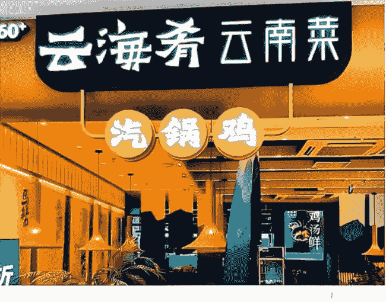

# 餐饮业的大势所需

发布专栏 知几共话

发展像是一枚硬币，一面刻着效率，一面刻着残酷。

2025年9月19日，云海青创人之一、CEO朱海海发布微博，证实云海青创人赵晗离世的消息。

赵晗出生于1985年7月，云南昆明人，中国大学学院首届毕业生。他一生致力于传承云南美食文化，推动云南食材产业发展，曾获“兴滇人才奖”等诸多荣誉。

疫情后，传统餐饮业面临的压力与日俱增，这种压力摧毁了赵铭。而作为行业革新先锋之一的西汐，其推崇的“现代餐饮”模式却未获得市场和消费者的认可。

此时，再次回望我们两个月前的讨论，我们不禁要问，餐饮业未来的道路究竟在何方？这背后是否隐藏着某种历史规律？如果效率确实是未来，我们是否做好了接受的准备？

## 01 云海看

9月19日 13:36

> 我的师兄赵铭去世了。这个病应该是累出来的，餐饮业这些年压力很大。

> 刚看到了新闻，再联系到自己和身边很多创业者这么多年的近况，不禁感慨，这个时代就是这样，无所谓对错。我们从小到大的教育都是要承担、要负责、要奉献，于是只能不断透支自己，去扛起那些超出身体极限的压力。

餐饮这种劳动密集型的产业，不太适合你们这种资本密集型来搞。

基础首要考虑的是如何规模化、标准化、降低成本。靠廉价劳动力和非标产品出来的生意，很多到最后是没法持续的。

之前在学校社团一起逛过山，感觉他身体应该没问题，估计还是这几年压力太大了。

心理压力、信念丧失、权力丧失等这些因素，都会出现很严重的身体衰退。

搞餐饮的都是有理想的。

搞特色餐饮的，肯定都是有理想的。

啧，他这个人就是很有理想的，当时和海朱琴几个同学一起做，慢慢进了商场，做的很好。最早最早是拿家里给的买房钱开餐厅，压力可想而知，后面慢慢起来了。

感觉国企更适合搞餐饮，广州酒家就是国企，也能招揽到厉害的师傅，安心做菜。

听你们这么一说，餐饮创业的创业的那团熊烈火就熄灭了。

嗯，个人去餐饮，压力确实太大了。别说国企，各地机关和国宾馆这类国营饭店，其实都做得挺稳，菜品也扎实，厨师还有编制。

> 有一些城市的餐饮娱乐是社会大哥洗钱用的，这种一般都会走相式的，比如如烧烤这种技术含量低的一些。

我认为餐饮属于泛农业，农产品的价格波动真不是一般能接受的，参考今年的荔枝、晴王葡萄。

上游是农资，下游是房东，有的饭店愿意用预制菜，也是因为预制菜价格相对稳定，抗风险。

## 02 工业化餐饮

9月19日 13:55

京东七鲜小厨这种感觉不错，一种新的餐饮合作模式。

但与平台合作，第一要赌平台能赢，有订单；第二要赌平台有良心，以后不会改分成。对于京东来说，这是非核心业务，两个赌中太难了。

我持乐观的态度，京东东强亲自代言下场，抱着背靠大平台改善外卖品质（主要是卫生问题和食材健康）甚至改变餐饮方式（平台和餐饮机器提供便利便宜的餐饮熟食）的目标。资本强势加入，会加速低端、不良餐饮退出这个市场。在七鲜小厨之后，还会扩展京东等等……

七鲜小厨是历史发展的方向，就是工业化。

本质上是把大量的自耕农产业，变成工业产业，这一块的影响非常之大。

农食住行，近代工业革命的开端，就是“衣”的，“珍”的珍妮纺织机，两次工业革命的开端都是“行”，是蒸汽的船和内燃机的车。

下一次工业革命，最容易崩溃的就是“食”和“行”了。

是的，在餐饮行业，京东七鲜小厨和七鲜咖啡并不是一种先进生产力（餐饮机器人、餐饮和城市消费大数据）和生产关系（大资本、门店+高效平台管理，固定且客观的分割模式）对传统低端生产力和生产关系的碾压呢？

食品，包括蛋白、肉类都工业化后，接下来就是餐饮工业化。

每一次崩溃都会带来产业的大洗牌，大量的自耕农失业。

## 餐饮不是早就工业化了吗？七鲜小厨没出来之前就进入了半智能化轨道了。

餐饮距离工业化太远了。它还是工业化程度最低的行业之一。

现在的餐饮业还需要农业和养殖业，即便是你所说的“半智能化”也是“中央厨房”模式下的一种延展。

中央厨房，只是工业化的第一步，接下来还要流水线。

第一次工业革命的标志之一是工厂的建立，第二次工业革命的标志之一是流水线的建立。餐饮现在连工厂还没开始。

五年前碧桂园的机器人餐厅，当时很震惊各种餐饮机器人，以为智能化很快到来。其实这还不是智能化就能智能化的。时机很关键，要看外部大环境和上面的意志力，等到条件成熟，更优质的资本介入，时机就来了。

> 未来肯定还有数据化，炒菜机器人要根据每个人的口味优化菜品。

## 03 发展的反思

9月19日 14:55

你们追求的是一个没有例外的世界。如果真有那一天，中国的饮食文化完全不一样，那是很悲哀的。饮食文化本身就是多元化的，七鲜小厨这种模式只能解决下限问题，无法拓展上限。这种文化会以爱好的形式保存下来，比如地域文化和游牧文化。

其实很多科幻电影里都有工业化的幻想，比如标准化食物，世界可以没有标准化食物，难道也可以吗？

> 时代是进步的，传统都会慢慢地跟上时代。君子亦，礼被服取代、乐被摆脱、枪被汽车取代、简体被数字、数据被取代。

这样发展下去的意义是什么？随着生产力进步，个体的影响不断减弱。

> 发展的话，在熵面前，人类会毁灭。但今天的发展方向，似乎注定是缺乏温情的，人类是不是该反思一下。

> 人类的发展，最终走向基础，可能真的没有温情。生产力决定生产关系，会有新的“概念”诞生。

资本主义社会，生产就是围绕增值进行的。这才是百年未有的变局。

> 只看不见的大手驱动。上一次百年大变局，大部分人是不接受的，生产力发展了，生产关系就会调整。

> “谁会坐着铁盒子？”

未来世界，会是毁灭的，但我们不会是。

编注：分别为《地球》和《西部世界》中的角色。

如果是这样，天天盯着就业率就没有意义了，真要完全追求效率，现在不需要那么多劳动力了。我前几天讨论过，当下就业问题就是无解的事，现在都进入失业旋涡，失业一人，都是一个数字，谁也挡不住。

我的观点很明确，一直没有变过，就是需要加强就业保障之类的限制和监管。或许行业也是个不错的选择，也能解决很多就业问题。这一轮新能源革命，直接让汽车行业了，上一轮电气化革命让电子制造了，上一轮90年代，是互联网。

农食住行这些与信息相关的事物，将被新质生产力裹着迈下一个时代。“食”已经落后于其他产业，让我们在这个时代被加速淘汰。

然而发展的洪流中，我们或许失去一些“人文”，产生诸如就业在种种问题。但历史不会倒车，没有人能回头，最终要发展的方式，解决发展的问题。

— END —

相关阅读：

- 【知几共话】专栏
- 《无可避免的失业潮》（2025年9月29日更新）
- 《西贝模式与市场的错位》（2025年9月16日更新）
- 《西贝的错误战争》（2025年9月15日更新）

# 大哥文集 VIP 群（原价300，限时年费249）包括以下全部内容：

大哥dai2021 大哥文集 VIP 群简介

- 吃瓜群众私享会实时图文实时群聊天（原价365 元/年）
- 子明私享会内部文章（原价568 元/年）
- 政事堂（顾子明）付内容后再送顾子明深度
- 米联储见闻【作者米楷】（原价599 元/年）
- 欧洲金雀会员专属文章（原价328 元/年）
- 砖瓦厂内部文章（原价400 元/年）
- 卢文青读书专属文章（原价699 元/年）
- 茶茶财经知识星球（原价3310 元/年）
- 猫哥的视界知识星球文章（原价299 元/年）
- 财新周刊【独家新闻】（原价1498 元/年）
- 杨世光在金榜（原价2200 元/年）
- 森森财经知识星球（原价1600 元/年）
- 濑泽异谈付费文章（持续更新）
- 司马南猛选全套音频和全书收藏版无删减（原价2.3 万）
- 虚彦三部曲（民国史、帝国统治、不被理解的MAO）（原价599 元）
- 卢文知识星球文章（原价268 元/年）
- 额外付费：户银新浪博专栏、三花九树文集等（更多资源不写下了……）
