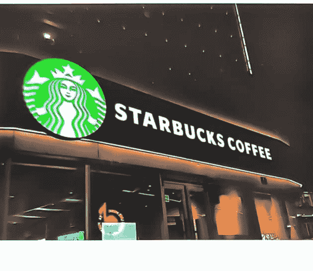

# 收购星巴克释放的信号
发布专栏 知几共语

2025年11月4日，星巴克官方发布公告，宣布将其中国业务的60%股权，以40亿美元出售给博裕资本，双方将共同成立合资企业。

位于雅典的星巴克全球总部将保留中国业务40%股权，并继续作为品牌与知识产权的持有者。这一交易，预计将于星巴克2026财年第二季度前完成。

值得注意的是，星巴克的收购仅发生在中美元首会后的第二周，背后的面孔博裕资本也让人眼前一亮，送此一切，究竟在释放怎样的信号？星巴克本身身有着怎样的财务和战略价值？

11月4日 11:32

星巴克和博裕资本成立合资企业，这就相当于咱们把星巴克中国的业务给拿到了。

> 大概率是替马云买的，然后整合到阿里。

子明

所以这个博裕资本算是白手套？

应该是白手套的白手套吧……递延式白白手套。

星巴克是准备加入瑞幸、库迪们的竞争了？

应该不能，价格下去的，最多碰一下茶雪、奈雪的蛋糕，横向发展。

肯定不能自降身份成瑞幸和库迪他们一个价位，要不然档次和逼格就没有了，这是星巴克的核心。

本来现在也没降格吧，我个人去星巴克主要是为了座位谈事情，如果人太多了就得换地方了。

所以就是感觉有点奇怪，想问一下明白，星巴克既不属于科技，也不属于能源，它有什么不得的价值吗？值得两大势力如此争夺？

上海那个亚洲最大的星巴克工厂，体验还是有点不一样的。

我认为我是IP钱，之前被其他同行打爆的一部分原因是横向产品线有点崩坏了。

打个比，如果马上能推出等于喜茶、奈雪的茶产品，估计马上也能重新扩张，毕竟星爸爸的小资IP还是立得很死的。

这是纯粹从财务角度考虑的吧？

大量的星巴克门店本身，也是很好的终端，摆在星巴里的水都是高端的。如果有想做策略整合的话，那它的价值确实提高。

不过短期内应该还是从纯财务的角度考虑的，小J一定愿意做这样的产业操作。

一般人这么操作可以理解，但是这种顶级的优势下场，总感觉并不会学会从财务去考虑问题。

# 难道是预判消费重新升级？

千里之行始于足下吧，看看后续会有什么动作。如果真有产业整合的打算，后续应该还会收购其他标。

嗯，如果还有动作，而且大手笔的产业整合，那真就有大棋的味道了，这些人的举动，往往不会简单。

> 重回2015了，如果不是2020年反噬，星巴克早就被收下了。

明白，顺着这个思路往下走，后续收费是不是有机会？

> 噫，是的。但看起来是高端消费，小J买的都是费的。

我前阵子看段永平、张坤都在继续加仓茅台，最近这星巴克又被两家抢，我就在想，高端消费是不是又要起来了。

对呀，我当时也是想在这个事，所以才问。个人觉得这块资产并不稀缺啊，值得大佬这么出手吗？

> 我2021年是强烈看空徕台的，不过现在看空了，但也没有看涨。

子明

星巴克不是卖水的生意吗？大佬都喜欢这类现金流，和可口可乐、农夫山泉、雀巢咖啡没本质区别。

前面是消费门，后面是消费品，还是有点区别的，后者不容易倒闭，但前者容易。即时餐饮的市场变化速度，比传统消费品快多了。

也对，我确实没考虑门店这个因素。

茅台的本质是老登们的消费升级。

不是因为15年狂飙的房产吗？

通过房地产赚钱的可不就是中老登吗？目前前一轮的消费升级就要靠新登了。

注②杨致远：美籍华人企业家，雅虎集团联合创始人之一。

高端的棋术小子，总会有更宏观的考量，本次星巴克的收购显然不只一桩商业交易。它或许意味着，我们正重新回到2015年那个周期，也将重新走上那条被阻断的，科技赋能消费的发展道路。

— END —

相关阅读：
【子明解读】公众号
《收购星巴克的神秘资本》
（2025年11月4日更新）

# 时见【观局洞见】专栏

《星巴争战背后的的大佬》
（2025年11月4日更新）

《博裕回归背后的博弈》
(2025年11月5日更新）

# 深度视野VIP群
（此处为广告/推广信息，已合并处理）
