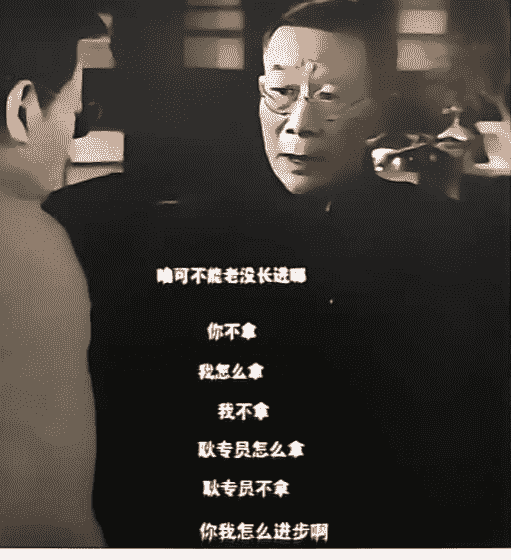

# 风向在变

发布时间：2025年11月11日

随着四中的胜利召开，十五五规划的推出，风向已经变化了，消失已久的红色勋奖励开始纷纷“扩表”甚至亮登场。

去年闰心腹作家伙被颇捕，今年孙子买下了星巴克；
去年根据地内蒙古震荡，今年儿子买下了汉堡王；
十年前被彻底清理的梅州，今年迎来了最尊贵的亲近。

随着特朗普的登场，和他孩子们的商业扩张，全球的天龙人都在随着他尽情的摆摇。

所以这里有两个问题：
- 特朗普真的是全靠红脖子上台的吗？
- 特朗普全球主要国家的关系真的那么糟么？

# 星巴克中国易主：博裕投资拿下60%股权 目标在华2万家店

来源：财联社 2025年11月4日

财联社11月4日讯，美东时间周一，星巴克官方表示，其将其中国业务的多数股权出售给了博裕投资，这标志着星巴克在中国市场持续转型的重要里程碑。

根据拟议，星巴克与博裕投资成立一家合资企业，负责在中国运营星巴克零售业务。博裕集团持有星巴克在中国零售业务中高达60%的股份。星巴克将保留资企业40%的股份，并继续拥有星巴克品牌和知识产权，并将授权给新实体。博裕集团将按40亿美元的企业价值（不计现金与债务）收购其股份。

# CPE源峰与汉堡王母公司RBI达成战略合作，为汉堡王增长注入新动能

来源：整理汉堡王官网 2025年11月10日

2025年11月10日，北京——CPE源峰与汉堡王品牌达成战略合作，该品牌由餐饮品牌国际集团（Restaurant Brands International, RBI）全资持有。双方将成立合资企业（“汉堡王中国”），开启汉堡王在中国市场的下一阶段增长。

CPE源将向汉堡中国注入3.5亿美元的初始资金，用于支持其餐厅门店扩张、市场营销、菜单创新以及运营能力提升，把握中国这一全球增长最快的消费市场。

在本次交易中，汉堡王全资关联企业签署了一份为期20年的主开发协议，该协议将授予在中国独家开发汉堡王品牌的权利。交易完成后，CPE源将持有汉堡中国约83%的股权，RBI将保留17%的股权。该笔交易预计将在2026年第一季度完成，具体时间依监管审批进程进展而定。

# 关于CPE源峰

CPE源峰是一家具有全球产业视野和中国投资经验的资产管理机构，旨在运用远光和价值投资策略，专注科技与工业、消费与健康、基础设施等三大重点领域的龙头企业提供创新性的解决方案。目前，CPE源峰在北京、上海、香港、东京、纽约及阿布扎比等地设立办公室，累计资产管理规模超过1500亿元。

---

# 相关阅读：

## 时见【周局洞见】专栏
- 《星巴克竞争夺坟背后的大佬》（2025年11月4日更新）
- 《博裕回归背后的博博弈》（2025年11月5日更新）

## 时见【知己共话】专栏
- 《收购星巴克释放的信号》（2025年11月7日更新）

## 【子明解读】公众号
- 《收购星巴克的神秘资本》（2025年11月4日更新）
- 《消费真能起来吗？》（2025年11月6日更新）

# 深度视野优质集团（链接优质社群，助你成功）

全部包含以下内容：限时年费188/年 加微信cuk255

- ① 吃瓜群众包帝微信加时群群对话（原价365 元/年）
- ② 子明私享
- ③ 政事室
- ④ 雪雪花
- ⑤ 欧洲金
- ⑥ 砖瓦仁
- ⑦ 卢克文书会
- ⑧ 鉴茶财经
- ⑨ 猫哥的视界
- ⑩ 财新周刊
- ⑪ 杨世光
- ⑫ 森淼财经
- ⑬ 潇泽异译
- ⑭ 司马林解课
- ⑮ 虚构三部曲
- ⑯ 卢克文星球
- ⑱ 额外再送：卢户元新浪微博获付费专栏、三村丰老王、三花九涯文集

不定期内容：......（更多资源下去了......

- 守夜人司令、接换魔王、达叔谈论、成后财富、雪花甲老头等
- 创始人笔记、A 视野、大树乡谈、江初俊、泮咩说、上海海家学等
- 西风、老端、赢在八小时之外、局外的视界、升值、老A体制内等其它一些 V 付费文章低于600 元的付费文集
