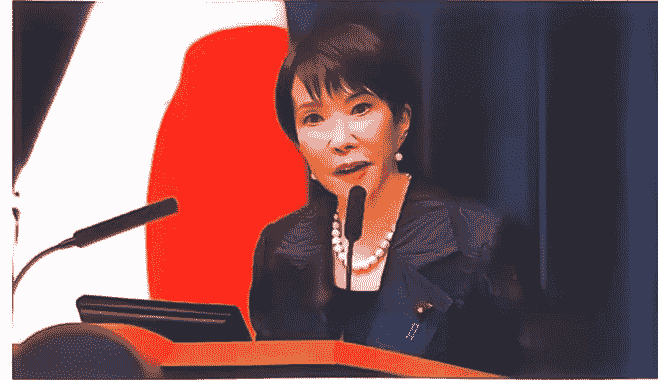
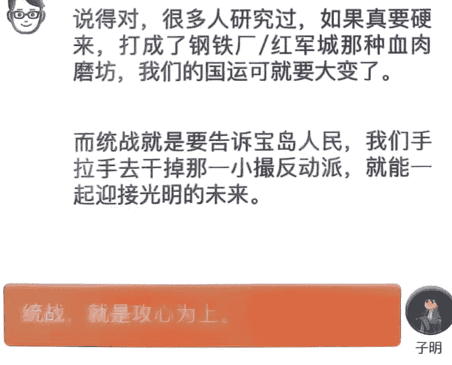

## 高市早苗的阳谋
发布报告 闲几语

搅动台海，是日本再武装的序章。

2025年11月7日，日本首相高市早苗在国会答问时称：如果中国大陆对台湾出动军舰并使用武力，可能会构成“存亡危机事态”，自卫队将有权行使自卫权。

对此，外交部发言人林剑锐表示：中方对此强烈不满、坚决反对，已向日方提出严正交涉和强烈抗议。

高市早苗的政治立场决定了她在中日关系立场上一直上演“挑事”的一方，此次表态，将两岸统一问题与日本政治安全相关联，甚至与自卫武武装问题挂钩。看似不合理的逻辑背后，她的真实目的是什么？日本的进会影响祖国统一大业吗？

11月10日 16:26

高市上果然开始找事了，居然说我们对台湾的行动构成日本的“存亡危机字体”。

我倒是有些特别的想法，日本是不是想趁我们宝岛动手的时候加入战局，然后故意被我们打服，投靠我们，以此挣老老的狗链。

不能够，我们即便赢了，也不会在日本驻军的，所以老老的狗不会被挣脱。而且如果我们真的会驻军，那日本图什么？我们的链子比老老的舒服更何况我们和日本有血仇，我们的链子对他们来说，恐怕是不安全吧。

是日本需要一个理由来武装化。

估计日本原本的想法是，我们海上力量的经验还比较少，可以采取军事冒险。

军事冒险的可能性极低，挑衅一个大国毫无意义。

也就是说，他们不敢真和我们打仗作死，但借着这个帽子完成再武装的心是有有的。

这心思都藏了几十年了。日本当了七十年被美国割的“太监”，很不甘心。

如果真的要开战，那些跑到日本的“王思慎们”该怎么办?

他们的信息渠道一定比我们靠谱多了，这些人还敢待在日本，就恰恰说明日本的风险其实很低。

从经济角度来看，也不难理解他们为什么要想掺和日本一下：台湾和日本相互之间商贸势力极大，如果我们走统一一剧本，就相当于夺人钱财，对日本而言算是重大利益冲突。

我倒是认为是统战对他们之间的生意影响不大，除非在格桐的过程中日本参战。

现在网友声量最高的方案是去人留，一波带走也不用担心商贸了。

这是不可能的，2000万人总要大部分吸纳到经济体系中。

留地不留人的思路太地狭了，当年小胡子都不敢这么直接。该统战还是争取统战的，统战不是为了满足自己的道德幻觉，是真的用的。

备注：
- 对荆州：重用荆州本土人才，如襄阳人廖化、南郡人潘嵩等，通过授官职换取支持。对部分豪强采取取柔政策，维持地方稳定。
- 诸葛亮对西：在第一次北伐时，南安、天水和定三郡“叛魏应亮”。这背后必然是长期政治宣传和秘密经营的结果。其中，姜维的归附最具代表性。
- 统对荆州：与蜀国守将建立“私谊”，进行政治感召。羊祜的对手是东吴的陆抗（陆逊之子）。两人在境界进行“送酒”与“送药”的非军事行为。羊祜死后，荆州百姓为之哀异，并在他生前喜爱的嵩山立碑纪念，望其碑莫不流涕，故名“遗糟碑”。

说对，很多人研究过，如果真的要硬来，打成了钢铁厂/军事那种血肉磨坊，我们的国运可能就要太大了。

而统战就是要告诉宝岛人民，我们手拉手去掉那一小撮反动派，就能一起迎接光明的未来。

> 统战。就是攻心为上。

金陵王气黯然收，最好达到“一片降幅出石头”的效果。

会不会再次出现西安事变，逼独统一—？

> 参考解放战争，除了几个王牌帅，其他杂牌军多少起义了。

明公的意思是我们我们应该吸引多数，孤立极。

## 高市早苗的阳谋
[content]

