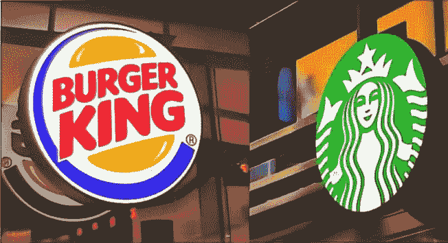

# 中资出海的本质

在这场局里，能上桌的，早已经不是算账的人，而是洗牌的人。

2025年11月10日，CPE源峰宣布与美国餐饮饮品牌汉堡王达成战略合作，双方将成立合资企业“汉堡王中国”。在此之前，星巴克也将中国业务多数股权出售给私募博裕资本。

在此前的文章中我们介绍了了两家公司幕后的推手——这个级别的投资公司所做的决策，必然不可能只考量经济因素。

## 那么，究竟是什么因素在驱使着这一轮的中资金出海呢？它的本质是中美分家还是资本联合呢？

11月12日 13:01

我看现在我们的很多国内资本都在海外买买买买，这个潮下我们到底是亏了还是赚了？

> 双缘。

像是甲骨文和TikTok一样吗？

> 不完全一样，但很大相似之处。

其实就是回溯到2015年的这个时候，我们是不是也在开始买买买。

这些“消费品牌”上去确实不如TT那那么优质。我觉得，或许只是因为下一个时代的水会流向消费领域，借此刺激经济，所以这些消费品牌才有机会回潮头吧。

海航飞机、万达买院线、苏宁买球团队、乐视转全权。那就是当年的华人资本买海外资产给海外送钱？

就是在送钱+润钱。80年代的日本也是如此。

那是在华人资本在中国的海外资产，继续给海外送钱？顺带让人民币出去。

对。

这就是你上次说的，新时代的贵人们为了一个项目搞city owner。

可以竞猜一下，中国对美国的投资协议需要几千亿？

6000亿美金左右吧。感觉万亿还是要有。

按照中美第一阶段协议是每年新增一千亿的货物采购，四年就是四千亿，加上第二阶段协议应该更多，所以从总数上，低于这个数字是不可能的。这样下去我们贸易逆差了。

那不会，需求就那么多，更大概率是恳别人的供给给美国。

普京现在提提急稳定石油天然气订单的。总理访华，重要的任务就是确保中国的订单和投资。

特朗普最近对中国的偏好有点真离像是刚签下2019第一阶段协议的时候的样子。

## 中美这看起来真像离分家啊。

消费品集中销售，现在至少有几十个外大品牌在寻求出售中国业务，PE的兄弟们告诉我，看都看不出来，以前不想的品牌，现在全都可以商。

- 出售中或刚完成的有：
- 哈根斯坦中国门店业务
- Costa Coffee中国
- Peet's Coffee中国
- 必胜客中国
- 迪卡侬中国部分股权
- 宜家业务
- 星巴克中国（已达成就协议）
- 汉堡王中国业务（已达成就协议）

8:48·2025/11/12·8.77 次查看

看看星巴和汉堡王的买家。这是普通PE能的东西吗？

江孙子、刘的儿子，现在能下场扫货的，那都不是一般背景，目的都是为了拿钱和拿资源扩张的。子明：这里很多品牌都是去了A类店铺，在房地经济（商业地产）上升中崛起，就是免租金补贴装修，地几乎随随便便，开一个牌一个。

现在房地产，尤其是商业地产，中国品牌崛起起来了，蜜雪、瑞幸带流量根本不输于这些品牌，没有人给他们免租了，他们也就扩不起来了。

## 这类企业会免税吗?

不是免税，而是地方运营方一般免一段时间的租金。

子明：如果你把王健林的万达广场当成是个线下的淘宝。麦当劳就是一个瑞幸咖啡。淘宝为了流量，补贴让瑞幸咖啡，万达广也会为流量、补贴让麦当劳。

以前这些品牌高级，自带流量效果，现在供求关系变了。

这些品牌想要在中国活下去就需要改进改造。

子明：现在都追求健康饮食了，麦当劳和汉堡王再想扩张确实难了，反而肯德基的本土化做得比较好。肯德基的本土化是做的最好的吧，老百姓零售需要什么就做什么。新奥良良烤翅是中国独特的，美国奥尔良的肯德基不卖这个。

子明：不是在商超综合体，一个品牌是要如果没有头部流量，根本经营不了，光租金也够，这算不算骗局？商超综合体，是靠产生额外效益，类似于戈兑说跟周润来。星巴克没有档次。

子明：星巴克90年代在大连的第一家位置应该是爱马仕的。现在呢？爱马仕。以后都要有一个座，取代过去的阳台，专门用来停机。

子明：子明，对于一个大总结来说，手把手教你如何持续稳定的钱。这种体量的钱能出去，也折值很高，何况本来就是一种战略绑定的动作，在这里一起干。嗯，战略绑定，行成你中有关系，才是避免被老板清洗的筹码。

子明：即使钱要出去，也不至于这么搞。几十亿美金，因为2015年之后那一波的润，已经打了补了。

去年根据地震，今年买了汉堡王重点不是儿子买买，而是前半句根据地震，所以才需要买。按照您的说法，就是已经过去的官僚，只能变成半官侠才能活下去。

子明：也就是说，这些属于被老板清洗的资产，从原有渠道退出。其实这也是一种机制，是帮幕后的老板把钱漏到海外去？

子明：他们自己有海外的需求。不管溢价多少倍都值得的，还能从银行借钱买。就当个古董，反正都是内保外货，直接美元出去。

子明：这和菲特投资一个路。以前不良资产公司也是这个逻辑。现在是新轮的机会，帮助企业把这些经验拿回美国，直接在美帝用干活。在中国养殖卷出来的，经验带回国。

子明：未来早晚都是来生产，冲咖啡这事交给机器人很复杂？支持无人机派外卖到阳台。以后房子都要有一个停机坪。

子明：无人机也不仅仅是送快递类的工具，还可能是座驾，现在四座的千多万，十年后说不定干到百万了。普通人还是地面上的，能飞也是一种特权。只要规模量产，这些东西都很便宜的，就是看航线不给你了。

当“买卖”不再只是商业行为，而是一场横跨资本、权力与地缘的暗流动。我们看到中资出海，表面是资本扩张，实则是身份转换。这不是简单的投资逻辑，而一场全球重组权力——旧体系退场，新秩序尚未定型，所有人都在资本为自己争取一张游戏的入场券。

所以，别问“亏不是赚”，在这场局里能上桌的，早已不是算账的人，而是洗牌的人。

—— END——

相关阅读：

- 【子明解读】公众号
《消费真能起来？》（2025年11月6日更新）
《中国秘密资本下一城》（2025年11月11日更新）
《赵公子们的扫货经》（2025年11月12日更新）

- 时见《观局洞见》专栏
《星巴战斗背后的大佬》（2025年1月4日更新）
《博裕背后的博弈》（2025年11月7日更新）
《风向在变》（2025年11月11日更新）
《天龙公子们的复出》（2025年11月12日更新）

- 时见【知已共话】专栏
《收购星巴克释放的信号》（2025年11月7日更新）

## 深度视野优质集团（链接优质社群，助你成功）

全部包含以下内容：限时年费188/年 加微信cuk255

- ① 吃瓜群众含时圈加时群对话（原价365 元/年）
- ② 子明私享汇（含）内部文章（原价568 元/年）
- ③ 政事室（顾子明）付费内容加送顾子明群聊
- ④ 米联储闲闲【作者米穗】（原价599 元/年）
- ⑤ 欧洲金雀会员专属文章（原价328 元/年）
- ⑥ 砖瓦仁内部圈文（原价400 元/年）
- ⑦ 卢克文专属文章（原价699 元/年）
- ⑧ 鉴茶财经星球（原价3310 元/年）
- ⑨ 猫哥视界星球（原价299 元/年）
- ⑩ 财经周刊【独家新闻】（原价148 元/年）
- ⑪ 杨世光金坝（原价2200 元/年）
- ⑫ 蒜森财经星球（原价1600 元/年）
- ⑬ 潇潇异译付费文章持续更新
- ⑭ 司马林课全套音频和全套书籍无删减（原价2万）
- XV 虚构三部曲[民国梦、帝国战争、不理解的MAO]（原价599 元）
- ⑱ 户克文知识星球再送（原价268 元/年）
- XVII 额额外送：卢祺元新浪付费专栏、三村丰老王、三花九杭州文集

不定期内容：......（更多资源将不下）

- ① 守夜人司令星球、接魂魔王后星球、成术后财富圈、雪花甲老等
- ② 创始佳笔记、达叔泛谈论星球、成术后财富圈、雪花甲老等
- ③ A视野、大树乡谈、江初序、咩咩说、上海海家等付费文集
- ④ 西风付费文章、老端、赢在八小时之外、局外人的视界、升值、老体制内等等其它大V付费文章（每月不超过600 元的付费文章）
