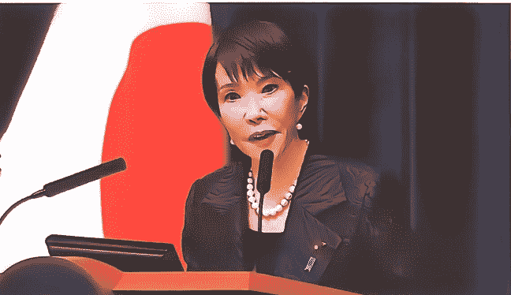

## 高市早苗的阳谋

发布专栏 智几共话

搅台海，是日本再武装的序章。

2025年11月7日，日本首相高市早苗在国答问时称：如果中国大陆对台湾出动军舰并使用武力，可能会构成“存亡危机”，自卫队将有权行使集体自卫权。

对此，外交部发言人林剑表示：中方对此强烈不满、坚决反对，已向日方提出严正交涉和强烈抗议。

深度视野VIP群 人工追踪50+大V 付费进群加微信cuk255微信ch5568

高市早苗的政治立场决定了她在中日关系立场上始终扮演“挑事的”的一方，此次表态，更是将两岸统一问题与日本政治安全相关，甚至与自卫队武装问题挂钩。看似不合理的逻辑背后，她的真实目的是什么？日本的进场会影响祖国统一大业吗？

11月10日 16:26

> 高市上台果然开始找事了，居然说我们对台湾的行为会构成日本的“生存危机事”。

> 我倒是有个特别的想法，日本是不是想趁我们对宝宝动手的时候加入战局，然后故意被我们打服，投靠我们，以此挣脱老狗链。

> 不能，我们即便打赢，也不会在日本驻军的，所以老狗不会被挣脱。而且就算我们真的驻军，那日本本图什么？我们的链子比老老的舒适？更何况我们和日本有血仇，我们的链对他们来说，恐怕更不安全吧。

是日本需要一个理由武装化。

子明

深度视野VIP群 人工追踪50+大 付费群加微信cuk255微信ch5568

估计日本原本的想法是，我们海上力量的经验还比较少，可以采取军事冒险。

军事冒险的可能性极低，挑一个一个大国毫无意义。

也就是说，他们不敢真打算和我们打仗作死，但借着这个帽子完成再武装的心是有过的。

这心都藏了几十年了。日本当了七八十年被美国的“美国”，很不甘心。

如果真的要开战，那些跑到日本的“王世链们”该怎么办?他们的信息渠道一定比我们靠谱多了，这些人还敢待在日本，就恰恰说明日本的风险其实很低。

从经济角度来看，也不难理解他们为什么要掺和一下：台湾和日本相互之间的贸易势力巨大，如果我们统一一场本，就相当于夺人钱财，对日本而言算是重大利益冲突。

我是认为统战对他们之间的生意影响不大，除非在统一的过程中日本参战。

现在网友声量最高的方案是去人留，一波带走也不用担心商贸了。

这是可能的，2000万人总要大部分吸纳到经济体系中。

留地留人的思路太极端了，当年小胡都不敢直接。该统战还是应该争取统战的，统战不是为了满足自我道德幻觉，是真的有用。

统战是为了战争过程中能够实现横截拉垮，譬如关羽对荆州的统战，吕越统战，李嘉肃对广西西的统战。

编者注：

- 关对荆州：重用荆州本土人，如襄阳人廖化、南郡人潘等，通过授予官职换取支持。对部分豪强采取怀柔策略，维持地方稳定。
- 诸葛亮对蜀：在第一次北伐时，南安、天水和安定三郡“叛魏应亮”。这背后必然是长期政治宣传和秘密联络的结果。其中，姜维的归附最具代表性。
- 杨皓对荆州：与敌国守将建立“私谊”，进行政治诱惑。羊祜的对手是东吴的陆逊（陆逊之子）。两人在边界进行“送道”的军事行为。羊祜死后，荆州百姓在他生前山上立碑，望其莫流涕，故名“羊祜碑”。

说对，很多人研究过，如果真的要硬来，打成了钢铁厂那种肉磨，我们的国运太大了。而统战就是要告诉宝岛人民，过去干掉一个反动派，就能迎接光。

> 统战，就是攻心为上。

子明深度视野VIP群 人工追踪50+大V 付费加微信cuk255微信ch5568

金陵王气黯然收，最好达到“一片塌”的效果。会不会再次出现事变逼迫统一？

> 参考解放战争，除了几个大牌师多少起了。

子明：统战的意思是我们吸引大部分同胞真正在一起，孤立少数，这几年统战工作已经成效，“攻心为上”的策略也会让日本增加风险，起不起台海的风浪。对大陆的统一没有实质威胁，由此高市早苗针对两岸事的言论，不是为了日本找一个理由，进而实现再武装。深度视野VIP群 人工追踪50+大V 付费群加微信cuk255微信ch568

现在的我们已跻身军事强国，无端挑衅只会日本增加风险，同时我们近几年统战工作已经成效，为统一大业贡献力量。

— END —

相关阅读：

- 【局势洞见】专栏：《赛点，爱国者治台》2025年10月30日更新
- 《吴石将军与路线分支》2025年1月10日更新
- 【知否共话】专栏：《吴石背后沉默的利益》2025年10月27日更新
- 《高市早苗当选的对华态度》2025年1月28日更新
- 《再给两岸一点时间》2025年1月1日更新

2025年11月14日 补充更新深度视野VIP群 人工追踪50+大 付费进群加微信cuk255微信ch568

相关新闻动态：

1月7日，日本首相高市早苗发表关于中国大陆对台可能构成日本“存亡危机事态”的言论，此后中方提出正交涉。但是，高市在近期参加的国会辩时声称，有关言论符合日本政府考虑、无意撤回或取消。

12日，高市早苗政府考虑为日本自卫队的“卫”改名，包括将“佐”改为旧称“大佐”。结合日本近年来大幅增加防卫开支，发展远程进攻能力，不断扩张事实力的表现，应引起周边国家和社会的高度警觉和共同反对。

13日，外交部发言人林剑表示：中方对此坚决反对，绝不容忍。日方必须立即纠正收回恶劣言论，否则后果须由日方承担。如日方妄武力介入台海势，将构成侵略行为，中方必将迎来后果。同日，外交部部长孙和丰会见日本驻华大使金杉治，就高市早苗涉华错误言论提出交涉深度视野VIP群 人工追踪50+大V 付费进群加微信cuk255微信ch568

14日，人民日报钟声（中国之声）发表文章，表示绝不容忍高市早苗在台湾问题上的越线挑衅。

对高市早苗政府提出严抗议并不只有我们。13日，俄罗斯安全会议秘书绍伊古对俄新社表示，高市早苗奉行历史修正主义政策，发表了大量反俄言论，并认为美日关系并不是平等关系，而是庸关系。

## 2025年11月18日 补充更新

1月12日 12:25 请教，最近与论场又在渲染内部民族意识形态叙事了？这方面注意。子明：中国驻日大使馆现在天天高市早苗，今天最新发布的一条X说，即将来的十二月，最大的历史事件是日本攻击了珍珠港。深度视野VIP群 人工追踪50+大 付费群加微信cuk2555微信ch55568

我推测是不是背后有股力量想要阻挠中日韩的相向而行?

> 外交部对高市早苗的当选缺乏准备吧。子明：但她继承的其实还是安倍的衣钵吧。

> 统战的意义是我们吸引大部分同胞真正在一起，孤立少数，这几年统战工作已经成效，“攻心为上”的策略也会让日本增加风险，起不起台海的风浪。对大陆的统一没有实质威胁，由此高市早苗针对两岸事的言论，不是为了日本找一个理由，进而实现再武装。深度视野VIP群 人工追踪50+大V 付费群加微信cuk255微信ch568

现在的我们已跻身军事强国，无端挑衅只会日本增加风险，同时我们近几年统战工作已经成效，为统一大业贡献力量。

### 深度视野VIP群

- 包含以下内容：
- 卢克文集（免费）
- 欧洲（（会员）
- 卢克文专属
- 卢克读书会
- 鉴茶财经
- 猫哥的视界
- 财新周刊
- 杨世光在钱坝
- 蒜森财经
- 激译异译
- 司马林解课
- 虚构三部曲[民国梦、帝国战争、不被理解的MAO]
- 卢克知识星球
- 更多资源将不下：
- 守夜人司令星球
- 接换魔王知识星球
- 雪花枫甲头
- 创始笔记
- 达叔浅论
- A视野
- 大树乡谈
- 江初序
- 泮咩说
- 上海海家等付费文集

额外送：
- 卢锐元新浪薇专栏
- 三村丰老王
- 三花九洞文集
