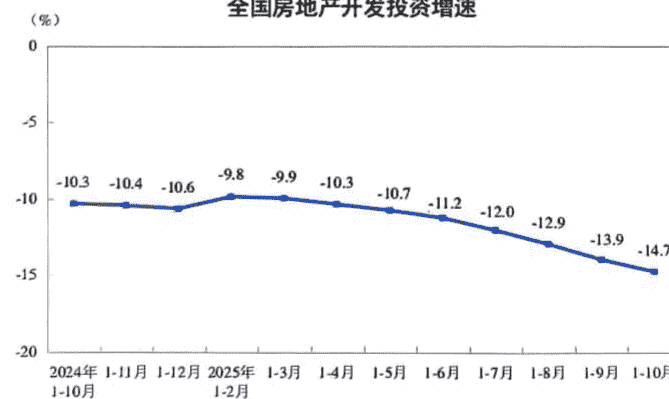

# 新经济周期的房地产

发布时间：2025年11月19日

11月北京线下读者会系列内容

15年经济周期，国家放水的能够进入房地产，是因为老部长仍然在最高层会议拥有投票权；25年经济周期，国家不会放水进入房地产，是因为目前的最高层会议里面就没有房地产的利益团。
所以新一轮房地产只能是托底，不会重新刺激起来，最终房子其实一个消费属性，房价跟租金成比例挂钩。

未来几年，房地产要重回核心，但有科技底性的城市和区域就那么几个，其他大部分地区的房产都没有持有的意义，如果之前没有售卖的话，到时可以在未来几年出现流动性的时候售掉。

房地产最终就是回归三个不可复制的Position：
第一个Position是城市，要靠近政策中心；第二个Position是市场，要靠近核心资源；第三个Position是实际占据的土地面积（别聚类）。

深度视野VIP群 人工追踪50+大V付费群加微信cuk25568 微信chp5568

一个有价值的房产，最起码要满足两个Position，一个Position都不占的房产，最终一定是房价如意。

## 权威发布 | 中共中央关于制定国民经济和社会发展十五五规划的建议
来源：新华社2025年10月28日

（41）推动房地产高质量发展。加快构建房地产发展模式，完善商品房开发、融资、销售等基础制度。优化保障性住房供给，满足城镇工薪阶及及困难家庭基本住房需求。因城施策增加改善性住房。实施舒适适宜绿色的“好房子”，实施品质提升工程和物业服务提升行动。建立房屋全生命周期安全管理制度。

## 中央定调！未来五年房地产发展方向明确
来源：中国地产报（住建部主管）2025年10月29日

建议提出，加大保障和改善民生力度，切实推进全体人民共同富裕。其中，“推动房地产高质量发展”被放在此框架下，房地产的民生属性进一步被强化。

深度视野VIP群 人工追踪50+大V 付费群微信cuk255 微信chp5568

在“十四五”规划中，有关房产的要求被放在新型城镇化框架之下。这也预示着，规模化扩张阶段已经结束，未来5年房地产行业将全面转向注重品质与安全的高质量阶段。

## 2025年1月—10月份全国房地产市场基本情况
来源：国家统计局 2025年11月14日

房地产开发投资完成情况：1—10月份，全国房地产开发投资73563亿元，同比下降14.7%（按可比口径计算）；其中，住宅投资56595亿元，下降13.8%。

深度视野VIP群 人工追踪50+大V付费进群 加微微信cuk255 微信chp5568

# 深度视野优质集群（链接优质群，助你成功）

全部包含以下内容：限时年费188/年 加微信cuk255

- ① 吃瓜群众包时圈加时群对话 (原价 365 元/年)
- ② 子明私享汇（含）内部文章
- ③ 政事室（顾子明）付费内容再送顾子明群群
- ④ 米联储闲见【作者米穗】(原价 599 元/年)
- ⑤ 欧洲金雀会员专属文章 (原价 328 元/年)
- ⑥ 砖瓦斥内部圈 (原价 400 元/年)
- ⑦ 卢克文青读书会专属文章 (原价 699 元/年)
- ⑧ 鉴茶财经知识星球 (原价 3310 元/年)
- ⑨ 猫哥的视界知识星球文章 (原价 299 元/年)
- 10 财新周刊【独家新闻】(原价 1498 元/年)
- 11 杨世光在钱 (原价 2200 元/年)
- 12 蒜淼财经知识星球 (原价 1600 元/年)
- 13 激源异译付费文集（持续更新）
- 14 司马林解课全套音频和全套书籍版无删 (原价 2.3 万)
- 15 虚构三部曲【民国梦、帝国争霸、不被理解的MAO】(原价 599 元)
- 16 卢克文重知识星球文章 (原价 268 元/年)
- 17 额外再送：卢祺元新浪韭搏付费专栏、三村丰老王、三花九树文集

内容：......（更多资源将下去......

- 守护者司令知识星球、接入魔王知识星球、成达谈论星球、成术花财富、雪球花甲老头等
- 创始人笔记、达叔谈论星球、成术花财富、雪球花甲老头等
- A 视野、大树乡谈、江初序、咩洋说、上海家学等付费文集
- 西风付费文章、老端、赢在八小时之外、局外的视界、升值优、老A体制内等若干其他 V 付费文章（每月不低于 600 元付费文集）

# 限时年费188/年 底部链接全网V优质内容

深度视野文集
进群微信cuk255
深度视野（付费文集）

