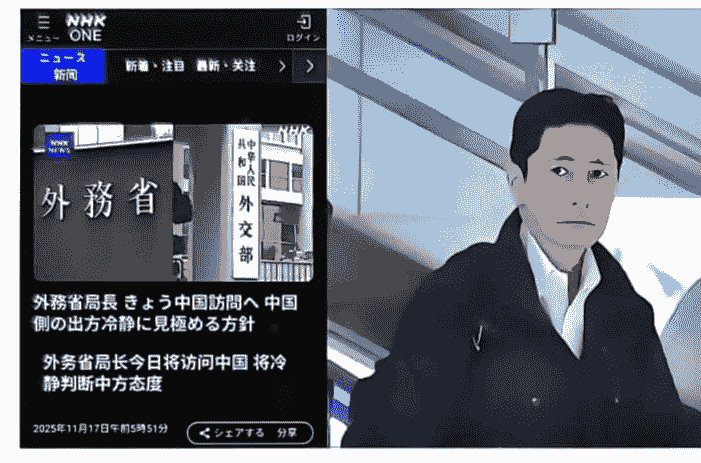

# 日本要“换朝本”？

发布专栏 知几共话

日本“换房本”，敲响中日关系的长钟。

2025年11月17日，日本外务省亚洲大洋局长金井正彰访问中国，预计将围绕日本首相高市早苗涉台发言与中进行协商。

据报道，金井与中国官员将在访问期间将重点指出，高市早苗的相关言论并不代表日本政府已有肺炎的转变。

高市早苗上台后的涉言论是对中国立场的严重挑煽，以她为代表的日本右翼政权意欲何为？日本外务省此行，能否给出一个令人信服的解释？而在国内，高层中谁仍在与日本之间“频繁不断、还往来？”

## 01 雷声大雨点小

11月17日 10:46

今天日本外务省的高官们已经抵京了，看来，“钟声”这种高级别警告还是吓到他们了。

附注：《人民日报》“钟声”专栏是权威国际评论专栏，取名“中国之声”的谐音，寓意警钟声。

但是目前为止，我们并没有看到实质性的反措施，比如稀土禁运彻底。西方左右翼都在为政治口号走极端，不给他们一点实质性的惩罚，他们是不会知道道的。

嗯，来人的级别也不高，正厅级。厅局级和厅局级决定不了什么事。

这就像是两国关系紧张，对方只派了个数办事员来通知一下。但我们会形容成“日本高官负荆请罪”，又赢麻了。而且我估计这都不是高市派出的，而是外务省省自己的动作。

正常来说，应该请退休的、对华友好的前首相或者民间大佬过来来吧，派个小虾米过来，不是明着打脸吗？

好友大佬不愿意出面吧。二阶、岸田、茂木都没说话呢？

编注：分别指二阶俊、岸田文雄、茂木敏充，均为自民党有实质影响力的过往高官，对华政策相对温和，主张经济互通。

在中国在推进的好多业务，都是钱啊。

我觉得这个时间点交本身就很离谱，日本已经选完了，而美国又在推自贸区，双方应该都没有动机在这个时候激化矛盾。

右翼是有支持率的，估计她现在支持率应该该突破界了。

本质上，日本就是在搞战狼的玩法，东亚人都吃过这一套。

注释：战狼，中国“战狼”的日本版本。

日本政坛的换朝本怕是也要开始了了。

她是打算激化矛盾，背靠高支持率去洗牌政坛？在日本的门阀体系和党派组织制度下，她能撼动那些老牌家族吗？

干事的胆子没有，打着直匿名搞钱的胆子很大。

话说当年松下政经营塾的建立之初，就是想要换朝本吗？

注释：松下政经营塾是由日本松下电器创始人松下幸之助于于1979年创立的精英培养机构，其毕业生在日本政界颇有显著影响。部分观点认为其对日本右翼势力扩张有关。

可是日本虚传统的，旧的这套制能运行这么久，是利于养老的，这也也要换本科了吗？

感觉她应该换到一半，就得乖乖下台了......

哪有82%支持率下台的道理，比之前的岸不知道高到哪里去了。

懂可是是通过帮共和和共和州议员选举，洗掉共和成为MAGA党的，而高市组阁都差点失败，她能洗掉自民党？

感觉是日本狼外交，高市真正的目的，可能是修宪。

> 对啊。大家都想修宪。

日本外交官员的低调抵京，看似我们赢了呀，实则暴露中日关系的微妙僵局。

作为右翼推举的政坛明星，高市政权高调挑衅的目的，可能是希望以高支持率推动修订宪法议程，撼动传统门阀体系。面对这位她的虎视眈，我们内部的应对态度又如何呢？

## 02 认知外交部

11月17日 16:53

最新消息是，G20期间总理倒也不会听日本代表意见。

那肯定的，怎么可能面面子。

老板这次被测测，处理层级一下子太高了。

感觉外交部内部都不很统一，比如最近驻日大使发的推，感觉完全没有意见。

注：11月14日中国驻日大使发推“国家受到严重威胁”，是在1941年12月。“当时，以此为由发动了对美国的袭击，结果被美国宣布。很多国家里面，我们懂的是日本，这次还安排这个样子，看看老板会不会处理。

这几年来，我最烦的人，差不多就是日本，一直被日本。

这就是下场，日本只能出台，必须乖乖。

他任职和外交集，在那边有合作者，对他自己也有好处？就像倾向于美国。

## 他总是推动一些无脑的外交策略

不过现在高市已经是热下了了，我大概可以算是友派，但我讨厌的就是右派。

高市选举时候，没转换过来，接触过一些“高层”就会发现，大部分真的是草台班子。

高市这种新手水平，也就是县级干部。感觉我们之前还行，04年-07年期间是驻日大使，然后安倍上台来，08年-13年负责事务，当时马英民，不是关系挺好的吗？都是搞定了。

他的背景很硬？岳父很厉害，曾经担任过总理外事秘书。

高市频繁发表敏感言论，目的是巩固右翼基本盘。这些政治表达，她在的支持率一路走，按照“脚本”，她接下来的很有可能推动国内的“换朝本”，最终指向修宪。中日关系，真的要走远了吗？

— END —

## 深度视野优质群（链接，助你成功）

全部包含以下内容：限时年费188/年

- 吃瓜群众圈对话（原价365 元/年）
- 世界私享汇（内部）优秀文章
- 政事室（付费内容送）
- 米联储闲【作者米栖】原价599 元/年）
- 欧洲精英会员专属文章（原价328 元/年）
- 华街内部圈（原价400 元/年）
- 卢克文读书会专属文章（原价699 元/年）
- 鉴茶财经星球（原价3310 元/年）
- 猫哥的视界星球文章（原价299 元/年）
- 财经周刊【独家新闻】原价1498 元/年）
- 杨世光在财经（原价2200 元/年）
- 蒜森财经星球（原价1600 元/年）
- 潇译译付费文集（持续更新）
- 司马南解课全套音频和全套书籍藏版无删减（原价2.3 万）
- 走出三部曲[国梦、帝国兴亡、不被理解的MAO](原价599 元/年）
- 卢克文知识星球文章（原价268 元/年）
- 额外再送：卢户元新浪韭搏付费专栏、三村丰老王、三花九树文集

不定内容：......更多资源如下......

- 守夜司令星球、接魂魔王星球、达叔谈论星球、成术后财富、雪球花甲老头等
- 创始笔记、达叔谈论星球、成术后财富等
- A视野、大树乡谈、江初将军、咩咩说、上海海学等付费文集
- 西凤付费文章、老端、赢在八小时之外、局人的视界、升级、老A体制内等其它一些付费文章（每月不超过600 元付费文集）

限时年费188/年 内测基础链全网优质内容

# 深度视野文集
进群微信cuk255
