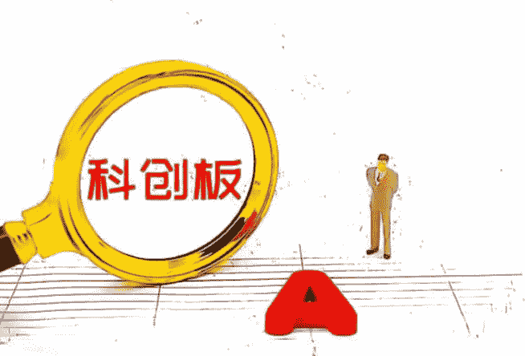

## 国科创的震荡期

发布专栏 知乎共语

曾经的保护温室正在散去，真正的全球市场的竞争雨林已然来。

2025年11月14日，A股市场迎来年内最剧震荡，上证指数跌破4000点心理关口。其中，科技板块成为重灾区，半导体、AI算力、存储芯片等细分领域集体暴跌，创业指跌幅达2.82%，创三个月以来最大单日跌幅。

此前气势如虹的科创板块，近期为何突出现大幅震荡？这背后是否存在政治因素的驱动？这一轮的震荡是会快速平息，还是将持续延续？

11月12日 12:55

子明：最近科技股怎么跌得这么厉害，是受政治影响吗？

中国在跟美国谈芯片入华。

我看美国市场上OpenAI也是突然增了很多负面新闻。

对啊，美国那边明显在凿局。

那国内是不是不是也是这个情况？

从资本角度，我单纯认为是中美缓和，半导体入华。

软银之前抛售一次英伟达，追悔莫及后又买回来了，这次再次抛售是什么信号？

抛售可能是为了12月买Open AI。

如果半导体的热热入华，是不是意味着国内半导体产业会长久承压？

是持续性的，今年半导体上涨的背后是英伟达的市场份额从80%跌到了70%。现在英伟达试图把失去的市场份额重新拿回来。

子明：群里有没有在做芯片的？想了解一下，我们现在买英伟达的芯片到底是因为自己做不出来，还是类似于买飞机，属于战略采购？

最近在台北君悦的意外释放，不就是说一些不方便公开的话吗？

不过话说回来，其实不光是芯片行业，其他领域也面临着技术赶超的风险。这次我去参加一个展会，除了无人驾驶，中国的农机行业表现也不甚理想，被印度全面追上了。这几年产业链脱钩，美德把他们的供应链扶持起来了——高价值客户，自然催生高价值的供应链。

听东欧的农机公司说，保守估计，美国现在已经在控制乌克兰差不多快50%的农田了。美国、波兰也在规模进行围围。进入新的荒圈地时间。

中美元首握手的背后，藏着的是更加宏观的经济战略布局。A股跌破4000，科创板块的震荡，与其说是一场危机，不如说是芯片的进退进行一场关乎国运的长期博弈。而英伟达的回归，必将成为中国科创企业必须直面的、更难避但也真实的角力。

曾经的保护温室正在散去，真正的全球市场竞争雨林已经来临。

—— END ——

## 深度视野优质集团（链接优质社群，助你成功）

全部包含以下内容：时年费188/年 加微信cuk255

- ① 吃瓜群众倍帝圈加微信群对话（原价 365 元/年）
- ② 子明享汇（内部）文章
- ③ 政事室（顾子明）付费内容再送顾子明群聊
- ④ 米联私享【作者米穗】（原价 599 元/年）
- ⑤ 欧洲金雀会员专属文章（原价 328 元/年）
- ⑥ 砖瓦石内部文档（原价 400 元/年）
- ⑦ 卢克文青读书会专属文章（原价 699 元/年）
- ⑧ 深度财经（原价3310 元/年）
- ⑨ 猫哥的视界（原价 299 元/年）
- ⑩ 财经周【独家新闻】（原价 1498 元/年）
- ⑪ 杨世光在钱圈（原价 2200 元/年）
- ⑫ 森淼财经（原价 1600 元/年）
- ⑬ 深度译付费文章（持续更新）
- ⑭ 司马林解课毛选全套音频和全套书籍版权
- ⑮ 虚彦三部曲【民国梦、帝国、不被理解的MAO】
- ⑯ 卢克知识星球（原价 268 元/年）
- ⑰ 额外再送：卢薛元新浪微博付费专栏、三村丰老王、三花九文集
