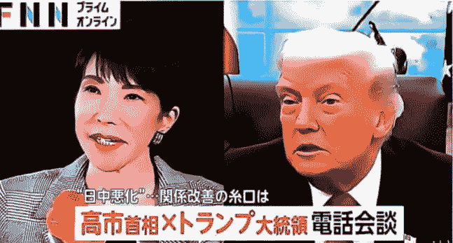

# 懂王的东亚电话会

发布专栏：知几共话

懂王的两通电话，要把风往哪边吹？

2025年11月24日晚，中美进行了通话，中方强调了在台湾问题上的原则立场，强调台湾回归是战后国际秩序的重要组成部分。特朗普表示，中国曾在二战中为反法西斯联盟胜利作出重大贡献，美方理解台湾问题对于中国的重要性。

次一早，特朗普方面主动提出与日本首相高市早苗通话。当被问及，通话中双方是否对此前日本在国会发表的涉台错误言论进行沟通时，高市早苗未正面回应，仅以“细节不便透露”一句带过。

## 靳妞不到24小时内的两通电话，特朗普究竟对中日两国说了什么？

这两通电话对东亚局势、科技前景和资本市场又会带来什么样的影响呢？

### 01 “好战”的基因

11月25日 9:36

懂王昨刚和我们打过电话，今天一早又给高市早苗，是谁主动打的？是不是意味着中日之间要降温了？

老板给特朗普，特朗普打给高市。

子明：
像是是孩子闯祸，先找家长。更像是找主人去管好自家的狗。

> 孩子在学校闹事，老师只能惩罚不能体罚，然后给家长长了个电话。

子明：
以懂王的性格，管束自己的孩子怕是得加钱吧？在中美谈判中，相当于懂王凭凭空多了一个筹码。

现实中一般是家长给学校交钱，而这件事或许刚好反过来。同样的，现实中学校可以劝退学生，家长是被动的，但这件事里，主动权也发生了转移。

现在的问题是这条“狗”想要自由，美国还管不管得住......

我们一直所说的战后秩序，其实就是德国和日本被严格管控和约束的。

今天已经不是过去那个时代了，现在也能偷装修珍珠港，但能毁灭一个国家的“武器”可变多了。不知道纳斯达克的股和日经，还经得起这样的折磨吗?

其实，我们的稀土割据，跟日本侵袭珍珠港是一样的，都是希望以止战。

对啊，芯片全断和稀土全断，都相当金融核武器，更何况我们手里还有一堆经济核弹动用，为什么还有人认为是真的会打起来？

因为男性基因里面，有着对战争的渴望。

> 反战本质上是一种理性的、反动性的思考。如果一个男性的DNA对战争感兴趣，那么他的祖先就不可能有机会把这段DNA传来。

对战争的渴望是一种竞争心理，而竞争又有很多，很多人因为觉得他们里没法竞争了，所以要么转到宏大叙事，要么陷入各种细分领域的矛盾，比如性别、民族等等。

想请教明公，说到“对战争的渴望”，让我联想到当年二战初期的一个疑问：德国占领了西欧，日本占领了东亚、东南亚之后，真的没有收手，然后慢慢消化领地后再徐图之的可能性吗？还是因为他们初期太顺顺，没有付出多少代价，所以根本刹不住车呢？

理智的群体被边缘化，军国主义主导、踩不住车了。

子明：
日本最完美的“变”结局是按照石原闲宪的计划，拿下满蒙就停下来。

编者注：“九一八事变”罪魁祸首之一，关东军参谋，提出“石原构想”和“满蒙生命理论”，他认为日本的侵略要分阶段进行，首先占领满蒙，并消化东北地区的发展潜力，作为整个战线的补给线，建立伪政权，再逐步征服中国及亚洲。

如果开疆的过程不顺利，先付出高昂的代价，或许会让决策者冷静下来。

### 02 对科技前景

11月25日 10:00

明公，以前重心放到发展经济的时候，与舆论引导会偏左一点，鼓励大家多于；而这次经济发展不需要太多人参与了，为了稳住大众且源头，与舆论选择右转去打击，而不是奶头。这种情势后续会如何演变呢？经济顺时会加剧泡沫的思想，而右转是否有可能会反过来绑架政府，打破经济发展节奏呢？

子明：
以前大左是反垄断、查资本收税，右转是民族主义，都是大政府。我感觉这次的行为会对我们的芯片领域形成冲击，我不看好前景。

为啥？

子明：
因为懂王看出来不用自己上了，而是会让小弟们来针对我们的弱点。日本先下了，整个欧洲都会随之一起来。市场化竞争，才能卷。

子明：
原来只有一个英伟达，现在还有一大欧洲、日本和韩国的芯片部件和产业链都要分。国产替代的速度要下降。

子明：
> 芯片卡脖子问题被解决后就会变成基建，也不会有多大。

子明：
芯片的中端已经抢占了大部分份额。对于企业的发展，要看增长空间；但对于一个产业的培育，另外一件事，本来就是英伟达做的，没有太大增长空间。这些产业的利润低。

### 03 资本市场

11月25日 13:27

请教明公，记得之前看过的文章，什么时候中美重启谈判，资本市场才能好转，这次通话？

子明：
算是啊，终于回正轨了。为什么这次算命？从釜山到现在一直跌，中间也没有听到什么消息。为啥打电话？

子明：
参考老板上一次电话，双方当时的言论和表态。两通电话，就是对中国方向的一种维护，也是确保自己在亚洲的话语权。至于他的小弟们会如何权衡未来的市场份额，我们还需要继续筹谋，解释一个问题。

政治博弈是钢丝的艺术，一场新的动态平衡，从特朗普的两通电话中悄然开启。

— END —

相关阅读：
【子明解读】公众号
《特朗普背刺了高市苗》（2025年11月25日）
《AI投资逻辑的转变》（2025年11月27日）

# 深度视野优质集团（链接优质社群，助你成功）

全部包含以下内容：限时年费188/年

- 吃瓜群众微信群聊天（原价365/年）
- 子明优享会（内部）文章
- 政事室（子明优）付费内容再送子明群
- 米联储闲兜【作者米穗】（原价599/年）
- 欧洲金雀会员专属文章（原价328/年）
- 砖瓦仁内部圈（原价400/年）
- 卢克文青读书会专属文章（原价699/年）
- 鉴茶财经知识星球（原价3310/年）
- 猫哥的视界知识星球文章（原价299/年）
- 财新周刊【独家新闻】（原价1498/年）
- 杨世光在金钱煽（原价2200/年）
- 森淼财经知识星球（原价1600/年）
- 潇漾异译付费文章（持续更新）
- 司马林解课全套音频和全套书籍原版无删减（原价2.3万）
- 虚构三部【民国梦、帝国争霸、不被理解的MAO】（原价599/年）
- 卢克文知识星球文章（原价268/年）
- 额外再送：卢薛元微博付费专栏、三村丰老王、三花九树文集
