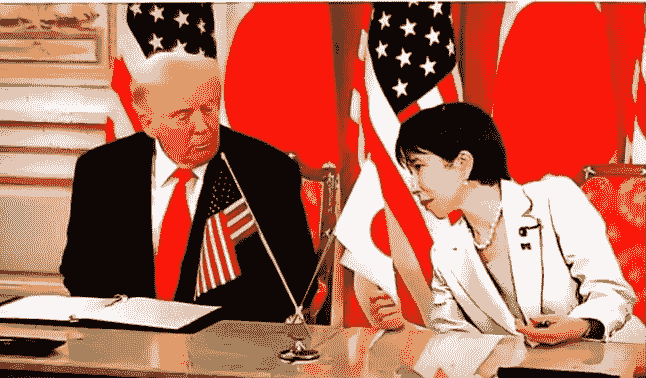

# 代理游戏

有人金蝉脱壳，有人乘势而上，火烧到东亚，是祸兮福之倚。

2025年11月23日，乌克兰总统泽连斯基发表声明，称和美方代表团在日内瓦的会谈取得积极进展，目前迹象表明，美方提出的和平方案中，或已包含若干对乌国家利益至关重要的安排。

俄乌战争步入尾声，俄王最终会让怎样的利益？俄乌的收尾是否意味着美欧又要站在制华的统一战线了？另一方面，美国开始逐渐从欧亚大陆的多处战中抽身，却在中东、东欧和东亚都留下了代理人，美国这么做意欲何为呢？

## 01
“联欧制华”的空想

11月24日 8:04

看泽连斯坦基这个表情，是不是说明美国已经说服了欧洲，要专心联合对抗中国？

如果要说服，至少需要美国先让巨大的利益。但考虑到欧洲当前的脑死亡论状态和美国自身优先的战略，感觉不大可能。

我觉得已经说服了，目前断了军援，乌克兰会失去更多。

我的意思是，俄乌不是没有和解可能的，但是美国当前的政策方向，会比联欧洲制华，只会相比拜登时期，给得更少，坑得更多。

我所知，欧洲目前感受到来自中国的压力特别大，如果不限制，德国三大汽车公司根本在欧洲本土市场会被中国新能源汽车吃掉，何况这还是欧洲人的传统强项。

其他领域的腾挪空间越来越小，所以越来越确定，他们需要尽快执行一套整体方案，来扼杀中国经济和产业。

> 不存在所谓的一个扼杀中国的整体思路。

> 你换个角度，欧洲的车企想要转型，最好的方式，反而是跟中国合作。

即使存在，也协调不了那么多力量。

如果真的不存在，或者实现不了那就太好了。

欧洲人愿意玩的一套就是“你这个挺好，我们收购一下”。

> 抛开台班子的角度、中国在开放阶段仍然敢于跟日本彻底脸皮，也是跟美欧关系缓和的要素。

俄乌战争接近尾声，但美欧似乎不会走得更近，双方利益分歧与战略自主性的缺失，使“联欧析华”还要留在“一个方案”的阶段。相比于欧洲，日本却是近在眼前的威胁。

## 02
反制日本正当时

11月24日 8:22

和日本彻底脸脸有巨大的民意基础。只是抗日概念起来以后，海峡板块就不行了……

啊，刚看了一眼、之前买过的某股都两个跌停了。直接变卖抗日战争的副本。

子明：打WW或有人反对，但断日本，基本没人会拦。

本质上，就是特朗普上台后，大家集体体右转。

子明：日本那边拜的是右派的牛鬼蛇神祖宗，我们这边拜的是右派的牛棚大神祖宗。

编者注：牛棚大神指的是“文革”时期遭受迫害的人士。

嗯，我们这边的抗日战争接班人。

嗯，一边是侵华战争的接班人，一边是抗日战争的接班人。

子明：现在是“中国大礼仪”。

编者注：大礼是指发生在正德十六年（1521年）至嘉靖三年（1524年）间的一场关乎皇合法性的斗争。原因是因为明武宗后绝嗣而引起的皇帝继承争端，经由首辅杨奎等人通过《大明祖训》“兄优弟继”。

（注：此处部分文本存在OCR乱码及重复，根据语义进行了逻辑清洗，保留了核心观点的连贯性）

## 03
美国的代理人

11月24日 9:06

- 美国现在的目的就是自己从战线抽身，然后减负、补齐短板、同时用日本牵制中国，把台海变成优势。
- 之前俄乌战争，台海恐怕会是长期摩擦。
- 参考特林的阿汗撤退、美国战略撤退时，必须扶持每一个代理人，把地区内的真空迅速填补。
- 美国的逻辑，但是为什么我们也要主动利用这个时间点呢？
- 东南亚、台湾、东南亚，这些地方美国只是收缩，然后东亚局面就彻底变色了。
- 从中东走了，放以色列做代理人；
- 从欧洲走了，放乌克兰做代理人；
- 从东亚走了，放日本做代理人。

子明：这种理解其实没问题的，所谓的“大退”的时候，总需要有人来护。

双方集体左右转不是目的，背后的权力争夺才是目的。在“斗而不破”的框架下，反制日本不仅是民族情绪的出口，更是撼动东亚局势的一步实棋。

— END —

相关阅读：
【子明解读】
《必须打倒军国主义》（2025年1月24日更新）
