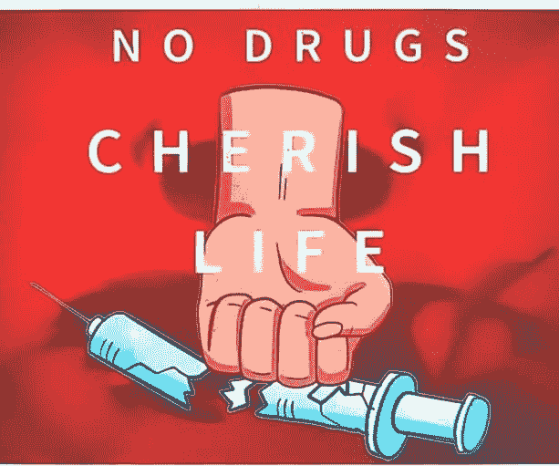

# 禁毒钢印的松动

发布专栏 知几共话

历史是个有耐心的老师，如果你没听懂，它愿意再讲一遍。

在上文中，我们深刻剖析了毒品的危害性和“封存吸毒记录”政策的相关疑问，虽然子明也提出这些失当的法条后续可能会得到一定程度的修正与完善，但仍有许多读者强烈反对的政策，当初为何能顺畅通过？这些法条到底在“服务”谁？

深度视野VIP群 人工追踪50+大V 付群加微信cuk255 微信chp5568

更深一层思考，赏赌同为疾病，为何“禁毒”如思想罔深植于国人的集体意识，而“赌”和“赏”却似乎未见过同等严厉？三者有什么本质上的区别呢？

## 01 赏黄和赌

12月1日 9:56

我有一个疑问，禁毒当然是全民共识，甚至是执政合法性的来源之一，那禁赌和扫黄也是也是吗？

赌，有合法赌场（彩票），黄，有擦边，但是毒，在此之前，就是没有所说的轻重程度之分。

扫黄是为了妇女儿童，如果黄合法化，相关从业者的处境可能反而更糟——现在那些黄的个体户能够挣到钱，是因为黄违法，如果不违法，产业化后，资本碾下他们就会沦为庸。赌的违法性其实很强。

深度视野VIP群 人工追踪50+大V 进群加微信cuk255 微信chp255

积极地说，禁赌是防止快速击穿一个家庭的抗风险能力；消极地说，禁赌是不允许博赌跟官府争税源，而且博赌家庭的破产必然带来各种问题，比如子女教育受影响成长为官流、家庭暴力等等，以及正常消费需求置于非法赌场。

参考《红楼梦》，以黄赌为名义，查抄大观园是否为命？

子明：部分原因是那夫人夺取王熙凤。

代表军集团的宰家，代表商的豪家，代表旧豪的长房奴，以反自由为名义，对代表文官掌控统治权的史家进行的一次政治反击。

子明：查抄大观园，掀开了王夫人夺取家族核心力的序章。

黄、赌、毒三者同属社会治理的“传统禁区”，但在法律和道德光谱的位置并不相同。历史与现实告诉我们，每一项禁令背后，依然复杂葬序。

深度视野VIP群 人内追踪50+大 VIP费加微信ckuk255 微信chps568

那么，当政策试图为某些“轻微犯罪”打开一道修复之门时，它究竟源于怎样的现实需要？

## 02 为什么开口？

12月1日 10:09

我理解的档案封存，以及最近的信用修复，其实是一撮子政策的解决方案。或者说是补补。核心心态考量之一或许是维稳。

在过去各种查询技术不那么发达的情况下，社会实际上为部分人留有一定生存的灰度空间。但是现在信息技术太透明了，而当时的约束条件和威戒措施力度又太严苛，导致这些人一犯错，整个社会支持体系就崩溃了。这部分人的体量基数也大，可能是成百上千万的，如果他们一直游荡的，对于全社会的冲击都是巨大的。

> 嗯，这个我也理解，就像税务查一样，随着技术的进步，如果严格按照税法查税，全国几乎没有几个违法的商人，所以必须要补补。

深度视野VIP群 人工追踪50+大V 付费加微信cuk255 微信chp556

其实上面更关注的是全局。底层有案的人可能超乎想象，如果不进行赦免，“高压”容易过载而爆炸。我说一个点，因为我负责很多工作，因为竞争者比较多，内部要求的是，只要他有记录，就可以考虑。注意，这里不是失信，也不是违约，你只要点过就可以考虑。在风险研判中，会把用户列为高风险。

我是觉得，为了底层“生路”逻辑不成立，因为底层审查就不严格。比如入职、离职率、工人，也是环境的影响，如果真的招不到人，要求得太厉害。说白了，优质岗位才会严格，那么轻微犯罪记录，到底谁受益？看看今年，记得十年前，媒体的主流还是考公。子明

深度视野VIP群 人工追踪50+大V费加微信cuk255 微信chp55

所以上面知道现在形势严峻吗？肯定是知道的，年龄都放宽了。不过可能宏观数据和个体感受有差异。

> 为了搞那么多特殊机构，能够看清楚吗？

子明：即使数据是假的，趋势总能明白。问题不在于，而在于走哪条路。毕竟未来是领航，不需要那么多人了。

> 大家觉得，经济危机和失业危机恐怖吗？

子明：那肯定是失业了。

深度视野VIP群 人工追踪50+大V加微信cuk255 微信chp5

真的有经济危机发生吗？不过还没有经济危机，但是失业率上升，尤其是全职岗位下降是有过的，比美国。严重的经济危机必然伴随失业。

> 参考08年下，经济危机，参考08年危机。可以理解为，一个是主动的，一个是被动的。

咱们现在是主动还是被动的？不会变成被动了吧？我们前几年是被动的，最近是主动。

深度视野VIP群 人工追踪50+大V加微信cuk255 微信chp5

从维稳到发展，从结构转型，“开口”背后是社会治理术。然而调整的方向与幅度，恰考验考验的智慧与定力。接要面对的问题是：边界在哪里？

## 03 调整与完善

12月1日 10:22

总来说，上面能看到趋势就好，知道形势严峻，也像子明之前说的，这些政策和法条肯定会一定程度的修改和调整。一切的做法不一定就能执行。想要改法是可以的，但是需要将违法行为细分阶梯，拿出执行细节。过于宽松的一切不行，过于严格的一切也不行，违法犯罪可以让他，不要让他成了不稳定因素。再说，现在被动犯罪的人不少，真的不能。

深度视野VIP群 人工追踪50+大V加微信cuk255 微信chp5

这是对违法的奖励，遵纪守法的负反馈。这个口绝对不能开，如果开了，只会开越大，不存在明显的阈值，最后只会离谱，就失控了。退一步来说，即使要封存，现在的争论焦点是吸毒，这件事不能和“轻微犯罪”相提并。一旦对毒品宽松，有资源的人就会尝试，然后带着别人去尝试，需求就会泛滥。之后就会跟着尝试，借此来控制他人……真的丑陋。吸过毒的人，我认为已经不算常意义上的普通人了，他们的道德感已经丧失了。都没有独立人格了，就为了毒品而活着，何谈民主与科学？何谈五四精神？何谈民族和人类的未来？

## 这种算不算春药？

发帖

昨天上课导师竟然讲起了春药，然后说在国内有真正的春药，所有能激发性欲的药物都是甲基苯丙（俗称冰毒）提取出来的，国内是禁止的，还有一种是空孕催乳剂，在不怀孕的情况下可以产奶，副作用就会很大，这个在国内也是禁止的，所以不要相信有什么春药了。

2025年11月30日，8:58 · 145万次 查看

> 那就不至于，权力的快感与依赖性可能是世界上唯一能跟毒品匹配的东西。子明：权力是男人最好的春药，确实依赖性太强了。法条虽然已经通过了审议，但是由于之前积累的“轻微犯罪”基数问题，拜登到任和懂王严厉的禁毒行动，这些法条大概也将迎来完善和修订。

深度视野VIP群 人工追踪50+大V进群加微信cuk255 微信chp

我们真正要警惕的是，是否还有人将各种“一切切”式的条款悄悄塞入议案，逐步淡化我们心中的禁毒钢印，让国家重陷历史的泥潭。

— END —

相关阅读：

- 【子明解读】公众号
- 《禁毒，不能宽恕》
