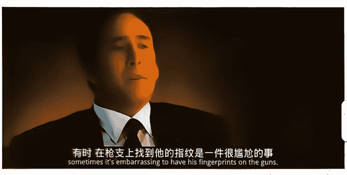
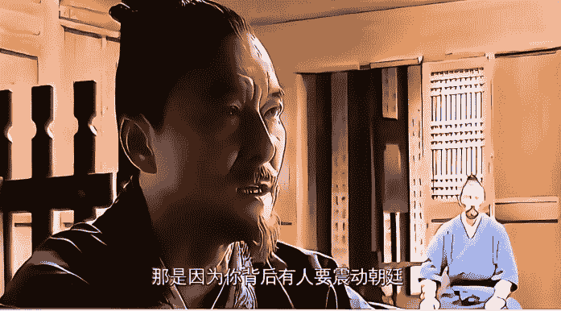

# Jack Ma 能 MAGA 么？

发布时间：2025年9月18日

GOV每个阶段需要不同的资本家，
当面对系统性冲击寻求稳定的时候，
GOV需要贾国龙这种就业型资本家，
只要少量的投资就能带动大量的就业，
当面对系统性寻求突破的时候，
GOV需要马云化这种创业型资本家，
需要他们向资本市场和未来高杠杆借钱。

本质就是GOV在重要还是人重要之间的问题。
国家要优先解决就业问题的时候，
西贝的上万员工是贾国龙的护身符，
二马拼命的流量颠覆就是原罪，
国家要优先解决创业问题的时候，
二马就会重新被请来座上宾，
贾国龙的万员工就会成为笑话。

资本主义经济周期与经济危机的本质，
是新生产力强行淘汰落后生产力，
西方往往是以周期性的经济危机来实现，
东方往往是以GOV或者GOV代理人操刀来实现，
98周期是通过实营公司强制收购破产国企，
08周期是通过拆迁公司强制拆迁户区，
18周期是通过平台公司强制拆除零售业产，

深度视野文集cuk255 有温度高质社群cuk255

等这些白色手套完成了历史宿命之后，
再给这些白色手套扣上劫国资产、非法拆迁、
宰断经营的大帽子、
让这些小乌承担改革过程中民众的愤怒。

28年周期，是人工智能的时代，
也是蓝翔的悲哀，
自动驾驶取代司机，机器人取代厨师、汽修，
国家需要将这些劳动力打散后再投入到劳动力市场，
就需要马云的平头哥，
就需要李彦宏的萝卜快跑，
就需要刘强强的七鲜小厨，
而贾国龙依靠一推出的巨大就业网就不再被需要。

对比疫情期间马云的举措和贾国龙西贝生的蒸蒸日上，
再对比如同马云的 MAGA (Make Alibaba Great Again) 和一个脱口秀演员就能把蒙古
让贾国龙踩在脚下，

深度视野文集社cuk255 有温度高质社群cuk255

正如1566的名言，你罗永浩做些事能震动朝廷，那是因为背后有人要震动朝廷。上面要用的，你推不倒，上面不用的，你保不了。

## 延伸阅读

| Bloomberg | Jack Ma Returns With a Vengeance to ‘Make Alibaba Great Again’ |
| :--- | :--- |

马云强势回归，力求“让阿里巴巴再创辉煌”
来源：彭博社 2025年9月16日

阿里集团内部留言板上充满了“MAGA”——让阿里巴巴再次伟大（Make Alibaba Great Again）。该公司正在部署着其最有力的武器之一来实现这一使命：马云。

这位中国著名的企业家，如今重返阿里巴巴，而比过去五年来更直接地参与其中，他的“无形之手”正在变得越来越清晰。

## 深度视觉集社cuk255 有温度高质量社群cuk255

今年4月，马云视察阿里巴巴计算部门总体发表演讲，也会要求匿名以讨论该事件。摄影博新闻看到的一份演讲记录显示，他表示：“科技不仅是为了征服星辰和海洋，而是为了保留我们每个人心中的火花。”

马云不能以正式身份重返阿里巴巴。但是，他在园区里无论走到哪里都佩戴着公司徽章，员工将此解读为他重返职场的标志。

## 阿里市重值3亿港元！马云现身“HHB平头酒酒吧”

来源：财财经社 2025年9月17日

昨日（9月16日），央视《新闻联播》报道了中国联通三江源电智算中心项目建设成效，其中就暴露了阿里巴巴旗下平头哥最新研发的AI芯片PPU。

值得的是，9月16日晚，马云现身阿里区HHB酒吧，据悉，HHB啤酒酒吧由马云于2019年1月创办，取名为“HHB平头哥”（Happy Badger，快乐的平头哥）。值得一提的是，店所推荐的招牌啤酒也有一款“平头哥”命名。

深度视野文集cuk255 有温度高质社群cuk255

## 深度视野优质集团（链接优质社群，助你成功）

全部包含以下内容：限时年费188/年 加微信cuk255

- ① 吃瓜群众包时微信加时群群对话（原价 365 元/年）
- ② 子明享汇（内部）文章（原价 568 元/年）
- ③ 政室（顾子明）付费内容再加送顾子明群聊
- ④ 米联锦胜【作者米穗】（原价 599 元/年）
- ⑤ 欧洲金雀会员专属文章（原价 328 元/年）
- ⑥ 砖瓦斥内部文档（原价 400 元/年）
- ⑦ 卢克文读书会专属文章（原价 699 元/年）
- ⑧ 鉴茶知识星球（原价 3310 元/年）
- ⑨ 猫哥的视界星球（原价 299 元/年）
- ⑩ 财经新周【独家新闻】（原价 1498 元/年）
- ⑪ 杨世光在钱爆（原价 2200 元/年）
- ⑫ 莱森财经星球（原价 1600 元/年）
- ⑬ 激源异译付费文章（持续更新）
- ⑭ 司马林解课选全套音频和全套书籍无损（原价 2.3 万）
- ⑮ 虚政三部曲【民国梦、帝国争亡、不被理解的 MAO】（原价 599 元/年）
- ⑯ 克文知识星球（原价 268 元/年）
- ⑰ 额外再送：卢薛元微信滚浪付费专栏、三村丰老王、三花九洞文集

不定内容：......更多资源将下下了......

- ① 守夜人司令星球、接换魔王知识星球、养成论财富、成雪花甲老头等
- ② 创始人笔记、达叔泛论星球、成别财富圈、雪花甲老头等
- ③ A 视野、大树乡谈、江初序、咩咩说、上海海学等付费文集
- ④ 西风付费文章、老端、赢在八小时之外、局人的视界、升值、老A体制内等其它一些大V文章（每月不低于600元的付费文章）

限时年费188/年

## 深度视野文集
进群微信cuk255

深度视野（付费文集）

## 底层链接全网V优质内容
