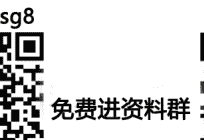
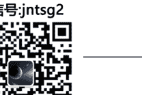

# 学习笔记，2025.4.29

1，为什么说大多数人都是金融消费者而不是投资者？

因为投资是一个系统的事，什么时候进，什么时候出，什么时候按兵不动，都有对应的策略，是在进场前就该给自己定下的规矩，坚决执行，每个投资者都有自己的系统。

散户没有系统，只会追涨杀，赚了不知道为啥赚，亏了也不知道为什么亏，他们只是去花钱买一种自己有钱能力的感觉，最后感觉买到了，钱也都送进去了。

挣钱从来不是容易的事，任何人、任何行业告诉你赚钱容易，都是忽忽悠悠你进去消费的。

2，对喜欢的东西，要极表达喜欢，因为讨厌讨厌的人不会掩饰自己的讨厌。

沉默也是一种表达，但会把评价权交给那些总爱表达负面情绪、表达讨厌的人手上。

不要把话语权让讨厌的人。

3，经常有人说，没有好电影，没有好电视剧，导演、资方不是傻叉，他们只是在研究市场喜欢什么，观众喜欢什么，因为观众喜欢，他们的作品才能盈利。

短剧超越长剧，爽剧超越正剧，恨不得把两个小时的东西都压缩到三分钟，这就是观众喜欢的东西，是观众用自己的钱和时间投票选出来的东西。

4，想上进的人很多，但是有耐心的人不多，他们想要的上进，是今天努力一下，明天就能立刻看到回报，看不到回报，就会怀疑上进的意义，质疑别人是不是不是亏了自己少给了回报。

行动力跟不上欲望，人就会陷入痛苦。

不要高估三五天的努力，也不要低估一年的坚持，改变不是靠某一天，是靠每一天。

5，别爱之前，先好好自己，一个人没有爱自己的能力，不可能真正爱别人。

而且，爱别人，可能无功而返，投入打水漂，但是，爱自己，无论如何都能让自己变得更好。

6，如果长期没自信，就不要想太多了，越想越焦虑。

行动起来，先做成一件小事，让自己看到“我也行”，再开始另一件小事，一次次把事情做成，自信就建立起来了。

很多人的自信是因为总拿去和金字塔的人比较，比不上，就焦虑。

别跟别人比，和自己比，今天比昨天优秀一点点，就是进步。

7，抱怨，对一些人来说，是舒缓自己情绪的方式，要把这股憋在心里的气顺出去，自己才不会持续处于痛苦当中。

但是，这种持续的向外回归，很难让自己获得成长，下次遇到相同的问题，还是会出错，还是会抱怨，还是觉得错不在自己。

8，好的关系，一定能双赢，彼此都有收获，任何单面的付出或索取，都不会会长久。

商业关系也是一样，双方都觉得有赚，才能有回购，有下次合作。

9，一个没有信誉的人，不值得第二次信任，尤其是赌狗那一类人的话，他们如果有信，如果爱惜自己的羽毛，不会沦落到这种情况。

某种程度上来说，朋友借钱是一种低成本筛选的行为，可能他找你借五千，借来就借走，也不打算还，只这这一次，你就能看透他的嘴脸，在一定程度上避免未来的更大损失。

10，现在老板赚钱难，银行赚钱难，找不到好机会。

如果你没资源没人脉，有人告诉你赚钱很简单，不用信，因为告诉你赚钱这事，就就是他的赚钱方式。
