腾讯易科技 | 腾讯易研究院

# 孩子需求是中国车市的最大痛点

中国购车用户家庭收支洞察报告之养育子子女篇(2025版)

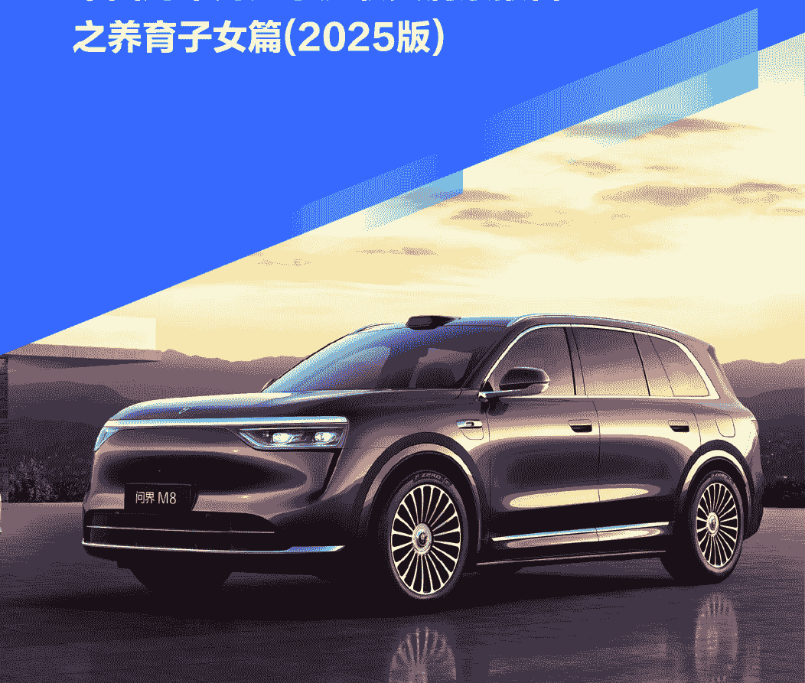

## 免费 价值 及时 专注

## 扫码加入 知识星球TOP 免费资源群 每日免费获取有价值资源 可提供各类资源搜索服务

- 每日免费获取价值资源
- 可提供各类资源搜索服务

| ◆热门付费文章 | ◆各行业报告 |
| :--- | :--- |
| ◆精选图书资源 | ◆副业挣钱方法 |
| ◆职场实用资源 | ◆AI政经自媒体 |

公众号:知识星球TOP 微信信号:jntsg8 微信信号:jntsg2

分享资料仅供个人学习，请及时删除，切勿商用传播

## 团队成员

- 周丽君：院长/首席分析师
- 高英：行业分析师
- 石本雅：行业分析师

# 2022-2024年，中国购车家庭养育子女的负担持续增长且位居榜首，状况极易挤占汽车消费，能否滋生结构性机遇？

2022-2024年，为了降低广大家庭的教育成本与提升高校大学的教学质量，相关部门针对非法教育开展了一系列的严厉打击，该支持却是中国购车家庭养育子女的负担在增长，该汽车支出占比超过15%的购车家庭数占比由58.14%至64.01%，且位居主要购车家庭数占比的榜首；

在主要关注的购车家庭数排行中，汽车以43.13%位居第三，非常靠前，相信我们汽车行业非常活跃，担好养育子女支出会挤占汽车消费市场；目前中国用车（新车）已全面进入存量时代，2024年换购占比近75%。对比首购，增购的弹性更大用户可以多看看，如等车企有大优惠，或者政府有更多补贴再购买；重视教育的意识已深入每一位中国父母的基因里，哪怕不买车，中国家庭也毫不犹豫支持子女学习……随着养育子女的成本持续提升，汽车消费非常容易被压缩，不买车或延迟购未达标准或取消购车；

虽然沉重的养育子女负担部分挤占汽车消费，但养育子女本身也会滋生出购车需求，面对日常上下接送、周末辅导接送、节假日出游等场景，家里有车总归方便。车企、经销商等易车客户，自然得积极捕捉养育子女出生的结构性机遇。至于如何降低养育子女的成本，我们对相关部门要有充分信心

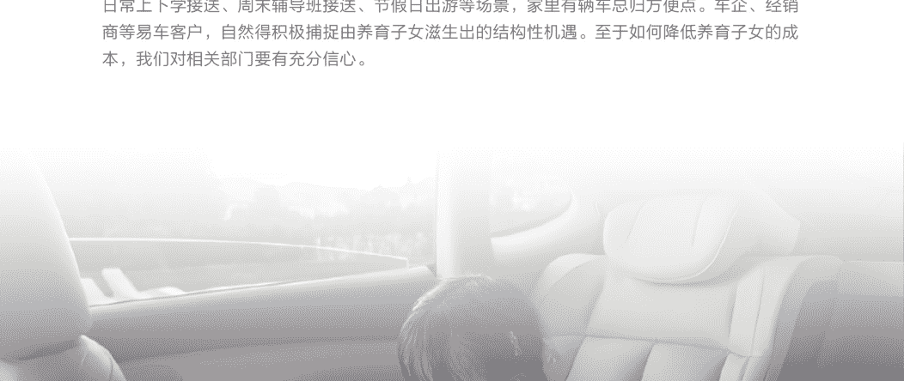

### 2022-2024年：养子女占总支出超15%的中国购车家庭数占比趋势

### 2024年：占支出超15%的主要项目，中国的购车家家庭数占比TOP10

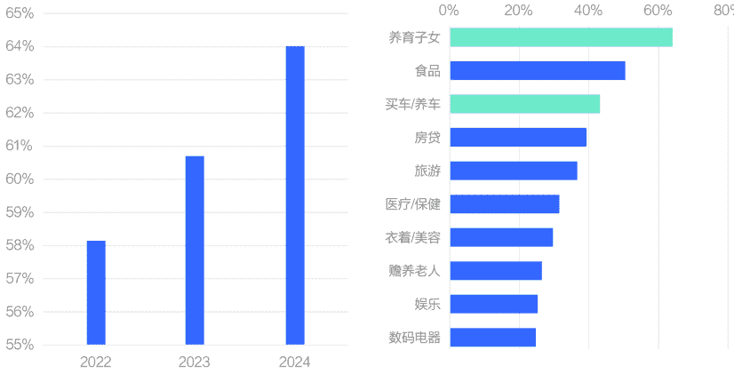

### 2014-2024年：中国乘用车市场(新车)首购、换购与增购占比趋势

- 增购
- 换购
- 首购

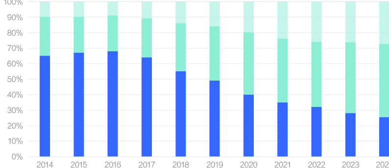
数据来源：畅智调研 数据统计：本文统计中国家庭支出超过15%以上的项目

### 2024年：中国家庭养育子女的平均开支3546元，中位支出2221元

2024年，中国家庭养育子女开支在1000元以内的占比为17.68%，1000-2000元占比最高高达27.60%，2000-3000元占比21.32%，3000-5000元占比14.06%，5000元以上占比近27.0%。

2024年，中国家庭养育子女的平均开支3546元，中位支出2221元。结合购家家庭的收入，有28.82%的家庭支出占收入在10%以内，33.30%的家庭支出占收入10%-30%，22.27%的家庭支出占收入30%-50%，15.60%的家庭支出占收入50%以上。

养育子女的具体支出项目：生活费/零花钱支出最高，是学费、学习用品等密切相关。课外辅导位居第四，也非常频繁其单价高。在中国不少城市，少则几百，多则几百，年轻用户的汽车消费并不突出。

2024年，中国家庭养育子女开支分布：

| | 1000元以内 | 1000-2000元 | 2000-3000元 | 3000-5000元 | 5000-7000元 | 7000-10000元 | 10000元以上 |
| :--- | :--- | :--- | :--- | :--- | :--- | :--- | :--- |
| 25% | | | | | | | |
| 20% | | | | | | | |
| 15% | | | | | | | |
| 10% | | | | | | | |
| 5% | | | | | | | |
| 0% | | | | | | | |

### 2024年：中国购车家庭养育子女开支占收入比例

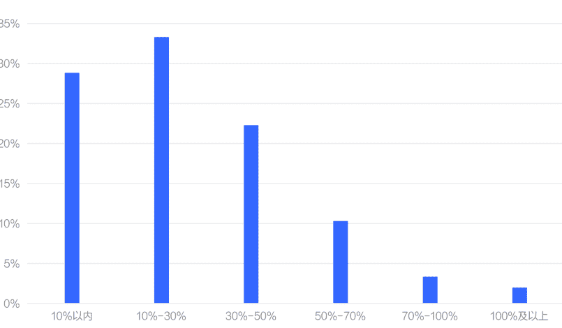

| 项目 |
| :--- |
| 生活费、零花钱 |
| 学费 |
| 学习用品（平板、电脑等） |
| 外习（培训、家教等） |
| 穿（衣服、鞋等） |
| 吃（餐、奶粉、零食等） |
| 住（学校住宿、租学房等） |
| 娱乐（玩具、游乐场等） |
| 医疗保健（打疫苗、看病等） |
| 旅游 |
| 买保险 |
| 行（自行车、地铁、公交等） |
| 购房 |
| 买车 |
| 彩礼、嫁妆 |

### 2024年：中国购车家庭养育子女的主要开支项目TOP15
数据来源：赛讯研究院

# 中国购车家庭养育子女的负担已沉重，还在加剧
### 2024年41.59%家庭的子女开支有提升
### 尤其是子女还是大学的家庭

2024年，中国购车家庭养育子女的平均月开为3546元，中位支出2221元，对不少普通家庭而言，其实确实有压力，不少购车家庭可能会转向二手车市场。养育子女开支对中国汽车市场的压力还会提升，2024年41.50%中国购车家庭养育子女的开支在提升，明显高于26.70%的降低比例，另外31.71%的子女负担保持不变；

从各年龄段购车家庭的子女年龄来看，提升最显著的是45-49岁的购车家庭，该年龄段购车家庭的子女以上大学为主。近几年大学费增长显著，尤其是民办大学，相关资料显示，2024-2025年中国民办大学学费的中位数由2.1万元进一步跃升至2.25万元。再加上子女生活费，一个大学生在一年内可能就会耗掉家庭五万的收入。目前，民办大学的大量学生来自中低收入家庭，沉重的子女读书负担，将进一步侵蚀以小型产品为主的中国入门新车市场。

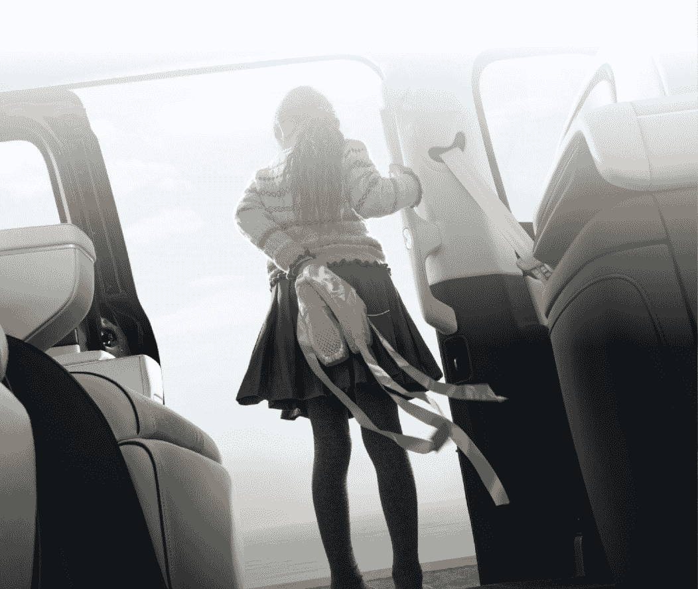

### 2024年：中国购车家庭开支变化

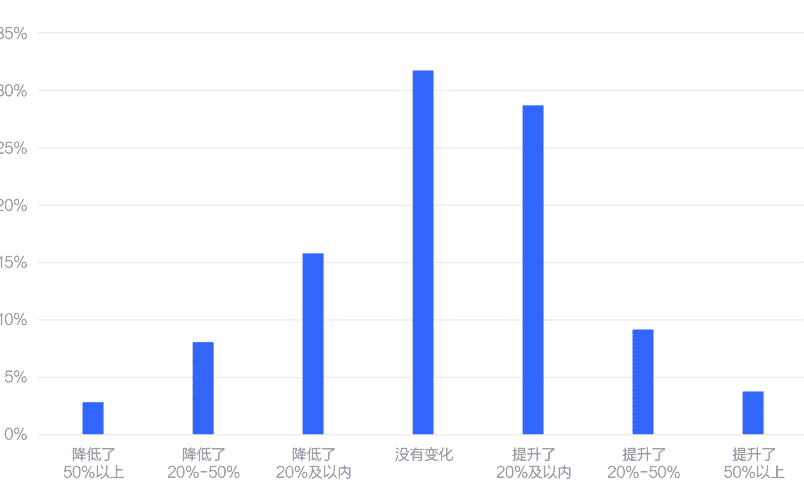

### 2024年各年龄段购车家庭开支变化

- 提升了50%以上
- 降低了20%及以内
- 提升了20%~50%
- 降低了20%~50%
- 提升了20%及以内
- 降低了50%以上
- 没有变化

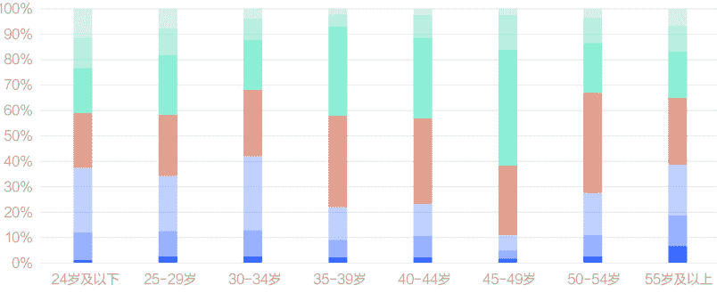
来源：携程研究院

# 中国家庭的子女负担还在加剧，两极化显著将推新车市场重心上移，进一步聚焦高收入家庭

2024年，30岁以内购买家庭的子女是6岁以下，尚未大规模进入教育阶段，月支出1000-3000元。分化显著，平均数与中位数接近3000元以上；

30-44岁购买家庭的子女以义务教育为主，课外辅导等支出项目，分化显著，1万以内和万以上的开支都快速提升，平均数与中位数快速扩大，前者升至3500元，后者升至2100元以上；也就是说，只要孩子上大学的，不管是低收入家庭还是高收入家庭，都得不少钱；

45-59岁购买家庭的多数进入大学阶段，3000-5000元的占比提升，同时1000元以内占数下滑，平均数和中位数在提升，前者升至3816元，后者升至2733元。

50-54岁购买家庭的多数结束了大学，开始步入社会并独立生活，1000元以内的占比大幅提升，平均数和中位数回落，终于可以休息一下；

55及以上购买家庭又开始忙碌，帮助子女完成结婚，该年龄段支出万元以上的占比大幅提升。有些孩子父母操心，该年龄段支出1000元以内的占比也持续提升。

整体来看，各年龄段支出分化显著，均衡中低收入家庭的新车消费。高收入家庭虽然存在养育子女的重负担，但绝对值更强，购买新车的能力自然也强，潜移默化将推新车市场重心上移，进一步聚焦高收入家庭。

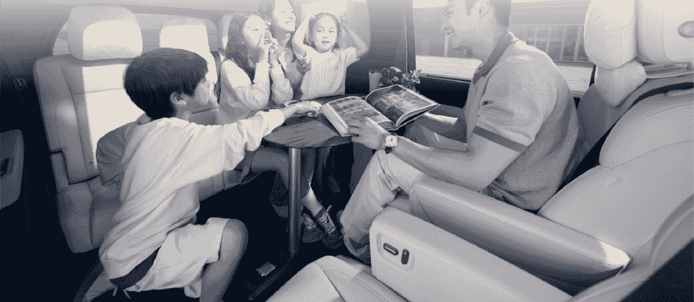

### 2024年各年龄段购车家庭的月度支出平均值与中位值(元)

- 中位年龄
- 平均年龄

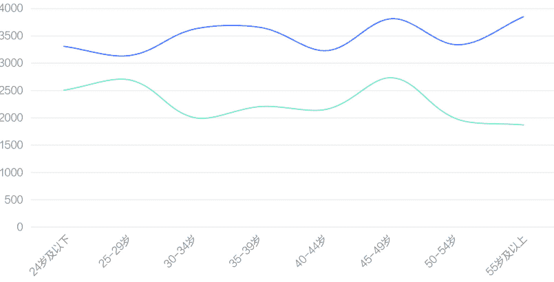

### 2024年各年龄段购车家庭的养育子女支出分布

- 10000元以上
- 2000-3000元
- 7000-10000元
- 1000-2000元
- 5000-7000元
- 1000元以内
- 3000-5000元

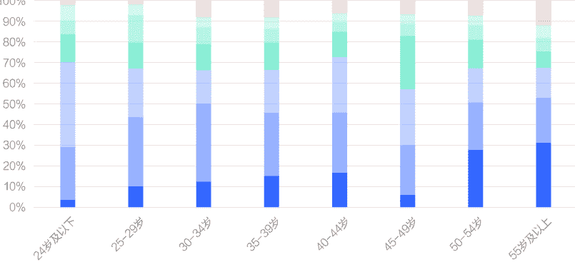
数据来源：车研研究院

### 2024年，雷克萨斯、凯迪拉克、腾胜等高端品牌养育子女的负担突出，高端品牌更积极探索由于增长的结构性机遇

整体来看，中国高端家庭养育子女的负担较重，本身品牌间差异较大，其中高端品牌的子女负担更显突出。2024年在养育子女总占超过15%的主流品牌中的家庭数排行中，雷克萨斯以79.8%位首，其次是凯迪拉克、腾胜、沃尔、理想、魏、奔驰、奔利，TOP20以内高端品牌为：

- 高端品牌子女负担较大的主要原因之一：是国际学校、海外留学、一补多补等项目的昂贵费用，是许多普通家庭负担不起的，多数参与者有能力购买凯迪拉克、奔驰、宝马等高端品牌的中富豪家庭为主；二是中国高端品牌的爆发式增长起于2015-2016年，当时选购B4C等高端车型的用户以后，随着高等教育的大众化，中国市场成为年轻化。已经是2025年，曾经的在小学、初中或高中，并参加各种补，让一个活生生的。

养育子女的负担相对匮乏，容易引起汽车消费，但是品牌确实能够满足结构性需求，中国市场的表现也印证了。2022-2024年，积极迎合家庭用车场景的判断。

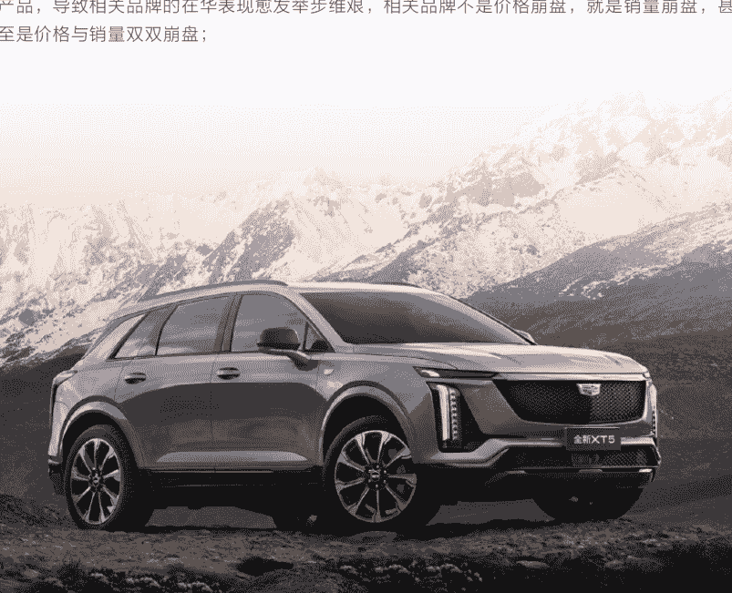

对于需求妥协、宝马、自达等一众强调运动理念的来说，是难以接受的或是店后。未来十年，用车仍然立足于中国市场，海外品牌的定义市场和重新定位。近年来，三田、奔驰、凯迪斯等部分，已领悟到部分精髓，哪种分挂的操控性。养育子女TOP20中，也有比亚迪、标致、奇瑞等少数品牌。2020-2024年，虽然比亚迪的销量从40万升至40万，但2025年以后，比亚迪积极迎合用车需求依然寥寥，燃、L等相关产品还在试点期。2025-26年，比亚迪将冲击50万辆，得完全满足。调整。近年来，奇瑞的瑞豪在城市场先先抢到家庭用车的新商机，并不停布布了捷豪山L系列，可能有些逊锐了。

### 2024年养育子女花费超过15%的主流品牌家庭占比TOP20

| 雷克萨斯 | 79.78% |
| 凯迪拉克 | 78.51% |
| 宝马 | 78.14% |
| 沃尔沃 | 76.95% |
| 理想汽车 | 76.47% |
| 贵驰 | 75.62% |
| 奔享 | 75.58% |
| 小鹏 | 75.19% |
| 瑞林 | 74.74% |
| 材料 | 72.25% |
| 广汽车 | 71.43% |
| 特斯拉 | 71.11% |
| 广汽传祺 | 70.76% |
| 路虎 | 70.65% |
| 比亚迪 | 70.63% |
| smart | 69.04% |
| 标致 | 68.86% |
| 奇瑞 | 68.42% |
| 奥迪 | 67.80% |

数据来源：盖世研究院
数据说明：主流品牌指在华销量突破30万辆的品牌

### 从年龄段，2024年中国家用家庭的子女年龄平均为13.79岁

2024年，中国家用家庭的子女年龄占比最高的是6-11岁，高达23.69%。该年龄段的父母集中在1985-1995年，刚好是中国改革后人口最多的一批。3-5岁和3岁的以下的大幅下降，因为该年龄段的父母以95后以后，不仅出生人口少，而且持续下降。12-17岁和18-22岁的子女占比虽然呈现下滑趋势，但明显高于6岁以内，因为该年龄段的父母以75后或80后为主，不仅出生人口多于95后，而且结婚生的意愿也强于95后。22岁以上年龄段的子女占比也不低，高达21.46%，该年龄段的父母以60、70后为主，子女多数已独立，父母车辆不会考虑子女的用车需求；

从年龄段家用家庭的子女年龄分布，2024年30岁以内家用家庭的子女3岁以内为主，该年龄段子女的日常出行为“豪华车”，除了进院打疫苗，平时用到汽车的不少。35-39岁和40-44岁家用家庭的子女集中在6-17岁，刚好处于义务教育阶段，用车场景丰富。50岁及以上家庭的子女22岁以上为主，大多数如此。整体看，2024年中国家用家庭的子女年龄为13.79岁，中位年龄为13.45岁，都处于初阶段，容易出生、周末游、节假日自驾等。2025-39岁，30-34岁和40-44岁年龄段的用户，重点考虑用车，需求突出，分别高达22.24%、18.76%和13.56%。

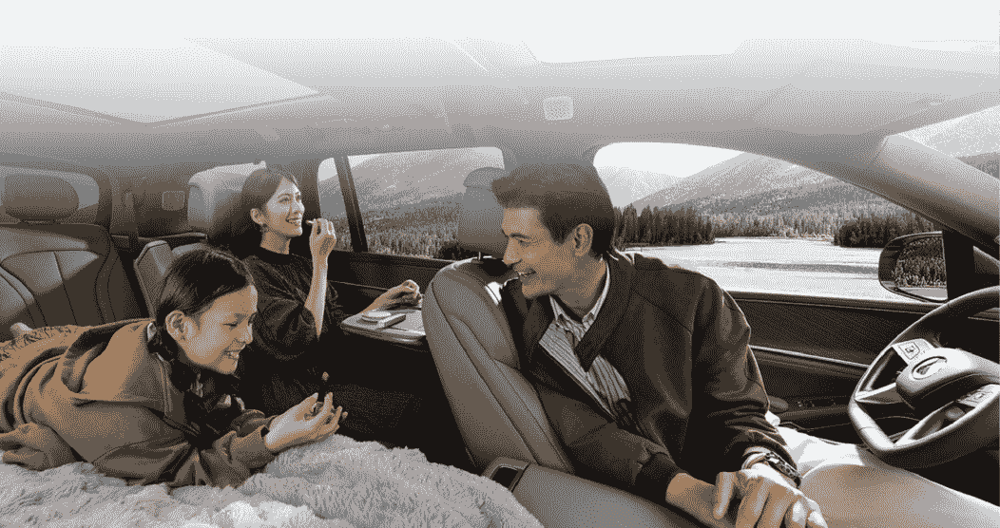

### 2024年中国购车家庭的孩子年龄分布

- 22岁以上
- 12-17岁
- 3-5岁
- 18-22岁
- 6-11岁
- 3岁以内

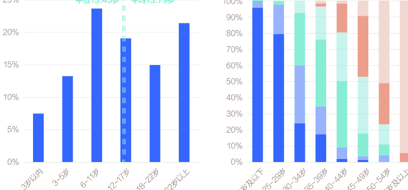

### 2024年各年龄段购车家庭的孩子年龄分布

- 55岁以上
- 50-54岁
- 45-49岁
- 35-39岁
- 30-34岁
- 25-29岁
- 24岁及以内

数据来源：慧聚研究院

### 2024年各年龄段购车家庭的年龄分布

2024年、大众、奇瑞、比亚迪、奥迪、长安、吉利等多数购车家庭的子女处于中小阶段。2024年，其平均年龄为19.83岁，领先主流品牌。所有销量超万辆的主流品牌中，捷达购车用户是不需要用车的，风行、红旗、豪驰之后位居TOP3，保持品牌调性不变，可能满足性价比突出的需求。

2024年，小米、维拓、icar、智己、领锐、格昂等个性性或实力品牌的子女年龄偏小，如果上述品牌持续走量或加速，理论上将拥有女性的家庭用户簇。上述品牌也是心神，2025-2026年，都会布局大能品牌，领锐90已在2025年半年投放，开局表现不错；

2024年，长达的哈瑞、奥与大众三大子品牌车家庭的子女年龄为15.93岁、14.83岁，差异并不显著。奇特的途、星和奇瑞分别为15.88岁、15.04岁和14.33岁，差异同样不显著。吉利汽车的吉利、凯锐与领锐分别为11.24岁、10.36岁和3.50岁，虽然长城和奇瑞购车家庭的子女年轻，内部差异也不显著……从孩子年龄看，主流中国企业的多品牌策略尚需优化。

### 2024年主流品牌购车家庭的子女年龄排行（周榜）
### 2024年主流品牌购车家庭的子女年龄排行（周榜）

| 捷达 | 19.83 |
| 东风 | 17.89 |
| 江淮 | 16.61 |
| 凯胜 | 16.34 |
| 大众 | 15.93 |
| 瑞狮 | 15.88 |
| 瑞实 | 15.81 |
| 特田 | 15.79 |
| 日产 | 15.74 |
| 比亚迪 | 15.50 |
| 广祺 | 15.47 |
| 吉利 | 14.50 |
| 启凯 | 14.46 |
| 林野 | 14.37 |
| 星田 | 14.34 |
| 奔驰 | 13.92 |
| 奥迪 | 13.82 |
| 德系 | 13.37 |
| 雪铁世 | 13.21 |
| 昂扬 | 12.96 |
| 坦克 | 12.88 |
| 宝骏 | 12.75 |
| 安 | 12.70 |
| 方程豹 | 12.07 |
| 长安 | 12.06 |
| 德瑞 | 11.80 |
| 理想 | 11.76 |
| 斯亚 | 11.53 |
| 广祺 | 11.48 |
| 吉利 | 11.24 |
| ARFOX | 10.51 |
| 欧尚 | 10.47 |
| 亚风 | 10.02 |
| 斯域 | 9.25 |
| 马达 | 8.29 |
| 小鹏 | 7.83 |
| 特驰 | 7.61 |
| 捷赛酷 | 6.42 |
| 五菱 | 5.53 |
| 名爵 | 4.50 |
| 领锐 | 3.50 |
| iCAR | 3.01 |
| 小米汽车 | 2.16 |

# 从数量看，2024年中国购车家庭的平均孩数1.21

### 2孩及以上占比33.49%，用车场景丰富
### 易成为购车家庭的重点关注

由于日益年轻的用户（原文为（首））涌入市场，中国新市场的用户年龄占比持续提升，且有孩家庭为主。2024年家用用车市场（新车）的用户年龄占比高达78.66%，其中二孩及以上占比33.49%，比无孩还高（此处原文逻辑可能存在笔误），把当年中国用车家庭的平均孩数提升至1.21。

各年龄段家庭的用车需求，随着年龄段的提升而提升；24及以下年龄段家庭的无孩占比近六成，意味着该年龄段的购车用户可以不太考虑子女需求；25-39岁购车家庭都以一孩为主，其中35-39岁的二孩及以上占比四成。由于该年龄段的子女以上小学和初中为主，理应引起购车企业的重点考虑；40-44岁年龄段的二孩及以上占比比上一个增加了一项，无孩占比该年龄段的二孩及以上小学、初中、高中为主。车企业更要认真考虑该年龄段家庭的用车需求；45岁及以上的二孩及以上占比接近六成，该年龄段购车家庭的子女要么上大学，要么开始工作，甚至已成业，子女年龄对父母购车影响不大：

近十年，中国乘用车市场（新车）购车用户的年龄在持续增长，2024年的平均年龄突破40岁，中位年龄突破38岁，理论上对应的子女以上小学、初中和高中为主，与前述的年龄数据相呼应，共同论证了一个观点，即足以尚处于学习期的子女用车需求，是中国车的主流需求，甚至是最大需求。

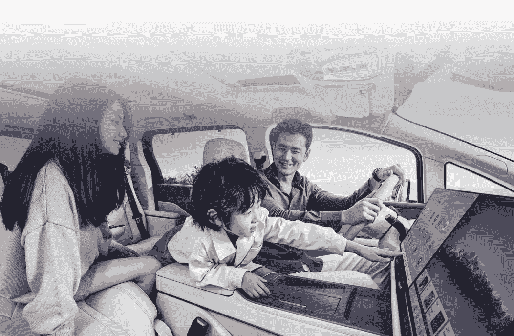

# 2024年中国购车家庭的拥有孩分布

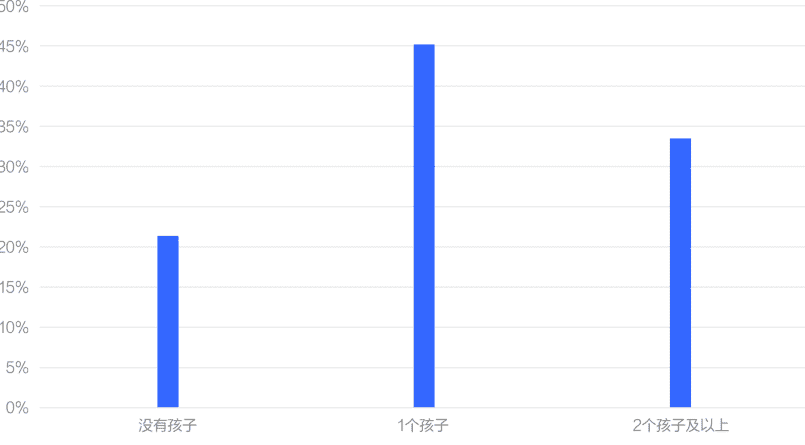

# 2024年各年龄段中国购车家庭的拥有孩分布

# 2014-2024中国乘用车市场(新车)购车用户的平均与中位年龄趋势（周岁）

- 2个及以上
- 1个
- 0
- 中位年龄
- 平均年龄

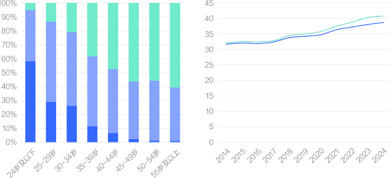

数据来源：慧想研究院

# 2024年，购车家庭的子女年龄组合
### 以6~11岁+12~17岁和12~17岁+18~22岁为主，大平均年龄17.01岁、二宝9.77岁、三宝1岁

2024年，中国购车家庭二胎及以上的整体占比高达33.99%，类似于多家庭中有一个，此例并不低，能深刻影响中国市场。其优对中型及以上、三六七座等分车市场有深远影响，而且2025-2026年广大企业密集投放的大型车型具有决定性价值;

从中国购车家庭子女较多的具体年龄组合来看，2024年以11~17岁和18~22岁两年年龄段为主，占比分别为18.62%和17.94%。两个年龄段组合，类似于小学、中学及大学，其中包含初和高中的学生是两者的重量部分，由于该年龄段的子女用车场景丰富，意味着多购车家庭同样有强烈子女用车需求;

2024年，中国多购车家庭大宝的平均年龄为17.01岁，二宝为9.77岁，三宝为1岁，前后都相差八九岁，类似于哥哥姐姐在上高中，弟弟妹妹在上小学，或哥哥姐姐在初中，弟弟妹妹还在怀里。对于中大型SUV、中大型MPV聚焦多孩家庭的产品，提出了更高要求，不仅要考虑婴儿的用车需求，诸如奶瓶该怎么放，还要考虑哥哥姐姐们的用车需求，诸如学习该怎么怎么进行;

# 2024年多购车家庭的子女年龄组合TOP10

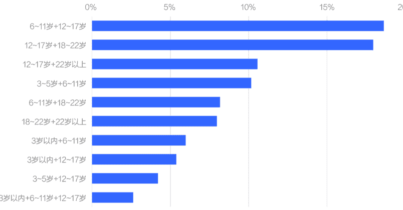

# 2024年多购车家庭的子女平均年龄（周龄）

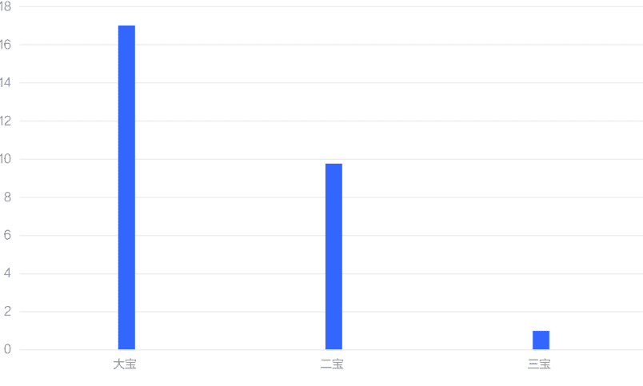

数据来源：晴基研究院

# 2024年，哈弗、奇瑞、别克、理想等多数品牌购车家的孩子数都高于大盘水平，用户用车需求更具强势

2024年，中国家庭购车孩子最多的是东风，高达1.502个，仍领先榜，这与风行市场的商为主有关，这些销量往往是夫妻店的，虽然辛苦了点，但生孩子的概率自然会增长。2024年东风还此时推出了中大MPV车型V9，布局了多孩家庭的潮流，能进一步探寻常车风家庭的用户指数，接下孩子上学、子女驾游的用车概率高，用方式，相同能更好把握V9的需求量。以1.491个孩子数为第二，德韩至2025年6月，用车以奶龄为主。网上的多为家长为口粮，不少时候不肯离广州、深圳等城市跑网的，与子女数量多，子女买车的市场竞争严峻激烈，唯捷以1.470个孩子数为第三，这与2023-2024年孩精准重心重心加速转向高山、等等。2025-2026年，孩精准重重点产品，优进一步优化（2025-2026年）中国多孩汽车的价格将整体化。

2024年，国内销量位第一和第二的孩子数分别为1.305和1.351个，两者在多孩家庭市场中都没有优势，不过2025-2026年会会布局，多孩家庭的绝对优势和比亚迪能否把大众打仗。多孩市也是2025-2026年演变成“螃蟹捕”后，2025年下半年吉利将投放M9等大能逐号。别克、瑞田等海外品牌，积极布局，仍有效满足多孩家庭的需求。

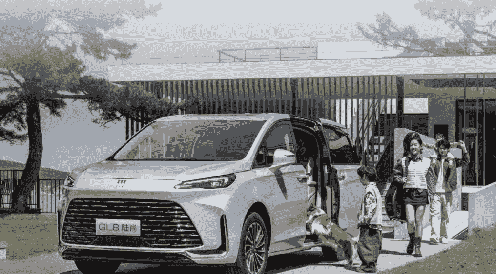

2024年，许多品牌购车家的频数高于大盘水平，且在2025-2026年，进一步扩大份额，一旦该攻势，小米、特斯拉、领克、极氪、icar等许多新品牌的频数较少，甚至不足1个。

| 2024年主流品牌购车家庭平均频数排行(个) | 2024年主流品牌购车家庭平均频数排行(个) | 2024年主流品牌购车家庭平均频数排行(个) |
|---|---|---|---|---|---|
| 东风 | 1,502 | 大众 | 1,351 | 长安汽车 | 1,172 |
| 华 | 1,491 | 广迪 | 1,344 | 奔驰汽车 | 1,153 |
| 理想 | 1,470 | 零跑汽车 | 1,331 | get | 1,142 |
| 捷胜 | 1,468 | 荣城 | 1,327 | 雷莱斯 | 1,136 |
| 启龙 | 1,467 | 比亚 | 1,311 | 宝马 | 1,103 |
| 广汽传祺 | 1,452 | 现代 | 1,305 | smart | 1,084 |
| 广域 | 1,444 | 向鸿 | 1,290 | 路迪 | 1,078 |
| 捷达 | 1,423 | 本田 | 1,286 | 克斯尔孚 | 1,062 |
| 希瑞 | 1,412 | 青海 | 1,269 | 温泽汽车 | 1,043 |
| 启源 | 1,411 | 东方系 | 1,267 | 智己汽车 | 1,039 |
| 迪达 | 1,410 | 方程 | 1,238 | 捷胜 | 1,026 |
| 江淮 | 1,404 | ARCO集团 | 1,233 | 名爵 | 1,023 |
| 起亚 | 1,398 | 北京 | 1,228 | iCAR | 1,016 |
| 别凯 | 1,382 | 瑞铃 | 1,219 | 汽车 | 959 |
| 东亚奔驰 | 1,381 | 凯莱拉克 | 1,199 | 格瑞 | 925 |
| 理想汽车 | 1,379 | 吉利汽车 | 1,188 | 特瑞昂 | 899 |
| 宝骏 | 1,376 | 小米 | 1,182 | 小米汽车 | 897 |
| 五菱汽车 | 1,376 | | | |
| 福田 | 1,374 | | | |
| 星界 | 1,370 | | | |

数据来源：易观研究院
数据解释：主流品牌购车家庭在当年有效购车期间的万份样本*

# 2024年养育子女冲击中国家庭的购车
## 子女需求是中国车市的最大痛点

2022-2023年，中国购车家庭养育子女的支出占总支出超过15%的家庭数量占比58.14%升至64.01%，且主要家庭支出占比的榜首。养育子女的平均月支出3546元，中位开支2221元，33.30%的家庭。中国购车家庭养育子女的负担不仅沉重，而且还在加剧，且分差异显著。这一系列挑战极易导致汽车市场，2024年养育子女冲击了中国家庭的购车行为，其中15.92%家庭推迟购，养育子女降低购车标准，6.73%家庭放弃购。

虽然汽车、经销商等大购车客户，无法解决如何降低购车养育子女的难题，我们可以积极考虑养育子女出生的机会性，尤其是子女相对更重要的高端品牌：从年龄看，2024年中国家庭的子女平均年龄13.79岁，正如此，子女用车场景丰富，容易成为购车家庭的重点关注；从数量看，2024年中国家庭的用车平均频率1.21次，2及以上占比33.39%，子女用车同样。

未来十年购车主要开支在子女，2024年养育子女。

数据来源：慧想研究院
