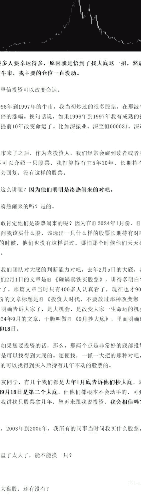
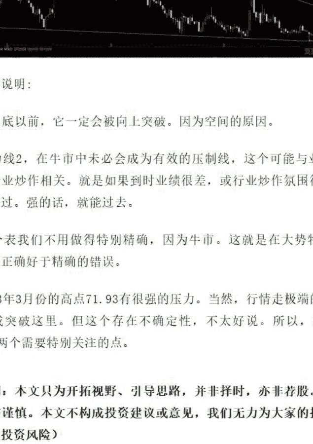

# 行业报告：锂电行业深度解析

2023年下半年以来，全球宏观环境错综复杂，受美联储加息超预期、地缘政治动荡等多重因素影响，锂电价格遭遇了剧烈波动。

在这种宏观背景下，中国锂电行业面临着前所未有的挑战。然而，随着新能源汽车、储能以及消费电子领域的持续增长，锂电行业的需求端依然处于历史高位。

与此同时，供给端也发生了深刻变化。随着全球锂矿产能的释放以及国内企业产能的扩建，锂电池的供应压力正在逐渐缓解，这使得行业进入了供需平衡的关键期。

本文将从锂电行业的宏观环境、产业链分析、核心技术演进、竞争格局以及未来趋势等多个维度，对锂电行业进行深度剖析，旨在为投资者和从业者提供有价值的决策参考。

从图1可以看出，2021年以来碳酸锂价格一路攀升，在2022年上半年达到了60万元/吨的历史高位。随后，随着需求放缓和产能过剩，价格开始持续回落，并在2023年跌至10万元/吨以下的区间。

价格的波动直接影响了产业链上下游企业的盈利能力。上游企业在价格高位时获得了巨额利润，而下游企业则面临着成本上升的压力。随着价格回落，行业的利润空间正在重新分配。

## 一、 锂电行业供需分析

### 1. 需求端：持续增长的动力源

新能源汽车是锂电需求最大的驱动力。随着全球电动汽车渗透率的提升，动力电池的需求量持续快速增长。此外，储能市场的崛起也为锂电池（尤其是磷酸铁锂电池）提供了新的增长点。

消费电子领域虽然增速相对平缓，但智能手机、笔记本电脑等产品的迭代更新依然维持了稳定的锂电需求。

### 2. 供给端：产能释放与结构性变化

近年来，锂矿产能的快速扩张缓解了原材料的短缺压力。同时，国内锂电池企业的密集扩产也释放了巨大的产能。然而，由于产能布局不均衡，部分企业面临着严峻的生存压力。

目前，行业正处于产能过剩向供需平衡过渡的阶段。只有具备核心竞争力的企业才能在激烈的竞争中生存下来。

## 二、 产业链深度解析

### 1. 上游：锂资源与矿加工

锂资源主要包括锂云石、锂卤水等。上游价格的波动受全球地缘政治和开采成本影响较大。矿加工技术的进步和回收率的提升是上游企业竞争的关键。

### 2. 中游：电极材料与电池制造

中游涵盖了正极、负极、隔膜和电解液。其中，正极材料的迭代最快。电池制造则是行业的核心环节，竞争主要体现在能量密度、安全性和成本控制上。

### 3. 下游：应用端

下游主要包括动力汽车、储能电站和消费电子产品。终端市场的需求变化直接决定了中游企业的经营状况。

## 三、 核心技术演进

### 1. 三元锂 vs 磷酸铁锂

三元锂以高能量密度为优势，主要用于高端动力市场；磷酸铁锂则以高安全性和低成本为优势，在中低端市场和储能领域占据主导。

随着固态电池、钠离子电池等新技术的发展，未来的市场格局可能会发生颠覆性的变化。

# 大文集 VIP 群（原价 300，限时年费 249）包括以下全部内容历史清单：

加微信 daizongdai2021 大文集 VIP 群简介 加微信 pepp854

- ① 吃瓜群众私享（含）内部文章（加微信实时群聊天（原价 365 元/年）
- ② 子明学 VIP 畅享内文章（原价 568 元/年）
- ③ 政事堂（顾子明）付费后另读子明明册
- ④ 米联储见闻【作者米穗】（原价 599 元/年）
- ⑤ 欧洲畅享（原价 328 元/年）
- ⑥ 内部圈（原价 400 元/年）
- ⑦ 卢克文专属（原价 699 元/年）
- ⑧ 财点（原价 331 元/年）
- ⑨ 猫哥的视界（原价 299 元/年）
- ⑩ 大财周刊【独家新闻】（原价 1498 元/年）
- ⑪ 杨世光在榜（原价 2200 元/年）
- ⑫ 蔡森财经（原价 1600 元/年）
- XIII 灏泽异谈
- ⑭ 司马解读猛选全套音视频全书珍藏
- ⑮ 虚陆声部（民国史、帝国齿轮、不理解的）（原价 599 元）
- ⑯ 卢克文（原价 268 元/年

额外内容：卢犀望新微博付费专栏、杭西边老王、三九花集；不定期内容：————（更多资源私下发）

- 守夜人司令、换搞魔王、生财有术、雪花虾老头等
- 创始笔记、达达天演讲论、成竹财富圈、雪花后、财上海学家等其他大V付费文集
- 西风付费文章、老磊、赢在八小时之外、外人的视界、升值纪、大体制内等一些大V付费文章（每月不超过 600 元的）
