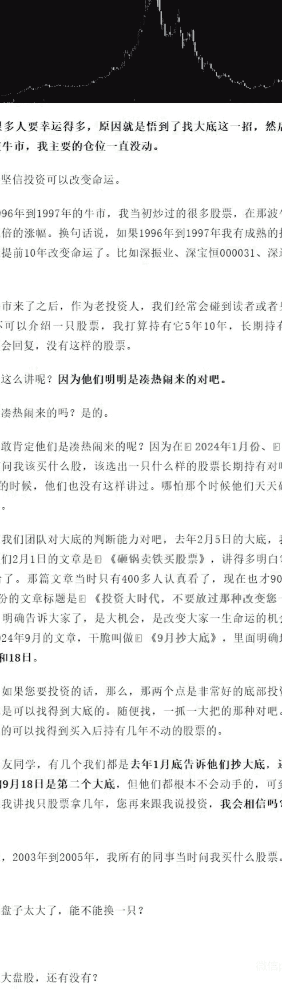
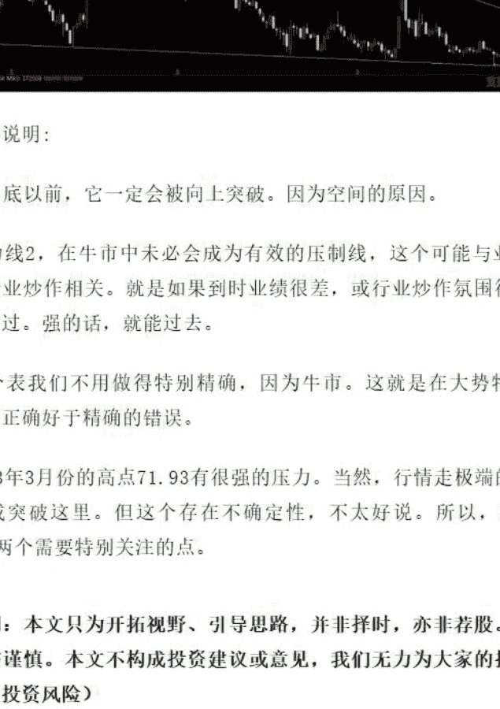
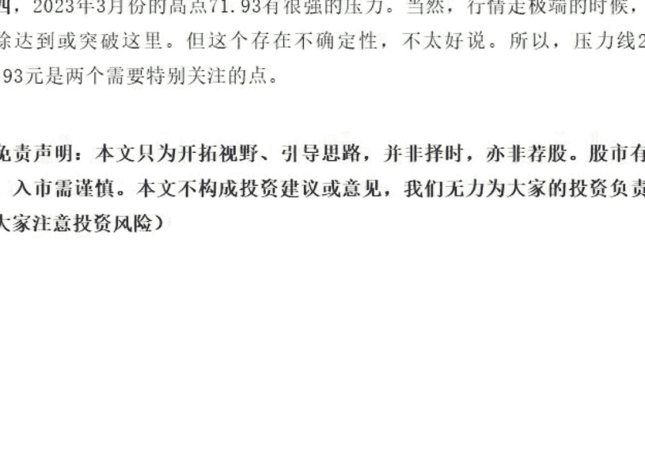

# 回归理性：煤炭的现状与机遇

2022年上半年，全球宏观环境复杂多变，地缘政治冲突加剧、全球通胀持续高位、能源供应紧张等多种因素影响，煤炭板块表现持续低迷。然而，进入2023年后，随着全球通胀预期放缓、货币政策转向以及国内经济需求逐步复苏的预期，煤炭板块迎来了一定的反弹。

从长期来看，煤炭价格经历了一轮又一轮波动的过程。2021年上半年，受全球经济需求回暖及供应受限影响，煤炭价格大幅上升；2022年上半年，受地缘政治冲突引发的能源供应紧张影响，煤炭价格再次大幅攀升，并创下历史高位。

进入2022年下半年，随着全球需求增长放缓以及能源供应逐步缓解，煤炭价格开始出现回落。2023年以来，受全球宏观经济下行压力、国内需求不及预期等影响，煤炭价格呈现出低位震荡态势。

从历史规律来看，煤炭价格呈现出明显的周期性。受宏观经济周期、供需关系变化以及政策调整等因素影响，煤炭价格往往呈现出高低波动的特征。

## 一、煤炭供需现状分析

在需求方面，我国煤炭需求也保持合理增长。2022年，我国煤炭需求为49.3亿吨，较2021年增长3.3%。2023年上半年，我国煤炭需求为24.5亿吨，较2022年同期增长2.5%。

总体来看，我国煤炭供需基本处于平衡状态，保障了能源安全。然而，随着我国能源结构转型的推进，清洁能源占比不断提升，煤炭需求可能面临下行的压力。

另一方面，全球煤炭市场也面临诸多挑战。受全球经济增长放缓、能源转型加速等因素影响，全球需求增长不确定性增加。

## 二、煤炭价格趋势展望

未来煤炭价格将受供需关系、宏观经济及政策等多种因素共同影响。短期内，随着国内煤矿产能的释放和需求侧的预期复苏，煤炭价格可能维持低位震荡为主。

中长期来看，随着全球经济的逐步复苏和能源缺口的持续存在，煤炭价格有望迎来新一轮行情。

综上所述，煤炭行业正处于挑战与机遇并存的，投资者应关注行业变化。

## 三、重点煤炭公司分析

在煤炭行业中，华能煤矿、中国神华、中国煤能等龙头企业表现出较强的竞争优势。

华能煤矿作为资源型龙头，其成本控制和产量保障能力领先。中国神华通过煤电一体化布局，抗风险能力也较强。

重点煤炭公司财务数据对比表

从财务数据看，各公司盈利能力和现金流表现均良好。

## 四、总结与展望

未来煤炭行业将面临深度变革，投资者应关注核心龙头企业。

## 大文集聚焦 VIP 群（原价300，限时年费 249）包括以下全部赠送历史文章：

加微信 daizong2021 大文集 VIP 群 简介 加微信 pep854

- ① 吃瓜群众私享（内）内部文章（实时群聊天（原价 365 元/年）
- ② 子明享 VIP 专属图文（原价 568 元/年）
- ③ 政事堂（顾子明）付费后另送顾子明册
- ④ 米联储见闻【作者米穗】（原价 599 元/年）
- ⑤ 欧洲畅会会员专属文章（原价 328 元/年）
- ⑥ 咕广厂内部图文（原价 400 元/年）
- ⑦ 卢克文专属文章（原价 568 元/年）
- ⑧ 茶财财经（原价 310 元/年）
- ⑨ 猫哥的视角（原价 299 元/年）
- ⑩ 大财新刊【独家新闻】（原价1498 元/年）
- ⑪ 杨世光金榜（原价 2200 元/年）
- ⑫ 蔡森财经（原价 1600 元/年）
- ⑬ 凛泽异谈付费持续更新
- ⑭ 司马庙选全套音频和全套书籍无删减（原价 2.3 万）
- ⑮ 虚虐部（民国风、帝国齿轮、不被理解的）（原价 599 元）
- ⑯ 卢克文知识星球（原价 268 元/年）
- 额外内容：卢颇新微博付费专栏、村西边老王、三九花集；更多资源不要写下了
- ① 守夜人司令笔记、换搞熊猫王后知识星球、生足有知识星球、成竹财富圈、雪花虾老头等
- ② 创始笔记、达达演讲论知识星球、江宁知府、洋咩、财上海学家等付费文集
- ③ 西风付费文章、老磊、赢在八小时之外、局外的视界、升值纪、老体制内等其它一些大 V 付费文章（每月不超过 600 元的付费文章）

大文集 VIP 群 原价 300 元，现仅需 249 元/年，包含以上内容。
