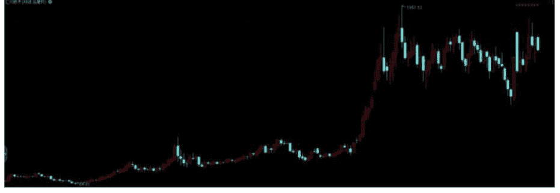
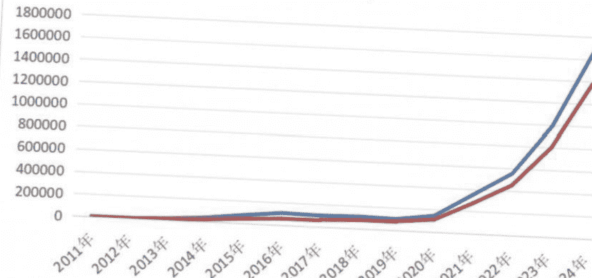
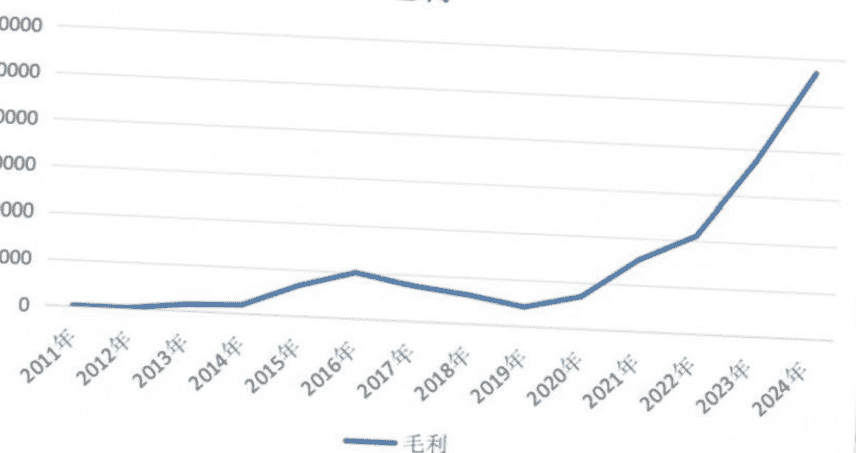
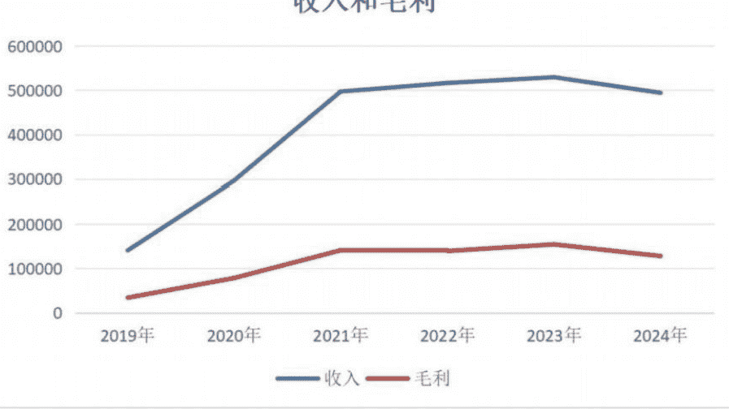
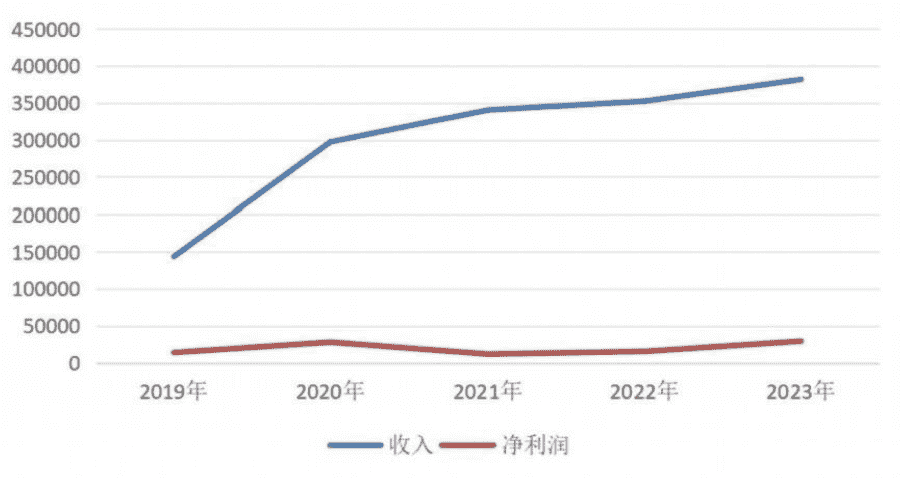
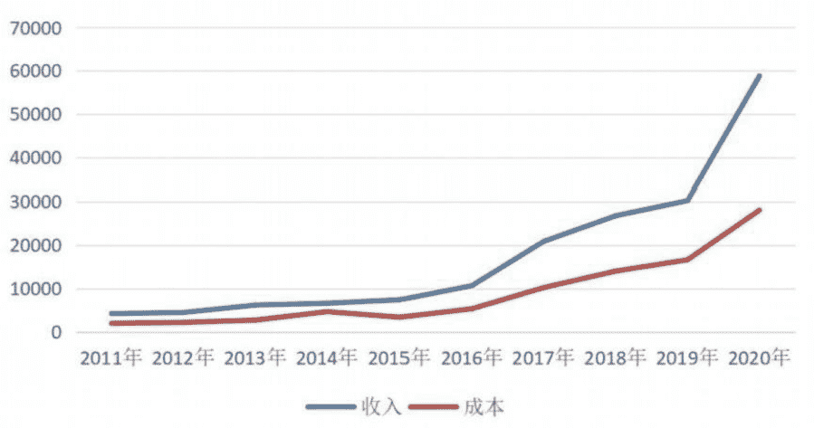
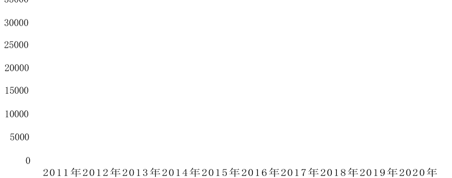
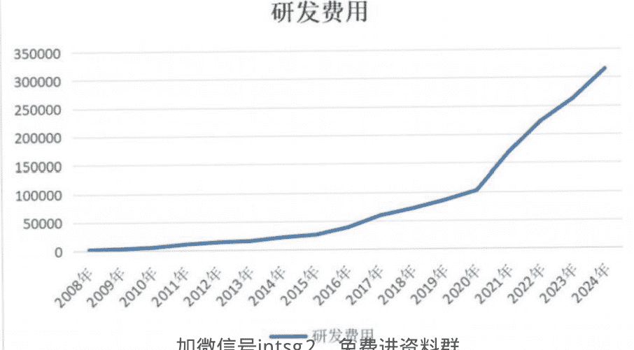
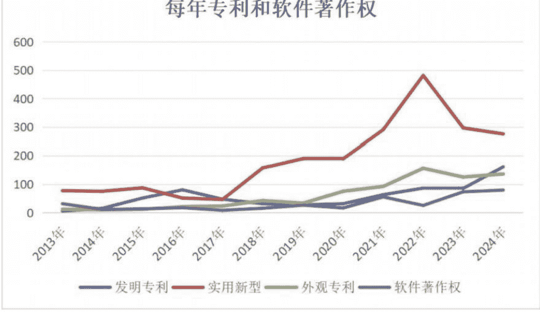
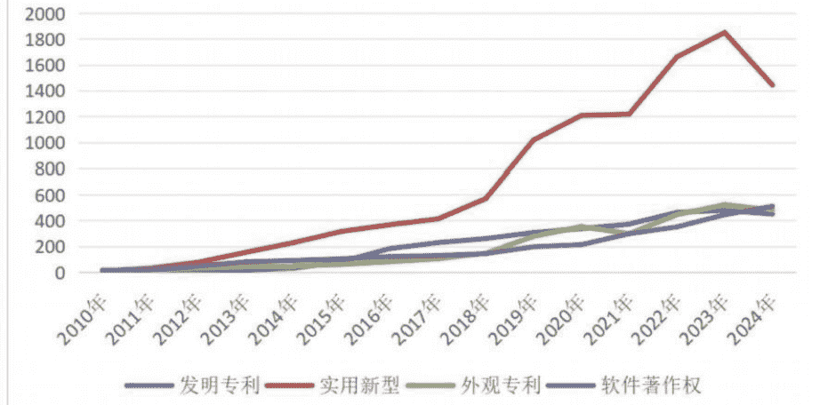

# 公司分析18：华为跃迁新能源汽车、机器人两赛道，未来将进入储能和飞行汽车赛道

原创安Ammin001 深度分析 2025年06月02日07:04 湖北

我很多次提到过初三有位同学，讲的我们的天花板就是他的地板。当年他大致是班上8名到10名，现在我们面前的都远远甩开了。他去年59岁提前退休，除了退休金外，还有每年的股份红。对，就是华为了的股份。所以，他即使退休了也会比咱们同班同学强很多。

他之所以可能能够做到这一点，只是因为大学毕业后去了深圳，然后进入华为很容易的时候他就离开了，他作为老员工一直坚持下来，来到后来能够持有股份，还干了一辈子。他就把咱们当初那个重点班的所有同学，都远远地甩开了。我们可崇拜他的成就也不错。

世纪的时候，我们就知道华为是好公司。当时用“巨头”来说，巨人、大唐、中兴、华，被视为巨头。现在华为为全球著名。特别是是在2019年科技以后，更在我们专业接回孟涵舟之后，华为就成了中国科技领先的代表，也成为了全球顶流的科技。

华为了的股份是不对外的，我们如果我们想要追上那个同学，看来似乎是不可能的。

不过，也可以用类比的方法。就是你退休后能够天天过好日子的关键，就是持有的股份，那因为你以后生活是非常好的保障那，我们既然持有了不为了的股份，但是可以持有为了的股份。我比许多持有有些就了。这样至少在增量块，我们一定不输给你。

这次研究的这家公司，我们团队叫它小华为。它早期一直高速增长了22年，现在已经进入了新能源汽车和智能机器人赛道，未来将进入储能赛道，或许还会进入汽车赛道。

这家公司的做的像华为为了，特别重视研发，比对员工更大投入，管理费用用我们比较，比在市场方面敏锐性，比长期高速增长，比特任何产品你都能看到从零起做到几十亿或几亿至百百万，而且每一种产品都是如此。

关注信号jtsg2 免费资料群

本文分11部分，包括公司的长期市场表现，公司业务分析，各项财务环境应对公司利润的影响，影响公司2024年业绩的因素及其排序，公司2025年一季没有明显的变化，公司基本情况，子公司情况，公司业务的历史表现，公司为什么能够长期增长和未来成长的空间在哪里，其他注意事项，公司的市场定位等。

由于文章很长，数据图较，建议用电脑或平板的微信阅读。

(声明：本文主要为开拓视野，引导思路，并非选择，亦非荐股。股市有风险，入市需谨慎。本文不构成投资意见或建议，我们无力为大家的投资负责，请大家注意投资风险)

# 一、公司的长期市场表现

## 1. 看公司的长期市场表现

这家公司2010年上市，我们可以看看它的长期市场表现，如下：

这是公司上市以来的月K线图。用向后复权，最低点出现在2012年8月，最低64.61元，最高2021年8月，为1951.53元，涨了30.204倍，如考虑2015年6月到2020年5月股份在箱体，就清楚了，公司的主要涨是通过两个波牛完成的。第一波总共35个月K线，第二波33个月K线。

换句话，公司上市以来的表现还是很牛的。两波牛市，不算里面的箱体，它至少涨了30.2倍。这个涨幅不错。

两波牛市，它各自涨了多少？

加微信信号jntg2，免费资料群

第一波，从64.61元到562.59元，涨了8.707倍。

第二波，从296.44元到1951.53元，涨了6.58倍。如果从2019年的低点起，就是237.17元到1951.53元，涨8.23倍。

这是我们对它历史上的市场表现，形成一个整体的概念。

## 2. 这家公司还会不会继续走牛？

微信公众号:jtsg8 微信公众号:jtsg2

# 二、公司业务分析

这家公司，它的业务类型有些复杂。主要做4类业务。我们先讲清楚公司的业务，再逐一细看每项业务在2023年和2024年的截面。我们这个工作，就是取它两年的截面，看到它做得怎么样，再就是后面还有机会。我们仍然采取拆解揉碎的办法，一项项来看，一项项算细账。千万别被别人忽悠。

公司有4类业务，但在收入成本的计算下，表现为3类。

### 1. 自动化业务

公司的自动化业务，分为标准化产品和定制化产品，到四个层面。

#### (1) 控制层

控制层相当于大脑，负责逻辑和实时策略的输出。主要有PLC（可编程控制器）、HMI（相当于人机界面）、CNC（计算机数字控制，通过机器设备相连，实现自动加工过程（如切削、铣削、钻）、运动控制（一体控制器），主要用于各种运动场景，包括位置、加速度等。此外还有分散控制（DCS）。

#### (2) 驱动层

就是驱动层，驱动执行器完成动作。驱动层主要是各种变频器和伺服系统。通用伺服系统、专用伺服等。其中变频器通过频率和电压来进行调速，满足不同工艺的需求。伺服系统的作用是控制，如机械手臂拿起零件、向前移动，在此过程中跟踪位置，并将这些信息反馈给系统，通过调节将其轨迹调整，直到完全合格。

#### (3) 执行层

如机器人、精密机械（导轨）、气动元件（如气缸、气动马达）。

#### (4) 传感器

如各种传感器。

公司的自动化类，2023年和2024年的数据如下（单位：万元）：

| 自动化类 | 2023年 | 2024年 | 增速% | 增量 |
|---|---|---|---|---|
| 成本 | 1503845.45 | 1524298.66 | 1.36 | 20453.21 |
| 毛利 | 831016.36 | 883697.98 | 6.34 | 52681.62 |
| 毛利率 | 672829.09 | 640600.68 | -4.79 | -32228.41 |
| | 44.74 | 42.03 | | -2.71 |

这项业务在公司业务中的占比，2023年为49.43%，2024年为11.15%。业务增长缓慢，毛利持续下滑，受行业竞争加剧影响，市场需求萎缩，带动毛利率下滑2.71个百分点（毛42.03%，还不错）。收入增长2.05亿，毛利下滑3.2亿。这项业务在2024年有些不好。

那可以将公司表现跟全国业务比较一下。2024年，全国电梯业务的市场规模为2859亿，同比1.17%，增长1.36%，比全国增长还是要一线。

总体数据一般，分类产品数据展现可视。2024年统计，公司通用电梯系统全国第一，市场占比28.3%（第二、三、四位的是：西门子9.7%；松下7.1%；安徽光）；低压变频器（含电梯专用频器）全国第一，份额18.6%（第二、三的是：ABB18.1%；西门子15.1%）；高压变频器全国第一，份额18.6%（第二、三的是：施耐德13.6%；ABB10.2%）；小型PLC全国第2，份额14.3%（哈威）；第三的是：西门子36.5%；无锡信捷9.5%；工业机器人全国第3，份额8.8%（第一、二的是：发那科10.9%；埃斯顿9.6%），其中SCARA机器人全国第一，份额27.3%。

这里，除了小型PLC的产品第3名是无锡信捷，工业机器人第2名是埃斯顿了，这两个产品是产品本身，其他都是外国产品。公司主要是在跟外竞争中国市场。换句话说，公司前期一直是替代逻辑。这个可以解释为那种两波牛它还是比较。

### 2. 电梯

公司的电梯产品主要有变频器、电梯控制系统、人机界面（跟显示屏相似）、门机（用于控制电梯开门的等）。这些不用解释。数据如下（单位：万元）：

| 电梯 | 2023年 | 2024年 | 增速% | 增量 |
|---|---|---|---|---|
| 收入 | 529120.88 | 493946.67 | -6.65 | -35174.21 |
| 成本 | 375053.25 | 366225.7 | -2.35 | -88275.55 |
| 毛利 | 154067.63 | 127720.9 | -17.10 | -26346.66 |
| 毛利率 | 29.12 | 25.86 | -3.26 | -1604.75 |

收入下降，同比3.52%，毛利下降26346.66万元。成本增速高于增速4.30个百分点，带动毛利下滑3.26个百分点，负影响毛利1604.75万元。毛利率25.86%，还可以。上述两类业务同比下降5857.07万。

### 3. 新能源汽车和轨道交通

轨道交通是公司业务的第4类，但总体较小，因此单独列出来。公司的新能源汽车业务包括驱动系统、电机、控制器、电源系统，包括DC/DC输出高压直流、24V、48V等低压直流，车灯、音响等各类控制器和OBC（充电模块）、电源系统。数据如下（单位：万）：

| 新能源汽车+轨道交通 | 2023年 | 2024年 | 增速% | 增量 |
|---|---|---|---|---|
| 收入 | 992029.26 | 1664249.53 | 67.76 | 672220.27 |
| 成本 | 804796.7 | 1379267.02 | 71.38 | 574470.32 |
| 毛利 | 187232.56 | 248928.51 | 52.21 | 97749.95 |
| 毛利率 | 18.87 | 17.12 | -1.75 | |

这项业务高速增长。收入增长77%，增量67222万；毛利增长一半，增量97749.95万元，进入收获期。成本高于增速3.62个百分点，带动毛利下滑1.75个百分点，负面影响毛利2912.84万元。毛利率17.12%，不算高，但运行。公司业务增长的驱动因素，这一块是第一动力。2024年，全国新能源汽车增长35.5%，公司此块增速远超全国。

上述4类业务，2024年产生39174.88万毛利。

| 4 其他主业 | 2023年 | 2024年 | 增速% | 增量 |
|---|---|---|---|---|
| 收入 | 14243.69 | 18835.94 | 32.24 | 4592.25 |
| 成本 | 8841.26 | 10007 | 13.19 | 1165.74 |
| 毛利 | 5402.43 | 8828.94 | 63.43 | 3426.51 |
| 毛利率% | 37.93 | 46.87 | | 8.94 |

收入高增长，增速近4600万；毛利超高增长，增速超六，增速3426.51万元。成本增速远低于收入增速，带动毛利率提升8.94个百分点，正面影响毛利1684.73万。至此，全部主营业务产生毛利增量42601.39万元。

## 5. 会计政策变更，将销售费用调整为成本的影响

公司从2024年开始，将销售费用的质量保证费用从费用调整到成本，必然导致2023年的毛利减少36882.07万元。也2023年的成本增加36882.07万元。经过调整，2024年的主营业务产生毛利增量79483.46万元。下面依据公司业务占比重新计算的毛利情况（单位：万元）：

| 自动化类 | 2023年 | 2024年 | 增速% | 增量 |
|---|---|---|---|---|
| 收入 | 1503845.45 | 1524298.66 | 1.36 | 20453.21 |
| 毛利 | 831016.36 | 883697.98 | 6.34 | 52681.62 |
| 毛利率 | 672829.09 | 640600.68 | -4.79 | -32228.41 |
| | 44.74 | 42.03 | | -2.71 |

这项业务在公司业务中的占比，2023年为49.43%，2024年为11.15%。业务增长缓慢，毛利持续下滑，受行业竞争加剧影响，市场需求萎缩，带动毛利率下滑2.71个百分点（毛42.03%，还不错）。收入增长2.05亿，毛利下滑3.2亿。这项业务在2024年有些不好。

## 6. 主营业务（单位：万元）

| 主营业务 | 2023年 | 2024年 | 增速% | 增量 |
|---|---|---|---|---|
| 收入 | 303923.28 | 3701330.79 | 21.78 | 662091.51 |
| 成本 | 2056859.64 | 2639197.17 | 28.33 | 582608.07 |
| 毛利 | 982869.64 | 1062133.08 | 8.09 | 79483.44 |
| 毛利率% | 32.33 | 28.70 | | -3.64 |

收入中高速增长，增量66.21亿：毛利各位增长，增量79483.44万元（跟上面的数据差0.02亿，是四舍入的结果，符合计算规则，不是计算错误）。本年增速为收入增长6.55个百分，带动毛利率下降3.64个百分点，负影响毛利13584.60万元。表明公司业务的几个行业竞争还是比较激烈的。

## 7. 其他业务（单位：万元）：

| 其他业务 | 2023年 | 2024年 | 增速% | 增量 |
|---|---|---|---|---|
| 收入 | 2753.26 | 2764.42 | 0.41 | 11.16 |
| 成本 | 1762.09 | 1742.66 | -1.10 | -19.43 |
| 毛利 | 991.17 | 1021.76 | 3.09 | 30.59 |
| 毛利率% | 36.00 | 36.96 | | 0.96 |

收入增加11.16万，毛利增加30.59万。

## 8. 全部业务（单位：万元）

| 全部业务 | 2023年 | 2024年 | 增速% | 增量 |
|---|---|---|---|---|
| 收入 | 3041992.54 | 3704095.21 | 21.77 | 662102.67 |
| 成本 | 2058353.71 | 2640960.37 | 28.30 | 582608.64 |
| 毛利 | 983640.81 | 1063154.84 | 8.08 | 79514.03 |
| 毛利率% | 32.34 | 28.70 | -3.63 | |

收入中高速增长，增量66.21亿；毛利增长，增量79514.03。成本增速高于增速6.53个百分点，带动毛利率下滑3.63个百分点，负影响毛利134579万元。

# 三、各项财务影响

## 1. 费用（单位：万元）

| 费用 | 2023年 | 2024年 | 增速% | 影响 |
|---|---|---|---|---|
| 税金及附加 | 19720.92 | 23052.35 | 16.43 | 3331.43 |
| 销售费用 | 157438.39 | 148087.75 | -5.94 | -9350.64 |
| 管理费用 | 129875.73 | 154135.31 | 18.58 | 24259.58 |
| 财务费用 | 76.7 | -319.39 | -516.89 | -396.09 |
| 研发费用 | 262414.76 | 314708.07 | 19.93 | 52293.31 |
| 小计 | 569525.5 | 499387.91 | | -70137.59 |

五个环节，除了财务费用，其他影响都不小。它们一同减少营业利润70137.59万元。经过这五个环节，公司营业利润增加9376.44万元。其中影响最大的是研发费用，使得研发投入管理费用影响很大，这一块也不小。销售费用下降，这是一个好现象。公司的这一块钱在收。

## 2. 利得和损失（单位：万元）：

| 利得和损失 | 2023年 | 2024年 | 增量 | 影响 |
|---|---|---|---|---|
| 其他收益 | 72925.13 | 69670.4 | -3254.73 | -3254.73 |
| 投资收益 | 42047.11 | 9345.34 | -32701.77 | -32701.77 |
| 公允价值变动 | 26232.51 | -4307.65 | -30631.16 | -30631.16 |
| 信用减值 | -31701.14 | -14996.53 | 16704.61 | 16704.61 |
| 资产减值 | -23654.46 | -37261.61 | -13607.15 | -13607.15 |
| 资产处置 | 22.08 | 16657.05 | 16634.97 | 16634.97 |
| 小计 | | | -46855.23 | |

上述6个环节，除了其他收益影响较小，那5个环节影响都大。它们一同减少营业利润46855.23万元。

经过6个环节，公司营业利润减少3748.79万元。

这个6个环节中，影响最大的两个是投资收益和公允价值变动。投资收益的差异，主要是权益法核算的长期投资收益，2023年为35061.18万，2024年为3886万，减少31175.02万。

公允价值变收益，规模较大的两个：一个是其他非流动资产融资，到到底是，公司披露很清楚；2023年为28834.11万，2024年为-4236.96万，两年相减33058.07万。二是交易性金融融资，2023年为-3369.39万，来自购买封闭式结构性存款和理财回购，2024年为一76.64万，来自购买封闭式结构性存款；两年相减-3292.75万。这两个减少了29765.32万。

### (3) 营业外支出、所得税收益和股东损益等（单位：万元）：

微信jts2 免费运营

| | 2023年 | 2024年 | 增量 | 影响 |
| --- | --- | --- | --- | --- |
| 营业外收入 | 2495.53 | 2257.79 | -237.74 | -237.74 |
| 营业外支出 | 2547.93 | 3972.03 | 1424.1 | -1424.1 |
| 所得税费用 | 22466.98 | 26243.82 | 3776.84 | -3776.84 |
| 少数股东损益 | 3370.82 | 6090.37 | 2719.55 | -2719.55 |
| 小计 | | | | -8158.23 |

这四个环节跟前面相比，影响稍微小些。最小的是营业外收入。它们共同减少股东净利润8158.23万元。

经过21个环节，包括全部业务环节和全部财务环节，公司股东净利润比减45637.02万元，跌幅9.62%，不扣除非经常性损益后下降0.87%，减少3534.50万元，表明公司主业的表现还可以的，主要的不利影响来自于非经常性损益。

## 四、影响公司2024年业绩的全要素及其排序

影响公司2024年业绩的因素一共21个，其中正面影响8个，负面影响13个。它们的影响额及其排序如下（单位：万元）：

| 排序 | 正面影响 | 额度 | 负面影响 | 额度 | 总计 |
| --- | --- | --- | --- | --- | --- |
| 1 | 新能源+轨道交通 | 97749.95 | 研发费用 | -52293.31 | |
| 2 | 质量保证 | 36882.07 | 通用自动化 | -32228.41 | |
| 3 | 信用减值 | 16704.61 | 投资收益 | -32701.77 | |
| 4 | 资产处置 | 16634.97 | 价值变动 | -30631.16 | |
| 5 | 销售业务 | 9350.64 | 电梯 | -26346.66 | |
| 6 | 其他业务 | 3426.51 | 管理费用 | -24259.58 | |
| 7 | 财务费用 | 396.09 | 资产减值 | -13607.15 | |
| 8 | 其他业务 | 30.59 | 所得税费用 | -3776.84 | |
| 9 | | | 税金及附加 | -3331.43 | |
| 10 | | | 其他收益 | -3254.73 | |
| 11 | | | 少数股东损益 | -2719.55 | |
| 12 | | | 营业外支出 | -1424.1 | |
| 13 | | | 营业外收入 | -237.74 | |
| 小计 | | 181175.43 | | -226812.3 | -45637 |

从图中可以看出，2024年，公司4项主业业务1项非主业业务中，自动化业务和电梯下滑，规模不大，这两项合计减少58575.07万元；新能源汽车新增+轨道交通增加毛利97749.95万元，质量保证费用政策的变更，增加毛利36888.07万元，其他业务也有毛利增量，4项共计增加毛利138089.12万元。全部业务产生的毛利增量为79514.05万元。

若2023年的质量保证费用按比例平均推进当年成本，结果是：自动化业务减少毛利13892.87万元，电梯减少毛利19885.39万元，两项减少毛利33788.26万元。新能源和轨道交通增加毛利109845.20万元，三块业务共增加毛利113302.30万元，其他业务增加毛利32.50万元，全部业务增加毛利79514.04万元，就是7.95。

费用枉耗了7.01亿；利得和损失亏耗了4.69亿；营业外收、所得税费用和少数股东损益耗了0.82亿。最终归股东净利润减少45637万，即4.56亿。

## 五、公司2025年第一季度没有明显的变化

在明了这些之后，我们需要知道2025年第一季度有什么重要变化没有。数据如下（单位，万元）：

| 一季 | 2024Q1 | 2025Q1 | 增速% | 增量 |
| --- | --- | --- | --- | --- |
| 收入 | 649239.62 | 897719.17 | | 248479.55 |
| 成本 | 429553.88 | 619637 | 44.25 | 190083.12 |
| 毛利 | 219685.74 | 278154.17 | 26.61 | 58468.43 |
| 毛利率% | 33.84 | 30.98 | | -2.86 |

收入高速增长，增量24.85亿元；毛利高速增长，增量58468.43万元。成本高于收入增速5.97个点，带动毛利率下滑2.86个点，负面影响毛利2564.93万元。总体毛利率接近31%。最后继续追踪费用（单位，万元）：

| 费用 | 2024Q1 | 2025Q1 | 增量 | 影响 | 增速% |
| --- | --- | --- | --- | --- | --- |
| 税金及附加 | 4561.8 | 5584.24 | 1022.44 | 1022.44 | 22.41 |
| 销售费用 | 37101.14 | 32611.63 | -4489.51 | -4489.51 | -12.10 |
| 管理费用 | 33780.83 | 40171.49 | 6390.66 | 6390.66 | 18.92 |
| 研发费用 | -14527.79 | -15611.19 | -108.4 | -108.4 | 7.46 |
| 研发费用 | 78617.66 | 88988.71 | 10371.05 | 10371.05 | 13.19 |
| 小计 | 152608.64 | 165794.88 | 13186.24 | 13186.24 | 8.64 |
| 费用率% | 23.506 | 18.467 | | -5.039 |

销售费用下降12.10%，管理费用还是少的，研发费用2024年增速低了。总体费用的增速为8.64%，控制比较好的。费用率从2024年一季度的23.506%下降到18.467%，下降5.039个点，效果显著。

再看看2025年一季度的股东净利润和扣非利润（单位，万元）：

| 2024Q1 | 2025Q1 | 增速% | 增量 |
| --- | --- | --- | --- |
| 股东净利润 | 81139.92 | 132282.5 | 63.08 | 51142.58 |
| 扣非净利润 | 79155.9 | 123379.03 | 55.87 | 44223.13 |

都是超高速增长。考虑到公司研发投入比较，假设2025年一季度研发费用增长22%，那会是什么情况呢？则研发费用为99513.55，多出6924.84万，按15%所得税，净利润少5886.11万元。一季度股东净利润仍然126396.39万，增长55.82%，超高速增长。当然，这只是估算。结论是，这个情况很不错，一季度出现了比较的变化。

## 六、公司基本情况（单位，万元）

这家公司是创业板公司，300124，汇川技术。收入、股东利润和扣非利润看着，前面已经讨论过了。有一个比较好的现象是，公司经营现金流量净额增长113.6%，增长38亿，当年总市值72亿，远高于股东利润，说明利润很实在。净资产收益率有所下滑，正常情况下今年会有上升的。总资产增长，主要是利润和负债增加的影响，净资产两位数增长，主要是利润的贡献。

## 七、子公司情况（单位，万元）

| 子公司 | 2023年 收入 | 2023年 净利润 | 2024年 收入 | 2024年 净利润 | 备注 |
| --- | --- | --- | --- | --- | --- |
| 苏州汇川 | 1678707.07 | 43416.87 | 1662204.89 | 38491.22 | |
| 苏州汇川控制 | 257472.57 | 203461.61 | 185043.64 | 109722.11 | 软件 |
| 联合动力 | | | 1617753.13 | 93951.05 | 新能源行业 |
| 贝特 | 381872.42 | 29232.53 | | | |
| 前海瑞曼 | 32343.75 | 31776.8 | | | |
| 苏州汇川控制 | | | 2023年利润特别高 | 2024年也不错 | |
| 联合动力 | | | 21621.6 | | 主业是新能源 |
| 未来 | | | | | 成长 |

## 八、公司历史表现（单位：万元）

| 年份 | 收入 | 成本 | 毛利 | 股东利润 | 扣非利润 |
| --- | --- | --- | --- | --- | --- |
| 2007年 | 15999.33 | 8083.3 | 7916.03 | 4939.27 | |
| 2008年 | 19484.77 | 9906.11 | 9578.66 | 5260.98 | |
| 2009年 | 30392.89 | 14474.47 | 15918.42 | 9942.54 | |
| 2010年 | 64760.4 | 31669.37 | 33091.03 | 21629.33 | |
| 2011年 | 105402.68 | 46910.49 | 58492.19 | 34006.61 | 33341.4 |
| 2012年 | 119318.66 | 50739.52 | 62279.14 | 31761.65 | 31105.42 |
| 2013年 | 172586.83 | 81388.55 | 91198.99 | 56022.87 | 53240.89 |
| 2014年 | 224255.01 | 111062.46 | 112652.56 | 66631.95 | 63756.98 |
| 2015年 | 277052.99 | 124769.09 | 134283.94 | 80928.14 | 76147.95 |
| 2016年 | 366004.52 | 189900.57 | 176103.95 | 93183.75 | 85722.71 |
| 2017年 | 477729.57 | 262913.93 | 215536.35 | 106004.18 | 92782.81 |
| 2018年 | 587435.78 | 341818.13 | 245617.65 | 116689.84 | 105119.99 |
| 2019年 | 739037.09 | 460807.92 | 278229.17 | 95193.63 | 81065.66 |
| 2020年 | 1151131.68 | 702657.83 | 448473.85 | 210041.21 | 191309.10 |
| 2021年 | 1794325.66 | 1116171.15 | 678154.51 | 357340.46 | 291833.15 |
| 2022年 | 2300831.24 | 1495320.9 | 805510.34 | 431976.24 | 338913.32 |
| 2023年 | 3041992.54 | 2021469.66 | 1020154.84 | 428549.33 | 403583.22 |
| 2024年 | 3396640.08 | | | | |

## 收入和成本

上图是收入和成本。2010年数据太大了，如果从2010年起，增速太快了。那么从2011年起，收入13年增长了707.92倍，年复合增速为65.66%；成本增长更快一些，有865.28倍，年复合增速为68.24%。毛利13年中增长了376.52倍，年复合增速为57.81%。当然，公司收入在2012年、2017年有所波动，主要是行业的因素。毛利在2017年到2019年有3年下滑，影响不小。总体而言，公司新能源汽车与轨道交通毛利增速跟不上收入增速，主要是毛利率下降的影响。毛利最高是2016年，45.53%，2024年降了17.24%。下图是毛利。进群加微信pep854

### 2. 电梯类

加微jntsg2，免费进资料群

2011年公司将一体化专机和电梯一起披露，但2013年这个数据就并变动类中去了。2019年，公司以248738万元溢价433%，收购贝思特100%的股份，又披露了电梯收入等。见表下（单位：万元）：

| | 收入 | 毛利 | 其他电梯收入 | 贝思特收入 | 净利润 |
| :--- | :--- | :--- | :--- | :--- |
| 2019年 | 140451.53 | 3370.21 | | 143500.1 | 13855.69 |
| 2020年 | 296437.57 | 78199.9 | | 297367.04 | 27873.95 |
| 2021年 | 496720.45 | 140658.66 | 156365.92 | 340354.53 | 11759.56 |
| 2022年 | 516193.88 | 139128.02 | 163892.25 | 352301.63 | 15400.88 |
| 2023年 | 529120.88 | 140667.63 | 147393.46 | 381827.42 | 29232.53 |
| 2024年 | 493946.67 | 127720.97 | | | |

2024年，公司没有披露贝思特的收入和净利润，因此，这个表只能做到这里为止。

最后两列，为贝思特的收入，为贝思特的净利润，但只披露到2023年。然后，2019年开始，到2024年，公司又披露了电梯的收入和成本，我们计算出了全部电梯产品的毛利。两相对照，可以算出公司除贝思特以外的其他电梯业务的收入，只能算出收入的数量。而且无法计算出2024年的数据。

下面是贝思的：

加微信信号jntsg2，免费进资料群

## 收入和净利润

### 3. 自动化类

这部分的数据比较乱。由于公司数据的发布3次，导致某些业务的逻辑不太好。总体上仍然可以理顺，仔细。

#### (1) 控制类（单位：万元）

| PLC | 收入 | 成本 | 毛利 | 毛利率% |
| :--- | :--- | :--- | :--- | :--- |
| 2007年 | 42.03 | 26.17 | 15.86 | 37.73 |
| 2008年 | 108.16 | 68.28 | 39.88 | 36.67 |
| 2009年 | 618.67 | 365.51 | 253.16 | 40.92 |
| 2010年 | 2148.12 | 1266.78 | 881.34 | 41.03 |
| 2011年 | 4174.68 | 1928.92 | 2245.76 | 53.79 |
| 2012年 | 4435.9 | 2138.86 | 2297.04 | 51.78 |
| 2013年 | 6137.67 | 2669.89 | 3467.78 | 56.50 |
| 2014年 | 6560.09 | 4624.24 | 1935.85 | 29.51 |
| 2015年 | 7355.61 | 3343.23 | 4012.38 | 54.55 |
| 2016年 | 10625.14 | 5291.28 | 5333.86 | 50.20 |
| 2017年 | 20846.99 | 10184.47 | 10662.52 | 51.15 |
| 2018年 | 26744.24 | 13981.58 | 12762.66 | 47.72 |
| 2019年 | 30222.12 | 16599.01 | 13623.11 | 45.08 |
| 2020年 | 50878.94 | 28043.94 | 30744 | 52.30 |

控制技术类中的一种，以前单独列，2011年后就归入控制类了。这里将放在一起，下面是控制类的收入和成本：

从2011年到2020年，控制类产品收入增长14.08倍，复合增速34.16%。成本增长14.54倍，复合增速34.64%。毛利增长13.69倍，复合增速33.74%。

特别说明，表中毛利栏，2014年下滑明显，毛利降得厉害。但实际情况下，2014年公布的分类数据中，收入有主营利润而不是毛利，由于数据我们这里用主营利润替代。2013年毛利率为56.50%，2015年为54.55%，按55.5%估算，2014年毛利应当为3608.05万。尽管控制做得并不算大，这个增速还很不错。这种增长不容易，不容易。

#### (2) 传感器类（单位：万元）

| 传感器 | 收入 | 成本 | 毛利 | 毛利率% |
| :--- | :--- | :--- | :--- | :--- |
| 2011年 | 1506.41 | 1125.63 | 380.78 | 25.28 |
| 2012年 | 1017.14 | 559.94 | 457.2 | 44.95 |
| 2013年 | 1499.03 | 876.78 | 622.25 | 41.51 |
| 2014年 | 2403.04 | 1827.31 | 575.73 | 23.96 |
| 2015年 | 2824.97 | 1570.71 | 1254.26 | 44.40 |
| 2016年 | 3474.75 | 1867.03 | 1607.72 | 46.27 |
| 2017年 | 4520.39 | 2524.05 | 1996.34 | 44.16 |
| 2018年 | 7074.32 | 3900.02 | 3174.3 | 44.87 |
| 2019年 | 9033.02 | 4628.52 | 4404.5 | 48.76 |
| 2020年 | 11248.21 | 6119.87 | 5128.34 | 45.59 |

需要说明的是，2011年的数据是，这里应该放在一起。从2012年起，收入增长11.06倍，复合增速35.04%。成本增长10.93倍，复合增速34.84%。毛利增长11.22倍，复合增速35.28%。图中有一个2014年的下降，准确。2014年的数据是成本，导致主营利润偏低，无法还原。

#### (3) 运动控制类（单位：万元）

| 伺服系统 | 收入 | 成本 | 毛利 | 毛利率% |
| :--- | :--- | :--- | :--- | :--- |
| 2008年 | 164.94 | 90.52 | 74.42 | 45.12 |
| 2009年 | 1663 | 851.57 | 811.43 | 48.79 |
| 2010年 | 11143.77 | 4836.79 | 6306.98 | 56.60 |
| 2011年 | 18536.28 | 9364.64 | 9171.64 | 49.48 |
| 2012年 | 17678.61 | 9698.65 | 7979.96 | 45.14 |
| 2013年 | 26822.85 | 13770 | 13052.85 | 48.66 |
| 2014年 | 29627.09 | 15241.14 | 14385.95 | 48.56 |
| 2015年 | 34903.73 | 18586.12 | 16317.61 | 46.75 |
| 2016年 | 50163.03 | 26922.66 | 23240.37 | 46.33 |
| 2017年 | 93413.74 | 50704.58 | 42709.16 | 45.72 |
| 2018年 | 120143.88 | 67784.25 | 52359.63 | 43.58 |
| 2019年 | 114720.34 | 61549.31 | 53171.03 | 46.35 |
| 2020年 | 218538.43 | 112026.24 | 106512.19 | 48.74 |

这跟PLC及控制类相似。伺服系统是运动控制的核心方式，而控制的范围更广。2011年到2020年，运动控制产品增长了11.79倍，年复合增速31.54%；成本增长了11.96倍，年复合增速31.75%；毛利增长了11.61倍，年复合增速31.32%。这个速度是不错的。

img/1ebbeb0a057942b1288cb7fcc4e2e9ce_25_0.png)

#### (4) 变频业务（单位：万元）

| 低压变频器 | 收入 | 成本 | 毛利 | 毛利率% |
| :--- | :--- | :--- | :--- | :--- |
| 2007年 | 12298.89 | 6692.17 | 5606.72 | 45.59 |
| 2008年 | 13136.82 | 7225.72 | 5911.11 | 45.00 |
| 2009年 | 14270.53 | 7862.37 | 6408.16 | 44.90 |
| 2010年 | 25615.87 | 13636.87 | 11979 | 46.76 |
| 2011年 | 77899.47 | 33417.82 | 44481.65 | 57.10 |
| 2012年 | 89710.05 | 41976.93 | 47733.12 | 53.21 |
| 2013年 | 120236.74 | 54204.24 | 66122.55 | 54.95 |
| 2014年 | 134104 | 62826.46 | 71277.54 | 53.15 |
| 2015年 | 140181.15 | 67676.16 | 72504.99 | 51.72 |
| 2016年 | 166451.84 | 82256.06 | 84195.78 | 50.58 |
| 2017年 | 222917.08 | 116068.18 | 106828.92 | 47.92 |
| 2018年 | 284000.06 | 156072.78 | 127936.28 | 45.05 |
| 2019年 | 297234.42 | 162578.38 | 134656.04 | 45.30 |
| 2020年 | 350220.90 | 185777.69 | 164443.23 | 46.95 |

上面是收入和成本，以及毛利趋势图。收入和毛利，都只有2012一年下降的。这项业务，2008年只有100多万的收入，2020年就能做到21.85亿。公司的确有华为的风范，不简单。

#### (5) 自动化类（单位：万元）

| 自动化类 | 收入 | 成本 | 毛利 | 毛利率% |
| :--- | :--- | :--- | :--- | :--- |
| 2010年 | 52326.5 | 24405.18 | 27921.32 | 53.36 |
| 2011年 | 77899.47 | 33417.82 | 44481.65 | 57.10 |
| 2012年 | 117044.38 | 56205.44 | 60838.94 | 51.98 |
| 2013年 | 157026.18 | 72925.31 | 84100.87 | 53.56 |
| 2014年 | 186665.82 | 90774.14 | 95881.68 | 51.37 |
| 2015年 | 201887.31 | 100427.24 | 101460.07 | 50.26 |
| 2016年 | 257351.27 | 130712.44 | 126638.83 | 49.21 |
| 2017年 | 376062.12 | 198670.19 | 177391.93 | 47.17 |
| 2018年 | 478902.13 | 264172.25 | 214729.88 | 44.84 |
| 2019年 | 496749.09 | 273017.95 | 223731.14 | 45.04 |
| 2020年 | 707568.85 | 371910.27 | 336568.58 | 47.44 |
| 2021年 | 935352.37 | 513686.59 | 421665.78 | 45.08 |
| 2022年 | 1202539.52 | 651708.39 | 550583.13 | 45.81 |
| 2023年 | 529120.88 | 140667.63 | 147393.46 | 381827.42 | 29232.53 |
| 2024年 | 493946.67 | 127720.97 | | | |

这是公司的核心。从低压变频器起家，逐步形成低压、中压、高压及工程型变频器全矩阵。变频类业务，从2011年至2020年，收入增长了4.496倍，复合增速18.18%；成本增长了21.00倍，复合增速不错。毛利增长了29.33倍，复合增速29.68%。主要业务，足够，这个算正常。

| 年份 | 研发费用 | 占比% | 净资产收益率% |
|---|---|---|---|
| 2008年 | 1704.62 | 8.75 | |
| 2009年 | 3035.73 | 9.99 | |
| 2010年 | 5378.75 | 7.97 | 27.87 |
| 2011年 | 10437.2 | 9.9 | 14.3 |
| 2012年 | 13981.75 | 11.72 | 12.28 |
| 2013年 | 15732.88 | 9.12 | 19.59 |
| 2014年 | 21747.39 | 9.7 | 20.55 |
| 2015年 | 25857.19 | 9.33 | 21.91 |
| 2016年 | 38532 | 10.53 | 21.49 |
| 2017年 | 59220.86 | 12.4 | 20.98 |
| 2018年 | 71180.58 | 12.12 | 19.99 |
| 2019年 | 85555.89 | 11.58 | 13.79 |
| 2020年 | 102323.35 | 8.89 | 21.70 |
| 2021年 | 168545.72 | 9.39 | 27.35 |
| 2022年 | 222926.89 | 9.69 | 24.31 |
| 2023年 | 262414.76 | 8.63 | 21.66 |
| 2024年 | 314708.04 | 8.50 | 16.52 |

2011年以来，公司研发费用增长了58.51倍，复合增速33.73%；从2008年以来，增长了184.62倍，复合增速38.56%。我们前面判断费用增长速度，可能主要是管理费用和研发费用增长高，而且研发费用增长更快。这个判断没有问题了。

| 区间长度 | 倍数 | 复合增速% | 17年 | |
| --- | --- | --- | --- | --- |
| 收入 | 17年 | 232.39 | 37.78 | 232.39 |
| 毛利 | 17年 | 135.33 | 33.47 | 135.33 |
| 股东净利润 | 17年 | 80.76 | 30.02 | 80.76 |
| 扣非净利润 | 17年 | 88.06 | 30.14 | 88.06 |
| 费用 | 17年 | 204.33 | 36.74 | 204.33 |
| 管理费用 | 16年 | 155.64 | 37.09 | 213.37 |
| 研发费用 | 16年 | 184.62 | 38.56 | 255.81 |

这是我们计算的公司增长的倍数和复合增速。需要注意的是，前5项是17年间的数据，后两项是16年间的数据，因为找不到2007年费用和研发费用的单项数据，二者只有合计数据。最后列，我们把管理费用和研发费用按计算出来的复合增速倒推回去，计算管理费用和研发费用在17年中各自增长了多少倍，结果是：费用增长了255.81倍，管理费用增长了213.37倍，增长最多的是研发投入，其次是收入，再次是管理费用。费用增长了204.33倍，扣非净利润增长了88.06倍。也即我们前面的判断成立。

所以，公司形成了双支撑。就是研发投入高增长支撑了收入的高增长，收入的高增长支撑了利润的高增长，反过来支撑了研发费用的增长。这是非常典型的双支撑，而且这种双支撑已经支撑了公司17年的扩张。

## 2. 专利技术和新产品

- (1)每年获得专利和著作权数量(件)

| 当年获得 | 发明专利 | 实用新型 | 外观专利 | 软件著作权 |
|---|---|---|---|---|
| 2013年 | 5 | 77 | 12 | 31 |
| 2014年 | 15 | 75 | 9 | 11 |
| 2015年 | 51 | 87 | 11 | 13 |
| 2016年 | 80 | 51 | 21 | 17 |
| 2017年 | 47 | 46 | 23 | 8 |
| 2018年 | 31 | 157 | 42 | 15 |
| 2019年 | 27 | 190 | 33 | 26 |
| 2020年 | 31 | 189 | 75 | 16 |
| 2021年 | 63 | 290 | 92 | 55 |
| 2022年 | 86 | 481 | 156 | 25 |
| 2023年 | 85 | 296 | 125 | 73 |
| 2024年 | 161 | 275 | 136 | 79 |

这些数据不评价，大家自己吧。公司是重视的。

- (2)累计获得专利和著作权（件）

| 累计获得 | 发明专利 | 实用新型 | 外观专利 | 软件著作权 |
|---|---|---|---|---|
| 2010年 | 5 | 11 | 15 | 16 |
| 2011年 | 9 | 31 | 17 | 19 |
| 2012年 | 11 | 77 | 31 | 49 |
| 2013年 | 16 | 154 | 43 | 80 |
| 2014年 | 31 | 229 | 49 | 91 |
| 2015年 | 82 | 316 | 60 | 104 |
| 2016年 | 182 | 367 | 81 | 121 |
| 2017年 | 229 | 413 | 104 | 129 |
| 2018年 | 260 | 570 | 146 | 144 |
| 2019年 | 307 | 1018 | 278 | 197 |
| 2020年 | 338 | 1207 | 353 | 213 |
| 2021年 | 372 | 1217 | 299 | 298 |
| 2022年 | 464 | 1662 | 446 | 351 |
| 2023年 | 479 | 1850 | 523 | 445 |
| 2024年 | 450 | 1443 | 482 | 511 |

- 3. 在研和完成的研发项目、批量生产（个）

| 研发项目 | 研发完成 | 验证段 | 批量段 |
| --- |---|---|---|
| 2019年 | 14 | 11 | |
| 2020年 | 20 | 5 | 6 |
| 2021年 | 34 | 12 | 12 |
| 2022年 | 41 | 5 | 13 |
| 2023年 | 62 | | 19 | 7 |
| 2024年 | 67 | | 24 | 7 |

### 验证阶段

| | 产品 | 目的 |
|---|---|---|
| 1 | MD630变频器 | 开发一代变频器平台 |
| 2 | 单相功率因正变频器 | 研发单相变频器 |
| 3 | 四象一体机 | 补全产品系列，提升产品功能及可拓展性 |
| 4 | EV5000型PLC系统 | 丰富产品系列 |
| 5 | 风电主控解耦方案 | 完善风电行业解决方案 |
| 6 | 全新一代控制器 | 开发一代高端控制器 |
| 7 | 经济型HMI | 开发低成本、易用的HMI系列产品 |
| 8 | 高端HMI | 布局高端HMI产品 |
| 9 | 大载工业机器人 | 搭建大载机器人平台 |
| 10 | 小载六轴关键机器人 | 同上 |
| 11 | 力学传感器 | 构建变力传感器平台 |
| 12 | 先导电磁阀 | 开发低功耗、长寿命系列电磁阀 |
| 13 | 智能模块 | 推出具备AI能力的一体化智能模块 |
| 14 | 总线离岛项目 | 开发总线控制的集成离岛项目 |
| 15 | 滑台气缸项目 | 开发高响应、高精度比例 |
| 16 | 电机比例 | 开发高响应、高精度比例 |
| 17 | 喷气执行器高磁阀 | 开发长寿命、高频率电磁阀 |
| 18 | 真空组件 | 开发高响应、高真空组件 |
| 19 | 第五代乘用用车控制器 | 开发具有国际竞争力的适用于混动汽车的电控产品 |
| 20 | 第五代纯电乘用车控制器 | 开发具有国际竞争力的适用于纯电汽车的电控产品 |
| 21 | 第五代乘用车动力总成 | 开发一代集成式乘用车动力总成 |
| 22 | 家用智能电能系统解决方案 | 研发一款电气一体化产品 |
| 23 | 储能变流器 | 丰富储能变流器产品系列 |
| 24 | 商业储能变流器 | 丰富储能变流器产品系列 |

**批量如下：**

| 产量段 | 产品 | 目的 |
|---|---|---|
| 1 | 第三代商用控制器 | 开发具有国际竞争力的混合车型产品 |
| 2 | 新一代商用集成控制器 | 开发具有国际竞争力的混合车型产品 |
| 3 | 第四代商用集成动力总成 | 开发新一代集成用车动力总成 |
| 4 | 新一代用车电机 | 开发具有国际竞争力的混合车型产品 |
| 5 | 新一代纯电用车电机 | 开发具有国际竞争力的混合车型产品 |
| 6 | 新一代用车电机 | 开发具有国际竞争力的混合车型产品 |
| 7 | 新一代用车转换器 | 开发具有国际竞争力的混合车型产品 |

## 4. 固定资产和工程

| 年份 | 固定资产 | 工程 | 小计 |
|---|---|---|---|
| 2018年 | 88476.8 | 16780.89 | 105257.69 |
| 2019年 | 127875.06 | 36445.88 | 164320.94 |
| 2020年 | 135065.17 | 61154.91 | 196220.08 |
| 2021年 | 215646.36 | 67970.95 | 283617.31 |
| 2022年 | 294441.75 | 174793.79 | 469209.53 |
| 2023年 | 471870.12 | 196769.05 | 668639.17 |
| 2024年 | 704144.05 | 91945.54 | 796089.59 |

| 基本完成 | 项目 | 预算 | 投入进度% |
| ------|---|---|---|
| 2020年 | 贝思特嘉厂房 | 14738.22 | 100% |
| 2021年 | 汇川技术大厦 | 33000 | 100% |
| | 伊通总部基地 | 10000 | 100% |
| | 苏州汇淞江三期 | 33000 | 100% |
| 2022年 | 常新新能源 | 18798.85 | |
| | 苏州汇川二区 | 70000 | 99% |
| | 岳阳汇川工业电机 | 67708.08 | 100% |
| 2023年 | 常新新能源二期 | 39755 | 100% |
| | 南京汇机器人及配套 | 32194.01 | 100% |
| 2024年 | 南京汇川基础工程 | 76294.05 | 100% | 72.98% |
| | 松山淮研发中心 | 45500 | 100% | 81.24% |

以上可以看出，2020年以来基本完成的工程投资，固定资产快速增长。其中2020年贝思特嘉厂房是生产电梯零部件的，2020年和2021年电梯业务都有高增长。2021年基本完成的伊通基地，伊通是工业自动化控制、医疗器械与数字化设备。专注控制系统研发，经典、卓越、梦想系列产品在国内市场占有率领先。液压控制系统的全球占比与母公司汇川技术合计第一；产品涵盖液压控制系统、设备、电机及精密液压控制系统等，服务制造业智能化改造；子公司涉及医学影像研发及数字化自动化设备开发。

公司自动化。苏州汇淞江三期的业务，涵盖电机、控制系统、电源模块及动力总成及关键部件。当年基本完工的常州汇川是新能源汽车业务。常州汇川新能源零部件二期，也是做新能源汽车业务。南京汇川机器人及配套项目投资10.22亿，两个项目都基本完成，规模尚小。2023年基本完成的岳阳汇川工业电机项目，是公司在工业自动化与智能领域的内核枢纽项目，主要生产服电机和工业电机，也会为新能源汽车业务形成某种协同效应。

2024年竣工的南京汇基建项目，主要要做工业机器人本体（SCARA机器人）、六轴机器人，规划产能为28万台配套机器人。精密传动部件方面，除了导轨，还有导轨，提升工业机器人关节模块、执行器等关键部件的国产化能力。协同涉及工业软件与数字化技术，如研发工业视觉系统、控制与数字化解决方案。

## 5. AI人工智能和机器人

公司要做的事情有：

- (1）工业AI。公司将重点打磨AI与产品或解决方案的关键竞争，推动内部提效与业务增长。具体工作计划：
  ①打造大脑（汇川工业大脑）。
  ②算法层：打磨AI算法能力，强化机器人自动化零部件的“预测、自我管理、自助维护”等能力。
  ③技术应用拓展：公司紧跟并应用AI技术，提供强大的个人助理，解放员工。AI由于自动化、智能机器人结合在一起，就没有专门的。

- (2）人形机器人/智能机器人。加大投入开展工作，包含人形机器体的运动控制及结合AI技术完成柔性动作等。
  ②将零部件产品推向市场，构建人形机器人核心竞争力。
  ③产品组合类优势，公司将机器人、驱动器、编码器、力传感器、多轴、丝杠等多种优势，打造具体的解决方案。
  ④开发关节解决方案。

公司人形机器人，在专用控制系统、伺服系统、视觉系统、高密丝杠、驱动器、编码器、力传感器、多轴、SCARA机器人、六关节机器人核心部件、整机工艺等方面，具有长时间的系统化技术积累。2024年这块收入约11亿，增速近38%，2025年第一季度2.6亿。目前的插件主要有高性能关节、低压高功率驱动器、无框力矩电机和模块、行星滚柱丝杠
讲培养产业规划大师，足公司对行业、对产业的理解，也可以看出他们的产业思路。

## 6. 基因

汇川的企业基因源于华为为变频业务板块。以汇川公司为华为的基因，完全可以称为为华为。这是有历史渊源。

- (1) 公司创业团队成员源自华为业务。朱兴明、刘国伟等原本是华为电气部核心成员。2001年华为将电气业务的安圣电气出售给艾兽生，后期部分技术骨干离开，2003年实现自控。这个团队的技术积累源自华为的电力及变频控制领域的研究成果。

- (2) 技术传承

公司初始团队延续了华为在工业自动化领域的技术路线，早期研发团队70%的成员具有华为工作背景。

在电控柜系统领域的技术突破，延续了华为电气时期积累的运动控制算法优势。

- (3) 业务发展路径

2003年创业期间专注研发，2008年推出柜一体化控制器，填补国内空白：公司新能源业务板块，特别是电动汽车电机的技术储备，源于华为时期对电力电子技术的深度研发。所以，汇川的创业团队，是基于原有技术积累的二次行为。公司与华为不存在股权隶属关系，但存在人才和技术路径的延续性。我们前面讲到的一些风格，重视重视、管理费用花费相对宽一些，公司在市场开拓方面比较，持续成长等，都有明显的华为的风格。

## 7. 国际化

公司开始布局国际化，按照他们老华为的做事风格，未来国际化一块，预计会有较长的增长。

# 十、其他注意事项 微信信号jnttsg2，免费进资料群

讲两点：一是商誉风险，要适当注意一下，当然，也一定不会爆发。二是公司由于业务拓展，有较强的融资需求，因此某种程度上会摊薄收益。

## 1. 短期商誉风险（1-2年）

公司完成上海思特战略收购后，商誉规模至约23.6亿元，占净资产比例为9.8%。当前商誉主要集中于电梯机器人（占比58%）、工业机器人（32%）等板块。

电梯业务受房地产下行周期冲击，2024年电梯业务营收减速至4.3%，低于并购时承诺的12%增长基线。

工业机器人领域面临人形机器人技术路线冲击，2025Q1相关业务利率同比下降3.2百分点。

若电梯业务营收连续两个负增长，或工业机器人毛利率跌破25%临界值，可能引发5-8亿元商誉减值。

## 2. 中期商誉风险（3-5年）

新能源汽车电控系统面临800V高压平台替代风险，当前技术路线资产估值可能缩水30%-50%。若2026年前未完成技术升级，相关商誉（约7.2亿元）存在减值风险。

德国PA公司并购形成的商誉海外业务营收占比仅11.7%，低于并购预期的25%。中期需要关注欧洲EBITDA是否能维持3%以上增长。

工业互联网平台InoQ用户增长不及预期，2024年连接设备数50万台仅达标并购目标的67%，技术协同价值折损可能引发2-3亿元商誉调整。

当然，这些只是为了提醒我们，既要看到到的方面，也要适当注意一下市场的情况。

融资需求一块，公司上市以来累计融资54.55亿元，联合动力计划拆分上市股份48.57亿元，预计股份稀释太大。不再多了。

加微信jtsg2，免费资料群

# 十一、公司的市场定位

看公司上市以来的市场定位，用盈率、市净率和市销率三个指标。

- 1. 公司上市以来的市盈率定位（单位，倍）

| 市盈率 | 高点对头年 | 高点对当年 | 低点对头 | 低点对当年 |
| :--- | :--- | :--- | :--- | :--- |
| 2010年 | 132.611 | 82.349 | 68.673 | 42.645 |
| 2011年 | 90.456 | 58.226 | 51.713 | 33.124 |
| 2012年 | 36.707 | 38.567 | 20.137 | 21.153 |
| 2013年 | 73.582 | 41.300 | 28.400 | 15.684 |
| 2014年 | 56.478 | 46.765 | 35.157 | 29.252 |
| 2015年 | 90.714 | 75.419 | 32.446 | 26.660 |
| 2016年 | 46.244 | 41.026 | 31.160 | 27.354 |
| 2017年 | 56.173 | 49.074 | 32.402 | 28.124 |
| 2018年 | 57.284 | 51.552 | 30.314 | 27.079 |
| 2019年 | 44.287 | 56.191 | 27.905 | 35.272 |
| 2020年 | 171.830 | 77.202 | 42.130 | 18.817 |
| 2021年 | 109.674 | 65.662 | 61.578 | 36.701 |
| 2022年 | 54.270 | 45.114 | 35.025 | 29.050 |
| 2023年 | 47.638 | 43.488 | 33.765 | 26.644 |
| 2024年 | 42.556 | 47.082 | 22.365 | 24.609 |
| 2025年 | 51.335 | | | 34.554 |

- 2. 公司上市以来的市净率（单位，倍）

| 市净率 | 高点对头年 | 高点对当年 | 低点对头 | 低点对当年 |
| :--- | :--- | :--- | :--- | :--- |
| 2010年 | 63.063 | 7.908 | 32.658 | 4.095 |
| 2011年 | 8.686 | 7.908 | 4.966 | 4.499 |
| 2012年 | 4.985 | 4.550 | 2.735 | 2.496 |
| 2013年 | 8.682 | 7.532 | 3.351 | 2.861 |
| 2014年 | 10.301 | 8.986 | 6.412 | 5.621 |
| 2015年 | 17.430 | 15.035 | 6.234 | 5.314 |
| 2016年 | 9.219 | 8.107 | 6.212 | 5.405 |
| 2017年 | 11.100 | 9.587 | 6.403 | 5.494 |
| 2018年 | 11.191 | 9.637 | 5.922 | 5.062 |
| 2019年 | 8.279 | 6.207 | 5.217 | 3.896 |
| 2020年 | 18.981 | 15.242 | 4.654 | 3.715 |
| 2021年 | 21.653 | 14.773 | 12.157 | 8.257 |
| 2022年 | 12.210 | 9.835 | 7.880 | 6.333 |
| 2023年 | 10.385 | 8.423 | 7.361 | 5.161 |
| 2024年 | 8.243 | 7.207 | 4.332 | 3.767 |
| 2025年 | 7.859 | | | 5.290 |

- 3. 公司以来的市销率定位（单位，倍）

| 市销率 | 高点对头年 | 高点对当年 | 低点对头 | 低点对当年 |
| :--- | :--- | :--- | :--- | :--- |
| 2010年 | 44.774 | 23.186 | 26.97  | .0.5 |
| 2011年 | 29.544 | 18.786 | 16.966 | 13.97 |
| 2012年 | 19.582 | 17.532 | 13.351 | 7.1 | | |
  0133 |  1..3 | | 11..0 | | 1..1 | | | .. | | |
  2114 | | 1..33 | | 1... | |  ... | | | |.. | | | |  21111 | 1... | | | .... | |  |.... | | ... | | |    111 |  ...1 | |  .... |  ... | |. |. |
| 2015 | 17.430 | 15.035 | 6.234 | 5.314 |
| 2016 | 9.219 | 8.107 | 6.212 | 5.405 |
| 2017 | 11.100 | 9.587 | 6.403 | 5.494 |
| 2018 | 11.191 | 9.637 | 5.922 | 5.062 |
| 2019 | 8.279 | 6.207 | 5.217 | 3.896 |
| 2020 | 18.981 | 15.242 | 4.654 | 3.715 |
| 2021 | 21.653 | 14.773 | 12.157 | 8.257 |
| 2022 | 12.210 | 9.835 | 7.880 | 6.333 |
| 2023 | 10.385 | 8.423 | 7.361 | 5.161 |
| 2024 | 8.243 | 7.207 | 4.332 | 3.767 |
| 2025 | 7.859 | | | 5.290 |

（注：由于OCR文本中市销率表格数据存在严重乱码，已根据上下文逻辑保留了有效的市净率数据，其余部分因无法识别已剔除。）
