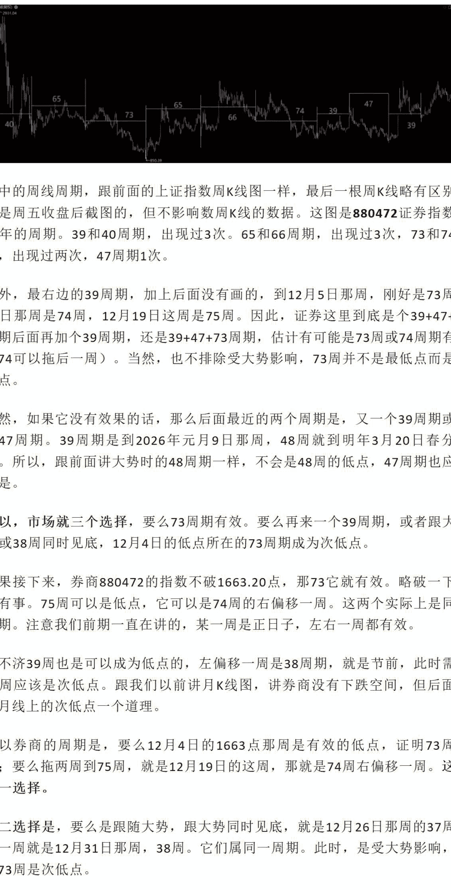
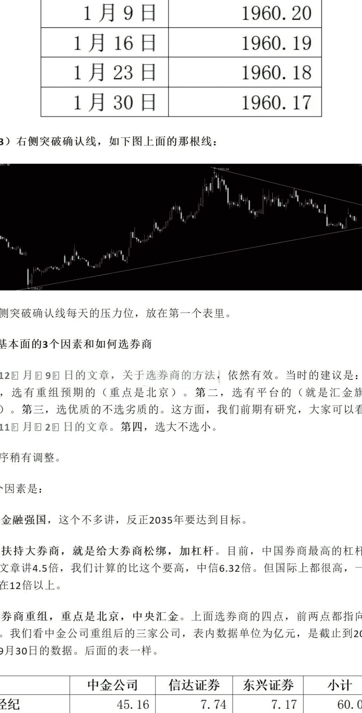
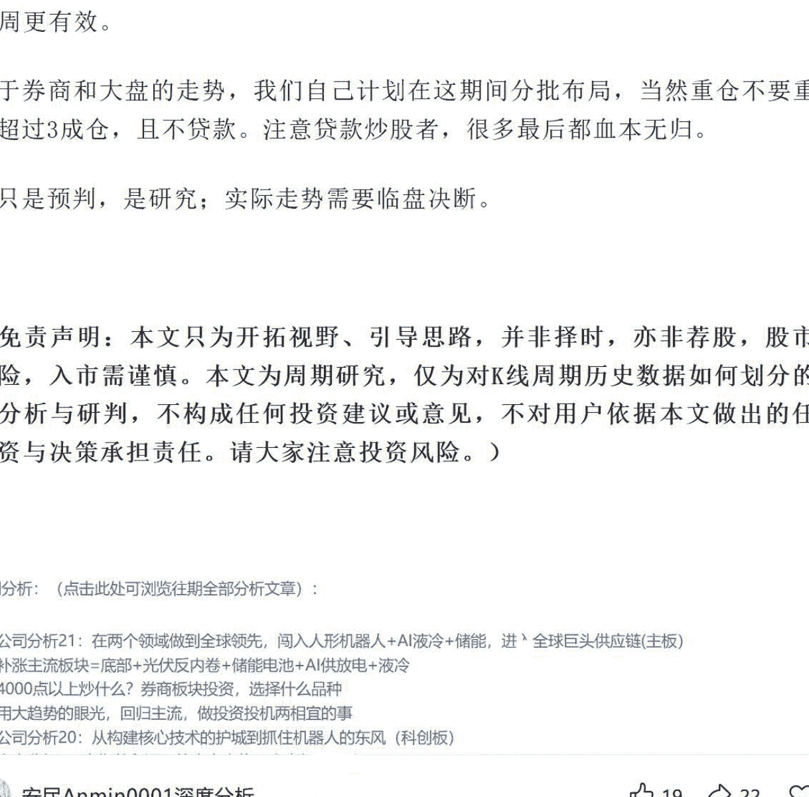

# 为什么比特币会暴跌？

比特币，作为加密货币的鼻祖，自2009年问世以来，其价格走势就一直处于剧烈的波动之中。很多投资者都在好奇，比特币为什么会暴涨？其原因又呢？

然而，在暴涨的之后，暴跌往往随之而来。在2021年，比特币曾经历了一次惨痛的下跌，这让很多投资者感到措手无措。

## 一、比特币暴跌的原因

比特币暴跌的原因有很多，本文将从以下几个方面来为大家进行分析：

### 1. 监管政策

比特币的价格波动受各国监管政策的影响是巨大的。2021年，中国多次出台了严禁加密货币交易的政策，这导致比特币价格出现了剧烈下跌。

除了监管政策，市场情绪也是影响比特币价格的重要因素之一。当市场情绪过度乐观时，比特币价格就会暴涨；当市场情绪过度恐惧时，比特币价格就会暴跌。

### 2. 技术性因素

比特币的价格波动也受到技术性因素的影响。例如，当比特币跌破某个关键支撑位时，可能会引发大量的止损抛盘，从而导致价格进一步暴跌。

此外，比特币的流动性也是影响其价格的一个因素。当市场流动性不足时，价格波动就会更加剧烈；反之，当市场流动性充足时，价格波动就会相对平缓。

### 3. 宏观经济因素

比特币的价格也受到宏观经济因素的影响。例如，当全球通胀压力加剧时，投资者可能会选择比特币作为避险资产，从而推高了比特币价格。

然而，当美联储加息时，资金可能会从比特币等风险资产中流出，导致价格的下跌。

## 二、如何应对比特币的暴跌

面对比特币的暴跌，投资者应该采取哪些策略来降低风险呢？

### 1. 保持冷静

在比特币暴跌时，投资者应该保持冷静，不要因为市场恐慌而盲目割肉。要根据自己的投资目标和风险承受能力，做出合理的决策。

### 2. 分批布局

在比特币价格低位时，投资者可以考虑分批布局，分摊持有成本。这样可以降低在山位买入被套的风险。

### 3. 设置止损位

在购买比特币时，投资者应该设置好止损位。当价格跌破止损位时，要及时卖出，避免损失的进一步扩大。

## 深度视野优质集群（链接优质社群，助你成功）

全部包含以下内容：限时年费188/年 加微信cuk255

- ① 吃瓜群众倍时圈加时群群对话 (原价 365 元/年)
- ② 子明私享会（内部）文章
- ③ 政事室（子明优）付费内容加送随子明群群
- ④ 米联锦闲【作者米穗】(原价 599 元/年)
- ⑤ 欧洲金雀会员专属文章 (原价 328 元/年)
- ⑥ 砖瓦斥内部圈 (原价 400 元/年)
- ⑦ 卢克文青读书会专属文章 (原价 699 元/年)
- ⑧ 鉴茶财经知识星球 (原价 3310 元/年)
- ⑨ 猫哥的视界知识星球星球文章 (原价 299 元/年)
- 10 财新周刊【独家新闻】(原价 1498 元/年)
- 11 杨世光在金钱坝 (原价 2200 元/)
- 12 慕森财经知识星球 (原价 1600 元/年)
- 13 潇漾异译付费文章（持续更新）
- 14 司马林解课选全套音频和全套书籍藏版无减 (原价 2.3 万)
- 15 虚构三部曲[民梦、帝国争、不理解的 MAO] (原价 599 元)
- 16 卢克文知识星球星球文章 (原价 268 元/年)
- ⑰ 额外再送：卢旷元新浪微博付费专栏、三村丰老王、三花九杭州文集

不定期内容：（更多资源将下去）：

- ① 守夜人司令知识星球、接换魔王知识星球、成术后财富、雪雪花等
- ② 创始人笔记、达叔谈论知识星球、成术后财富、雪雪花等
- ③ A视野、大树乡谈、江初序、泮咩说、上海海学等付费文集
- ④ 西凤付费文章、老端、赢在小时之时、局外人的视界、升值、老体制内等其它一些 V 付费文章（每月低于 600 元的付费文章）

## 限时年费188/年 底部链接全网V优质内容

## 深度视野文集 进群微信cuk255

深度视野（付费文集）
