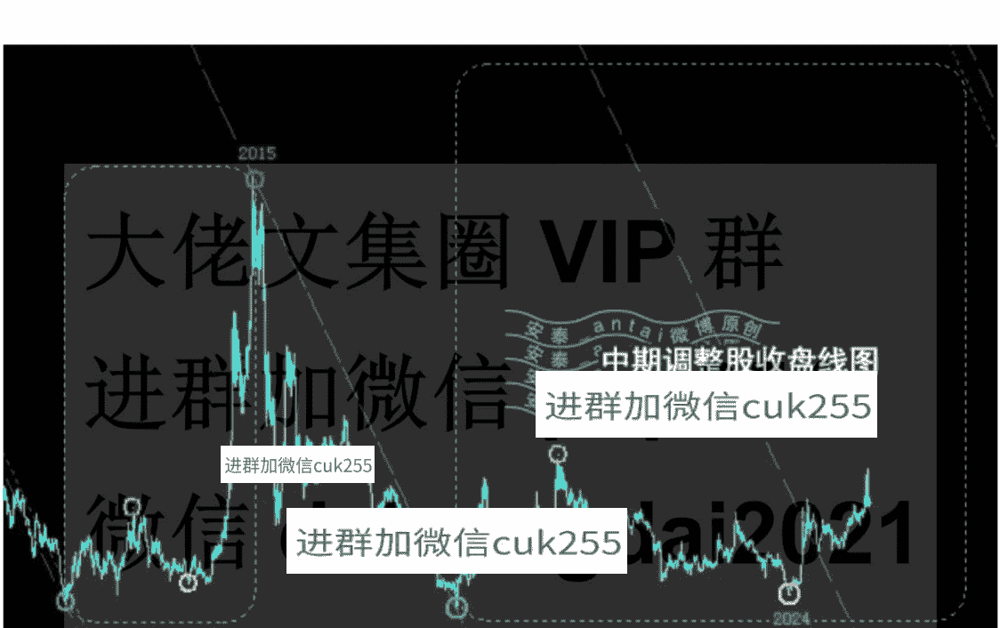

## 中期调整股 已付费

原创 安泰 安泰antai 2025年12月4日 15:42 天津

从分形看，两个灰框的形态应该近相似，相同颜色的圆圈（拐点）对应，性质相同。右侧经过调整后，未来会有一段快速上涨，2027年有望突破2015年高点，达到绿色线，2027年见顶日期可以参考大盘的见顶时间。

此股目前刚经历进入中期调整，时间可能较长，下跌规模并不小于去年四季那轮调整，空间至少回撤2024年以来总体涨幅的50%，至多回撤66.7%。由于个股强度低于大盘，抄底时机请自行判断——若要保守策略，等调整后突破今年11月高点再跟进也不迟，上方空间较大，不要拘泥于眼前得失。

业绩没悬念，大盘好的时候证券股都好，差异在于上涨过程中，波动有些小有些大。000686东北证券，历史有过多次急涨急跌，2024到2027年总体在急涨跌阶段，未来可期！

时间涨跌，基因形态，结构定级别，确认买卖中长线判断始终如一，短线分析难免误差，仅供参考

## 深度视野优质集团（链接优质社群，助你成功）

全部包含以下内容：限时年费188/年 加微信cuk255

- ① 吃群众粉丝群文档加时群群对话（原价 365 元/年）
- ② 子明私享汇（含）内部文章
- ③ 政事室（顾子明）付费内容再送顾子明群聊
- ④ 米联储闲【作者米穗】（原价 599 元/年）
- ⑤ 欧洲金雀会员专属文章（原价 328 元/年）
- ⑥ 砖瓦仁内部文档（原价 400 元/年）
- ⑦ 卢克青文读书会专属文章（原价 699 元/年）
- ⑧ 鉴茶财经知识星球（原价 3310 元/年）
- ⑨ 猫哥的视界知识星球文章（原价 299 元/年）
- ⑩ 财经周刊【独家新闻】（原价 1498 元/年）
- ⑪ 杨世光在金钱爆（原价 2200 元/年）
- ⑫ 森森财经知识星球（原价 1600 元/年）
- ⑬ 潇泽异译付费文章（持续更新）
- ⑭ 司马林解读课全套音频和全套书籍藏版无损辑（原价 2.3 万）
- ⑮ 虚构三部曲[民国梦、帝国扩张、不被理解的 MAO]（原价 599 元）
- ⑜知识星球文章（原价 268 元/年）
- ⑰ 额外再送：卢薛元新微博付费专栏、三村丰老王、三花九树文集

不定期内容：（更多资源不写下了）......

- ① 守夜人知识星球、接魂魔王知识星球、成达谈论星球、成后财富、雪花甲老头等
- ② 创始笔记、达叔谈论星球、成后财富、雪花甲老头等
- ③ A视野、大树乡谈、江初荷、泮咩说、上海海家学等付费文集
- ④ 西风付费文章、老端、赢在八小时之外、局人的视界、升值优、老A体制内等其它一些V付费文章（每月不超过600元的付费文章）

限时年费188/年

## 底层链链接全网V优质内容

深度视野文集进群微信cuk255

深度视野（付费文集）

