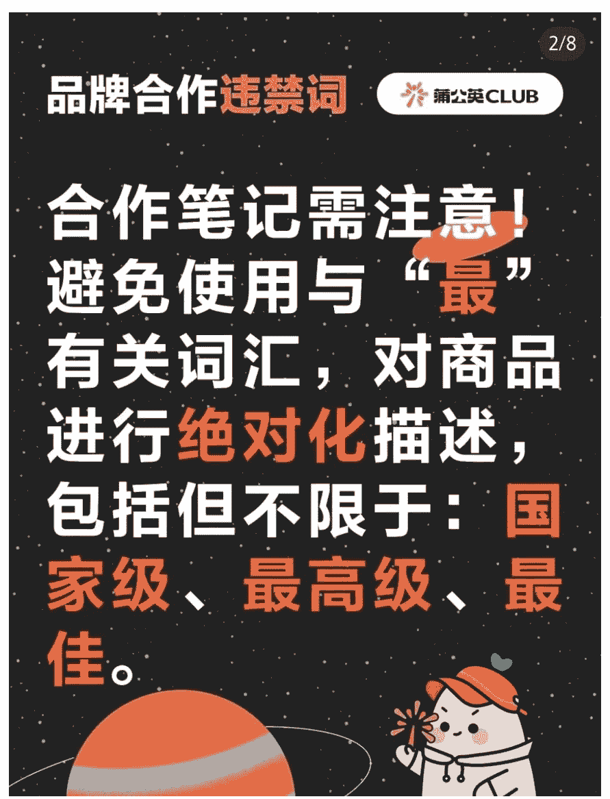

# 小红书 品牌合作违规词大公开

Violation words breakdown in collaboration notes

## 品牌合作违禁词

合作笔记需注意！
避免使用与“最”有关词汇，对商品进行绝对化描述，包括但不限于：国家级、最高级、最佳。

## 若合作笔记需要投放广告，则需进一步避免

- 与“级”有关的词汇，包括但不限于：极效、极品、极佳、终极、极致极、国际级、世界级、全球级、千万级、顶级、宇宙级等。
- 与“顶/鼎”有关词汇，包括但不限于：顶尖、顶级、问鼎、鼎级、TOP级、顶配等。
- 与“领”有关词汇，包括但不限于：遥领先、领袖品牌、世界领先、领袖、领导品牌、引领等。
- 与“第一”有关词汇，包括但不限于：NO.1、TOP级、全国第一、全网第一、销量第一、排名等。

## 若合作笔记需要投放广告，则需进一步避免

- 与“首”相关关键词，包括但不限于：首个、首选、首款、全国首家、全国首发、首次等。
- 其他绝对化术：笔记中不能使用以下词语对商品进行绝对化宣传，如销冠：笔记中不能使用词语对商品进行绝对化宣传，如销冠、开创、完美、100%有效、万能、性价比之王、永久、独家、王牌、XX领域之王、特供、老字号、独创、无可替代、唯一、MVP、XX领域天花板、祖等。
- 禁用语：笔记中不能以下词语进行虚假宣传，包括但不限于：至臻、臻品、不可复制、仅有、屈指、全民抢购、爆、了、业界/全球认等。
- 承诺语：笔记中不可对商品的用法/功能进行绝对化承诺，如无退款、不满意（符合真实情况下使用）、零风险、特效、强效、保证、彻底解决、天天见、100%有效、无依赖、副作用、彻底消除/清除。

## 若合作笔记需要投放广告，则需回避

- 金融术语：笔记中不可涉及以下金融术语，包括但不限于：收益率、投资回报、保底收益、返本、无风险回报、快速回报、高收益回报、升值、众筹等。
- 信仰：笔记中不可涉及以下词，如增强感、化解小人、增加运气、招财进宝、健康富、提升运气、护身、平衡能量、旺人、旺财、助吉避凶、算命、算八字、运势等。

## 知识科普

通俗来讲：绝对化用指不符合客观条件、不受时空限制，形容产品达到某种极致状态的夸张语言。在语境中同时满足以下“四性”的宣传，则属于绝对化用，在广告材料不支持：

- 与《广告法》规定禁止的绝对化用汇
- 与经营者推销的商品或服务相关
- 相同性
- 关联性
- 排他性
- 误导性
- 具有损害行业竞争者利益的可能性
- 违背真实性原则存在误导消费者的可能性

## 在语言中同时满足“四性”则不属于绝对化用的场景，可以在广告物料中使用：

1. 客观事实：显示时空顺序的用语或可证实的历史事实，未涉及虚假误导用户；如提供了材料证明的“最早、唯一、销量/销售额/市场有率第一”。
2. 产品内部分类：明确表示为自我比较的程度分类，未损害其他品牌的权益；如某产品广告称“为消费者提供舒适、高端”。
3. 主观感受：若语言中含有个人立场，未损害其他品牌的权益；适用于表达者自己的主观感受；如“这是我使用过的最好的乳液”、“我觉得这是最适合皮肤的”。
4. 愿景追求类：明示商家的经营理念、追求目标、企业愿景的，如“顾客第一”、“追求最美的品质”等描述不属于绝对范围。

# 抖音

## 抖音全套禁词与违规行为避雷指南

### 10类抖音禁词

#### 一 严禁使用词

1. 夸张词：名媛、顶级、金刚、世界级、豪门第一、顶品、万能、奢修、巨星、著名、高档、国际。
2. 绝对性词：含“首”、“一”、“顶”、“极”的词，如：最高、最新、领先、个、首选、首家、第一、顶级、永久、以及表达绝对的用词，如：独无二、绝无例外、史例。
3. 未经考证的词：世界首、顶级空间、全网第一、优先、上市、绝无例外。

| 禁词 | 替换表 | 禁词 | 替换表 | 禁词 | 替换表 |
|---|---|---|---|---|---|
| 名媛 | | 首家 | | 头部 | |
| 王牌 | 官方资源 | 无前例 | | 世界级 | |
| 金刚 | | 最新 | | 顶级 | |
| 第一几个 | | 只要、我想到的的是 | 最高级 | 第一人 | |
| 绝无例外 | | 超前 | | | |
| 唯一 | | 世界范围 | | | |
| 信仰 | | 满足 | 冠军 | | |
| 领先 | | 前沿 | 各种种类 | 100% | |
| 先上 | | 留 | 选(或) | | |
| 正品 | | 官方认证 | 纯 | | |

#### 二 限时词

根据活动调整，严禁使用，如：酷、这一次、限时价、马上抢、最后。

| 禁词 | 替换表 | 禁词 | 替换表 |
|---|---|---|---|
| 酷 | 结束 | 限时价 | 卖结束 |
| 这一次 | 现在只针对 | 最后 | 卖结束 |
| 结束 | | | |

#### 三 违禁词

1. 严禁使用国家、机关名称进行宣传，如：XXX、推荐、国家XX权威。
2. 严禁使用质量标准，如：质量检、无需检测、质量标准等。
3. 严禁使用人民币（行业除外）。

#### 四 涉及消费者的词

严禁使用，如：“粉丝获”、“全金单”、“点击奖励”、“点击领取”等。

| 禁词 | 替换表 | 禁词 | 替换表 |
|---|---|---|---|
| 粉丝获 | 粉丝幸运送宝宝 | 点击奖励 | 联系客服 |
| 全金单 | 免费、领取 | 点击领取 | 联系客服 |
| 纱 | 一个、一个 | 不能要了 | 库存不足 |
| 抢 | 没了，没有了 | 这个精力竭了 | 断了好了 |

#### 五 刺激消费词

严禁使用，如：“秒杀”、“抢爆”、“不会便宜了”、“以后”、“抢了”等。

| 禁词 | 替换表 | 禁词 | 替换表 |
|---|---|---|---|
| 纱 | 一个、一个 | 不能要了 | 库存不足 |
| 抢 | 没了，没有了 | 这个精力竭了 | 断了好了 |

#### 六 未使用词

严禁使用、蓝底。

#### 七 色情、谐俗、暴力、迷信

严禁使用：算、靠、神、保、佑、玉帝、王母、精魂、鬼撞、如、如来、佛、壮神、大仙、地狱、魔鬼、招运、厕所等神信类素材的画面；性生活、生意、生殖等文字或画面；有害内容的；带来负面、增强财富、扩大人生、创业事业、招财进宝、健康财富、提升运气；有助于事业、升平、培养正能量、消除精神压力、调和压力、迈优化、万事通、旺狂、旺财、助吉运、转运等。

#### 八 民族歧、种族、性别歧视

黑鬼、血统、杂种、亚细亚、蜜狗、大男人、小情人、男女精神女、洋女、小本、大主义。

#### 九 化妆品广告用词

特效、全效、致效、速效、美白、天然、无添加、即时、超强、润活、全方位、安全、全面、无毒、无残留、致敏、抗敏、测试、刺激、渗透、溶解、去细胞、去（祛）、祛痘、渗透、化、溶解、去（祛）、祛纹、平滑、修复、新生力、支撑、能吸收、抑制黑色色素、绝色、速修复避免外造成的损伤的更新、破坏黑色层、抑制黑色素的形成、丰润、美丽、使皮肤亮满、防晒霜（美容化妆品除外）、改善后、扩散、彻底。

| 类别 | 替换方式 | 示例 |
|---|---|---|
| 痘型 | 拟代替 | 那个什么（痘伤） |
| 皮肤 | 祛黑、痘、祛斑 | 祛黑头、粉刺痘、护护口 |
| 肤色 | 美白 | 近去色米、白 |
| 抗敏 | 替代代替 | 从这里回来好好抑制皮肤的皮肤 |
| 抗衰老 | 替代修复受损的皮肤效果 | 同义 |
| 改善 | 改进 | 能够 |

#### 十 医疗用语（不含化妆用品、保健用品、医疗器械）

| 类别 | 替换方式 | 示例 |
|---|---|---|
| 功效 | 增强免疫力 | 指示 |
| 医疗 | 治疗 | 调整 |
| 医疗 | 细胞 | 近去 |
| 毛发再生 | 细胞 | 同义 |
| 毛发再生 | 细胞 | 变能力 |
| 医疗 | 治疗 | 效果 |
| 医疗 | 细胞 | 视线 |
| 毛发再生 | 细胞 | 增长 |

1. 全面调理、热、增强免疫力、助眠、失眠。
2. 消除、扩散、修复、部位、沉积、色素、精准。
3. 血管、压力、压力、止血、养颜、补血。
4. 降敏、中枢、神经系统。
5. 细胞再生、增殖、免疫、调节、纤维、肠炎、烫疗、呼吸道炎症、红肿、淋巴、愈等。

### 34种抖音违规行为

#### 一 暴力营销类行为

为流量和关注，采用购买、软优化等博弈元素，如：
- 运用话术承诺取关注
- 通过重排、控感、质量
- 通过引导、假装、免费、单价等方式推广
- 通过极度夸张的方式推广产品并引起注意
- 通过连接承诺等方式推广流量
- 通过社交、信任等引导

正确做法：使用文明的方式传达信息和价值，避免夸大、不符合社会良好的行为方式和手段。

#### 二 涉嫌传播

引起观众关注，通过极端叫嚣、夸张情节的方式进行流量，博取观众情感。如：
- 刻意渲染色彩、造故事吸引流量
- 利用老人、残疾等特殊群体，通过夸张场所引起共情
- 歧视他人国籍、侮骂、攻击等有害信息影响用户

正确标识：不要误导信息，不要通过虚假的商品活动，来源观众对信息的信任。

#### 三 涉作推销

通过超出预期获取关注或扭曲价格价值的夸张方式展示商品效果。如：
- 为营销制造焦虑，解决焦虑关系
- 设计各种异常陷阱，在上架的链接内加入大量优惠，且直播事实不真
- 设计夸张价格，比较商品时，引导粉丝在商品内投入大量资金

正确标识：设计合理的视频，通过优质内容和视觉表现来获得互动和流量。

#### 四 涉损害爱国行为

诋毁、操摇、故意消费消费者进行营销。如：
- 发表歧视言论，对其他国家进行无理批判
- 恶意或过度歧视他人，引起损害国际冲突，来吸引观众理性评价其他国家文化
- 认为“只有中国，其他国家都是”

正确标识：传播正确的价值观与爱，理智地进行商品信息介绍和推广。

#### 五 危害行为引导

不安安全引起，通过速度、危险、高风险、危害行为来引导观众注意力。如：
- 吃有毒药物、过猛、危险等给观众有危险药物
- 过量进食，量与普通标准严重不符
- 医疗性质行为，在无专业资质且不符合科学医学原理的情况下，进行打针或用药操作

正确标识：加强安全意识，时刻注意安全和责任，避免。

#### 六 推销行为

为了流量，对比，如：
- 卖自家产品，对比
- 告诉他家的裤子，对比
- 看着他家的裤子，对比
- 看着他家的裤子，对比
- 卖他家的裤子，对比

正确标识：对比他家的产品，对比。

#### 七 性暗示诱导类

引起观众，通过等方式营销，如：
- 价格差异
- 价格差异，
- 价格差异
- 价格差异，比：
- 价格差异
- 价格差异
- 价格差异
- 价格差异，比。

正确标识：通过平台，互动，维护秩序。

#### 八 招募类

在平台发布推销、招募、高风险，如：
- 加入我们，你
- 粉丝，后
- 粉丝，后
- 粉丝，后
- 粉丝粉丝，互动：
- 粉丝视频（没有版权）
- 粉丝、招募
- 粉丝粉丝，后：
- 粉丝，后
- 粉丝，后：
- 粉丝，后
- 粉丝粉丝，后：
- 粉丝，后

#### 九 造假营销类

在平台发布，招募，如：
- 粉丝粉丝，后：
- 粉丝，后：
- 粉丝，后
- 粉丝粉丝，后：
- 粉丝，后
- 粉丝，后
- 粉丝，后：
- 粉丝，后：

#### 十 引导私下交易类

引导至其他渠道，如：
- 看我主页，联系方式
- 加微信

正确标识：禁止直播中含有“加微信”。

#### 十一 医疗承诺类

强调产品具有功效，如：

#### 十二 挂直播、暴露类

互动。

#### 十 三 衣着暴露类

直播过程中过度暴露，如：
- 内衣过低。

正确标识：请穿着合适的衣服进行直播，避免。

#### 十四 吸烟、饮酒

直播过程中抽烟，造成不良影响。包括但不限于：
- 直播过程中抽烟、饮酒
- 吸烟在直播过程中体现，直播间内看到烟雾或看到打机火、吸烟声等；在直播间内刷到多个酒瓶或直播过程中饮酒

正确标识：切在直播过程中抽烟传递负面内容，如保持直播直播内容，声音、元素及视频界面积极向上。

#### 十五 语言低俗

直播过程中涉及身份低的话，如：
- 直播间内谈论低俗语言
- 将正常改为低俗语言

正确标识：请引导健康的直播内容，实力。

#### 十六 封建迷信

传递无事实依据的谣言，如：
- 此放能保你转运，化解小人
- 人大会六轮，让你自己一转身看到未来给你的备案是什么命
- 带上这个项目，一定会有运

正确标识：根据科学，切勿宣传封建迷信。

## 抖音全套禁令与行为规避指南

### 十八 取割牟利

禁止以名导师/专家类课程教学的形式牟利，如：
- 这个课程教你涨98万粉丝就能获得巨大流量，买了不吃瓜买了不当，月入六位
- 只要跟着我学98天手把教你玩直播电商，在家就能赚钱！

正确标识：平台禁止自拟导师类、挂热门，教学带卖电商的名义。

### 十九 未成年人带货

禁止未成年人现在直播间内带货及带货行为，

- 直播间内可以出现未成年人进行直播、讲解、推广商品等。若未成年人在直播过程中出现是可以，但不可讲解；或代言形。

正确标识：直播间内可以出现未成年人带货行为。

### 十三着暴露类

直播过程中过度暴露，如：
- 内衣过低。

正确标识：请穿着合适的衣服进行直播，避免。

### 十四 语言过界

侮辱、谩骂、用攻击他人。对用户发起挑衅，传递负面信息造成不良影响。如：
- 他们都一样，是像
- 粉丝都是傻逼，不给我

正确标识：使用文明语言，避免低俗关注，对用户发起挑衅，传递负面信息。

## 抖音全套禁令与行为规避指南

### 二三、任何方式展示毒品、管制制刀、枪检（包括仿真枪、玩具枪）

如：发布一个用户原创视频，里面有假仿真枪出镜，然后这个账号就会被封禁了。

### 二四、严禁直播外拍摄（直播期间直播带违外内容）

场景会被标记为违规，出现后会被直接停播，甚至封号。

### 二五、严禁直播期间抽奖/引流私域微信

禁止抽奖回复，在直播间内不要去引导引流贴链接，因为这种抽奖歪歪一样，没有链接的，活动购时要用心慎，要谨慎。

### 二六、严禁使用连用或其他挂功能

严禁一个手机挂多个，然后1号链接79元，2号链接69元，3号链接59元，其实是保护你的客户卖其他产品，相同设备相同手机号，2号或3号链接，这种容易被系统检测出来连连。

### 二七、严禁在直播中卖假数据或产品数据

抖音可以买一会粉丝或者是刷点链接，但是如果是大量的发布产品链接，也是会对用户造成惩罚，系统检测到后。

### 二八、严禁引导用户防护违规

其实在各种平台都有这种规定，可以隐晦的操作，但他是不能在直播间直接或者是私信直接引导用户去私信违规。

### 二九、严禁宣传其他平台或多平台开播、非本人实名认证

### 三十、严禁宣传充值平台或钱包等进行直播活动或未经授权的官方活动

### 三一、尽量不提“钱”，用“米”

主播说了“钱”很容易被平台违规，认为是在广告词里或者违规。现在粉丝越多越精准，而抖音流量很大，很容易引流粉丝到抖音。如果字母的太了，可能会被抖音检测为高风险的客户，粉丝会有被直接断流的可能性，还可能被直接封号。同时不建议使用原创这个词，可以用日常代来代替，最低优惠活动替代。

## 抖音全套禁令与行为规避指南

### 二、传播禁令

传播营销：‘低价秒杀’‘免费’等福利引导用户参与‘秒杀’互动，实际未免或无法兑现的促销行为；秒杀信息发布属于违规行为。推广方式包括但不限于口播、贴纸弹。

- 1. 低价秒杀，实际未上架或未兑现承诺
  作者宣传低价高频参与秒杀活动，实际未上架相关商品、未兑现承诺进行低价秒杀或虚高价格构成违规行为。
  - a、作者购买9.9元进行秒杀，但实际价格为19.9元，高于实际价格
  - c、作者承诺30元或19.9元零食包，半小时后仍未上架商品，剑计时购不可不顾观众互动、弹播直播
  - d、作者16.9元买299元的耳机，实际未上架相关商品
  - e、作者19.9元买8.5元公仔消毒洗衣机，实际未上架相关商品。

  【说明】
  未到约定的活动开展的，不属于违规。例如，承诺在20:00开始秒杀，当时直播时间为19:46，未到约定时间，不属于违规。

- 2. 无法兑现的‘不限量免费’
  以任何形式无法兑现的用户全部免费、不限量免费、一人单单0元获赠等推广行为。

  【说明】
  作者承诺进入直播间的用户领一份免费福利，并引导用户在直播间点赞，刷‘新来的’，最后未兑现商品或承诺。

  【说明】
  商品发布的存量是一定的，此类推广行为在直播间用户达到一定规模后，并不具备完全兑现的属性。发放商品或抽奖时，必须明确说明商品数量与参与条件（如关注登录），并真实兑现。

- 3. 未与商家互动一致传递虚价值商品
  指作者在未与商家互动一致的情况下播活动（商品详情查不到信息或相关说明），在推广过程中虚构商家购买商品为假价值进行推广。

  【违例】
  作者在推广过程中虚称购买某款商品（如羽绒、毛巾、水等），免费送高价值B商品（如手机、电脑、高端手机等），商品信息详情页未说明。

- 4. 秒杀信息发布规范
  指作者未按照要求发布秒杀信息，或者发布的秒杀信息完整，被视为违规。作者在直播期间开始秒杀活动，每秒杀活动前，需在直播间背景、组件等显著位置。

  【说明】
  使用秒杀功能发布的商品，不可被。秒杀活动必须准确。展示相关信息，包括但不限于：
  - 1. 秒杀开始时间（必填）：包括日期及时间。若秒杀活动为当日，可写“今日”。
  - 2. 秒杀商品信息及数量（需填）：商品品牌、商品名及核心参数（如手机等）。
  - 3. 秒杀活动限制（如，必填）：例如粉丝到达，无法参与。
  - 4. 是否为预售（有，必填）。

## 抖音全套禁令与行为规避指南

### 三、引导互动

引导互动，指通过互动获取折扣、福利、特价、购买商品等引导用户进行互动。引导方式包括点赞、管理抽奖、低价、积分等。

- 1. 如规定
  引导互动，以互动获取折扣、福利、特价、购买商品为前提，将“互动”包括：
  - a. 要求用户发表“打了”、“想要”、“666”、“报名”等互动无关无意义评论
  - b. 要求用户点击关注
  - c. 要求用户在直播间观看时长

- 2. 违规定
  - a. 如果某弹幕重复，在直播间停留5分钟后，发布三次“已买666”评论，相同内容内禁封
  - b. “一定”报名参加不得领取福利
  - c. “打了”关注优先发

- 3. 如何避免“引导互动”
  规避“引导互动”影响粉丝交易和观众体验，干扰平台秩序，平台不鼓励此类互动。主播与用户互动时，应当规范，例如：
  - a. 发布抽奖时，明确规则，避免使用有利于消费者权益的描述；
  - b. 合理引导用户参与互动，如“关注主播”、“关注主播加入直播”。
  - c. 合理控制“福利”的节奏，最长时间“时长”（直播间优惠信息，商品不上架）。

## 抖音全套违禁词与行为规避指南

### 三四、其他严禁直播的情况

- 直播车祸、广播等事故场景。
- 精神患者等无完全民事能力的单人单独进行直播。
- 严禁乞讨直播。
- 严禁军人直播。
- 严禁违反景区规定，假名胜等。
- 禁止出售游戏号、游戏币、代练、代打游戏等。

## 三、视频号

## 新广告法禁用词汇

国家级、世界级、最高级、最佳、最大、唯一、第一个首选、最好、最大、精确、顶级、最高、最低、最、最具、最便宜、最先进、最大程度、最新技术、最先进科学、国家级产品、填补国内空白、绝对、独家、首家、最新、最先进、第一品牌、金牌名牌、优秀、最顶级、独家、全网销量第一、全球首发、全国首家、全网首发、世界领先、顶级工艺、最新科学、最新技术、最先进加工艺、最时尚、极品、顶级、顶尖、终极、最受欢迎、王牌、销量冠军、第一（NO.1, Top1）、极致、永久、王牌、掌门人、领袖品牌、独一无二、独家、绝无只有、前无古人史无前例、万能等词汇。

## 新广告法

### 电商类禁词一

销量第一、销量最高、服务最好、质量最优、杀全网、全网第一、全网最优、质量最好、秒底价、类目底价、同行底价、顶级、价格最低、口碑最好、最便宜、第一品牌、驰名商标、价格低、最便宜、第一、XX最新、XX最好、XX冠军、XX高、XX抄底、XX冠军、XX最新、国际规模、最热销、国际、顶级品牌、顶级支持、韩国销量、韩国销量、欧美销量。

### 电商类禁词二

最低价、行业热卖、行业销量第一、品质最好、品质最优、最强、人气第一、口碑最好、口碑第一、秒杀、高价值B商品（如手机、电脑、高端手机等）、商品信息详情页未说明。秒杀、抢购、抢爆、再不抢就没了、错过机会了、万人抢疯、抢疯了。

### 电商类禁词三

国内热销、国内规模、国内服务第一、国内最、国内销量第一、亚洲销量冠军、亚洲销量冠军、亚洲第一、亚洲第一、顶尖品牌、领先品牌、领先、顶尖技术。

## 权威性词语

1. 严禁使用领导推荐、国家推荐、国家批准、国家工作人员名称进行宣传语言；
2. 严禁使用质量免检、无需检测、无需检测的语言；
3. 严禁使用老字号、中国驰名商标、特供、违禁时语：限时须有具体日期、随时结束、随时涨价、马上降价、最后一步、恢复原价、确定、严禁使用刺激词语。
4. 迷信词语：带来好运、增强第六感、化解小人、增加事业运、招财进宝、健康富贵、提升运气、助事业、平衡负能量、消除精神压力、逢凶化吉、时来运转、旺财运等。
5. 直播间出现任何形式，包括QQ、微信、手机号码、二维码（包括头条系二维码）等暗示；
6. 民族性别歧视用语；
7. 故事剧情类卖货。

##疑似医疗用语

1. 全面调整人体内分泌平衡、增强或提高免疫力、助眠、失眠、滋阴补阳、壮阳；
2. 消炎、可促进新代谢、减少红血丝、产生生化细胞结构、修复受损肌肤、治愈（外）、抗炎、活血、解毒、抗敏、脱敏；
3. 减肥、清热解毒、清热祛湿、治疗、除菌杀菌、抗菌、灭菌、防菌、消毒、排毒；
4. 防敏、柔敏、舒敏、缓敏、脱敏、褪敏、改善敏感肌肤、改善现象、降低皮肤敏感度；
5. 镇定、镇静、理气、行气、活血、生肉补血、神、养脑、益气、通脉；
6. 胃肠蠕动、利尿、驱寒解毒、调节内分泌延缓更年期、补肾、祛风、生发；
7. 防癌、抗癌；
8. 祛疤、降血压、防治高血压、治疗；
9. 改善内分泌、平衡荷尔蒙；防止卵巢及子宫的功能紊乱；去除体内毒素、吸附铅汞；
10. 除湿、润燥、治疗胰臭、治疗体臭、治疗阴臭；
11. 美容治疗、消除斑点、斑立净、无斑、治疗斑、逐层减退色斑、妊娠纹；
12. 毛发生、毛发再生、生黑发、止脱、生发止脱、脂溢性脱发、病变性脱发、毛囊激活；
13. 酒糟鼻、伤口愈合清除毒素；
14. 缓解痉挛、缓解疾病症状、处方、药方、观察具有明显效果；
15. 丘疹、脓疱、手癣、甲癣、体癣、头癣、股癣、花斑、牛皮癣、传染性湿疹、湿疹；
16. 伤风感冒、经痛、腹痛、头痛、腹痛、便秘、哮喘、支气炎、消化不良；
17. 细菌、真菌、念珠菌、棘刺孢菌、厌氧菌、牙菌、痤疮、毛囊寄生虫等微生物名称；
18. 雌性激素、雄性激素、荷尔蒙、抗生素、激素；
19. 药物、中草药、中枢神经；
20. 细胞再生、细胞增殖和分化、免疫力；
21. 疤痕、关节痛、冻疮、冻伤；
22. 细胞间的氧气交换、红肿；淋巴液；毛细血管；淋巴毒等。

## 化妆品虚拟宣传用语

特效；高效；全效；强效；速效；速白；洗白；XX天见效；XX周期见效；超强；激活；全方位；全面；安全；无毒；溶脂、吸脂；燃烧脂肪；瘦脸；瘦腿；减肥；采用新型着色机制永不褪色；迅速修复受紫外线伤害的肌肤；更新肌肤；破坏黑色素细胞；阻断（阻隔）黑色的形成；丰乳；丰胸；使乳房丰满；预防乳房松弛下垂（美乳、健美类化妆品除外）；改善（促进）睡眠；舒眠等词汇！
