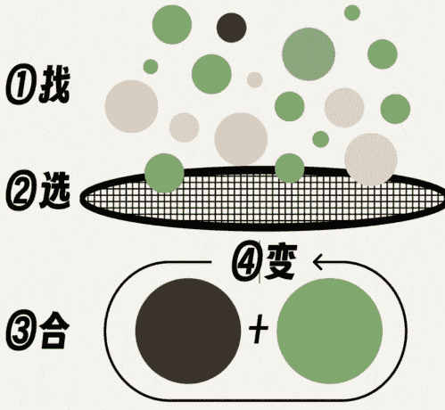

# 知识星球TOP 资源分享社群

汇聚全网付费资源
让更多人获取高价值信息

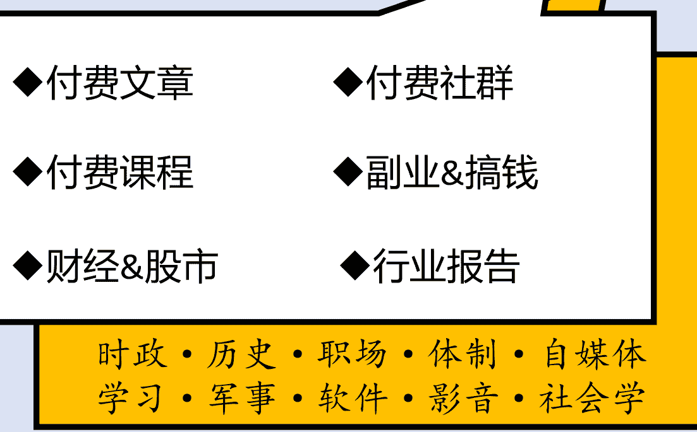

- 付费文章
- 付费社群
- 付费课程
- 副业&搞钱
- 财经&股市
- 行业报告

时政·历史·职场·体制·自媒体·学习·军事·软件·影音·社会学

公众号: 知识星球TOP
微信信号: jntsg8
微信信号: jntsg2

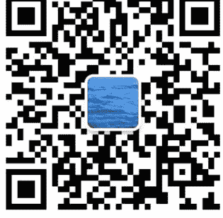
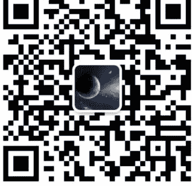

添加微信 免费进群

## 找 是什么？

通过培养网感寻找选题方向

### 培养网感
- 网络内容敏感度
- 出圈核心

### 收集选题
- 站在巨人肩肩膀上
- 熟悉行业、理解行业、解读行业

### 找关键词
- 热搜词
- 刚需词

## ①找通过培养网感寻找选题方向

怎么做？

### 跟经历找
### 跟流量找
### 跟网络找

用户思维

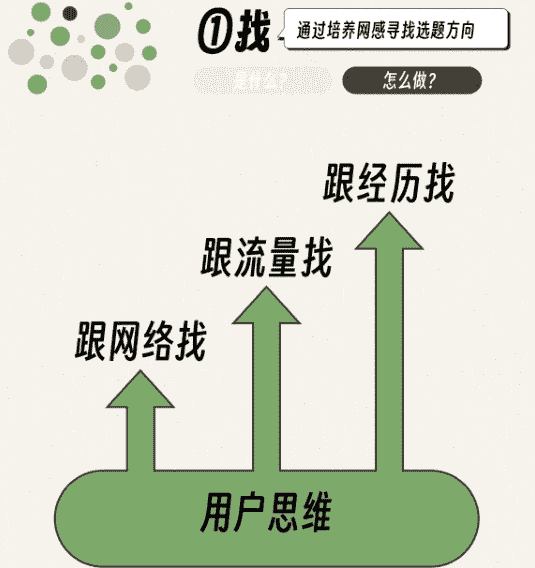

## ①找

通过培养网感寻找选题方向

是什么？
怎么做？

### 是建立网感的核心
内容/笔记要具备“利他”性
就是站在用户角度创作内容
用户思维

## ① 找

通过培养网感 寻找选题方向

怎么做？

### 从推荐找
### 按搜索找
### 跟网络找
### 看评论找
### 学大厂找
### 多平台找

## ① 找 通过培养网感寻找选题方向

是什么？
怎么做？

### 跟流量找
找“三高”笔记：用户数据、热点事件

## 找

通过培养网感寻找选题方向

是什么？
怎么做？

### 自身领域痛点
### 跟经历找
### 身边故事/事件
### 旧选题翻新
### 近、反义词联想
### 跨界对象找

## ②选用合理的原则和标准过滤选题

是什么？
怎么做？

- 通过合理的『原则』+『标准』判断、筛选，去伪存真排除掉不适合的选题

## ②选 用合理的原则和标准过滤选题

是什么呢？怎么做？

| 维度 | 说明 |
| :--- | :--- |
| 匹配度 | |
| 价值观 | |
| 有用性 | |
| 新奇性 | |
| 风险性 | |
| 共鸣性 | |
| 覆盖性 | |
| 时效性 | |
| 延延续性 | |

## ②选 用合理的原则和标准过滤选题

是什么？
怎么做？

- 匹配度
- 价值观
- 有用性

好的IP都很“专情”，懂得对自己的选题精耕细作。

@ 小红书

## ③合将选题与你的经历相结合

是什么？
写什么？

- 选题
- 经历
- 找写作角度：知识、思考
- 融合、借鉴、迁移、升华

## 10大确定选题的方法

### 将选题与你的经历相结合

是什么？
怎么做？

- 01 对标选题法
- 02 痛点细分法
- 03 问题选题法
- 04 热点选题法
- 05 人性选题法
- 06 目标人群法
- 07 标新立异法
- 08 场景设置法
- 09 产品卖点法
- 10 组合法

## ④变 根据数据，持续迭代

是什么？
“好文章都是改出来的”

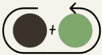

## ④变 根据数据，持续迭代

是什么？
怎么做？

- 了解数据：建立追踪、定期定量
- 持续分析：围绕消费者需求、买点和痛点
- 进一步分析：搜索词和相关词

## 标题的价值

| 指标 | 描述 |
| :--- | :--- |
| 深度 | 分享、收藏 |
| 匹配度 | 分享、收藏 |
| 渠道 | |
| 质量 | |
| 速度 | |
| 风格 | |
| 价值观 | |
| 初次打开率 | |
| 分享率 | |
| 收藏率 | |

@ 小红书

### 选题

## 什么是好标题

### 好标题的作用

- 让用户明白你想要表达的观点或想要的问题
- 激发好奇
- 满足用户自我表达、身份认同

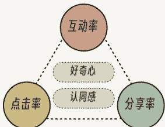

## 写出好标题

好标题的流程

- 建立标题库
- 关键词管理
- 创作标题
- 测试与反馈

### 好标题的6大原则

- 高度概括性：简单好
- 用户能快速明白笔记讲什么
- 用户注意力：没时间处理信息
- 涉及违规被限流：遵守规则
- 重视性：这种行为
- 站在用户的角度，思考用户希望看到、得到什么
- 适当加入一些emoji，突出重点，易于理解

### 写作角度

- 亚洲脸必备：美容技巧
- 金融人必备：经济知识
- 50元以下大牌平替
- 不要错过的小红书58元
- 很温柔的单色眼影：超显白的夏天
- 一定要收藏的内妆
- 杭州夜景婚照去哪里拍
- 秋冬最美系列，小仙们赶起来
- 姐妹聚会的战袍
- 爆款美白淡精华简直绝了！
- 这种靠谱吗？我来验证下
- 兰蔻新调唇膏合集
- 限量红色涂上就是高级

## 20个常用技巧

### 问题、提问法
百万富翁都在用哪些思维方法？秋天孩子容易咳嗽怎么办？

### 引发好奇、制造悬念
躺在家里赚钱的方法，不知道的很亏这瓶酒喝了不会醉，原因找到了

### 结合热点
双十一活动策划方案提前泄露瑞幸和茅台联名活动爆火后的逻辑

### 利用数字和数据
99%的人不知道的思维，20%的人依靠它们逆袭月薪3K和月薪5W的人在这里

### 讲故事
30岁开始创业，5年后身价过亿异地写了1000份情书，麻雀变凤凰

### 反差+对比法
真正有钱的人，只用这一个思考模型他来自偏山区，一把直播圈百万

### 制造画面感
每天晚上准时出现在这个洞洞的人抹上这支口红瞬间变年轻

### 引起见证
被5w名粉丝实测3个月后，终于要上架了经过100w次路测的车，你不看看？

### 免费、折扣吸睛
设计师都在用的10个免费素材网，都在这里免费公开课，10位行业大咖在线授课

### 时间紧张法
2023年最后季度，这个策略很管用5个方法、10个工具，1天搭好运营平台

### 你、我、他法
别以为你考上大学就可以混日子了这个运营策略我一直在用，今天总总结出来

### 权威、稀缺感
小红书首发，百万博主都在卖的好货离职了，我把阿里10年的运营经验放出来

### 涨、画饼法
用3步，让英语分数提高20分一个小众赛道，竟然变现4位数

### 观点、情绪传递
那年刚毕业，你是何等意气风发\李文的这段录音，听哭了

### 抱腿
马斯克喜欢的10w赞：10本好书

### 前缀后缀
- 创意型：完了……嘛
- 实用型：学霸都在用的笔记如何提高效率
- 通用型：这种方法

### WIH模型

- why (为什么): 要解决什么具体的问。
- who (向谁说): 确定目标读者，具体人群。
- what (说什么): 具体要说什么，重点传达内容。
- how (怎么说): 以哪种方式，将信息传达给读者。

### AIDA模型

非常经典的文案结构，70%以上的文案都是依照这个模型完成的，例如海报、封面

- Attention (引起注意)
- Interest (激发兴趣)
- Desire (刺激欲望)
- Action (促成购买)

### 引爆点

是由马尔姆·格拉威尔总结的，信息之所以流行的3个关键点：关键节点，放大信息声量、扩大传播。

- 个人人物法则
- 核心爆点（此处重复识别误）
- 环境威力法则
- 附着力法则：信息的受到极大影响，比如重大节日

### AISAS模型

是消费者行为成熟的分析模型，适应了传统到互联网购物路径的变化，增加了搜索和分享环节。要制作出优质、吸引人的内容，例如引人入胜的标题、好看的封面，注重内容的趣味性，让用户产生情感共鸣和社交需求。内容的可搜索性，要具备关键词密度和SEM优化，内容的转化率，以引导用户购买。

- Attention 引起注意
- Interest 激发兴趣
- Share 分享
- Search 搜索
- Action 购买

## 5A模型

营销之父菲利普·科特勒在他的《营销革命4.0》中提出的：

| 阶段 | 模型 | 价值 |
| :--- | :--- | :--- |
| 种子期 | Aware (了解) | 内容可见度，通过内容影响观众认知 |
| 推广期 | Appeal (吸引) | 内容吸引度，通过内容吸引观众关注 |
| 突破期 | Ask (询问) | 内容驱动力，通过内容激发观众了解 |
| 沉淀期 | Act (行动) | 内容获客力，通过内容影响观众决策 |
| 沉淀期 | Advocate (拥护) | 内容转粉力，通过内容吸引观众拥护 |

## 5W要素

构成传播过程的五种基本要素，描述和分析一个事件或信息的关键方面：

- who (主角是谁?)
- when (什么时间?)
- why (为什么做)
- where (什么地点?)
- what (做什么?)

如果5W都是普通的、常见的，那么这个事件或信息就会缺乏吸引力，无法引起人们的注意。相反，如果将其两个W变得非常寻常，就可以增加这个事件或信息的吸引力。

## 写作金字塔

运营类内容创作不像学术创作自下而逻辑，相反，先抛出选题，再收集数据、事实，最后证明假设。金字塔原理是以思考的逻辑、表达的逻辑、展示的逻辑为核心的，一个挖掘受众需求点，想要清楚的内容，选择基本结构进行规范动作的过程，这和文案写作异曲同工之妙。

自下而上：提出假设到证明假设

## SCQA模型

SCQA模型是麦肯锡一个非常经典的“结构化表达”工具，也是金字塔原理的一部分。无论是在写方案、写文案，还是演讲、分享中，这个模型都是一个十分实用的沟通工具。

- 标准式 = S情境 + C冲突 + A回答
- 门门式 = A回答 + S情境 + C冲突
- 答案式 = A回答 + S情境 + C
- 疑问式 = Q + S + C + A

## AARRR模型

AARRR模型又叫海盗模型，是运营过程中常用的从获客到传播，形成了闭环模式，持续增长。

## 小红书笔记尺寸

- 3:4 常规照片，手机竖拍尺寸
- 4:3 常规照片，手机横拍尺寸
- 9:16 视频画幅，手机竖拍视频
- 16:9 荧幕画幅，手机横拍视频尺寸
- 1:1 正方形，手机自带拍照尺寸

这4种比例的图片上传小红书时不会被裁剪，小红书对图片有规范，让用户有更好的浏览体验。

- FULL 其它尺寸，各种潮流尺寸

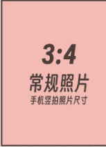
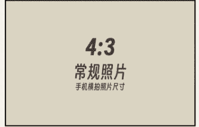
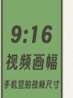
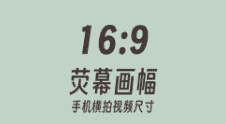
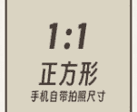
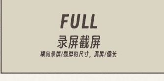

# 发现页流量规则

## 发现页流量

| 流量平均占比 |
| :--- |
| 70% ~ 80% |

本质：【推荐流量】通过系统算法推荐

### 特点
- 系统主动推送
- 热度一般持续7天甚至更长
- 账号初期几乎全靠首页推荐
- 流量占比高

### 推荐机制
- 用户浏览内容喜好
- 用户标签和笔记标签的匹配度
- 曾经过的关键词
- 关注的博主所在领域及内容
- 可能感兴趣的内容

### 流量策略
- 建立选题库
- 关注热门选题
- 重视标题写作技巧
- 增强封面的设计感
- 关键词及选题的加入
