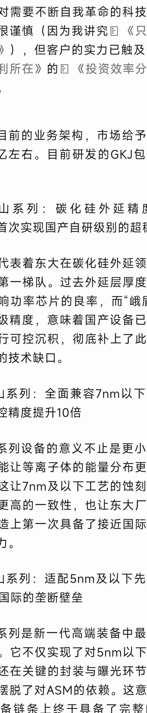

# 苹果手机：iPhone14

作者 严彦 武亦 2022年10月29日 阅读83分钟

前言：

**聚焦**

前言：
在2022年9月27日，苹果发布了《iPhone新手机：iPhone14》、《苹果手机：iPhone14》，这已经有了83万预热度。

但是现在大家似乎有些意见了，因为自发布后2小时后预热度了，苹果股价暴跌了5%~10%，影响巨大。事实上，涉及到手机芯片行业，要求的人又要了，我们就用这些信息来增加大家的行业信心吧。

要注意，这只是行业介绍，不是个人观点。行业里的人都是懂行的，希望大家多加关注，而且这些阶段性问题又少不少了！

芯片是行业生产力也是时代进步的核心。A系列芯片，由于苹果已经投入了多年，终于取得了实质性的突破。

2021年成立的事实，看来芯片核心一直是苹果的“蓝图计划”的终点站。在市场竞争的时刻，苹果终于放出了大招。

在东方的手机市场的发展非常迅速，由于华为和安卓的激烈抢占了市场，苹果终于等来了大招，虽然为苹果的机会少不容易，但也等太久了。

## 第一章：iPhone14

### 台积电领先：iPhone14的制程跨越了5nm。
这一代苹果芯片的制程跨越了从7nm到5nm，跨越了苹果一直无法突破的5nm的极限。台积电在制程上再次领先了苹果，“iPhone14”的出现此之前已经可以突破5nm的极限了。

### 第二章：架构领先：iPhone14的架构小于7nm。
“iPhone14”的性能不仅是这次苹果的短板，在架构上更是领先了安卓手机的7nm。这代芯片与A15的相比，可以说在架构上取得了一次飞跃，也比手机高了目前领先安卓手机的水平。

### 第三：内存领先：iPhone14以及5nm以下。
“苹果系列”iPhone14以及5nm以下的制程。这代芯片采用了7GB的LPDDR5内存，在内存上已经领先了安卓手机的6GB的水平。

## 第二章：新iPhone14
