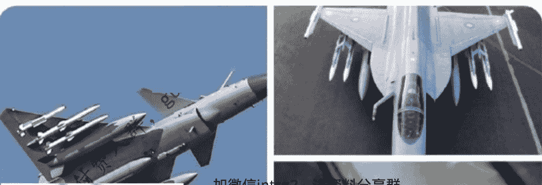
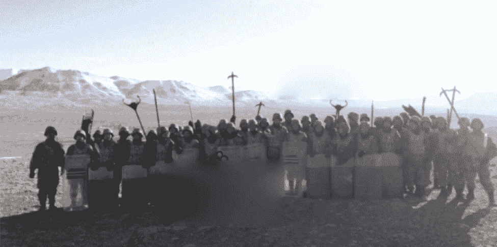
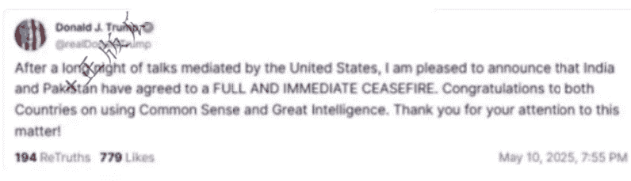

本世纪以来，印巴已经发生三次军事冲突，平日里小冲突更是不断。

这一次是第三次，也是唯一——中国大力下场撑巴基斯坦的一次。

# 中国有多力撑?

1. 提前派兵去巴铁
4月份阿三刚批事的时候，兔子就分派部队入巴了，义上是参加“团队精神-2025”国际比赛，但是这个赛以前没有举报过，这个事一周前我看到还以为假的，现在已经被兵发言人证实了。

2. 开战前夕运送20紧急加班，运送pl-15原版货

# Defence Pakistan @Defence_PK99

Thank you, China, for arming the PAF with the PL-15.
The skies over South Asia just sent a message to the world — 6 Indian jets down.
Now, get ready for global demand.

感谢中国为巴基斯坦空军提供PL-15号导弹。
南亚上空向世界传递信息——6架印度战机down。
现在，为全球需求做好准备。

# 3、中国军方特意为这次印巴突破成立作战部

今天24架笨妞，就是跟巴铁壮壮胆去的。
西部战区已经成立对巴信息支援中心。
张的军事指挥能力不用担心。
啊三，指挥系统都被监视时连战指挥语音，都被布出来了。
刘宗杰666。
兔子拉胯架有些狼啊。

## 4、开战后中国大锐凌晨4点还在外交部等巴消消息 加微信kktt87658，进毛选微信群
加微信jntg2，进资料分享群

-巴基斯坦外交部长伊萨克·达称：“巴基斯坦用中国制造的歼-10C击落了印度包括“阵风”在内的所有战斗机。中国大使凌晨4点还在外交部。我们作为友好国家，向其通报了一切。那些被大肆宣传的“阵风”战机表现极其糟糕。”

# 这次中国太狠了，就差直接下场干预印度了。

这很反常，因为前几次巴冲突我们都没有这么给力过，西部战区在边境面对挑衅的印军依然是冷兵器时代。

中国如此卖力搞印度，实在是出于莫迪意料。
莫迪错估局势，他认为兔子只会有限出手，没想到兔子直接来来狠的。

背后因素，其实分内外两大因素。

外部因素，当然是针对俄美的。
针对美，大家都理解。
美国和印度谈关税贸易，万斯去印度吹印度到天上去了，美国无非就是想让印度搞中国，换取关税贸易协议的利益。
印度要滑头不干边境巴基斯坦，搅动中国周边边缘安全，而且狗看主人只要俄军打赢了巴铁中国也丢脸。

为此美国还拉偏架，擅王不允许许巴铁用美国的f16迎敌。

所以我们加大下力猛搅印度，是针对对美国的破招。

而且，还有一个更意义深远的影响。
那就是伊核。

伊朗总的一遍，没有抵抗美国以色列列的坚定决心。
即使中国支持，伊朗也妥争不坚决。
因为中国的确不忘怎么出手，包括伊朗在内的全球各国都不清楚中国真正的军事实力。

中国用印巴战争证明，中国的军火力大好使，铁都能以弱胜强，只要伊朗坚定斗争决心，只要中国撑伊朗，伊朗就完全不用怕美，伊朗你要有斗争决心啊。

而5月这个月，本身就是美伊谈判的关键时期。
所以，中国猛揉印度，不仅是破局美印媾和，也是搅乱美伊谈判。
这是针对美国的。

还有就是针对俄罗斯。
原因很简单，普京是一边倒站队支持印度莫迪的。
俄罗斯的国家电视台在开战后就是印度立场，说恐袭是巴基斯坦搞的说印度是正当合理的军事行动。

而莫迪在开仗前也会了普京。
毕印军虽然号称万国造军队，但主要武器火火还是俄罗斯的，特别是s400这个反导导系统，是俄罗斯的王牌武器，罕见的卖给了印度。
而且普京在开国大典，印度这个时候干架的确切需要知会普京。

我在文章里已经明确说了，我们对普京很不满意。
当着普京的面，提到了懂王的联俄些，将之前欧亚关系的不受制于第三方的这句批评话，原封不动的送给了普京。
背后的考量是完全下确的，一个俄乌惨胜的俄罗斯才是好俄罗斯，一个衰落需要仰仗中国的普京才是好普京。

普京最近有些飘，那么确实应该敲打下普京了。
于是我们选择帮巴铁狠揉捏印度，让普京的俄式武器出丑，让普京知道中国真实恐怖的实力，好好掂量下中俄关系的分量。
耿爽那句话的含金量还在上升

加微信ntsg2，进资料分享群

# 如果中国支持克兰，或许如果没有美国的话，战争早就结束了

今天我可以说的更直白：
如果中国真的向俄罗斯提供补给，那战场的局势早就不是今天样子了，普京肯定心慌，因为普京知道中国狼狈印度，是给给他看的。

加微信ntsg2，进资料分享群

普京过去的得到了我们的俄援，但我们主要给的是核心片和普通火炮，并没有输出俄罗斯先进武器。
反而是中俄关系产生裂痕，中国停了火炮供应，然后普京去找朝鲜要火炮。

正是中国的克制，没有对乌放开军援，所以乌才能打到今天。
而我们对普京最大的杀手，也是中俄破脸的标志，就是我们抛弃乌大规模军援。
这是摆在台面上的战略杀手。

# 在印巴冲突之前，中国先进军事实战震慑全球

普京可能知道兔子乌克兰很难过，但之前的普京不会想到，如果拿到兔子武器，俄军将毫无胜算。
现在以弱胜强的巴铁用一把颠压俄军将从胜利瞬间溃败。
所以，印巴交后中国军实力的战线，对普京最好的震慑。

说完俄美这两个外部因素，其实还有内部因素。

加微信ntsg2，进资料分享群

第一个因素，最好理解。
那就是西部战区的头，听说最近被那个了。
前几天的事很正常，苗华案是个仅于林彪的大案，影响是历史性的。
升上那一批人，全军一个尴尬的历史记录。
唉，连东部的头和武警头都接连出事了，西部头要是再出事，不用惊讶。

但是，西部战区出现震，到底不是好事。
毕竟印度最近蠢欲动。
你想想，西部战区出现震，赖清德以为无力外顾，闽台外扔实弹。
西部战区高层后，你能保证莫迪不会出现侥衅吗？
这种脑路异常的人，只会玩更多花样。
如果这次力撑巴铁将服，那么印度过来觉得中国有机乘。

所以，在西部战区高层的当下，中国力撑巴铁狠搅印度，其实是一种以攻为防，针对印度的预防性进攻。
用血的教训打消莫迪可能的侥幸心理！
第一个内部原因。

还有第二个内部原因，更是隐晦的，和军队反腐有关。
其实岱之前铺垫了。

那就是会后的裴云南。

特别是云南访问火箭军部队和14集团军。
这是该篇文章的原话：
——我们这次去云南视察部队，意义深长。
——去看14集团军，建立中红二代隔空喊话，争取他们支持，问他们是支持我们呢，还是支持另一边呢？
——去视察53基地，因为风的问题没清晰差不多，视察53基地就意味着火箭军的反腐作业一段，给军内各方吃定心丸。

是的，云南之行，就是暂缓军方反腐的明确信号。
没办法，这场始于火箭军的地震，一路震到其他军种和各个军区。

后来连聂华案都震出来了，一彻彻底不可收拾，百位将军被咬谈或者被查，枪不离身，一旦有纪委的人过来带走就准备换一个。
枪杆子是不稳的，不能再查了，再查枪杆子失控，连天都要塌了。
所以，云南之行，安抚人心，释放叫停反腐的信号。
从云南回京后，我们更是神隐六天，六天时间里我们做了什么都不知道，只知道六天后军部战区捷海军和火箭军，凑齐收台三套后开展了高强度的围台军演，释放出了枪杆子基本稳且依然可控的信号。

云南之行+隐6天，我们都是围绕军队在做工作，做安抚枪杆子的工作。
甚至在最近，监控得到一个更隐秘的消息：在某些军工单位之前被谈话暂停工作的人，乃至消失一段时间的兵，又继续回来工作了。
看来，我们不仅叫停缓了这场高强度军队反腐，还网开一方面，几乎特赦一样对这些人手。
政治是妥协的游戏，的确这样才能尽可能挽回军心稳定部队，是非常正确的。

而且，这批真正干事的中基层，大部分都不是罪魁祸首，就算是有些腐败或者政治攀附，他们只要交出贪的钱和作出指证，看他们有工作成绩对国家有用的份上，对他们网开一面也是合情合理的。
但是，这样特赦让他们戴罪立功，总得有个下台阶。
毕竟我们一直说腐零容忍，态度一直是强硬，还没搞过规模的特赦。
而这次印巴冲突，则给我们了一个很好的台阶。
因为中国军事实力一直没有实战过，这套体系第一次亮相。
虽然巴铁用的是二流军事体系，但基本军事思想是相同的，超视打击，电子战干扰。
所以，巴铁才会让我们人民骄傲。
同样，印巴碾压战绩，让中国人员骄傲。
实战事实证明，中国军事思想和体系是成功的，是对外国降维打击。
相比欧美没那么烂的世界，大部分军人员整体是有功的，即使有些问题，但还是好的。
这就叫停缓反腐，释放这批工人继续工作。
给莫迪一个一个台阶，最后也给出一个够的台阶。

这轮印巴冲突受益的国人三批：
- 第一批是吃瓜的群众，多年未出手就惊呆了，大呼瘾。
- 第二批是在股市上买股的股民，不仅吃瓜，爽，口袋里的钱也当响。
- 第三批则是原本深陷军方高强度溃的军工群体，实战给他们扬名，给了他们一个很好的台阶，让这批人回到岗位，继续为国贡献。

这三批人，是最稳的，因为他们失去的一切回来了。
对人来说，钱不是最贵的，生命和自由才是无价的。
综上，我们这次力帮巴铁狠狠揍印度，国际上两个因素，服务于中美的博弈。
国内两个因素：
- 一个是西部，我们要对印度进行预防性进攻，消掉莫度的挠心。
- 一个是为了更好安抚杆子，需要叫缓反腐，这样做需要好的台阶。

毕竟杆子是最重要的。
所以，各方考量，我们才会力撑巴铁，狠搅印度。
当然，这次中国选择了间接下场，以和平名，让懂王拿吧。

# 巴基斯坦外长：印度已立即停火
当地时间5月10日，巴基斯坦外长达尔表示，巴基斯坦和印度同意立即停火。

# 特朗普：印度和巴基斯坦已经立即全面停火
5月10日讯，美国总统特朗普在社交媒体上表示：“在我的斡旋下，经过漫长的夜晚，我乐意宣布，印度和巴基斯坦同意立即停火。祝贺两国运用常识和智慧。”

是的，懂王说是他劝和印巴停火。
哈哈，我们对内需要一个台阶，被挫傻的莫迪也需要一个台阶，那懂王就捡和平名吧。

当然，懂王也占了这个便宜，中美关税谈判占不到便宜了。很简单，我们本来不是真的想谈，只想刺激欧洲。
而懂王更是骚操作，说要在关税谈判中带上香港议题，只肯降低关税到80%。
在中贸易于瑞士举行前夕，美国总统特朗普受访时表示，他将香港传媒集团创始人智英纳入中美贸易谈判中。
唐纳德·J·特朗普 @realDo 对中国征收80%的关税似乎合理！由斯斯科特·B决定。

懂王这种不认实力实现高高在上极限执法的谈判态度，就注定瑞士没有什么好谈的。
2025/5/10 19:42 美联社和路透社报道，双方会谈的确切地点没有公开，但在会议开始后两个小时后，有人看到双方代表在午餐时间隙离开瑞士联合国大使的官邸。
美联社表示，取得重大突破的前景似乎很渺茫，但是有希望的。

# 中美谈前中国加速替代美产品

差不多可以了。
下面的重头戏就是美伊谈判了。因为美伊谈判已经到达最后临门一脚的时刻。中国紧密关注，暗中发力。
内塔更是会注孤一掷，各种搅局。
印度巴铁的好戏差不多一段落，接下来的舞台交给中美伊以，全球一起瞩目中东吧！
加微信ntsg2，进阶资料分享群

## 免费 价值 及时 专注
## 扫码加入 知识星球 免费资源群

- 每日免费获取有价值资源
- 提供各类资源搜索服务

| 热门付费文章 | 各行业报告 |
| :--- | :--- |
| 精选图书 | 副业赚钱方法 |
| 职场实用资源 | AI政策自媒体体 |

公众号：知识星球TOP 微信号：ntsg8 微信号：ntsg2

分享资料仅供个人学习，请及时删除，切勿商用传播
