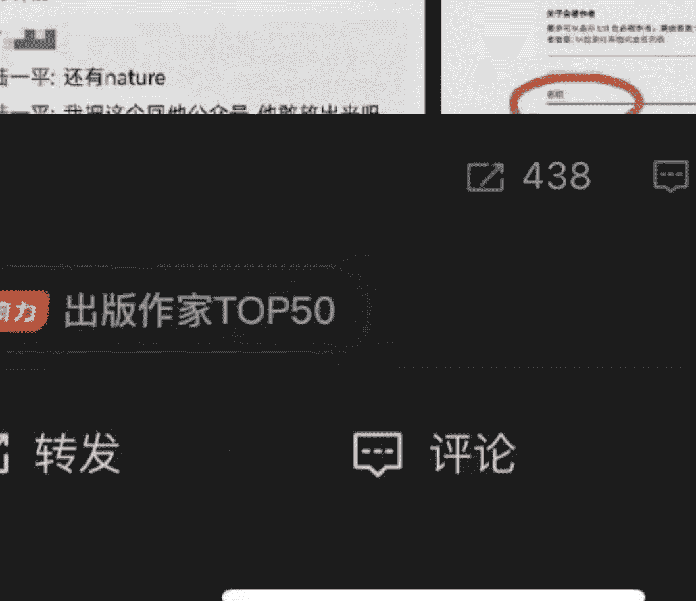

# 群聊

2025年3月4日 至 2025年5月3日

绪铭 4月30日 12:22:28
易4月22号还出参加调研讨。

奎信容 4月30日 21:34:41
这位王才证监任上落马似是史上首例，他是小刚重用的人。写作业三部曲的时候，查股幕后查到了深圳证监。

奎信容 4月30日 21:34:45
然后深圳证监一个总经理跳楼死了，留下遗言“勿扰妻儿”。

奎信容 4月30日 21:34:48
深圳线索断了，对对面市场断了扁果子威胁，我们的股民反应不得不止。

奎信容 4月30日 21:34:50
中止后，此人就去了深圳证监任职，由派让他让他滚了他的吧。

奎信容 4月30日 21:34:52
此人落马，是剑刺小重新回归旧的意思。

奎信容 4月30日 21:34:52
大家早点休息吧。

快讯 5月3日 15:57:16
学界门化的趋势已成，用一个治理来转型整体趋势是有效的，得靠靠建设了。

奎信容 5月3日 15:57:17

终于清楚楚楚为什么这么急出来避清了原来的女儿是个天才，高中的时候就发表了6篇文。还有，到了她天才了。申请上跟父亲大学专业，压过她还有4+5*3的学的说法，才能录取医学专业。

所以让让清了，这事太火了。有朋友说，原来有这一层关系，还好奇为什么他会这样。快清清，他也走这这条路了。也有网友说，两人表面看似似，其实是有关系的。不这次他也看也是了，当做什么事没发生不。好了，这这么看看，让人让出什么事来。

作者TOP350
