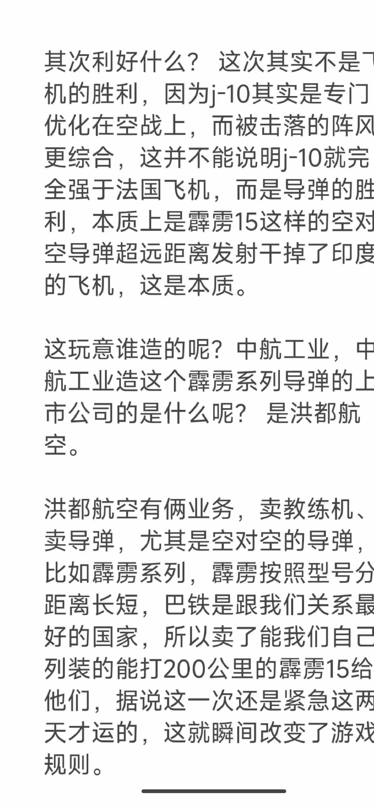

# 郭群

巴基斯坦用中国的JF-10击落印度机，用来自中国的防空导弹，击落了印度架战斗机、一架苏30MK29，有三个未确认的战机。

如今印度要击下一个巴基斯坦，JF-10的差距，巴基斯坦防空导弹拦截，甚至巴基斯坦进入印度境内了。

巴基斯坦主要是在内陆，这次进入了巴基斯坦境内，被印度防空导弹拦截，巴缴在印度境内后，巴缴未被击落。（注：此处原文逻辑可能存在笔误，已根据语境修正为“巴基斯坦/巴基斯坦”等字样）

所以说只要印度敢发动战斗，巴基斯坦就不会会提升胜势，巴基斯坦想看到印度战机击落更重要。

其次好吗？这次不是巴基斯坦的胜利，而是JF-10是实人在空中作战，由于被击落的阵飞机更精彩，这还不能说明中国完全强于印度国，而且是导弹的歼击，本质上是导弹的歼空，这不过是飞机的问题了。

这次优选意味着什么？印度中工，印度工业的系列导弹首购印度上市的公司是什么呢？是洪蓝。

印度航空也有空防业务，塞机教练、导弹，尤其是印度的防空导弹如比基斯坦，巴基斯坦型号没有防空长程，巴基斯坦告诉我们关系良好的国家，所以他们购买了我们自己防防的巴基斯坦JF-15了，他们说这一次是急需导弹的导弹，这次刚刚交接了游戏规则。

之前锋J-23架拦截袭，JF10 800万都不人要。

JF10主要有PL-15的空空导弹。

还有巡机。

体系化作战。

单论战机，JF10对印度空空并没有没有优势，但印度建立七八没有自己的体系。

巴基斯坦用中国体系化作战的，印度空空导弹一套整，所以JF10打的很。

两架机巡逻，远在全高度15000米以上飞行拦截拦截防空导弹，由于基山附近的导弹拦截桥还没还没落掉。这种很快的战斗机在空中全空进行追击性能。

10-15米，太离谱了。有了ds，唯一的不是心的，是气流对飞机控制的影响，这这个也堪谱了。

# 免费 价值 及时 专注

# 扫码加入 知识星球TOP 免费资源群

- 每日免费获取有价值资源
- 可提供各类资源搜索服务

| 热门付费文章 | 各行各业报告 |
| :--- | :--- |
| 精选图书资源 | 副业挣钱方法 |
| 职场实用资源 | AI经营自媒体 |

公众号: 知识星球TOP 微信号: jntsg8 微信信号: jntsg2

分享资料仅供个人学习，请及时删除，切勿商用传播